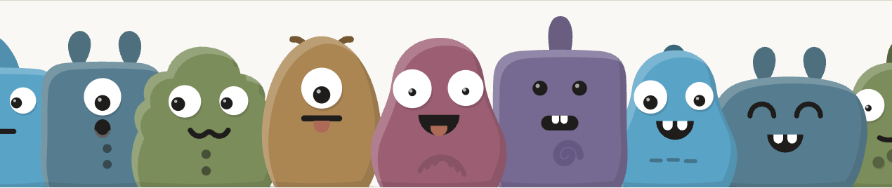

# guilds.run



guilds.run runs standing teams of AI agents you can inspect.

<a href="https://www.producthunt.com/products/guilds-run?embed=true&amp;utm_source=badge-top-post-badge&amp;utm_medium=badge&amp;utm_campaign=badge-guilds-run" target="_blank" rel="noopener noreferrer"></a>

A guild is a team of agents. Each agent has a role, a model, and
tools. The team shares a chat, notes, and collections of records.
Every run keeps the prompt the model saw, every tool call, and every
memory change.

[X](https://x.com/guildsrun) ·
[Discord](https://discord.gg/aqp5aPq9Uh) ·
[Product Hunt](https://www.producthunt.com/p/guilds-run)

## Get started

You need Docker. Run three commands:

```text
git clone https://github.com/CigaleAI/guilds.git && cd guilds
./setup.sh
docker compose up --detach --wait
```

Open `http://127.0.0.1:8080/`. Paste an API key from a model
provider. Build your first guild.

Three pages walk you through it, in order:

1. [Install](getting-started/install.md)
2. [Connect a model](getting-started/model-keys.md)
3. [Your first guild](getting-started/first-guild.md)

Then one short page each:

- [Add a routine](getting-started/add-a-routine.md) wakes the agent
  on a schedule.
- [Give it web search](getting-started/web-search.md) lets agents
  search the web.
- [Save a recipe](getting-started/save-a-recipe.md) saves the guild
  as one file and applies it again.
- [Add a coding agent](getting-started/add-a-coding-agent.md) gives
  the guild an agent that writes code with Claude Code, Codex, or
  Cursor.

## Why guilds.run

Agent-to-agent work opens uses of LLMs a single agent cannot cover.
It also makes the ways those models fail harder to see. guilds.run
is the framework Cigale AI built so that collaboration stays
tractable.

- **Deeply inspectable.** What the model sees is what you see.
- **Deeply customizable.** Each connection, each tool, and the model
  for each agent is chosen for the job.
- **Iterate till perfection.** A long-running multi-agent system is
  refined in place.
- **Share the love.** Recipes carry a working guild to someone who
  does not want to design one from scratch.

[Philosophy](philosophy.md) says why the product is shaped this way.

## Find your way

Each page describes what the code does today. The security register
is the one page that keeps history.

| You want to | Read |
|---|---|
| Use it | [Get started](#get-started), then [Concepts](#concepts) |
| Run it for other people | [Run the box](#run-the-box) |
| Reach Gmail, Drive, or GitHub from an agent | [Tools and connectors](#tools-and-connectors) |
| Change the code | [Architecture](#architecture), then [Contributing](#contributing) |
| Meet the people around it | [Community](contributing/community.md) |

## Run the box

- [Configure](getting-started/configure.md) — `.env`, platform keys,
  limits, the model catalog
- [Remote access](getting-started/remote-access.md) — reach the box
  from another computer
- [Operate](getting-started/operate.md) — update, back up, restore,
  logs, error messages

## Concepts

How the product works, for the operator. Start with
[How it fits together](concepts/how-it-fits.md).

**People**

- [Users](concepts/users.md) — accounts, sign-in, the instance admin
- [Organisations](concepts/organisations.md) — members, roles, what
  an organisation owns
- [Operators](concepts/operators.md) — the people a guild works for,
  the Inbox
- [Model keys](concepts/model-keys.md) — providers, the welcome
  dialog, which models an organisation offers

**Teams**

- [Guilds](concepts/guilds.md) — a team of agents and what it owns
- [Agents](concepts/agents.md) — name, focus, model, limits,
  capabilities
- [Group chat](concepts/group-chat.md) — tags, recipients, wake
  triggers, posting
- [Routines](concepts/routines.md) — wake an agent on a schedule

**Where agents run**

- [Machines](concepts/machines.md) — the containers agents share,
  sizing, placement
- [Agent home](concepts/agent-home.md) — an agent's files, disk,
  and terminal
- [Browser](concepts/browser.md) — an agent's own Chrome
- [Scripts](concepts/scripts.md) — reusable Python an agent keeps

**How an agent thinks**

- [Runs](concepts/runs.md) — direct, group, and schedule runs;
  what each run records
- [System prompt](concepts/system-prompt.md) — Guidelines and the
  State snapshot
- [Task](concepts/task.md) — the operator's standing instructions
- [Memory](concepts/memory.md) — what an agent keeps between runs
- [Usage](concepts/usage.md) — tokens and cost

**Shared knowledge**

- [Artifacts](concepts/artifacts.md) — the store and its display
  paths
- [Notes](concepts/notes.md) — markdown at agent, guild, and
  organisation level
- [Collections](concepts/collections.md) — typed records agents
  read and write

**Access**

- [Access](concepts/access.md) — scopes, bindings, and grants
- [Secrets](concepts/secrets.md) — values handed to an agent's
  commands

**Coding agents**

- [Coding agents](concepts/coding/index.md) — an agent that leads
  code work with Claude Code, Codex, or Cursor
- [Harnesses](concepts/coding/harnesses.md) — the coding CLI and
  your subscription
- [Repositories](concepts/coding/repositories.md) — the guild's git
  repositories
- [Code tools](concepts/coding/code-tools.md) — `code_task`, shell,
  file reads, search
- [Reviewing changes](concepts/coding/reviewing-changes.md) —
  checkpoints, diffs, commit trailers
- [Coding teams](concepts/coding/teams.md) — several coding agents
  in one guild

**Workspaces**

- [Recipes](concepts/recipes.md) — a guild as one file
- [Recipe format](concepts/recipe-format.md) — the recipe document
- [Applying recipes](concepts/applying-recipes.md) — from a recipe
  to a running guild
- [Prompt Studio](concepts/prompt-studio.md) — improve Tasks on a
  live guild
- [Guild builder](concepts/guild-builder.md) — design a recipe from a
  conversation
- [Operator app](concepts/operator-app.md) — a map of every screen

## Tools and connectors

- [Catalog](tools-and-connectors/catalog.md) — native and MCP tools,
  what a run offers
- [Native tools](tools-and-connectors/native.md) — notes, collections,
  memory, browser, scripts, routines, secrets
- [Connectors](tools-and-connectors/connectors.md) — token logins
  and remote MCP
- [Gmail and Drive](tools-and-connectors/google.md) — the Google
  OAuth client
- [GitHub](tools-and-connectors/github.md) — the GitHub App
- [Registry](tools-and-connectors/registry.md) — connectors beyond
  the image

The code tools are in [Coding agents](concepts/coding/code-tools.md).

## Architecture

For the people who change the code.

- [System](architecture/system.md) — processes, state on disk,
  images, the trust boundary
- [Web app](architecture/web-app.md) — the operator app: stack,
  extension slots, state and events
- [Code map](architecture/code-map.md) — repository layout, boot,
  the request path, the run flow
- [Orchestrator](architecture/orchestrator.md) — startup, events,
  PostgreSQL, the model client, the sandbox manager
- [Extension points](architecture/extension-points.md) — what an
  edition built on core may replace
- [Design system](architecture/design-system.md) — `@guildsrun/ui`:
  tokens, components, [Storybook](/storybook)
- [Security register](architecture/security-register.md) — issues
  fixed and still open, with their history

## Contributing

- [Contributing](CONTRIBUTING.md) — licence, pull requests, the check
- [Development](contributing/development.md) — the development
  stack, verify, check, CI, fixtures
- [Code guidelines](contributing/code-guidelines.md) — names,
  functions, boundaries, docs
- [Community](contributing/community.md) — X, Discord, Product Hunt

## Licence

guilds.run is made and operated by Cigale AI. It is free software
under the GNU Affero General Public License, version 3 only
([LICENSE](../LICENSE)). What it builds on is listed in
[THIRD_PARTY_NOTICES.md](../THIRD_PARTY_NOTICES.md).

The hosted edition, the layer Cigale AI runs its own service with,
is separate and proprietary.
