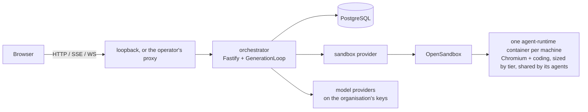

# Code map

Where code lives and what each directory is for. Each row links to
the page that explains it.

## Repository

| Path | What it is |
| --- | --- |
| `apps/orchestrator/` | The Node control plane ([Orchestrator](orchestrator.md)) |
| `apps/web/` | The React operator app, served at the site root ([Web app](web-app.md)) |
| `packages/ui/` | `@guildsrun/ui`, the design system ([Design system](design-system.md)) |
| `runtime/` | The `agent-runtime:0.4` image every machine runs, and the helpers baked into it |
| `fixtures/compat/` | Frozen HTTP, SSE, schema, crypto, and adapter contracts |
| `docs/` | This documentation |
| `docker-compose.yml`, `docker-compose.watch.yml`, `docker-compose.dev.yml` | The shipped stack, the development overlay, and the two merged ([Deployment](deployment.md#compose-stacks-and-images)) |
| `setup.sh` | Writes `.env` (state path and generated secrets) and builds the OpenSandbox and runtime images |
| `.env.example` | Core's settings, by integration ([Configure](../operations/configure.md)) |
| `scripts/` | `check.sh` (the whole check; with `EDITION_ROOT` it checks an edition), `images.sh` (the OpenSandbox and runtime images), `smoke-core-stack.sh` (the shipped stack, end to end) ([Development](../contributing/development.md)) |
| `Makefile` | `state`, `opensandbox-image`, `runtime-image`, `core-image`, `build`, `up`, `dev`, `down`, `reset`, `migrate`, `verify`, `check`, `contract`, `compat-verify`, `soak`; an edition's Makefile includes it, with `CORE` naming core's path |
| `eslint.boundary.js` | The lint rule holding core code inside core ([Extension points](extension-points.md#how-an-editions-repository-holds-core)) |
| `.github/workflows/` | `verify` (every push: `scripts/check.sh`), `images` (a version tag publishes the orchestrator, runtime, and OpenSandbox server images on ghcr.io) |
| `.state/` | The local `STATE_ROOT`, not in git ([Deployment](deployment.md#state-on-disk)) |

An edition on top of core is a repository of its own that holds this
one as a submodule ([Extension points](extension-points.md)).

## `apps/orchestrator/`

| Path | What it is |
| --- | --- |
| `src/server.ts` | Core's process entry: loads config and runs the server with no extension |
| `src/run.ts` | `runServer`: builds the server, listens, shuts down on a signal or a fatal error |
| `src/compose.ts` | `createServer`, the composition root ([Startup](orchestrator.md#startup-and-shutdown)) |
| `src/extension.ts` | `ServerExtension`, what an edition adds ([Extension points](extension-points.md)) |
| `src/app.ts` | The Fastify app: the web build, `/storybook`, `/health`, `/avatars/:style.svg`, client-error intake, domain routes |
| `src/usage.ts` | Usage counter keys, deltas, and tree |
| `drizzle/` | `0001_baseline` (with `0001.notes.md`), then numbered migrations ([PostgreSQL](orchestrator.md#postgresql)) |
| `test/` | `unit/`, `integration/`, `contract/`, `helpers/` ([Tests](orchestrator.md#tests)) |
| `scripts/` | `compat-verify`, `compat-digest`, `dump-baseline-schema`, `patch-http-mcp-catalog`, `build-connector`, `models-dev-snapshot`, `sweep-workspaces`, `typesafe-replay` |
| `Dockerfile` | The core image: a `web` stage builds `apps/web` and Storybook; the final stage copies `src`, `scripts`, `drizzle`, and the web build |
| `package.json` | `exports`: the modules another package may import |

### `src/` directories

| Directory | What it holds |
| --- | --- |
| `http/` | Routes (`routes.ts` and the `*-routes.ts` siblings), the `AUTH_MODE` seam (`identity.ts`), the host and origin check (`origin.ts`), SSE, the sandbox proxies (`sandbox-proxy.ts`), the Host Finder over the artifact store (`artifact-notes.ts`), and the web build (`web-app.ts`) |
| `generation/` | `GenerationLoop`, run chains (`chain.ts`), organisation admission (`admission.ts`), idle stops (`idle.ts`) ([Generation](orchestrator.md#generation)) |
| `toolbox/` | Native tools, the sandbox command runner (`shell.ts`), and the result pipeline (`output.ts`) ([Native tools](../tools-and-connectors/native.md)) |
| `connectors/` | One folder per connector, the manifest schema, the adapter contract, and the connector registry ([Connectors](../tools-and-connectors/connectors.md)) |
| `registry/` | Installing connectors from a registry, and the code tier ([Connector registry](../tools-and-connectors/connector-registry.md)) |
| `mcp/` | `McpPool`, the catalog and its policy, tool names, and an operator's direct tool call (`operator-call.ts`) |
| `oauth/` | Connect flows from each manifest's `auth.oauth` |
| `github/` | The GitHub App and its manifest flow ([GitHub](../tools-and-connectors/github.md)) |
| `coding/` | Guild repositories, a coding run's git side, the harnesses (`harnesses.ts`), and each harness's models and efforts (`harness-models.ts`) ([Coding agents](../concepts/coding/index.md)) |
| `machines/` | Tiers, sizes, slots, placement access, and the boot layout of agent homes ([Machines](../concepts/machines.md)) |
| `access/` | Binding resolution and a run's tools, MCP, and secrets ([Access](../concepts/access.md)) |
| `credentials/` | AES-GCM, environment fingerprints, connection views, and validation |
| `secrets/` | Who reaches and manages a secret, `secret_store`, and redaction ([Secrets](../concepts/secrets.md)) |
| `db/` | Pool, codecs, Drizzle schema, `Repositories`, seeds, and the migration check |
| `attachments/` | Chat images: sniffing, the blob store, and hydration |
| `artifacts/` | `ArtifactStore`: notes, memory, scripts, collections, records, and the access lists of notes and collections ([Artifacts](../concepts/artifacts.md), [Access](../concepts/access.md)) |
| `notes/` | `NotesStore`: `system.md` and the routine shadow files; the store the generation unit tests use |
| `directories/` | State listing over `NotesStore` for those tests |
| `memory/` | Hydration, the cap, the archive, and the version history ([Memory](../concepts/memory.md)) |
| `prompts/` | Prompt composition and the `system.md` and `task.md` templates ([System prompt](../concepts/system-prompt.md)) |
| `state/` | The State JSON a run sees |
| `groupchat/` | Group history, tags, and the dispatcher ([Group chat](../concepts/group-chat.md)) |
| `typesafe/` | The group routing client |
| `schedules/` | Routine timing and the `Schedules` service ([Routines](../concepts/routines.md)) |
| `scripts/` | The agent `script` catalog and its materialisation ([Scripts](../concepts/scripts.md)) |
| `sandbox/` | `RunSandboxes`, core's sandbox provider, and the orphan sweep |
| `llm/` | Providers, the models.dev catalog, credentials, the model client, tokens, and cost ([Model client](orchestrator.md#model-client)) |
| `policy/` | `OrgPolicy` and the checks core runs against it |
| `avatars/` | [DiceBear](https://www.dicebear.com/) SVGs in seven styles (critters, cameo, pixelbot, bottts-neutral, clay, cutouts, voxel-bot); `looks.ts` assigns a guild family and a variant per builder role |
| `issues/` | Guild issues from `report_issue` |
| `notifications/` | The inbox view and its per-user stream |
| `studio/` | Prompt Studio: sessions, tools, drafts, edit, table, and routine requests, focus pins, and the activity ledger ([Prompt Studio](../concepts/prompt-studio.md)) |
| `builder/` | The guild builder: sessions, tools, widgets, and workspace search ([Guild builder](../concepts/guild-builder.md)) |
| `recipes/` | The `guilds.recipe` schema, capture, rewrite, validation, and apply ([Recipes](../concepts/recipes.md)) |
| `conversation/` | The shared coach runner and tool-result projection |
| `capabilities/` | The catalog facts the builder may name |
| `guilds/`, `agents/`, `organisations/`, `users/` | Validation and persistence |
| `config/` | Environment → `AppConfig` ([Configuration](orchestrator.md#configuration)) |
| `instance/` | Instance keys: the integration registry, the encrypted store, write effects, and connector-declared integrations ([Instance keys](extension-points.md#instance-keys)) |
| `cli/` | `seed:system`, `seed:operator`, `migrate`, and `pnpm connector` |
| `observability/` | Logs, request ids, client-error intake, Sentry, and runtime metrics ([Observability](orchestrator.md#observability)) |
| `net/` | Outbound HTTP and endpoint validation |
| `lib/` | Shared helpers: ids, paths, locks, the event queue, the clock, JSON, names, numbers, and an agent's home files (`agent-file.ts`) |

## `apps/web/`

| Path | What it is |
| --- | --- |
| `src/main.tsx`, `index.html` | Entry: mounts the app with no slot filled |
| `src/mount.tsx` | `mount(slots)` ([Boot](web-app.md#boot)) |
| `src/app/` | The app frame: providers, identity, routes, slots, theme, storage helpers, formatting, and the back button (`returnTrail.ts`) |
| `src/api/` | The typed API client, identity, queries, streams, and the client error log ([State and events](web-app.md#state-and-events)) |
| `public/` | Files served as-is |
| `vite.app.ts` | `appConfig()`: build and dev-server configuration, shared with an edition |
| `package.json` | `exports`: what an edition's package may import ([Extension slots](web-app.md#extension-slots)) |
| `claude-design-export/` | The first Claude Design export; not the live library |

### `src/features/`

One directory per area. The screens are in the
[Screen map](screen-map.md).

| Directory | What it holds |
| --- | --- |
| `shell/` | Sidebar and rail, unread counts, account menu, new-message chime and desktop notifications |
| `home/` | `/`, the empty state, and the not-found page |
| `guild/` | Guild workspace, group chat with its message queue, guild menu, and guild pages |
| `agent/` | Create-agent dialogs and the agent inspector's tabs |
| `agent/runs/` | A run's rows grouped into generations, steps, and tool calls |
| `notes/` | The notes browser and the provenance strip |
| `access/` | One scope's tools and secrets |
| `tables/` | The Tables page |
| `studio/` | Prompt Studio |
| `builder/` | The guild builder |
| `coach/` | What Studio and Builder share: the coach log and the split |
| `recipes/` | Recipe library, recipe page, apply preview, and checklist |
| `admin/` | Connector catalog, platform keys, and users |
| `settings/` | Organisation settings |
| `machines/` | Machines tab, dialog, meters, and picker |
| `models/` | Model setup and the model pickers |
| `instance/` | What a missing platform key means for a screen |
| `inbox/` | The Inbox |

## `packages/ui/`

| Path | What it is |
| --- | --- |
| `src/index.ts` | Public barrel, a client module |
| `src/theme.css`, `src/tokens.css`, `src/motion.css` | Tailwind entry, tokens, and motion |
| `src/primitives/`, `src/components/` | Library modules, stories beside each |
| `src/foundations/` | Token and icon Storybook boards |
| `src/writeDesignSystemDoc.ts` | `pnpm design-system-doc` |
| `.storybook/` | Storybook config |

[Design system](design-system.md) explains each one.

## `runtime/`

Runs **inside** a machine's Docker sandbox, not in Node. Every
helper that acts for one agent takes its id, or reads its home from
`GUILDS_AGENT_HOME`.

| Path | What it is |
| --- | --- |
| `Dockerfile` | `python:3.12-slim` plus Chromium or Chrome, TigerVNC, noVNC, ttyd, Playwright 1.52.0, Node.js 24, build tools, GitHub CLI, mise, the coding harnesses, and the helpers below. Codex (`CODEX_VERSION`) is always installed. Claude Code, the Cursor CLI, and the Antigravity CLI (`CLAUDE_CODE_VERSION`, `CURSOR_VERSION`, `ANTIGRAVITY_VERSION`) are installed when the `HARNESSES` build argument names them, which its default does. The harness CLIs it carries are listed at `/usr/local/share/guilds/harnesses` |
| `guilds-code` | `shell` and background commands, `file_read`, ripgrep search, output shaping, home and machine sizes, and git setup, clones, checkpoints, and diffs; reads the agent's tokens from `/run/guilds/<agent id>/git-tokens.json` |
| `guilds-harness` | The coding harnesses behind `code_task`: `check`, `start`, `poll`, `result`, `stop`, and `log`; one driver per harness (Claude Code, Codex, Cursor, Antigravity); call state under `/run/guilds/<agent id>/harness/` ([Harnesses](../concepts/coding/harnesses.md)) |
| `agy` | The Antigravity CLI at the pinned version, installed as `/usr/local/bin/agy` |
| `claude-code-managed-settings.json` | Claude Code's managed settings at `/etc/claude-code/managed-settings.json`: hooks off, no project MCP servers |
| `guilds-git-credential` | The git credential helper: the installation token of the guild repository git talks to |
| `git-template/` | The git template whose `prepare-commit-msg` hook adds the `Guild-Run` and `Guild-Agent` trailers |
| `guilds-script-run` | Runs a named Python script with `GUILDS_SCRIPT_ARGS` on stdin |
| `agent-browser-start <agent id> <slot> <language>` | One agent's Xtigervnc display, Chrome, and noVNC on its slot's ports |
| `agent-cli-start <agent id> <slot>` | One agent's ttyd with bash in its home; prints the secret path segment it serves under |
| `agent-stop <agent id> browser\|all\|purge` | Stops one agent's browser, or its browser and terminal; `purge` also removes its `/run/guilds/<agent id>/` files |
| `agent-lib.sh` | Shell helpers the `agent-*` scripts share |
| `guilds-browser` | Playwright over the agent's CDP port for the browser tools ([Browser](../concepts/browser.md)) |
| `guilds-locale` | Timezone from the egress IP; Chrome language from `GUILDS_BROWSER_LANGUAGE` (default en-US) |
| `install-chrome.py` | Google Chrome Stable on amd64, Debian Chromium on arm64 |
