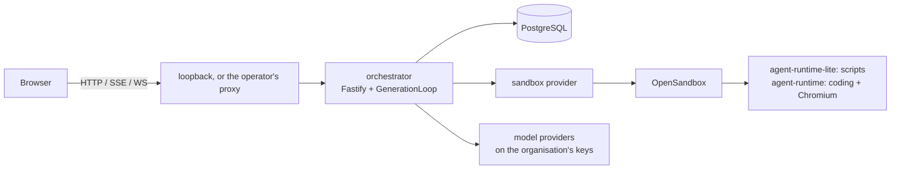
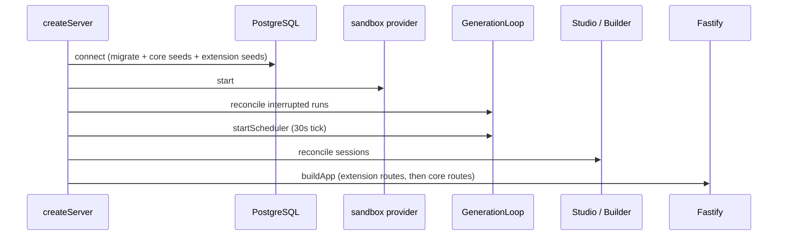
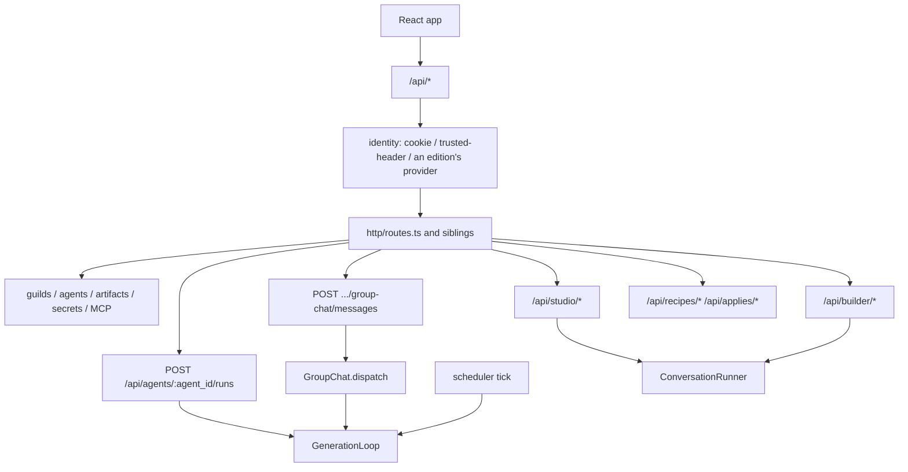
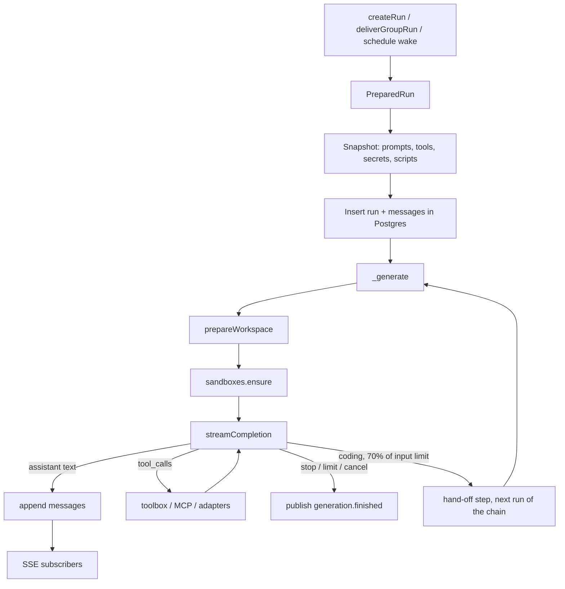

# Code map

Where code lives, what each directory is for, and how a request
becomes a run.

## What runs

One Node process (`apps/orchestrator`) is the whole control plane.
It owns HTTP (including the React app's build, `apps/web`),
generation, tools, MCP, OAuth, Studio, Builder, and recipes.

Python runs only inside agent sandboxes (`runtime/`).



## Repository

```text
guilds.run/
  apps/orchestrator/        Node control plane (this is the app)
  apps/web/                 React operator app (served at the site root)
  packages/ui/              @guildsrun/ui design system (tokens, components, Storybook)
  runtime/                  Dockerfile (agent-runtime:0.3, the standard box), Dockerfile.lite (agent-runtime-lite:0.1, the lite box), and the helpers baked into them
  templates/degen-capital/  Example guild prompts
  fixtures/compat/          Frozen HTTP/SSE/schema/crypto/adapter contracts
  docs/                     Documentation (this set)
  docker-compose.yml        The core stack as shipped: postgres, opensandbox, orchestrator on loopback
  docker-compose.watch.yml  Development overlay: source mounts and reload, Postgres on loopback
  docker-compose.dev.yml    = product + watch, core alone
  setup.sh                  Writes .env (state path and generated secrets) and builds the unpublished images
  .env.example              Core's settings, by integration; an edition lists its additions in an .env.example of its own
  scripts/                  check.sh (the whole check, run by CI and before a push; with EDITION_ROOT it checks an edition, adding the steps in its check.steps), images.sh (the OpenSandbox and runtime images), smoke-core-stack.sh (the shipped stack, end to end)
  Makefile                  state, opensandbox-image, runtime-image, core-image, up, dev, verify, check, contract, docs-*; an edition's Makefile includes it, with CORE naming core's path
  eslint.boundary.js        Lint rule holding core code inside core; a core package's eslint.config.js names the packages it may not import and the repository its relative imports stay inside
  .github/workflows/        verify (every push: scripts/check.sh), images (a version tag publishes the orchestrator, runtime, and OpenSandbox server images on ghcr.io)
```

`.state/` (not in git) is the local `STATE_ROOT`. An edition on top
of core is a repository of its own that holds this one as a submodule
([Extension points](extension-points.md)).

### `apps/orchestrator/`

| Path | Goal |
| --- | --- |
| `src/server.ts` | Core's process entry: load config and run the server with no extension |
| `src/run.ts` | `runServer`: runs a server as the process. Builds it with the edition's extensions, listens, shuts down on a signal or a fatal error |
| `src/compose.ts` | `createServer`: the composition root. Connects, wires every service, reconciles, builds the app with the extensions it is given |
| `src/extension.ts` | `ServerExtension`: what an edition adds to core. Its own migrations, boot seeds, routes, instance keys, the hook for a new organisation, and its own organisation policy, identity provider, and sandbox provider, and the build of the operator app it serves |
| `src/app.ts` | Fastify app: the React app's build at the site root, `/storybook`, `/health`, `/avatars/:style.svg`, client-error intake, domain routes |
| `src/` | Domain modules (table below) |
| `drizzle/` | Core's migrations: `0001_baseline`, the snapshot of core's schema (`0001.notes.md` says how it is regenerated), then the numbered migrations after it |
| `test/` | `unit/`, `integration/`, `contract/`, `helpers/` |
| `scripts/` | `compat-verify`, `compat-digest`, `dump-baseline-schema`, `patch-http-mcp-catalog` (rewrites the HTTP fixture when catalog shapes change), `build-connector` (bundles a connector folder into a registry package), `sweep-workspaces`, `typesafe-replay` |
| `Dockerfile` | The core image. Pinned Node image; a `web` stage builds `apps/web` and Storybook, the final stage copies `src`, `scripts`, `drizzle` and the web build |
| `package.json` | `exports` lists the modules another package may import: the composition root and process runner, the extension interfaces, and the domain modules and test helpers an edition's package builds on |

### `apps/web/`

The operator app in React, served by the orchestrator at the site
root.

Stack:

- Vite
- React 19
- TypeScript
- Tailwind v4
- Radix primitives
- TanStack Query and Router

Screens are [Operator app](../concepts/operator-app.md). The design
system and Storybook live in `packages/ui`.

The app keeps the operator's user and organisation in localStorage
(`guilds-user-id`, `guilds-org-id`) and in the `guilds_user` and
`guilds_org` cookies that SSE streams carry.

View preferences live in localStorage too:

- theme
- folded guilds
- the retracted sidebar
- the agent inspector's size
- the Studio and Builder splits
- the activity window
- browser logins marked done

The tab's request id and a new Studio session's pinned issue live in
sessionStorage.

`pnpm --filter @guildsrun/web dev` serves it on
`http://127.0.0.1:5173/` and proxies `/api`, `/avatars`, and
`/health` to the orchestrator on 8080.

`pnpm --filter @guildsrun/web build` writes `dist/`, which the
orchestrator serves.

| Path | Goal |
| --- | --- |
| `src/main.tsx`, `index.html` | Entry: mounts the app with no slot filled |
| `src/mount.tsx` | `mount(slots)`: applies the stored theme, installs error reporting, names the edition's sign-in page, and mounts the app with React's error hooks reporting too; a path the edition's slots own renders without loading identity |
| `src/app/` | App frame: boot (identity before any page), `slots.ts` (`AppSlots`, what an edition adds to the app: pages shown before identity, the sign-in page and sign-out, Settings and Admin tabs, notices above every page, a panel under the member list), router (`/`, `/inbox`, `/settings` (`?tab=`: core's `general|members|keys|secrets|tools|usage` and any an edition adds), `/admin` (`?tab=`: core's `catalog|instance` and an edition's), `/builder` and `/builder/$sessionId`, `/recipes`, `/recipes/$recipeId` and its `…/apply` preview, `/applies/$applyId` (an apply's checklist), `/studio` (`?guild=`), `/studio/$sessionId` (`?agent=&tab=&item=&call=&seq=`: the inspected agent, its tab, the item selected in that tab and the run step to reveal), `/databases[/$collectionId]` (`?tab=columns|access`), the guild's pages at `/guilds/$guildId` (group chat, `?seq=` to open it at a message), `…/settings`, `…/state` (`…/state/files`, `…/state/databases`, `…/state/artifacts`), `…/routines`, `…/issues`, `…/usage`, `…/tools` and `…/secrets`, the agent inspector's tabs at `/guilds/$guildId/agents/$agentId` (Chat, `?run=` for one session and `&call=` or `&seq=` for a step in it), `…/prompt`, `…/state` (`…/state/memory`, `…/state/notes`, `…/state/databases`, `…/state/scripts`, `…/state/artifacts`), `…/history` (opens Chat with the session drawer), `…/routine`, `…/browser`, `…/cli`, `…/tools`, `…/secrets`, `…/usage` and `…/settings`), theme choice, identity context, localStorage helpers, media queries, agent looks (identity colour and mascot URL), time formatting |
| `src/api/` | Typed API client and shapes (every call carries the tab's `X-Request-Id`), `clientLog.ts` (reports uncaught errors, unhandled rejections, render errors, and 5xx or network API failures to `/api/client-errors`, deduplicated and capped), identity loading, TanStack Query hooks, SSE hooks (guild chat, inbox, run, Studio and Builder streams, refetching on every reconnect since the server replays nothing; the guild stream also refreshes file reads when a file changes and an agent's routines when they change, and the run stream carries the turn being written) |
| `src/features/` | Pages. Each feature is listed after this table. |
| `src/features/agent/runs/` | A run's rows grouped into generations, steps and tool calls, with their stats; tool kinds and tool-call formatting |
| `public/` | Files served as-is (favicon), by every edition's build |
| `vite.app.ts` | `appConfig()`: how the app is built and served in development, shared with an edition's package |
| `package.json` | `exports` lists what an edition's package may import: `mount`, the slots, the build recipe, and the API client, identity, formatting, and role helpers an edition's screens use |
| `claude-design-export/` | Original Claude Design documents |

`src/features/` pages:

- `shell/` — sidebar with agents flagged for broken Task links,
  collapsed rail folded with ⌘B / Ctrl+B, account menu. On a phone
  the sidebar opens as a drawer from a top bar.
- `guild/` — guild workspace and group chat, opened at a message by
  `?seq=`. The header's member avatars open the inspector. The
  header's message budget. The guild menu's Studio, new agent and
  save-as-recipe. Creating a guild. `pages/` holds Settings with
  operators and deleting the guild, Repositories, Routines by agent
  with the guild's switch, Issues, and Usage by agent. The State tab
  holds Files, Databases and Artifact scope. Tools and Secrets are
  the guild's view of `access/` (Tools: integrations and native
  tools). An agent's inspector opens over the group chat.
- `agent/` — creating an agent, and the agent inspector over its
  guild.
  - Chat tab (`chat/`) — shows a run's prompt (tagged parts as
    nested cards), turns, steps with what the model reported, and
    tool calls (arguments and results as JSON trees or raw text,
    with copy buttons). Opens at a step by `?run=&call=`. Talks to
    the agent. Answers the agent's secret requests from a card
    under the step that asked. `chat/SessionChrome.tsx` sits on the
    tab strip with a clock for the session drawer and a plus for a
    new session.
  - Prompt tab (`prompt/`) — edits the Task with its versions,
    embeds and change history.
  - State tab (`AgentState.tsx`) — Memory (`memory/`: every memory
    version with who wrote it, edits the live one and shows an
    archived one as its change or whole text, the version pieces
    shared with Studio's memory view), Notes, Databases, Scripts
    (`scripts/`: lists, adds, deletes and clears the agent's Python
    scripts) and Artifact scope.
  - Chat's history drawer (`?history=true`, `history/`) — lists
    every session by day.
  - Routine tab (`routine/`) — adds, pauses and deletes routines,
    previewing their timing in the words the server stores.
  - Browser tab (`browser/`) — starts the agent's Chromium and
    embeds its noVNC view with a clipboard bridge.
  - CLI tab (`cli/`) — behind a start button, wakes the machine
    and embeds a bash session on it.
  - Tools tab — integrations and native tools over `access/`.
  - Secrets tab — the agent's view of `access/` secrets.
  - Usage tab — its lifetime model usage.
  - Settings tab (`settings/`) — edits its name, focus, mascot and
    identity colour, wake triggers, model, thinking, run limits,
    script cap, browser and browser language, and can remove all
    its scripts.
  - The header flags broken Task links. A browser agent's strip
    asks for its browser login until marked done. The inspector's
    menu deletes it. `runState.ts` names runs and says where each
    stands.
- `files/` — the notes browser the agent's State Notes view and the
  guild's State Files view share. Scopes, each listing its notes
  side by side. The open note to edit with embeds and provenance.
  New and deleted notes. The provenance strip other views share,
  with a file's change history and the step that wrote it.
- `access/` — one scope's tools and secrets, for an agent, a guild
  or the organisation. Integrations, native tools and artifact
  scope switched over what the scope inherits, with a reset back to
  the inherited value. Its own logins with their settings, such as
  a GitHub login's repositories. The secrets that reach
  the scope, with who gets each, adding, editing, deleting, and the
  access picker.
- `databases/` — the organisation's databases. List by owner.
  Records with search, filters, sort, paging and refresh. A
  record's typed form. The columns editor. Who reaches it. Create,
  edit, export and delete. The guild's grants and an agent's own
  access.
- `studio/` — coach sessions on a guild. Starting and resuming one.
  The inspector beside the coach, split by a draggable bar.
  - For the guild: its activity (`activity/`: over a window, a map
    of who woke whom that narrows the list of every chain of wakes,
    each wake opening its tool calls, side effects, errors and
    output with links to its exact steps, and each agent's inputs
    and outputs), files and databases.
  - For an agent: its Task and effective prompt, the coach's Task
    drafts to review, edit, publish or discard, its runs with the
    transcript opened at a step, its memory versions with who wrote
    each, its routines and the runs they started, its scripts,
    files, databases and Task versions.
  - Evidence from any of them, down to one tool call or the open
    file, pins to the next message.
  - The coach conversation with its edit requests (the live text
    beside the proposal; for a table, its definition before and
    after with what applying does to its records) and access
    requests.
  - Opening an issue in a new session at the run that raised it.
- `builder/` — the Builder. Describing a guild to start a session,
  earlier drafts, and a session's workspace. The live blueprint of
  its draft recipe beside the coach, whose connect and question
  requests the operator answers before it carries on. Task rewrites
  and access cuts told to the coach. Approving and deploying. Under
  the same ink header as Studio.
- `coach/` — what Studio and the Builder share: the coach
  conversation log, its rows, and the draggable split between a
  workspace's panes.
- `recipes/` — the recipe library. Capturing a guild and importing
  a recipe file. A recipe's page: the plan of everything it creates
  and needs (`plan/`: the pure plan model and its view, shared with
  the Builder), Task rewrites, connector tools switched per agent
  or connectors dropped, approving, exporting. The apply preview
  with the new guild's and agents' names and the login each
  connector starts with. The apply checklist of logins, secrets and
  outside setup, skipping, activating or aborting. The strip on a
  guild whose checklist is still open.
- `admin/` — for platform admins. The connector catalog: each
  connector's switch, its copy over the manifest, its tools' defaults,
  servers added by hand, and an export. The instance's keys with each
  integration's state.
- `settings/` — the operator's own name, colour and timezone. The
  organisation's name and slug. Its members. Its model keys: each
  provider's state, the connect form, the catalog to choose models
  from, and the default. Its secrets and tools over `access/`. Its
  usage by guild and agent.
- `models/` — what every model picker shares: the options from the
  organisation's chosen models grouped by provider, the default to
  preselect, what a model does not take, and the guide shown in a
  picker's place while no provider is connected.
- `instance/` — what the server's integrations mean for a screen:
  the native tool and connector that waits for an instance key.
- `inbox/` — issues and tags for the operator across the guilds
  they operate.
- `home/`

### `packages/ui/`

`@guildsrun/ui`, the guilds.run design system. CSS tokens, React
primitives and components, Storybook, and the Claude Design doc
generator.

The operator app and an edition's build of it import `@guildsrun/ui`
and `@guildsrun/ui/theme.css`.
[Design system](design-system.md).

| Path | Role |
| --- | --- |
| `src/index.ts` | Public barrel, a client module (`"use client"`) |
| `src/theme.css` | Tailwind v4 entry: fonts, tokens, motion, `@theme` |
| `src/tokens.css`, `src/motion.css` | Brand/semantic variables and overlay motion |
| `src/primitives/`, `src/components/` | Library modules, stories beside each |
| `src/foundations/` | Token and icon Storybook boards |
| `.storybook/` | Storybook config |

### `runtime/`

Runs **inside** the agent's Docker sandbox, not in Node:

- `Dockerfile`: `python:3.12-slim` plus Chromium/Chrome, TigerVNC,
  noVNC, ttyd, Playwright 1.52.0, Node.js 24, build tools, GitHub CLI,
  mise, ast-grep, Graft, and the helpers below
- `guilds-code`: the code tools: `shell` and background commands, the
  file tools, ripgrep and ast-grep search, Graft queries, output
  shaping, the workspace size, and git setup, clones, checkpoints, and
  diffs
- `guilds-git-credential`: git credential helper: the installation
  token of the guild repository git is talking to; the image sets it for
  `https://github.com` in its system git configuration and its
  environment
- `git-template/`: the git template (`init.templateDir`) whose
  `prepare-commit-msg` hook adds the `Guild-Run` and `Guild-Agent`
  trailers
- `guilds-script-run`: run a named Python script with
  `GUILDS_SCRIPT_ARGS` on stdin
- `agent-browser-start`: Xtigervnc + Chrome + noVNC for the Browser pane
- `agent-cli-start`: ttyd with bash for the CLI pane; prints the
  secret path segment it serves under
- `guilds-browser`: Playwright over CDP for the eight browser tools
- `guilds-locale`: timezone from the egress IP; Chrome language
  from `GUILDS_BROWSER_LANGUAGE` (default en-US)
- `install-chrome.py`: Google Chrome Stable on amd64, Debian Chromium
  on arm64

## Boot

From `apps/orchestrator`, `pnpm start` (or
`pnpm --filter @guildsrun/orchestrator start` from the repo root)
runs core's `src/server.ts`. An edition has an entry of its own.

Each calls `runServer` (`src/run.ts`). `runServer` builds the server
with `createServer` (`src/compose.ts`). Local Compose uses
`make up` / `make dev`.



`reconcile()` does three things:

- finishes in-flight group/schedule runs that died with the previous
  process
- resumes group dispatch
- parks idle sandboxes

Studio and Builder reconcile repair abandoned coach generations.

## `src/` directories

Each folder is a domain. HTTP stays thin. Generation orchestrates
agent runs. Studio and Builder share `conversation/`.

| Directory | Goal |
| --- | --- |
| `http/` | `routes.ts` (guilds, agents, runs, attachments, group chat, files, collections and records, collection access, schedules, scripts, secrets, MCP, bindings, usage, the instance descriptor at `GET /api/instance`), `coding-routes.ts` (guild repositories, a GitHub login's reachable and selected repositories, a run's changes and diff), `model-provider-routes.ts` (an organisation's own model keys), `me-routes.ts` (`/api/auth/config` and the request's own user at `/api/auth/me`), `instance-admin.ts` (who administers the instance), `studio-routes.ts`, `builder-routes.ts`, `builder-capability-routes.ts`, `recipe-routes.ts`, `admin-mcp-routes.ts`, `admin-registry-routes.ts` (the registry's connectors beside the box's, install, update, remove), `org-connector-routes.ts` (an organisation's own remote servers); `identity.ts` (the `AUTH_MODE` seam: core's two modes, or the `IdentityProvider` an extension supplies), `cookies.ts`, `origin.ts` (the host and origin a request may come from), `usage-view.ts`, `access.ts`, `artifact-files.ts` (Host Finder, collections, records, export, clear records, and grants over the artifact store), `items.ts`, `sse.ts`, `sandbox-proxy.ts` (noVNC and terminal, HTTP and WebSocket), `web-app.ts` (serves `apps/web/dist` at the site root: hashed assets immutable, browser page requests the server does not own fall back to `index.html`) |
| `generation/` | `GenerationLoop`: create runs, stream the model, invoke tools, publish SSE, cron ticker; `chain.ts` for run chains (the hand-off request, the continuation message, chain positions); `admission.ts` for organisation concurrency. Each model call projects tool results through `conversation/projection.ts` |
| `toolbox/` | Native tool registry: `artifacts.ts` (note and record tools), `memory.ts`, `script.ts`, `schedule.ts`, `browser.ts`, `code.ts` (the code tools over `guilds-code`, repeated-read pointers, exploration), `group.ts`, `report.ts`, `secret.ts` (`secret_store`, `secret_request`); `shell.ts` runs sandbox commands; `output.ts` is the result pipeline |
| `registry/` | `index.ts` (the registry index schema, versions), `tar.ts` (reads a gzipped package), `client.ts` (`REGISTRY_URL`, the index, packages checked against their hashes, endpoint-only manifests), `install.ts` (install, update, remove, and list registry connectors), `code.ts` (the code tier: a version's folder under `CONNECTORS_ROOT`, and serving each row's version in the running process) |
| `connectors/` | One folder per connector (`<slug>/connector.json`, `adapter.ts`, its client code, `logo.svg`); `manifest.ts` (the TypeBox manifest schema and loader), `types.ts` (the adapter contract), `registry.ts` (entries by slug and server id), `index.ts` (core's list and the installed set an extension adds to), `connect.ts` (the token Connect operation), `view.ts` (what the API says beside a server row), `builder.ts` (searchable workspaces and systems of record), `instance.ts` (the instance key a platform login calls with, and its redaction), `format.ts` (compact TSV) |
| `mcp/` | `McpPool`: the remote MCP client and sessions, adapter dispatch through the registry, `mcp_tools` listing, connector State hooks; `catalog.ts` admin validation; `policy.ts` default-off overlays from the manifests, Studio readability, and reserved slugs; `verbs.ts` the writing verbs a tool name may carry; `names.ts` namespacing |
| `oauth/` | Dynamic-client (PKCE), configured-client, and GitHub App Connect from each manifest's `auth.oauth`, provider discovery for a connector with no endpoint, callback HTML |
| `github/` | The GitHub App: App token, install and user-authorize URLs, user code exchange, the installation the authorizing user can reach (or a picker when they have several), installation tokens and repositories |
| `coding/` | Guild repositories and a GitHub login's selected set (`repositories.ts`: validation, payloads, State entries) and a coding run's git side (`git.ts`: identity, installation tokens per connection, the token file) |
| `access/` | Binding resolution platform → org → guild → agent; `runtime.ts` resolves a run's tools, MCP, and secrets |
| `credentials/` | AES-GCM encrypt/decrypt, environment fingerprint, connection and binding metadata views, secret name and description validation, connection owner-scope visibility |
| `secrets/` | `access.ts` (organisation-wide or granted access, who may create and manage a secret, metadata with grants in unseen guilds masked), `agent.ts` (`secret_store`: the value file under `/home/agent`, the per-agent cap, rotation); redaction |
| `db/` | Pool, codecs, Drizzle schema, SQL `Repositories`, list views, `seed/` |
| `attachments/` | Chat image upload: magic-byte sniff, the blob store (`FileBlobStore` under `ATTACHMENTS_ROOT`, or in process memory without one), hydrate refs into `image_url` parts at provider-request time |
| `artifacts/` | `store.ts` (`ArtifactStore`: notes, memory, scripts, collections, records, collection grants), `columns.ts` (the column dialect: parsing, value checks, patch validation, identity, catalog lines), `search.ts` (`where`, `order`, `since`, limits, the record search blob), `paths.ts` (display paths), `embeds.ts`, `grants.ts` (the four note grants), `file-changes.ts` |
| `notes/` | File-backed `NotesStore` under `NOTES_ROOT`: resolves `system.md`, shadow-writes routine files, and is the store the generation unit tests run against when no `ArtifactStore` is wired |
| `directories/` | State listing over `NotesStore` for that same test path |
| `memory/` | Memory hydration and the 12 000-character cap, `memory_revisions` archive, the version timeline (`timeline.ts`), and the operator's version history with runs and `memory_write` calls (`history.ts`) |
| `prompts/` | Compose `<guidelines> <task> <state> <memory>`; `system.md`, `task.md`, `memory.md` templates |
| `state/` | UTC clock, note levels, granted collections with columns, scripts, env names, connector State entries, last 10 group rows (or a TypeSafe subset) |
| `groupchat/` | Public history, agent and operator tags, dispatcher, guild event observers; `history.ts` limits |
| `typesafe/` | Jev client: recipient Choice, history Noul, `replay.ts` |
| `schedules/` | Cron and random-window validation and planning (`timing.ts`, `window.ts`), `Schedules` service, human-readable cadence |
| `scripts/` | Agent `script` catalog, run snapshot, materialise `/home/agent/scripts/` |
| `sandbox/` | `RunSandboxes` (one OpenSandbox: ensure, idle, destroy), core's sandbox provider; `sweep.ts` orphan workspaces |
| `llm/` | `providers.ts` (the provider table and the `{provider}/{model}` prefix), `catalog.ts` and `models-dev.ts` (the models.dev catalog: fetch, cache, snapshot, mapping), `credentials.ts` (the model credentials extension point and core's default over the organisation's rows), `models.ts` (an organisation's providers, chosen models, and default), `client.ts` (the OpenAI client with per-provider request shaping), `tokens.ts`, `cost.ts` |
| `policy/` | Organisation policy: `OrgPolicy` (an organisation's limits and whether it may work), core's open policy, and the checks core runs against it (agent, browser, coding, and guild caps, the monthly Studio and Builder quota) |
| `avatars/` | [DiceBear](https://www.dicebear.com/) SVG rendering (`clay.ts` body variants) |
| `issues/` | Guild-level tooling reports from `report_issue` |
| `notifications/` | The inbox view (open issues and unread tags per operator) and its per-user change stream |
| `studio/` | Prompt Studio sessions, tools, drafts, publish, State preview, focus pins (`focus.ts`), edit requests (`edits.ts`) and table requests (`tables.ts`), the guild activity ledger (`activity.ts`), `system.md` |
| `builder/` | Guild builder sessions, tools, widgets, connected-workspace search, `system.md` |
| `recipes/` | `guilds.recipe` v2 schema, capture, rewrite, validate, apply (collection plan: create, reuse, or conflict) |
| `conversation/` | Shared coach runner (admission, streaming, cancellation, stubbing); `projection.ts` for tool-result stubbing on agent runs and Studio; `prompt-placement.md`, `content-trust.md` |
| `capabilities/` | Catalog text and the native, browser, and limit facts the builder may name |
| `guilds/` `agents/` `organisations/` `users/` | Validation and persistence |
| `usage.ts` | Usage counter keys, deltas, tree |
| `config/` | Env → `AppConfig`, core's settings; refuses the all-zero master key outside a development stack; `loadToolConfig` for command-line tools, which run in whatever mode the box is in |
| `instance/` | `integrations.ts`: the registry of instance keys. Each optional integration, the environment variables it reads, what it switches on, and its state (`on`, `off`, `incomplete`); the modules that need a key read it through here |
| `cli/` | `seed:system` / `seed:operator`; `connector.ts` (`pnpm connector install`, `update`, `remove`, `list` against the registry) |
| `observability/` | Structured logs, request ids, client-error intake, Sentry |
| `net/` | Outbound HTTP with optional forward proxy; endpoint validation |
| `lib/` | ids, paths, locks, event queue, clock, JSON; `agent-file.ts` reads and writes agent workspace paths without following a link out of the workspace |

## Request path



CRUD writes PostgreSQL and returns JSON. Runs go through
`GenerationLoop`. The UI follows on `GET /api/runs/:id/stream`
(SSE).

Studio and Builder use the shared conversation runner and their own
streams.

## Work queuing (one generation per agent)

There is **no job queue** (no Redis, no per-task rows). An agent
runs at most one generation at a time (`GenerationLoop` busy
registry). Direct, group, and schedule all take that same lock.

| Incoming work | If the agent is already generating |
| --- | --- |
| Direct chat (message) | HTTP **409**; the operator retries |
| Group delivery | **Wait** for lock release, then retry |
| Due schedule | **Skip** this tick; `next_run_at` stays due |

Studio and Builder take an **organisation** admission slot, not the
agent lock. They do not make a target agent busy.

Group chat **coalesces**. Several unseen messages become **one** run
with a snapshot through the current `chat_seq`. Schedules do not
coalesce: two due routines for the same agent fire on successive
ticks.

## A run

Three ways in: direct message, group-chat delivery, or a due
schedule.



`PreparedRun` hydrates `task` + `memory`. It builds the State JSON.
It resolves bindings and the agent's secrets. It hashes the opening
system prompt.

That prompt and the ordered message rows are the stored history.
Each model call projects tool results from those rows.

Tools:

- **Native** (`toolbox/`): artifacts, memory, scripts, schedules,
  browser, code tools, group post, report issue
- **Connectors** (`connectors/`, dispatched by `mcp/`): a remote MCP
  endpoint (Notion, Sentry, Cigale, Etherscan), adapter code
  (CoinGecko, Alchemy, X, TwitterAPI.io, Qonto, DexPaprika, Gmail,
  Tavily web search on the instance key), or both (Drive, OpenSea); one catalog shape

Scripts and Chromium run in the sandbox. Notes and collections stay
in PostgreSQL. The sandbox never mounts a notes tree.

## Data plane

| Store | Owns |
| --- | --- |
| PostgreSQL | Users, orgs, guilds and their operators, agents (`task` on the agent row), runs, messages, attachments, group chat, secrets and their grants, MCP, bindings, artifacts (notes, records, memory, scripts, collections and their grants), guild issues, usage, Studio, Builder, recipes, applies |
| `workspaces/<agent-id>/` | Bind-mounted at `/home/agent`: `scripts/`, `.browser/`, a coding agent's `repos/`, `.runs/` (shell logs and working directory per run), caches and toolchains, scratch |
| `notes/` | `NotesStore` shadow files (routines); nothing reads them |
| OpenSandbox SQLite | Container lifecycle (not application data) |

## Tests

| Layer | Role |
| --- | --- |
| `test/unit` | Domain without Docker; generation tests drive `GenerationLoop` against `NotesStore` and fakes |
| `test/integration` | HTTP + Postgres (`http-r2`, `http-r3`, `http-r6` replay the recorded routes and SSE/WS fixtures) |
| `test/contract` | Live OpenSandbox / model / Jev routing, gated by env (`RUN_*_CONTRACT=1` + key) |
| `fixtures/compat` | Frozen HTTP, SSE, schema, crypto, and adapter contracts (`manifest.json` digests) |

How to run them, with `make verify`, `make check`, the pre-push
hook, and CI, is [Development](../contributing/development.md).
