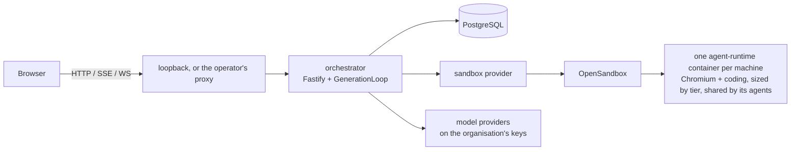

# Code map

Where code lives and what each directory is for. A row links to the
page that explains it, where there is one.

## Repository

| Path | What it is |
| --- | --- |
| `apps/orchestrator/` | The Node control plane ([Orchestrator](orchestrator.md)) |
| `apps/web/` | The React operator app, served at the site root ([Web app](web-app.md)) |
| `packages/ui/` | `@guildsrun/ui`, the design system ([Design system](design-system.md)) |
| `runtime/` | The `agent-runtime:0.4` image every machine runs, and the helpers baked into it |
| `fixtures/compat/` | The frozen contracts `compat-verify` checks the code against, one folder per area (HTTP, SSE, WebSocket, codecs, crypto, adapters, and more), indexed in `manifest.json` |
| `docs/` | This documentation |
| `docker-compose.yml`, `docker-compose.watch.yml`, `docker-compose.dev.yml` | The shipped stack, the development overlay, and the two merged ([Deployment](deployment.md#compose-stacks-and-images)) |
| `setup.sh` | Writes `.env` (state path and generated secrets) and builds the OpenSandbox and runtime images |
| `.env.example` | Core's settings, by integration ([Configure](../operations/configure.md)) |
| `scripts/` | `check.sh` (the whole check; with `CHECK_ROOT` it checks an extending repository), `check-suppressions.sh` (refuses a commit that grows a package's lint suppressions outside a rule commit), `lint.mjs` (runs Oxlint on a package and subtracts its `lint-suppressions.json`), `images.sh` (the OpenSandbox and runtime images), and `smoke-core-stack.sh` (the shipped stack, end to end) ([Development](../contributing/development.md)) |
| `Makefile` | `state`, `opensandbox-image`, `runtime-image`, `core-image`, `build`, `up`, `up-dev`, `dev`, `down`, `reset`, `migrate`, `verify`, `check`, `contract` (`contract-opensandbox` and `contract-model`), `compat-verify`, `soak`; an extending repository's Makefile includes it, with `CORE` naming core's path ([Make targets](../contributing/development.md#make-targets)) |
| `lint/` | The Oxlint plugins every package loads: `boundary.js` holds core code inside core ([Extension points](extension-points.md#how-an-extending-repository-holds-core)) and refuses a module that re-exports another module's exports; `limits.js` carries the function and file limits and the syntax the [code guidelines](../contributing/code-guidelines.md) refuse ([Lint](../contributing/development.md#lint-and-format)) |
| `.github/workflows/` | `verify` (every push: `scripts/check.sh`), `images` (a version tag publishes the orchestrator, runtime, and OpenSandbox server images on ghcr.io) |
| `.state/` | The local `STATE_ROOT`, not in git ([Deployment](deployment.md#state-on-disk)) |

A repository that extends core holds this one as a submodule
([Extension points](extension-points.md)).

## `apps/orchestrator/`

| Path | What it is |
| --- | --- |
| `src/server.ts` | Core's process entry: loads config and runs the server with no extension |
| `src/instrument.ts` | Loaded with `--import` before the server: starts Sentry and its event-loop, profiling, and Fastify integrations |
| `src/error-reporting.ts` | `startErrorReporting`: starts Sentry from the `error-reporting` integration; the server and each command-line tool call it first |
| `src/run.ts` | `runServer`: builds the server, listens, shuts down on a signal or a fatal error |
| `src/compose.ts` | `createServer`, the composition root ([Startup](orchestrator.md#startup-and-shutdown)) |
| `src/extension.ts` | `ServerExtension`, what an extension adds ([Extension points](extension-points.md)) |
| `src/app.ts` | The Fastify app: the web build, `/storybook`, `/health`, `/avatars/:style.svg`, client-error intake, domain routes |
| `drizzle/` | `0001_baseline` (with `0001.notes.md`), then numbered migrations ([PostgreSQL](orchestrator.md#postgresql)) |
| `test/` | `unit/`, `integration/`, `contract/`, `helpers/` ([Tests](orchestrator.md#tests)) |
| `scripts/` | `compat-verify`, `compat-digest`, `dump-baseline-schema`, `patch-http-mcp-catalog`, `build-connector`, `models-dev-snapshot`, `sweep-workspaces`, `typesafe-replay`, `browse-spike` (one fastbrowse task on an agent's sandbox Chrome through the CDP bridge), and `import-cycles` (the import-cycle check of a package's `src/`, which the web app runs too) |
| `Dockerfile` | The core image: a `web` stage builds `apps/web` and Storybook; the final stage copies `src`, `scripts`, `drizzle`, and the web build |
| `package.json` | `exports`: the modules another package may import |
| `.oxlintrc.json` | The package's lint configuration ([Lint](../contributing/development.md#lint-and-format)) |
| `lint-suppressions.json`, `import-cycles.json` | The lint errors and the import cycles that predate their rules; both lists only shrink ([Lint](../contributing/development.md#lint-and-format)) |

### `src/` directories

| Directory | What it holds |
| --- | --- |
| `http/` | One `*-routes.ts` file per domain, registered in `routes.ts`, and what the routes share: who a request is from under each `AUTH_MODE` (`identity.ts`), the host and origin check (`origin.ts`), domain errors as HTTP answers (`errors.ts`, `error-handler.ts`), SSE (`sse.ts`), the sandbox proxies (`sandbox-proxy.ts`), and the web build (`web-app.ts`) |
| `generation/` | `GenerationLoop` (`index.ts`) and everything a run goes through: its config snapshot, the preparation of its prompts and State, the model calls, its tool calls, its event stream, the machines' containers, coding runs and their review, run chains, idle stops, and the runs an operator opens (`operator.ts`) ([Generation](orchestrator.md#generation)) |
| `toolbox/` | The native tools, one module per family, the tools a run offers (`offered.ts`), the sandbox command runner (`shell.ts`), the output pipeline (`output.ts`), and `code_task` over the `guilds-harness` ops (`harness*.ts`) ([Native tools](../tools-and-connectors/native.md)) |
| `connectors/` | One folder per connector core ships, the manifest schema (`manifest.ts`), the adapter contract (`types.ts`), the installed connectors (`registry.ts`), the servers configured from them (`servers.ts`), and the platform integrations they bring (`instance.ts`, `instance-keys.ts`) ([Connectors](../tools-and-connectors/connectors.md)) |
| `registry/` | Installing connectors from a registry, the code tier, and the instance admin's registry view and changes (`admin.ts`), each applied without a restart ([Connector registry](../tools-and-connectors/connector-registry.md)) |
| `mcp/` | `McpPool` (`pool.ts`), the catalog and its policy, MCP sessions, logins and the tools they list, an operator's direct tool call, who sees a connector and a login, and the connect flows (`connect-*.ts`, `github-install.ts`, `github-app-manifest.ts`) |
| `oauth/` | The OAuth mechanics of a manifest's `auth.oauth` (`index.ts`), and the callback and installation-picker pages (`html.ts`) |
| `github/` | The GitHub App, its manifest flow, and the installation tokens minted for a login's repositories ([GitHub](../tools-and-connectors/github.md)) |
| `coding/` | Guild repositories and the GitHub logins they use (`guild-repositories.ts`), a coding agent's git side (`git.ts`), the harnesses (`harnesses.ts`), and each harness's models and efforts (`harness-models.ts`) ([Coding agents](../concepts/coding/index.md)) |
| `machines/` | Tiers, sizes, slots, placement and who may place on a machine, an organisation's machines as its members manage them (`service.ts`), and the boot layout of agent homes ([Machines](../concepts/machines.md)) |
| `access/` | Binding resolution and its change log, a run's tools, MCP, and secrets (`runtime.ts`), the access view a scope's page shows (`view.ts`), an agent's page (`agent-page.ts`), and the bindings an operator sets (`operator.ts`) ([Access](../concepts/access.md)) |
| `credentials/` | AES-GCM and environment fingerprints (`crypto.ts`), owner and secret validation, and the scopes a credential is visible at |
| `secrets/` | Who reaches and manages a secret, `secret_store`, redaction, and an organisation's secrets as its members manage them (`service.ts`) ([Secrets](../concepts/secrets.md)) |
| `db/` | Pool and migrations (`client.ts`, `migrations.ts`), codecs, the Drizzle schema (`schema/`), and one query module per table family (`users.ts`, `agents.ts`, `runs.ts`, …) ([PostgreSQL](orchestrator.md#postgresql)) |
| `seed/` | The database at boot (`connect.ts`): core's and an extension's migrations and seeds, the installed connectors' rows (`system.ts`), the native tool catalog (`catalog.ts`), and a fresh box's first user and organisation (`operator.ts`) |
| `attachments/` | Chat images: sniffing, upload, and hydration |
| `artifacts/` | The artifact store (`store.ts`) with one module per sub-domain (notes, Memory, collections, records, access lists), shared files (`files.ts`, `operator-files.ts`), the files an operator's pages read and write (`host-files.ts`), and the collection views ([Artifacts](../concepts/artifacts.md), [Access](../concepts/access.md)) |
| `notes/` | `NotesStore` (`store.ts`): the `system.md` template and each agent's folder on disk, with its Task, Memory, notes, and routine files; the checks a relative path passes (`paths.ts`); and an operator's notes on a guild, agent, or organisation page (`operator.ts`) |
| `directories/` | The listing of an agent's private and shared notes, scripts, and environment that its State shows |
| `memory/` | Hydration, the cap, the archive, and the version history ([Memory](../concepts/memory.md)) |
| `prompts/` | Prompt composition and the `system.md`, `task.md`, and `memory.md` templates ([System prompt](../concepts/system-prompt.md)) |
| `state/` | The State JSON a run sees |
| `groupchat/` | `GroupChat` (`index.ts`): posts, clears, the event stream, and the dispatcher; group history, tags, the recipient rules and router, deliveries, the message a woken group run reads, and what an operator reads and posts (`operator.ts`) ([Group chat](../concepts/group-chat.md)) |
| `typesafe/` | The System One client, which group routing asks, and the replay that `typesafe-replay` runs |
| `schedules/` | Routine timing, the `Schedules` service, and the routine writes an operator makes, each announced to the agent's guild (`operator.ts`) ([Routines](../concepts/routines.md)) |
| `scripts/` | The agent `script` catalog, its materialisation, and the listing and script writes an operator makes, each write announced to the agent's guild (`operator.ts`) ([Scripts](../concepts/scripts.md)) |
| `sandbox/` | `RunSandboxes`, core's sandbox provider (`index.ts`), the OpenSandbox SDK adapter (`sdk.ts`), and the orphan sweep (`sweep.ts`) |
| `browse/` | The agent-optimized browser behind `browse`: the call's service (`service.ts`), the fastbrowse run and its environment, the result text, browser usage from fastbrowse's cost lines, and the loopback CDP bridge to an agent's DevTools relay (`bridge.ts`) |
| `llm/` | Providers, the models.dev catalog, credentials, the model client, tokens, and cost ([Model client](orchestrator.md#model-client)) |
| `policy/` | `OrgPolicy` and the checks core runs against it |
| `avatars/` | SVG avatars in seven styles: six from [DiceBear](https://www.dicebear.com/) and the clay default (`clay.ts`); `looks.ts` assigns a guild a mascot set and each builder role a look |
| `issues/` | Guild issues from `report_issue`, and the statuses an operator sets, each announced to the guild (`operator.ts`) |
| `notifications/` | The inbox view and its per-user stream |
| `usage/` | Usage counter keys, deltas, and tree (`index.ts`), and the organisation, guild, and agent listings (`view.ts`) |
| `studio/` | Prompt Studio: sessions, the coach's tools, drafts and edits, focus pins, the activity ledger, and the runs and routines the inspector reads (`inspector.ts`) ([Prompt Studio](../concepts/prompt-studio.md)) |
| `builder/` | The guild builder: sessions, tools, widgets, and workspace search ([Guild builder](../concepts/guild-builder.md)) |
| `recipes/` | The `guilds.recipe` schema, capture, rewrite, validation, and apply ([Recipes](../concepts/recipes.md)) |
| `conversation/` | The coach runner Studio and Builder share (`runner.ts`), tool-result projection, and the prompt sections both coaches read (`*.md`, `templates.ts`) |
| `admission/` | `AdmissionCoordinator` (`coordinator.ts`): the generation slots that agent runs, Studio, and Builder take under the box's cap and each organisation's plan |
| `capabilities/` | The catalog facts the builder may name |
| `guilds/`, `agents/`, `organisations/`, `users/` | One directory per entity: its validation, who sees it (`access.ts`), how the API shows it, and the service it is created, changed, and deleted through (`service.ts`; `directory.ts` for users, with `identity.ts` naming the user a request is from) |
| `config/` | Environment → `AppConfig` ([Configuration](orchestrator.md#configuration)) |
| `instance/` | Instance keys: the integration registry (`integrations.ts`), the encrypted store (`keys.ts`), and the confirmation a GitHub App change needs (`changes.ts`) ([Instance keys](extension-points.md#instance-keys)) |
| `cli/` | `seed:system`, `seed:operator`, `migrate`, and `pnpm connector` |
| `observability/` | Logs, request ids, client-error intake, Sentry, and runtime metrics ([Observability](orchestrator.md#observability)) |
| `net/` | Outbound HTTP and endpoint validation |
| `lib/` | Shared helpers with no domain of their own: ids, paths, locks, the clock, JSON and schema decoding, names, emails, numbers, the event queue, change actors, an agent's home files, the blob store under attachments and shared files (`blob-store.ts`), and what a forwarding proxy sends upstream (`forwarding.ts`) |

## `apps/web/`

| Path | What it is |
| --- | --- |
| `src/main.tsx`, `index.html` | Entry: mounts the app with no slot filled |
| `src/mount.tsx` | `mount(slots)` ([Boot](web-app.md#boot)) |
| `src/app/` | The app frame: providers (`App.tsx`), identity, routes (`router.tsx`), slots, theme, browser storage, formatting (`format.ts`), the rules a guild, agent, or repository name follows (`names.ts`), the list beside its selected item (`MasterDetail.tsx`), and the back button (`returnTrail.ts`, `ReturnButton.tsx`) |
| `src/api/` | The typed API client, identity and session, the JSON value type and the guards that narrow a server's reply (`wire.ts`), the API types and the queries (`types/` and `queries/`, one module per domain, [Code paths](web-app.md#code-paths)), streams, and the client error log ([State and events](web-app.md#state-and-events)) |
| `public/` | Files served as-is |
| `vite.app.ts` | `appConfig()`: build and dev-server configuration, shared with an extension |
| `package.json` | `exports`: what an extension's package may import ([Extension slots](web-app.md#extension-slots)) |
| `.oxlintrc.json` | The package's lint configuration |
| `lint-suppressions.json`, `import-cycles.json` | The lint errors and the import cycles that predate their rules; both lists only shrink |
| `claude-design-export/` | The first Claude Design export; not the live library |

### `src/features/`

One directory per area. The screens are in the
[Screen map](screen-map.md).

| Directory | What it holds |
| --- | --- |
| `shell/` | Sidebar and rail, unread counts, account menu, new-message chime and desktop notifications |
| `home/` | `/`, the empty state, and the not-found page |
| `guild/` | Guild workspace and its menu, group chat with its message queue and budget, the State tab, and the guild pages (`pages/`) |
| `agent/` | Create-agent dialogs, the agent inspector with a folder for most of its tabs (`chat/`, `prompt/`, `memory/`, `routine/`, `scripts/`, `browser/`, `cli/`, `history/`, `settings/`), and the repositories a guild's coding agents clone (`GuildRepositories.tsx`, `CodingRepositories.tsx`) |
| `agent/runs/` | How a run's rows read: grouped into generations, steps, and tool calls (`runFlowModel.ts`), each call's kind (`toolKinds.ts`), and its arguments and result as text (`toolFormat.ts`) |
| `notes/` | The notes browser, the provenance strip (`LatestChange.tsx`, `changeActor.ts`), and the notes and tables a Task or a note embeds (`embeds.ts`, `InsertPicker.tsx`, `EmbedPreview.tsx`) |
| `files/` | The files browser: upload, download, access, and delete of shared files |
| `access/` | One scope's tools, logins, and secrets, access lists and reach, and the repositories a GitHub login serves (`GithubRepositories.tsx`) |
| `tables/` | The Tables page and the State › Tables sub-tabs |
| `studio/` | Prompt Studio: the workspace and its sections, with `activity/`, `state/`, `tabs/`, and `tools/` |
| `builder/` | The guild builder |
| `coach/` | What Studio and Builder share: the coach log and the split |
| `recipes/` | Recipe library, recipe page, apply preview, checklist, and the plan a recipe is reviewed as (`plan/`) |
| `admin/` | Connector catalog and registry, platform keys, and users |
| `settings/` | Organisation settings and its members |
| `machines/` | Machines tab, dialog, meters, and picker |
| `models/` | Model setup, the model pickers, and the link to Settings, Model keys (`ModelKeysLink.tsx`) |
| `instance/` | What a missing platform key means for a screen |
| `inbox/` | The Inbox |

## `packages/ui/`

| Path | What it is |
| --- | --- |
| `src/index.ts` | Public barrel, a client module |
| `src/theme.css`, `src/tokens.css`, `src/motion.css` | Tailwind entry, tokens, and motion |
| `src/primitives/`, `src/components/` | Library modules, with their stories beside them |
| `src/foundations/` | Token and icon Storybook boards |
| `src/writeDesignSystemDoc.ts` | `pnpm design-system-doc` |
| `.storybook/` | Storybook config |
| `.oxlintrc.json` | The package's lint configuration |
| `lint-suppressions.json` | The lint errors that predate their rules; the list only shrinks |

[Design system](design-system.md) explains each one.

## `runtime/`

Runs **inside** a machine's Docker sandbox, not in Node. Every
helper that acts for one agent takes its id, or reads its home from
`GUILDS_AGENT_HOME`.

| Path | What it is |
| --- | --- |
| `Dockerfile` | `python:3.12-slim` plus Chromium or Chrome, TigerVNC, noVNC, ttyd, gost, Playwright 1.52.0, Node.js 24, build tools, GitHub CLI, mise, the coding harnesses, and the helpers below. Codex (`CODEX_VERSION`) is always installed. Claude Code, the Cursor CLI, and the Antigravity CLI (`CLAUDE_CODE_VERSION`, `CURSOR_VERSION`, `ANTIGRAVITY_VERSION`) are installed when the `HARNESSES` build argument names them, which its default does. The harness CLIs it carries are listed at `/usr/local/share/guilds/harnesses` |
| `guilds-code` | `shell` and background commands, `file_read`, ripgrep search, output shaping, home and machine sizes, and git setup, clones, checkpoints, and diffs; reads the agent's tokens from `/run/guilds/<agent id>/git-tokens.json` |
| `guilds-harness` | The coding harnesses behind `code_task`: `check`, `start`, `poll`, `result`, `stop`, and `log`; one driver per harness (Claude Code, Codex, Cursor, Antigravity); call state under `/run/guilds/<agent id>/harness/` ([Harnesses](../concepts/coding/harnesses.md)) |
| `agy` | The Antigravity CLI at the pinned version, installed as `/usr/local/bin/agy` |
| `claude-code-managed-settings.json` | Claude Code's managed settings at `/etc/claude-code/managed-settings.json`: hooks off, no project MCP servers |
| `guilds-git-credential` | The git credential helper: the installation token of the guild repository git talks to |
| `git-template/` | The git template whose `prepare-commit-msg` hook adds the `Guild-Run` and `Guild-Agent` trailers |
| `guilds-script-run` | Runs a named Python script with `GUILDS_SCRIPT_ARGS` on stdin |
| `agent-browser-start <agent id> <display> <vnc port> <devtools port> <cdp relay port> <novnc port> <language>` | One agent's Xtigervnc display, Chrome, noVNC, and gost DevTools relay, which sets each request's Host to Chrome's, on the display and ports its slot sets |
| `agent-cli-start <agent id> <terminal port> <first port> <last port>` | One agent's ttyd with bash in its home and its port block; prints the secret path segment it serves under |
| `agent-stop <agent id> browser\|all\|purge` | Stops one agent's browser, or with `all` its terminal and background commands too; `purge` also removes its `/run/guilds/<agent id>/` files |
| `agent-lib.sh` | Shell helpers the `agent-*` scripts share |
| `guilds-browser` | Playwright over the agent's CDP port for the browser tools ([Browser](../concepts/browser.md)) |
| `guilds-locale` | Timezone from the egress IP; Chrome language from `GUILDS_BROWSER_LANGUAGE` (default en-US) |
| `install-chrome.py` | Google Chrome Stable on amd64, Debian Chromium on arm64 |
