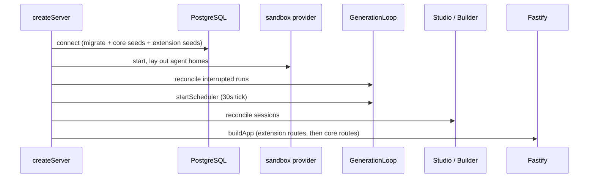
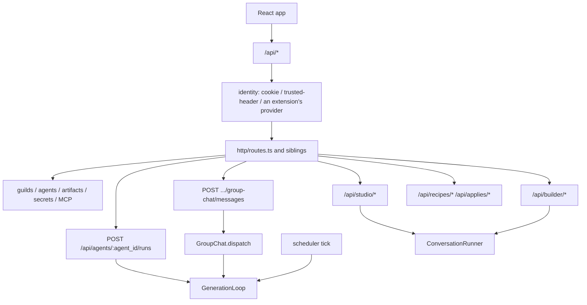
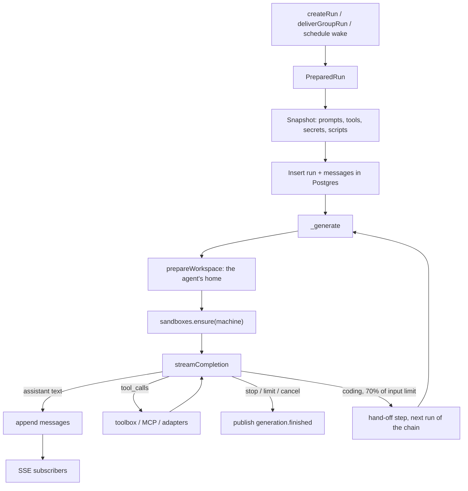

# Orchestrator

The control plane is a strict TypeScript service in
`apps/orchestrator`. The Python in `runtime/` runs inside agent
sandboxes: user scripts, browser automation, the code tools, and the
coding harness drivers.

The process model, the Compose stack, and the trust boundary are
[Deployment and trust boundary](deployment.md). Where each module
lives is the [Code map](code-map.md).

## Stack

- Node.js 24 LTS, image `node:24.21.0-bookworm-slim` (pinned by
  digest in the Dockerfile), `engines.node` `^24`
- pnpm 10 (`packageManager` pin), workspace `apps/*` and `packages/*`
- Fastify 5, TypeBox, `@fastify/type-provider-typebox`,
  `@fastify/static`, `@fastify/websocket`
- Drizzle ORM with `node-postgres` on `postgres:17`
- `openai` (official client) for every model provider, `js-tiktoken`
  for input counting, `croner` for cron, `undici` for outbound HTTP,
  `esbuild` (development) to bundle a registry connector,
  [`@dicebear/*`](https://www.dicebear.com/) for avatars, `@sentry/node`,
  `@sentry/node-native` for event loop stall stacks
- Tests: `node:test` through `tsx`
- OpenSandbox server commit `473ff611d93670a149ce6600f27ed194b18cce89`,
  `opensandbox/execd:v1.1.0`, runtime `agent-runtime:0.4` (every
  machine), TypeScript SDK from that same commit
  (`sdks/sandbox/javascript`)
- Token counting: `js-tiktoken` with one encoding, `o200k_base`, for
  every model
- Cost: provider-reported `cost_usd` first, then the catalog's rate for
  the model on a billed provider, else `cost_source: unavailable`. The
  catalog rate prices uncached input, cache reads, and output;
  `cache_read_tokens` is a subset of `input_tokens`. A message records
  the catalog's fetch date as `pricing_version`

## Configuration

`src/config/index.ts` validates the environment once into a typed
`AppConfig`:

- `DATABASE_URL`
- `NOTES_ROOT`
- `WORKSPACE_ROOT`
- `ATTACHMENTS_ROOT`
- `TEMPLATES_ROOT` (the prompt templates, `src/prompts` by default)
- `OPENSANDBOX_URL`
- `OPENSANDBOX_API_KEY`
- `SANDBOX_IMAGE` (the image every machine runs)
- `SECRETS_MASTER_KEY`, and `ALLOW_ZERO_MASTER_KEY` on a development
  stack
- `AUTH_MODE` with the `trusted-header` settings (`PUBLIC_BASE_URL`,
  `TRUSTED_HEADER_EMAIL`, `TRUSTED_PROXY_SECRET`, `OPERATOR_EMAIL`)
- `MAX_CONCURRENT_GENERATIONS`
- `TOOL_RESULT_MAX_BYTES`
- `HARNESSES_OFF` (coding harnesses this box does not offer)
- `HOST`
- `PORT`

[Configure](../operations/configure.md) explains each one. The model
catalog reads `MODELS_DEV_URL` on its own
([Configure](../operations/configure.md#model-catalog)).

`loadConfig` accepts the modes an extension identifies requests in
beside core's two. The instance keys are read through the registry
in `src/instance/integrations.ts` and the encrypted store it
snapshots (`src/instance/keys.ts`), so a platform key a platform
admin enters takes effect without a restart
([Extension points](extension-points.md#instance-keys)).

A few modules read their own optional variables:

- `CODE_RESULT_MAX_BYTES` (the code tools' and `code_task`'s result
  cap, default 8192)
- `WORKSPACE_MAX_MIB` (host-wide cap on one agent's home, default
  10240; each agent also has `max_workspace_mib`, default the same,
  and each machine a `max_workspace_mib` over every home on it)
- `SENTRY_ENVIRONMENT`, `SENTRY_TRACES_SAMPLE_RATE`,
  `SENTRY_PROFILE_SESSION_SAMPLE_RATE`, `SENTRY_DEBUG`
- `ADAPTER_PROXY_URL` (forward proxy for adapter and MCP HTTP)
- `OPENSANDBOX_SDK_MODULE` (test substitution)

## Operational constants

Configurable only in tests:

- `SANDBOX_IDLE_TIMEOUT` = 5 minutes, for a machine and for an
  agent's Chrome
- `SCHEDULER_TICK` = 30 seconds
- `CANCEL_GRACE` = 2 seconds
- `SHUTDOWN_TIMEOUT` = 15 seconds
- PostgreSQL pool = min 1, max 5, TCP keepalive, connection handshake
  timeout 10 seconds
- runtime metrics sample = 10 seconds; event loop stall = 1 second
- OpenSandbox SDK `request_timeout` = 3 minutes
- OpenSandbox list `page_size` = 100
- model request timeout = 25 ms per `max_tokens`, at least 2 and at
  most 10 minutes
- script command timeout = 120 seconds
- browser tool timeout = 60 seconds
- browser ready wait = 60 seconds
- code tool timeout = 120 seconds; `shell` gets its own timeout plus 30;
  ripgrep stops after 60 seconds inside the sandbox
- inline code-tool request = 64 KiB of base64; larger goes through the
  sandbox file API
- `code_task` = 30 minutes by default, at most 60; polled every 3
  seconds; each `guilds-harness` op 60 seconds, each task checkpoint
  300 seconds; three failed polls in a row end it `interrupted`
- MCP catalog refresh interval = 10 minutes
- MCP tools/list timeout = 15 seconds
- MCP tools/call timeout = 90 seconds
- adapter HTTP timeout = 30 seconds
- TypeSafe call timeout = 8 seconds, 2 retries with backoff
- `TOOL_RESULT_MAX_BYTES` default = 65536
- sandbox resources = 1 CPU and 2Gi on a standard machine, 2 CPU and
  4Gi on a code machine, and the machine's `cpu` and `memory_mib` on
  a custom one (0.5 to 4 CPUs in steps of 0.25, 512 to 8192 MiB)
- agents per machine = 32 (slots 0 to 31)
- agent minimum = the largest of 0.5 CPU and 256 MiB, 1 CPU and 2 GiB
  with `browser`, 2 CPU and 4 GiB with `coding`
  ([Machine sizing](../concepts/machines.md#machine-sizing))
- overcommit before placement warns = 5× a machine's CPUs, 3× its
  memory
- browser desktop = 1280×720
- event queue per subscriber = 4096

Compose `stop_grace_period` on the orchestrator is 20 seconds so
Docker does not SIGKILL during `SHUTDOWN_TIMEOUT`.

## Startup and shutdown

From `apps/orchestrator`, `pnpm start` (or
`pnpm --filter @guildsrun/orchestrator start` from the repo root)
runs `node --import tsx --import ./src/observability/instrument.ts src/server.ts`.
Local Compose uses `make up` or `make dev`.

`server.ts` is core's process entry. It loads `AppConfig` and calls
`runServer` (`src/run.ts`). `runServer` builds the server with
`createServer` (`src/compose.ts`), listens, and shuts it down on a
signal or a fatal error. The extending repository has an entry of
its own, which passes its extensions with its configuration loaded
beside core's
([Extension points](extension-points.md)). Core passes none.



`createServer` runs these steps in order:

1. install the extensions' connectors and integrations, and the
   `HARNESSES_OFF` list
2. connect to PostgreSQL: core's migrations, then each extension's;
   then seed the system catalog, then each extension's seed, then
   the operator and its organisation on a box that still has no user;
   start the runtime metrics; with `OPERATOR_EMAIL` set, give
   `user_operator` that address
3. construct `NotesStore` and check that `system.md` exists in
   `TEMPLATES_ROOT`
4. load the registry connectors' code (`registry/code.ts`), derive
   the connector-declared integrations (`instance/connectors.ts`),
   load the instance keys into their snapshot (`instance/keys.ts`),
   and sync the platform logins (`connectors/instance.ts`)
5. construct `ArtifactStore`, `Scripts`, `Schedules`, the model
   service, and `McpPool`
6. start the sandbox provider: one `RunSandboxes` manager on
   `OPENSANDBOX_URL`, or the one an extension supplies; then lay out
   agent homes by machine (`machines/layout.ts`): destroy every
   sandbox labelled with an `agent_id`, and move each
   `WORKSPACE_ROOT/<agent id>` that exists to
   `WORKSPACE_ROOT/<machine id>/<agent id>` when the target does not
7. construct the attachment service and `GenerationLoop`; reconcile
   active runs; start the scheduler
8. construct Studio and reconcile its sessions; construct recipes,
   capabilities, apply, and Builder; reconcile Builder sessions
9. build the Fastify app, each extension's routes first

`runServer` then listens.

Run reconciliation:

1. list every active run
2. append interruption tool results for unresolved committed tool
   calls; an unresolved `code_task` first gets `guilds-harness stop`
   on its machine when the machine is running, its state is cleared
   once the harness has exited, and the task's end checkpoint is
   taken; its result is `interrupted`, naming the session and log
   from the run's `metadata.harness_task`
3. leave direct runs active and reusable
4. append a `generation.interrupted` run error to group and
   schedule runs
5. complete group delivery through the run's snapshotted sequence
   or complete the schedule run
6. resume pending group dispatch
7. schedule idle teardown for running machines on which no agent
   generates

Studio and Builder reconciliation repairs abandoned coach
generations.

Graceful shutdown (SIGTERM / SIGINT): close HTTP, stop the
scheduler and dispatchers, cooperative-cancel in-flight generations
with `CANCEL_GRACE`, wait up to `SHUTDOWN_TIMEOUT`, close sandboxes
and the pool, flush Sentry.

An unhandled rejection or uncaught exception logs, flushes, stops,
and exits 1.

## Request path



CRUD writes PostgreSQL and returns JSON. Runs go through
`GenerationLoop`. The UI follows on `GET /api/runs/:id/stream`
(SSE). Studio and Builder use the shared conversation runner and
their own streams.

## Generation

### Work queuing

An agent runs at most one generation at a time (`GenerationLoop`
busy registry). Direct, group, and schedule work all take that same
lock. Work waits in that registry, in group dispatch, and in the
schedule's `next_run_at`, never in a job table.

| Incoming work | If the agent is already generating |
| --- | --- |
| Direct chat (message) | HTTP **409**; the operator retries |
| Group delivery | **Wait** for lock release, then retry |
| Due schedule | **Skip** this tick; `next_run_at` stays due |

Studio and Builder take an **organisation** admission slot, not the
agent lock. They do not make a target agent busy.

Group chat **coalesces**. Several unseen messages become **one** run
with a snapshot through the current `chat_seq`. Schedules do not
coalesce: two due routines for the same agent fire on successive
ticks.

### A run

Three ways in: direct message, group-chat delivery, or a due
schedule.



`PreparedRun` hydrates `task` + `memory`. It builds the State JSON.
It resolves bindings and the agent's secrets. It hashes the opening
system prompt.

That prompt and the ordered message rows are the stored history.
Each model call projects tool results from those rows
(`conversation/projection.ts`).

Tools:

- **Native** (`toolbox/`): artifacts, memory, scripts, schedules,
  browser, code tools, `code_task`, group post, report issue,
  secrets
- **Connectors** (`connectors/`, dispatched by `mcp/`): a remote MCP
  endpoint (Notion, Sentry, Cigale, Etherscan), adapter code
  (CoinGecko, Alchemy, X, TwitterAPI.io, Qonto, DexPaprika, Gmail,
  Tavily web search on the instance key), or both (Drive, OpenSea);
  one catalog shape

Scripts and Chromium run on the agent's machine. Notes and
collections stay in PostgreSQL. The sandbox never mounts a notes
tree.

### Concurrency rules

- A registry maps each active agent to at most one generation.
- One mutex protects ownership check, controller insertion,
  cancellation handoff, and removal. It is never held during model
  or tool I/O.
- Generation start reserves the agent **before** the run row is
  inserted.
- Creating a direct run **without** a user message is allowed while
  that agent is generating. Creating or continuing a run **with** a
  message returns 409 while the agent is busy.
- Each controller owns one `AbortController`.
- Cancel first requests a cooperative stop, interrupts the in-flight
  sandbox command, waits `CANCEL_GRACE`, then aborts. Settlement of
  interruption records runs once.
- Group dispatch waits on a generation lock-release counter when
  every actionable agent is busy. Schedule retry does **not** wait:
  a busy agent is skipped and the 30-second ticker retries.
- Guild deletion sets a deleting-guild guard, refuses new runs and
  group actions with 409, and releases the guard in `finally`.
- Secret changes re-resolve the active-run secret snapshots of the
  agents they reach and replace no container: secrets travel on
  each command, and a generation resolves them at its start.
  `secretChanged(secretId)` covers a new value, name, or description
  (the agents with an active run snapshot using it).
  `secretAccessChanged(agentIds)` covers a create, a delete, an
  access change, and a new `secret_store` secret (the agents that
  gain or lose it).
- Agents on one machine generate at the same time. A machine is busy
  while any of its agents generates. Its idle timer starts when the
  last generation on it ends, and a machine whose tier or size
  changed while busy is destroyed then instead.
- Each browser agent's Chrome has its own idle timer, restarted by
  the agent's browser calls and Browser pane input.
- Agent deletion, guild deletion, and a move between machines stop
  the agent's processes on its machine through `agent-stop`; a
  deletion removes its home, a move renames it on the host. They are
  refused while the agent generates.

Admission is per organisation. Ordinary runs, Studio, and Builder
share one slot count under the organisation policy's
`maxConcurrentRuns` and the instance ceiling
`MAX_CONCURRENT_GENERATIONS` (0 is no ceiling).

## Events

One in-process bus carries every event. Each SSE stream sends
`: connected\n\n`, then live events only.

| Event | Stream | Class | What it says |
|---|---|---|---|
| `message.committed` | run, Studio, Builder | durable | A message row committed |
| `generation.started` | run, Studio, Builder | durable | A generation began |
| `generation.finished` | run, Studio, Builder | durable | A generation ended |
| `run.error` | run | durable | A run error; cancellation has `operation: "generation.cancelled"` |
| `run.continued` | run | durable | A coding run continued in the run named by `run_id` |
| `assistant.delta` | run, Studio, Builder | ephemeral | Text being written |
| `assistant.reasoning.delta` | run, Studio, Builder | ephemeral | Reasoning being written |
| `tool.progress` | run | ephemeral | `{run_id, tool_call_id, lines, session_id}`: a running `code_task`'s redacted progress lines |
| `session.error` | Studio, Builder | durable | A coach session error |
| `draft.changed` | Studio | durable | A Task draft changed |
| `recipe.changed` | Builder | durable | The draft recipe changed |
| `group.message.committed` | guild | durable | A group message committed |
| `group.cleared` | guild | durable | An operator cleared the group chat |
| `group.limit_reached` | guild | durable | The guild's message budget is spent |
| `group.idle` | guild | durable | Group dispatch has nothing left to deliver |
| `group.delivery.started`, `group.delivery.finished`, `group.delivery.failed` | guild | durable | A delivery run's progress |
| `guild.artifacts.changed` | guild | invalidation | Re-read the guild's notes, files, Memory, and records |
| `guild.issues.changed` | guild | invalidation | Re-read the guild's issues |
| `agent.scripts.changed` | guild | invalidation | Re-read an agent's scripts |
| `agent.routines.changed` | guild | invalidation | Re-read an agent's routines |
| `notifications.changed` | inbox | invalidation | Re-read the inbox |
| `notifications.message` | inbox | durable | A message posted in a guild the user sees, with its author's look |

The streams:

- run: `/api/runs/:id/stream`
- guild: `/api/guilds/:id/group-chat/stream`
- inbox: `/api/notifications/stream`, one per user
- Studio: `/api/studio/sessions/:session_id/stream`
- Builder: `/api/builder/sessions/:session_id/stream`

Delivery rules:

- A durable or invalidation event is a commit notification. It is
  published only after its transaction commits. A subscriber that
  misses one recovers by re-reading PostgreSQL over REST.
- An ephemeral event cannot be reconstructed. The UI recovers by
  re-fetching committed messages. Their metadata carries the full
  reasoning text, and a `code_task` result carries the harness's
  final message and log path.
- There is no historical replay. After a reconnect the client
  re-reads over REST.
- Headers are `Content-Type: text/event-stream`,
  `Cache-Control: no-cache`, `Connection: keep-alive`, and
  `X-Accel-Buffering: no`.
- Slow subscribers do not stall generation. A disconnected or
  stalled subscriber is dropped.

## PostgreSQL

Core's schema starts at `0001_baseline` in
`apps/orchestrator/drizzle/`. That file is a snapshot of every core
table, including `pg_trgm`. Numbered migrations follow it.

Production never uses `drizzle-kit push`. Boot runs committed
migrations before the HTTP listener becomes ready: core's, recorded
in `public.__drizzle_migrations`, then each extension's chain. A
core migration the database has not recorded after that stops boot
with `MigrationsNotApplied`, naming it
([Development](../contributing/development.md#schema-changes)).
An extension keeps its tables and its record in a schema of its own
([Extension points](extension-points.md#data)).

New core schema lands as the next numbered SQL file in
`apps/orchestrator/drizzle/`. It is mirrored in
`src/db/schema/index.ts`, which the row types in `db/` derive from,
and stamped after the migration before it.

Core's tables:

- users
- orgs
- org_members
- org_model_providers
- org_monthly_usage
- instance_keys
- machines
- guilds
- guild_operators
- guild_repositories
- guild_issues
- agents
- runs
- messages
- group_messages
- group_chat_reads
- schedules
- secrets
- secret_grants
- connectors
- connector_calls
- mcp_connections
- mcp_tools
- bindings
- usage_counters
- artifacts
- artifact_collections
- artifact_access
- attachments
- file_changes
- config_changes
- memory_revisions
- task_revisions
- studio_sessions
- studio_messages
- studio_drafts
- builder_sessions
- builder_messages
- recipes
- recipe_applies

Scripts are `artifacts` with `kind` `script` at agent level.

Collections live in `artifact_collections` (name, purpose, typed
`columns`, `next_id`). Their records live in `artifacts` (`kind`
`object`, `key` the id, `identity` the normalised unique value).
`artifact_collections.guild_id` places a collection in one guild, or
at the organisation when null.

Notes and collections share one access list table, `artifact_access`:
one row per item and subject, the subject being the organisation, a
guild, or an agent. An agent's own row wins, and `none` there shuts it
out; otherwise it takes the better of its guild's and the
organisation's `read` or `write`. A new guild item starts with its
guild at `write`, a new organisation item with the organisation at
`read`. Rows go with their collection, guild, or agent
([Access](../concepts/access.md#access-lists)).

The standing task lives on `agents.task`. Agent names are globally
unique.

The host-side trees beside PostgreSQL are in
[Deployment](deployment.md#state-on-disk). OpenSandbox keeps its
container lifecycle in its own SQLite store, which holds no
application data.

Seeds stay separate from schema (`src/db/seed/`):

```text
catalog.ts        seed identifiers and native-tool lists
mcp-manifests.ts  the installed connectors projected into catalog rows and tool copy
system.ts         upsert catalog, platform bindings
operator.ts       the operator and the Home organisation, on a box with no user
test.ts           deterministic fixtures
```

Boot runs the system seed, each extension's seed, and the operator
seed. Each is idempotent. `POST /api/users` creates a personal
organisation for the user it creates. The baseline contains no
application data insert.

### Codecs

`node-postgres` parsers and repository mappers are explicit.

| PostgreSQL type | API JSON |
|---|---|
| `INTEGER` (`messages.seq`) | number |
| `BIGINT` / `BIGSERIAL` | number (safe-integer check) |
| `NUMERIC` (`usage_counters.cost_usd`) | number rounded to 8 decimal places |
| `TIMESTAMPTZ` | string, microsecond precision |
| `BYTEA` | never returned as UTF-8 text on list/get |
| `JSONB` | object; defaults applied before validation |

Column timestamps in REST (`created_at`, `updated_at`,
`next_run_at`, `last_run_at`, `rotated_at`) use
`YYYY-MM-DDTHH:MM:SS[.ffffff]+00:00`.

Operational `at` fields in run and group errors use `Z`.
Prompt-embedded JSON (State, group-chat info, schedule wake-up)
uses `JSON.stringify(value, null, 2)`. SSE `data:` framing is
exact. HTTP bodies compare as parsed JSON.

AES-256-GCM uses a 12-byte nonce and no additional authenticated
data. `secrets.ciphertext` stores ciphertext plus the GCM tag.
`secrets.nonce` stores the 12-byte nonce separately. The master key
stays outside PostgreSQL.

`SECRETS_MASTER_KEY` accepts a 32-byte strict base64 value,
URL-safe base64, hex (whitespace allowed; invalid hex rejected), or
raw ASCII, in that order. The all-zero key is refused unless
`ALLOW_ZERO_MASTER_KEY=1`, which only the development overlay sets.

AES-GCM plaintext is compact sorted UTF-8 JSON with non-ASCII
`\uXXXX`-escaped. Environment fingerprints serialize sorted
`[name, value]` pairs as compact UTF-8 JSON.

## Model client

```ts
interface ModelClient {
  streamCompletion(
    request: CompletionRequest,
    signal: AbortSignal,
  ): AsyncIterable<ModelEvent>;

  countInputTokens(request: TokenCountRequest): Promise<number>;
}
```

Each provider row names the API it speaks. A `chat-completions`
provider is called with the official OpenAI client, a `messages`
provider with the official Anthropic client (`src/llm/anthropic.ts`),
each pointed at the provider's base URL with the credentials the run
resolved. A run is `provider + credentials + model`. Stored model ids
are `{provider}/{model}`.

### Providers

One row per provider (`src/llm/providers.ts`) is its whole
definition. A provider's kind, whether it is billed, and whether it
needs `coding` come from the id prefix, never from a catalog row.

| Id | Kind | Billed | API | Catalog | Base URL |
|---|---|---|---|---|---|
| `openai` | marketplace | yes | `chat-completions` | models.dev `openai` | `https://api.openai.com/v1` |
| `anthropic` | marketplace | yes | `messages` | models.dev `anthropic` | `https://api.anthropic.com` |
| `openrouter` | marketplace | yes | `chat-completions` | models.dev `openrouter` | `https://openrouter.ai/api/v1` |
| `xai` | marketplace | yes | `chat-completions` | models.dev `xai` | `https://api.x.ai/v1` |
| `deepinfra` | marketplace | yes | `chat-completions` | models.dev `deepinfra` | `https://api.deepinfra.com/v1/openai` |
| `local` | marketplace | no | `chat-completions` | the endpoint's `/models` | the organisation's URL |
| `kimi` | coding | no | `chat-completions` | models.dev `kimi-code-plan-global` | `https://api.kimi.ai/coding/v1` |

An unbilled provider's calls record `cost_source: unavailable`.

### Catalog

[models.dev](https://models.dev) (`https://models.dev/api.json`) is
the catalog (`src/llm/catalog.ts`, `src/llm/models-dev.ts`). The
orchestrator fetches it on the first read and again on a read once
the cache is older than an hour. A failed refresh keeps the last good
cache and is retried after five minutes. Before the first fetch, and
on a box with no network, the snapshot in
`src/llm/models-dev.snapshot.json` serves it:
`pnpm --filter @guildsrun/orchestrator models:snapshot` rewrites that
file from the feed, reduced to the hosted providers and the fields the catalog reads. The whole feed is never checked in.

A row is kept when `tool_call` is true, `status` is not
`deprecated`, and text is among its input and output modalities. Each
kept row maps to an entry: `{provider}/{id}`, `name` → label,
`reasoning` → `thinking`, `temperature`, `attachment` or `image` among
the input modalities → `attachments`, `limit.context`, and `cost` per
million tokens → rates per token for a billed provider. The feed's
fetch date, or the snapshot's, is the `pricing_version` a message
records.

A model id that is well-formed for a known provider but missing from
the last fetch is valid, with the default capacities: thinking on,
temperature on, attachments off. The local endpoint is not in
models.dev; once its URL is saved, `GET {baseURL}/models` lists it,
and its models take those same capacities.

### Credentials

Core asks one function for the credentials of a provider for an
organisation: `ModelCredentialsProvider` (`src/llm/credentials.ts`),
an extension point whose core default reads the organisation's row
([Extension points](extension-points.md)). Agent save, Studio and
Builder start, and every completion resolve credentials through it. A
provider whose credentials resolve is **connected**; one that does not
refuses the save with `connect a … key on Model keys` and ends a run
with `generation.model_key`. A `PolicyError` it throws ends the run
with its message, as the organisation policy does. A connected
provider whose row holds no key of the organisation's is served by
the platform (`source: "platform"`), and is not the organisation's
to remove (409).

The function may return an `onUsage` callback. Core calls it once per
completion with the run id, the model, the token usage, and the cost
with its source; a failure is logged and never fails the run. Core
keeps no spend gate of its own.

### Requests

Requests send `User-Agent: guilds.run`. Automatic retries are off.
The request timeout scales with `max_tokens`, from two to ten minutes.

- Inputs are the complete ordered OpenAI-style message history.
- Tool schemas pass through without framework transformation to a
  `chat-completions` provider.
- `temperature` is omitted when the catalog says the model does not
  take one.
- A `chat-completions` body differs per provider in three places:

| Provider | Output cap | Thinking | Prompt cache |
|---|---|---|---|
| `openai` | `max_completion_tokens` | `reasoning_effort` | none |
| `openrouter` | `max_tokens` | `reasoning: { effort }` | `cache_control` on the last text, and top-level |
| `xai`, `deepinfra`, `local` | `max_tokens` | `reasoning_effort` | none |
| `kimi` | `max_tokens` | `reasoning_effort`, `low` → `low`, `medium` → `high`, `high` → `max` | none |

OpenAI rejects a field it does not know, so a request to it carries
only the fields in its row.

- A `messages` provider takes the same history translated to the
  Messages API: the leading system messages become `system`, a later
  one a user turn; assistant `tool_calls` become `tool_use` blocks and
  `tool` messages `tool_result` blocks; consecutive turns of one role
  merge; `image_url` parts become image blocks (a data URL as base64,
  an http(s) URL as a URL source). Tools are sent as `name`,
  `description`, and `input_schema`. A thinking level sends
  `thinking: { type: "adaptive", display: "summarized" }` with
  `output_config.effort` at that level, and no `temperature`; with no
  level, `thinking` is omitted. Top-level `cache_control` caches the
  prompt up to its last block. Thinking blocks are not replayed. Usage
  counts cache reads and writes into `input_tokens`; `stop_reason`
  maps to `finish_reason` (`tool_use` → `tool_calls`, `max_tokens` →
  `length`, `refusal` → `content_filter`, otherwise `stop`). Saving a
  key probes `GET /v1/models` with `x-api-key`.

- Streaming emits text deltas, reasoning deltas, and one final
  assembled assistant payload.
- Final metadata: `usage.input_tokens`, `usage.output_tokens`,
  `usage.cache_read_tokens`, `latency_ms`, `finish_reason`, served
  `model`, `response_id`, `provider_request_id`, `cost_usd`,
  `cost_source`, and `pricing_version` when the catalog priced it.
  Accounting reads `cost_usd` only.

## Sandbox and tools

A `RunSandboxes` manager drives one OpenSandbox, from the
configuration. An extension may supply a sandbox provider of its own
([Extension points](extension-points.md)).

A manager's work:

- ensure one matching container per machine, labelled with its
  `machine_id`, tier, size, and image fingerprint, with the
  machine's directory mounted at `/home`
- read the harness CLIs a new container's image carries
- execute and interrupt commands
- start and stop an agent's browser (`agent-browser-start`,
  `agent-stop`) and terminal (`agent-cli-start`) on its slot's ports
- resolve the agent's noVNC and terminal endpoints
- destroy the containers of idle or stale machines

The generation loop hands every tool an agent's view of the
machine's container: each command runs in the agent's home with
`HOME`, `GUILDS_AGENT_HOME`, `PORT`, `GUILDS_PORTS`, and the agent's
secrets in its own environment. Files and interrupts are the
machine's.

OpenSandbox SDK objects do not escape the sandbox module.

Control-plane tools run in Node (notes, records, memory, schedules,
scripts, secrets, remote MCP servers, adapters). Sandbox tools
invoke reviewed helpers inside the agent container
(`script_run` through `guilds-script-run`, Playwright through
`guilds-browser`, the code tools through `guilds-code`, `code_task`
through `guilds-harness`).

Browser tools are offered when the run snapshot has
`browser: true`. The code tools are offered when it has
`coding: true`. A coding generation runs its start checks in order:
no `harness` in the snapshot fails with `harness.missing` and
a guild without repositories with `coding.repositories_missing`, both
before the machine is woken; once the workspace check passes,
`guilds-harness check` fails it with `harness.not_installed`,
`harness.credential`, or `harness.check`; then the repositories are
prepared. All of them run before the model is called
([Runs](../concepts/runs.md#generation)).
`group_post` is offered when that binding is on. `secret_request`
is offered only on direct runs. `report_issue` is always offered.

Tool output: custom filter, exact-value secret redaction, byte cap,
then `remaining_tool_calls: N`. Official tool HTTP clients go
through `ADAPTER_PROXY_URL` when it is set and direct otherwise.

## HTTP and WebSocket

The React app (`apps/web`) is the black-box client. Route paths,
JSON names, status codes, and stable `detail` strings are the
contract.

Wire fixtures live in `fixtures/compat/` and `make compat-verify`
checks their digests. `pnpm compat:digest <path>` in
`apps/orchestrator` (or
`pnpm --filter @guildsrun/orchestrator compat:digest <path>` from
the root) refreshes a digest after a deliberate change.

Every request passes the host and origin check in
`src/http/origin.ts`. A request is served only for a loopback host
or the host of `PUBLIC_BASE_URL`. A state-changing request or a
WebSocket handshake that carries an `Origin` is served only when
that origin is that host, the origin of `PUBLIC_BASE_URL`, or a
loopback origin to a loopback host
([SEC-15](security-register.md)).

The sandbox proxies (`/api/agents/:id/browser/vnc/*` to noVNC,
`/api/agents/:id/cli/tty/*` to ttyd) find the agent's machine from
the agent id and the port from its slot. They preserve HTTP streaming,
WebSocket binary/text forwarding, and the `binary` and `tty`
subprotocols. The terminal proxy prepends the daemon's secret path
segment upstream. They decode and strip `content-encoding` before
streaming to the browser.

Client frames on either socket count as activity and restart the
machine's idle timer, and the agent's Chrome timer, at most once
every 30 seconds.

## Observability

Structured JSON logs on stdout:

- timestamp
- level
- run/guild/agent ids
- operation
- error type
- redacted message
- redacted stack

Prompts, model payloads, raw tool output, and secret values are not
logged.

A request id comes from the `X-Request-Id` header when the caller
sends one and is echoed on the response. The web app sends its
tab's id on every API call. It reports uncaught errors, unhandled
rejections, React render errors, and API calls that fail with a 5xx
or on the network to `POST /api/client-errors` (the app
deduplicates for 30 s and sends at most 10 a minute; the endpoint
accepts 30 a minute per address). Each report is logged with that
request id.

Compose json-file rotation is `max-size: 10m`, `max-file: 5`.
`error`-level events go to Sentry when `SENTRY_DSN` is set
(`instrument.ts` loads before the rest of the process; boot logs
`sentry enabled` or `sentry disabled`).

## Tests

| Layer | Role |
|---|---|
| `test/unit` | Domain without Docker; generation tests drive `GenerationLoop` against `NotesStore` and fakes |
| `test/integration` | HTTP + Postgres: a database per test on the server named by `R1_ADMIN_DATABASE_URL` (default the Compose Postgres on `127.0.0.1:5432`); `http-r2`, `http-r3`, `http-r6` replay the recorded routes and SSE/WS fixtures |
| `test/contract` | Live OpenSandbox / model / Jev routing, gated by `RUN_*_CONTRACT=1` plus a key |
| `fixtures/compat` | Frozen HTTP, SSE, schema, crypto, and adapter contracts (`manifest.json` digests) |

`make contract` runs the OpenSandbox and model contracts
(`RUN_OPENSANDBOX_CONTRACT`, `RUN_MODEL_CONTRACT` with
`MODEL_CONTRACT_MODEL`).

The OpenSandbox contract starts its own server at the pinned
commit. Its coding case runs the code tools through execd in
`agent-runtime:0.4` (or `CONTRACT_RUNTIME_IMAGE`). It is skipped
until the image is built.

The web app's tests (`pnpm test:web`, `node:test` over
`apps/web/src/**/*.test.ts`) and the design-system tests
(`pnpm test:ui` over `packages/ui/src/**/*.test.ts`) cover the
operator app's pure models and the `@guildsrun/ui` library.

How to run all of it, with `make verify`, `make check`, the
pre-push hook, and CI, is
[Development](../contributing/development.md).
