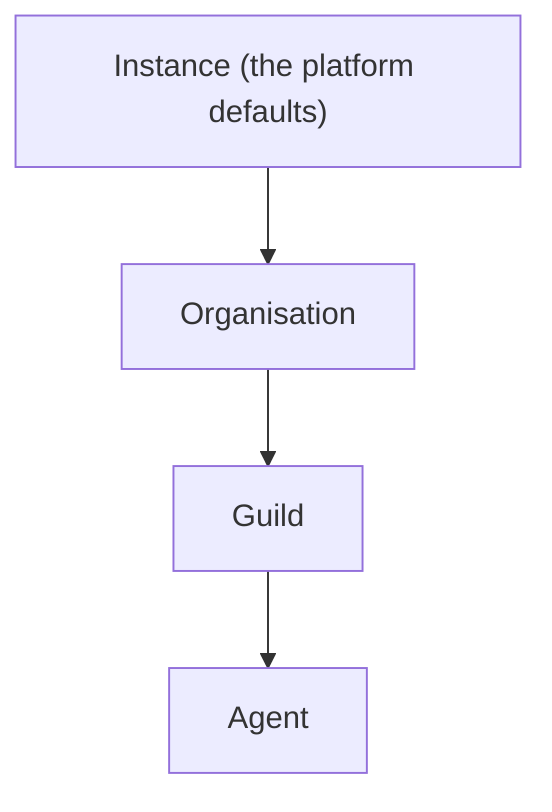

# Access

Access decides what each agent may use. It answers four questions:
which tools the agent is offered, which login a connector's tools act
as, which [secrets](secrets.md) reach the agent's commands, and which
[notes](notes.md) and [collections](collections.md) the agent may read
or write.

Every grant is set at a scope. There are four scopes, nested like
boxes: the instance, an [organisation](organisations.md), a
[guild](guilds.md), and an [agent](agents.md). A guild sits inside one
organisation and an agent inside one guild. What is set at a wide
scope reaches everything inside it, and a narrower scope can change
it for itself. The tools themselves are listed in
[Tools in a run](../tools-and-connectors/tools-in-a-run.md).

## Why it exists

An organisation sets things once for every agent: which connectors
are on, which login they use, which default tools exist. A guild then
adjusts that for its own agents, and one agent can be held back or
given something extra. Nobody has to repeat a setting for each agent,
and narrowing one agent never touches the others.

## How it works

### Scopes and inheritance



The instance is the whole box. It holds the platform defaults: the
native tools that start on, and the logins that the instance's own
platform keys provide. An operator does not change the instance scope
from an access view.

To decide whether something is on for an agent, the orchestrator
walks the chain from the top: instance, then organisation, then the
agent's guild, then the agent. Each scope that has its own setting
replaces the value it inherited. A scope with no setting leaves it as
it is. When no scope says anything, the item is off.

That one walk covers every pattern an operator needs:

- **Enable downward**: switch a tool on at the organisation, and every
  guild and agent gets it.
- **Opt out**: switch it off at one guild or one agent.
- **Enable extra**: switch on, for one guild or agent, a tool the
  organisation left off.
- **Re-enable**: switch it back on below a scope that turned it off.
- **Override the login**: sign in to a connector at a narrower scope,
  so that scope's agents act as a different account.

### The kinds of grant

| What | How it is granted | Scopes | Details |
| --- | --- | --- | --- |
| Native tools | A switch per tool, inherited down the chain | instance, organisation, guild, agent | [Tools in a run](../tools-and-connectors/tools-in-a-run.md), [Native tools](../tools-and-connectors/native.md) |
| Connectors and their tools | A switch per connector and per listed tool, inherited down the chain | instance, organisation, guild, agent | [Connectors](../tools-and-connectors/connectors.md) |
| Logins (connections) | Owned at one scope, usable at that scope and below | instance, organisation, guild, agent | [below](#logins) |
| Note reach | Four switches: read and write guild notes, read and write organisation notes, inherited down the chain | instance, organisation, guild, agent | [Notes](notes.md#how-far-an-agent-reaches) |
| Collections | A mode per guild and per agent; an agent's own mode overrides its guild's | guild, agent | [Collections](collections.md#who-reaches-a-collection) |
| Secrets | Organisation-wide, or granted to guilds and agents; grants add up, with no switch to turn one off | organisation, guild, agent | [Secrets](secrets.md#who-gets-a-secret) |

The switches for tools, connectors, and note reach are all
**bindings**: one row per scope that says on or off. A binding is the
grant. Collections and secrets have grants of their own, with no
inheritance switch.

### Bindings for tools

A native tool, such as `note_write` or `group_post`, has one switch.
A connector has a switch for the whole server, and each tool the
connector lists has a switch of its own. A listed tool follows its
server until a scope sets the tool itself. A server that is off keeps
every one of its tools off.

Every native tool that has a switch starts on at the instance. New
agents inherit that set. An organisation, a guild, or an agent can
turn any of them off.

Some tools have no switch:

- `report_issue` is always offered.
- The browser tools follow the agent's **browser** capability
  ([Browser](browser.md)).
- The code tools follow the agent's **coding** capability
  ([Coding agents](coding/index.md)).

Some switched tools are also left out of a run, whatever the
switches say:

- the script tools when the agent's **scripting** capability is off
  ([Scripts](scripts.md))
- `memory_write` when its **memory** capability is off
  ([Memory](memory.md))
- the routine tools in a routine's own run ([Routines](routines.md))
- `secret_request` outside a direct chat ([Secrets](secrets.md))

The coach in [Prompt Studio](prompt-studio.md) can propose changes to
one agent's own settings: its native tool switches, its note-reach
switches, its connectors, and their tools. The operator applies or
declines each proposal ([Studio proposals](studio-proposals.md)).

### Logins

A login, also called a connection, is one signed-in account on one
connector: a Notion workspace, a Gmail account, an API key for a
data service. It is owned by one scope, and it can be used at that
scope and below:

- an instance login anywhere
- an organisation login at that organisation and its guilds and
  agents
- a guild login at that guild and its agents
- an agent login only at that agent

When an agent's chain reaches a scope that has its own login on a
connector, that login replaces the inherited one. Signing in at a
guild therefore makes that guild's agents act as the guild's account,
while the rest of the organisation keeps the organisation's.

The credentials of a login stay in the orchestrator. An agent never
holds them: it calls the connector's tools, and the orchestrator
makes the call with the login, for tools that are on. A login shared
from a guild or an organisation is shared agency: every agent that
inherits it acts as that one account.

A login can carry settings, such as the one folder a Drive login
reads or the repositories a GitHub login picks. They live on the
login and show on its card in the **Tools** view.

## In the app

### The access view

One access view shows at every scope, the same screen over a
different subject:

- the organisation's under **Settings**, on **Tools** and **Secrets**
- a guild's on its **Tools** and **Secrets** pages
- an agent's on its **Tools** and **Secrets** tabs

Each view shows what the scope inherits from the scopes above it.

### Tools

The organisation's **Tools** has three sub-tabs:

- **Integrations**: each catalog server with its brand mark when
  there is one, its login, a switch for the server, and its listed
  tools behind a toggle with **All**, **Active**, and **Disabled**
  counts. GitHub shows its connected account without a switch, and
  the repositories that login's coding agents clone, at organisation,
  guild, or agent.
- **Native tools**: grouped by family (**Notes**, **Tables** for the
  record tools, **Memory**, **Scripts**, **Routines**, **Group chat**,
  **Secrets**, **Browser**, **Coding**, **Issues**, and **Other**),
  each family collapsible.
- **Artifact scope**: the four note-reach switches.

A guild's and an agent's **Tools** have **Integrations** and
**Native tools**. Their **Artifact scope** is on each **State** tab.

Each switchable item is an on/off switch captioned with where its
state comes from: inherited from a wider scope, or set at this one.
A switch writes this scope's own binding. When removing this scope's
binding already gives the wanted state, the switch removes it
instead. A row that carries this scope's own setting, a native tool
or a note-reach switch, offers a reset that removes it, so the value
is inherited again. A server card offers **Reset to inherit** for its
tools set at this scope.

Browser and coding tools show without a switch. The coding tools
listed are `code_task`, `shell`, `shell_status`, `file_read`, and
`code_search`.

A server shows **Connect** at the current scope, or **Use own login**
when it already uses an inherited one. It shows **Disconnect** when
this scope owns the login. Disconnecting also removes the bindings
that use the login, and the tools go back to a login inherited from a
wider scope, if there is one.

Key-based servers ask for the inputs their connector declares in a
dialog: X labels its key a bearer token, and Qonto asks for a login
and a secret key. A connector with settings adds its settings form
below, its searchable fields searched with the keys typed so far.

Notion, Gmail, Sentry, and Drive open a browser sign-in. A login that
still needs its settings, such as Drive's one folder, reads signed
in, and its card shows the settings form with **Save and connect**.

A login's settings show on its card from the connector's schema, with
a search box on each looked-up property. They are editable on the
scope's own login and read-only when inherited.

An organisation's owners and admins add a remote MCP server of its
own under **Settings › Tools** with **Add a remote server**: a slug, a
URL, how it signs in, and an optional name and description. Its card
reads **This organisation's** and has **Remove server**, which asks
before it removes the server with every login to it.

A connector the box cannot sign in to is marked **Not set up**, with
the fields its integration lacks, and its **Connect** is disabled. A
platform admin gets **Set up**, a link to **Admin**, **Platform keys**
with that integration preselected and a way back
([Platform keys](../tools-and-connectors/platform-keys.md)). A native
tool that waits for a platform key has no switch and says it is
offered once a platform admin sets up its integration there.

Local adapters group their tools under one server like any other
connector.

### Secrets

The **Secrets** side lists the secrets that reach the scope, with who
gets each. It has no switches ([Secrets](secrets.md#in-the-app)).

### Collections

A guild's and an agent's collection grants are set on their
**State › Tables** tab ([Collections](collections.md)).

## Rules and limits

| Rule | Behaviour |
| --- | --- |
| Inheritance order | Instance, organisation, guild, agent; the narrowest setting wins |
| Nothing set anywhere | Off |
| Instance defaults | Seeded by the box; no access view changes them |
| A connector's tools | Follow the server until set one by one; server off keeps them all off |
| Logins | One per connector per owner; usable at the owner's scope and below |
| Note reach defaults | [Notes](notes.md#how-far-an-agent-reaches) |
| Never a switch | `report_issue`, the browser tools, the code tools |
| Who writes an organisation's switch | Any member of the organisation |
| Who writes a guild's or an agent's switch | Any member of the organisation who can see the guild |

What an operator relies on about secrets, machines, and redaction is
in [Secrets](secrets.md#what-an-operator-relies-on).

## Reference

### Three objects

Access is built on three objects:

- **Catalog**: what exists. Native tools are the TypeScript registry.
  Connectors are rows of the `connectors` table.
- **Connections**: the logins.
- **Bindings**: which scope offers which catalog item. Bindings are
  the grant ([Bindings](#bindings)).

The connector catalog, the manifest keys, the `connectors` table, an
organisation's own MCP servers, connections, and the connect
operation are in [Connectors](../tools-and-connectors/connectors.md).

An agent's configuration does not hold its native tools or its
environment. Tools come from bindings and the environment from
secret grants ([Secrets](secrets.md)).

### Bindings

A binding is one `bindings` row:

| Column | Holds |
| --- | --- |
| `id` | The binding id |
| `catalog_kind` | `native_tool`, `mcp`, `mcp_tool`, or `artifact_grant` |
| `catalog_id` | A native tool's name, a server id, a namespaced tool `{slug}_{name}`, or a grant id |
| `scope` | `platform`, `org`, `guild`, or `agent` |
| `scope_id` | The organisation, guild, or agent id; null at `platform` |
| `org_id`, `guild_id`, `agent_id` | The owner of the scope, the one that matches `scope`; deleting it deletes the binding |
| `enabled` | On or off |
| `connection_id` | The login an `mcp` binding uses, or null |
| `created_at`, `updated_at` | Times |

An `mcp` binding may carry a `connection_id`. Native-tool, `mcp_tool`,
and `artifact_grant` bindings never do. A listed tool with no binding
at any scope follows its server.

Resolution walks `platform`, then the organisation, then the agent's
guild, then the agent. Each present row replaces `enabled` and, when
it carries a connection, the current connection. An absent row leaves
the current state. The empty chain is disabled.

A connection may be bound where it is visible, which follows its
owner:

- a platform connection may be bound anywhere
- an organisation one at that organisation or its guilds and agents
- a guild one at that guild or its members
- an agent one only at that agent

Platform seed bindings, written at boot when the platform row is
absent, enable:

- the note tools (`note_find`, `note_get`, `note_write`,
  `note_delete`)
- the record tools (`record_search`, `record_list`, `record_add`,
  `record_update`, `record_remove`)
- `memory_write`
- the five script tools
- the six schedule tools
- `secret_store`
- `secret_request`
- `group_post`

and set the four artifact grants: `read_guild`, `read_org`, and
`write_guild` on, `write_org` off. A grant with no row at any scope
reads the same default.

The artifact grants govern notes only. `guild` always means the
agent's own guild. Collection reach is the separate
`collection_access` grant ([Collections](collections.md)).

`report_issue` and the eight browser tools are never bindings; a
binding on one is 422 `NAME is not a binding`. The code tools are not
in the native registry's bindable set either (422 `unknown native
tool: NAME`). Deleting a connection, agent, or guild cascades the
bindings that point at it. Deleting an organisation's own MCP server
removes the bindings that name it.

```text
PUT    /api/bindings     { catalog_kind, catalog_id, scope, scope_id, enabled, connection_id? }
DELETE /api/bindings     ?catalog_kind=&catalog_id=&scope=&scope_id=
```

- `PUT` writes the scope's row, replacing an existing one. Without a
  `connection_id` key, an `mcp` row keeps the connection it had.
  `catalog_kind=mcp` needs a server visible to the organisation as
  `catalog_id`. `catalog_kind=mcp_tool` needs the namespaced name of
  a tool that a server visible to the organisation lists; any other
  name is 404 `mcp tool not found`.
- `DELETE` removes the scope's row and is 204, or 404 when there is
  none.
- Any other `catalog_kind`, an unknown native tool or grant, a bad
  scope, a missing `scope_id`, a connection for another server, or a
  connection not visible at the scope is 422.
- `scope=platform` is 400: platform bindings are not changed here.
- At `org` scope the caller must be a member of the organisation. At
  `guild` or `agent` scope the caller must be a member who can see
  the guild. No role is required. Otherwise the answer is 404. An
  unknown or another organisation's server or connection is 404.

Code: `apps/orchestrator/src/access/index.ts`,
`apps/orchestrator/src/http/routes.ts`.

### Access views

```text
GET /api/access                     the current organisation
GET /api/guilds/:guild_id/access    one guild
GET /api/agents/:agent_id/access    one agent
```

Each returns `{ tools, grants, mcp }`:

- `tools`: every bindable native tool
- `grants`: the four artifact grants
- `mcp`: each connector with its connection, its listed tools, and
  their resolved state

Every entry carries its effective value, the scope it comes from
(`source_scope`), and this scope's own setting (`overlay`).
`GET /api/secrets?guild_id=` and `?agent_id=` are the Secrets side
([Secrets](secrets.md#http)).

Every connector's access entry carries `oauth_setup_state`:
`not_applicable`, `dynamic`, `configured`, or `unsupported` when the
box holds no OAuth client or App for it. The Tools view marks an
`unsupported` connector **Not set up**.
