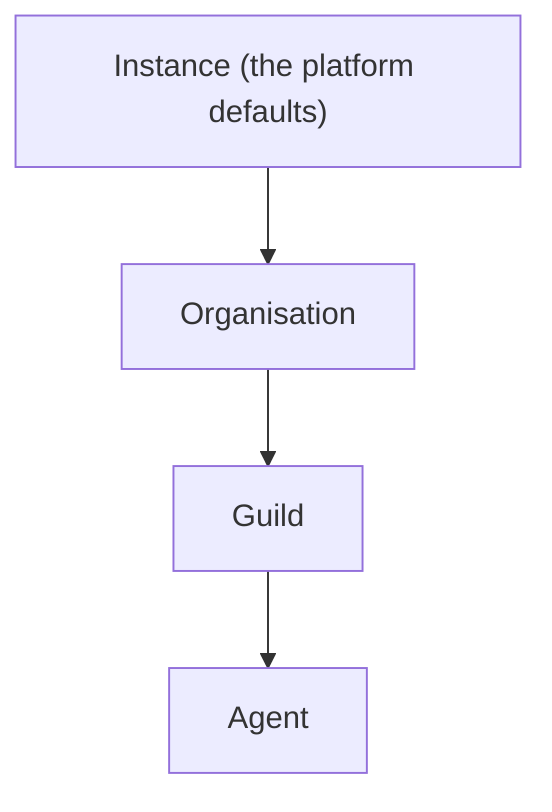
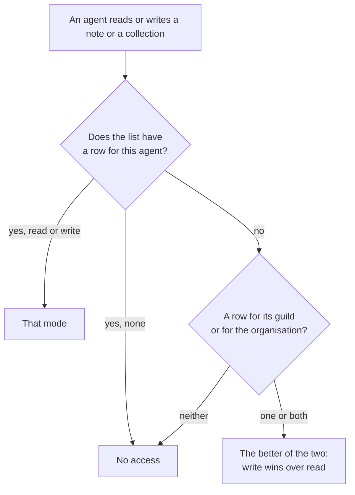

# Access

Access decides what each agent may use. It answers four questions:
which tools the agent is offered, which login a connector's tools act
as, which [secrets](secrets.md) reach the agent's commands, and which
[notes](notes.md) and [collections](collections.md) the agent may read
or write.

Tools, connectors, and logins are set at a scope. There are four
scopes, nested like boxes: the instance, an
[organisation](organisations.md), a [guild](guilds.md), and an
[agent](agents.md). A guild sits inside one organisation and an agent
inside one guild. What is set at a wide scope reaches everything
inside it, and a narrower scope can change it for itself. The tools
themselves are listed in
[Tools in a run](../tools-and-connectors/tools-in-a-run.md).

Notes and collections work differently. Each note and each collection
carries its own **access list**. A row of the list gives the
organisation, one guild, or one agent a mode on that one item.

## Why it exists

An organisation sets things once for every agent: which connectors
are on, which login they use, which default tools exist. A guild then
adjusts that for its own agents, and one agent can be held back or
given something extra. Nobody has to repeat a setting for each agent,
and narrowing one agent never touches the others.

Notes and collections are shared knowledge. Who reads them and who
writes them is decided item by item. A guild can open one note to a
second guild without opening all its notes, and one table can be
written by two guilds while the rest of the organisation reads it.

## How it works

### Scopes and inheritance



The instance is the whole box. It holds the platform defaults: the
native tools that start on, and the logins that the instance's own
platform keys provide. An operator does not change the instance scope
from an access view.

To decide whether something is on for an agent, the orchestrator
walks the chain from the top: instance, then organisation, then the
agent's guild, then the agent. Each scope that has its own setting
replaces the value it inherited. A scope with no setting leaves it as
it is. When no scope says anything, the item is off.

That one walk covers every pattern an operator needs:

- **Enable downward**: switch a tool on at the organisation, and every
  guild and agent gets it.
- **Opt out**: switch it off at one guild or one agent.
- **Enable extra**: switch on, for one guild or agent, a tool the
  organisation left off.
- **Re-enable**: switch it back on below a scope that turned it off.
- **Override the login**: sign in to a connector at a narrower scope,
  so that scope's agents act as a different account.

### The kinds of access

| What | How it is given | Who | Details |
| --- | --- | --- | --- |
| Native tools | A switch per tool, inherited down the chain | instance, organisation, guild, agent | [Tools in a run](../tools-and-connectors/tools-in-a-run.md), [Native tools](../tools-and-connectors/native.md) |
| Connectors and their tools | A switch per connector and per listed tool, inherited down the chain | instance, organisation, guild, agent | [Connectors](../tools-and-connectors/connectors.md) |
| Logins (connections) | Owned at one scope, usable at that scope and below | instance, organisation, guild, agent | [below](#logins) |
| Notes and collections | An access list on each item: a mode for the organisation, a guild, or an agent | organisation, guild, agent | [below](#access-lists-for-notes-and-collections) |
| Secrets | Organisation-wide, or granted to guilds and agents; grants add up, with no switch to turn one off | organisation, guild, agent | [Secrets](secrets.md#who-gets-a-secret) |

The switches for tools and connectors are **bindings**: one row per
scope that says on or off. Access lists and secrets have rows of
their own, with no inheritance switch.

### Bindings for tools

A native tool, such as `note_write` or `group_post`, has one switch.
A connector has a switch for the whole server, and each tool the
connector lists has a switch of its own. A listed tool follows its
server until a scope sets the tool itself. A server that is off keeps
every one of its tools off.

Every native tool that has a switch starts on at the instance. New
agents inherit that set. An organisation, a guild, or an agent can
turn any of them off.

Some tools have no switch:

- `report_issue` is always offered.
- The browser tools follow the agent's **browser** capability
  ([Browser](browser.md)).
- The code tools follow the agent's **coding** capability
  ([Coding agents](coding/index.md)).

Some switched tools are also left out of a run, whatever the
switches say:

- the script tools when the agent's **scripting** capability is off
  ([Scripts](scripts.md))
- `memory_write` when its **memory** capability is off
  ([Memory](memory.md))
- the routine tools in a routine's own run ([Routines](routines.md))
- `secret_request` outside a direct chat ([Secrets](secrets.md))

The coach in [Prompt Studio](prompt-studio.md) can propose changes to
one agent's own settings: its native tool switches, its connectors,
and their tools. The operator applies or declines each proposal
([Studio proposals](studio-proposals.md)).

### Logins

A login, also called a connection, is one signed-in account on one
connector: a Notion workspace, a Gmail account, an API key for a
data service. It is owned by one scope, and it can be used at that
scope and below:

- an instance login anywhere
- an organisation login at that organisation and its guilds and
  agents
- a guild login at that guild and its agents
- an agent login only at that agent

When an agent's chain reaches a scope that has its own login on a
connector, that login replaces the inherited one. Signing in at a
guild therefore makes that guild's agents act as the guild's account,
while the rest of the organisation keeps the organisation's.

The credentials of a login stay in the orchestrator. An agent never
holds them: it calls the connector's tools, and the orchestrator
makes the call with the login, for tools that are on. A login shared
from a guild or an organisation is shared agency: every agent that
inherits it acts as that one account.

A login can carry settings, such as the one folder a Drive login
reads or the repositories a GitHub login picks. They live on the
login and show on its card in the **Tools** view.

### Access lists for notes and collections

Every [note](notes.md) and every [collection](collections.md) carries
one access list. A row of the list names a subject and gives it a
mode:

| Subject | Modes | Covers |
| --- | --- | --- |
| The organisation | `read`, `write` | every agent of the organisation |
| A guild | `read`, `write` | every agent of that guild |
| An agent | `none`, `read`, `write` | that one agent |

`write` includes `read`. `none` exists only on an agent row: it keeps
that one agent out.

A guild row or the organisation row covers every agent that belongs
to it at the moment the agent reads or writes. An agent created
later is covered too, with no new row.

An agent's mode on one item is decided like this:



So an agent row can hold one agent back below its guild, with `none`
or `read`, or raise it above its guild, with `write`. An item an agent
cannot read behaves for it as if it did not exist.

A note's level and a collection's owning guild are placement only.
They decide the item's display path and where it is listed. They do
not decide who reaches it. Moving a collection between a guild and
the organisation leaves its access list as it is.

When an item is created, it gets starting rows. They are ordinary
rows, shown and changed like any other:

| The item is placed | Starting rows |
| --- | --- |
| in a guild | that guild at `write` |
| at the organisation | the organisation at `read` |
| on one agent (a note) | none |

Some things sit outside the access lists:

- An agent always reads and writes its own agent-level notes, its
  [Memory](memory.md), and its [scripts](scripts.md). Memory and
  scripts belong to one agent and have no access list.
- Operators reach every note and every collection, except those of a
  private guild they do not operate: its guild-level notes, its
  agents' notes, and its own collections ([Guilds](guilds.md#visibility)).

Agents never change an access list. Only an operator does.

## In the app

### The access view

One access view shows at every scope, the same screen over a
different subject:

- the organisation's under **Settings**, on **Tools** and **Secrets**
- a guild's on its **Tools** and **Secrets** pages
- an agent's on its **Tools** and **Secrets** tabs

Each view shows what the scope inherits from the scopes above it.

### Tools

The organisation's **Tools** has three sub-tabs:

- **Integrations**: each catalog server with its brand mark when
  there is one, its login, a switch for the server, and its listed
  tools behind a toggle with **All**, **Active**, and **Disabled**
  counts. GitHub shows its connected account without a switch, and
  the repositories that login's coding agents clone, at organisation,
  guild, or agent.
- **Native tools**: grouped by family (**Notes**, **Tables** for the
  record tools, **Memory**, **Scripts**, **Routines**, **Group chat**,
  **Secrets**, **Browser**, **Coding**, **Issues**, and **Other**),
  each family collapsible.

A guild's and an agent's **Tools** have **Integrations** and
**Native tools**.

Each switchable item is an on/off switch captioned with where its
state comes from: inherited from a wider scope, or set at this one.
A switch writes this scope's own binding. When removing this scope's
binding already gives the wanted state, the switch removes it
instead. A native tool row that carries this scope's own setting
offers a reset that removes it, so the value is inherited again. A
server card offers **Reset to inherit** for its tools set at this
scope.

Browser and coding tools show without a switch. The coding tools
listed are `code_task`, `shell`, `shell_status`, `file_read`, and
`code_search`.

A server shows **Connect** at the current scope, or **Use own login**
when it already uses an inherited one. It shows **Disconnect** when
this scope owns the login. Disconnecting also removes the bindings
that use the login, and the tools go back to a login inherited from a
wider scope, if there is one.

Key-based servers ask for the inputs their connector declares in a
dialog: X labels its key a bearer token, and Qonto asks for a login
and a secret key. A connector with settings adds its settings form
below, its searchable fields searched with the keys typed so far.

Notion, Gmail, Sentry, and Drive open a browser sign-in. A login that
still needs its settings, such as Drive's one folder, reads signed
in, and its card shows the settings form with **Save and connect**.

A login's settings show on its card from the connector's schema, with
a search box on each looked-up property. They are editable on the
scope's own login and read-only when inherited.

An organisation's owners and admins add a remote MCP server of its
own under **Settings › Tools** with **Add a remote server**: a slug, a
URL, how it signs in, and an optional name and description. Its card
reads **This organisation's** and has **Remove server**, which asks
before it removes the server with every login to it.

A connector the box cannot sign in to is marked **Not set up**, with
the fields its integration lacks, and its **Connect** is disabled. A
platform admin gets **Set up**, a link to **Admin**, **Platform keys**
with that integration preselected and a way back
([Platform keys](../tools-and-connectors/platform-keys.md)). A native
tool that waits for a platform key has no switch and says it is
offered once a platform admin sets up its integration there.

Local adapters group their tools under one server like any other
connector.

### Secrets

The **Secrets** side lists the secrets that reach the scope, with who
gets each. It has no switches ([Secrets](secrets.md#in-the-app)).

### The Access panel

The **Access** panel shows and edits one item's access list. It is
in two places:

- a collection's **Access** tab on the **Tables** page. The tab's
  count is the number of rows
  ([Collections](collections.md#the-tables-page)).
- the **Access** button in the header of an open note, in the notes
  browser. It opens a dialog titled **Access to `<path>`**
  ([Notes](notes.md#in-the-app)).

The panel:

- has one row per subject: the organisation first, then guilds, then
  agents, each agent with its guild
- has a mode control on each row: **Read** or **Read & write**, and
  for an agent also **None**
- has a remove button on each row
- has an add picker that offers the organisation, the guilds, and the
  agents grouped by guild, with a mode for the new row

Each change saves the whole list at once. Rows of private guilds the
operator does not operate, and of their agents, do not show, and a
save leaves them as they are.

### What a guild or an agent reaches

The **Access** sub-tab of a guild's **State** lists the tables and
notes that guild's agents reach. The **Access** sub-tab of an agent's
**State** lists what that one agent reaches, its own notes included.
Each item carries a tag with the mode it ends up with: read, or read
and write. The listing is read only. Its **Tables** and **Notes**
sections always show, with **None.** when one is empty.

Each item opens where its access is changed:

- a table opens its **Access** tab on the **Tables** page
- an organisation note opens in the current guild's **State › Files**
- a guild note opens in that guild's **State › Files**
- an agent note opens in that agent's **State › Notes**

## Rules and limits

| Rule | Behaviour |
| --- | --- |
| Inheritance order | Instance, organisation, guild, agent; the narrowest setting wins |
| Nothing set anywhere | Off |
| Instance defaults | Seeded by the box; no access view changes them |
| A connector's tools | Follow the server until set one by one; server off keeps them all off |
| Logins | One per connector per owner; usable at the owner's scope and below |
| Never a switch | `report_issue`, the browser tools, the code tools |
| Who writes an organisation's switch | Any member of the organisation |
| Who writes a guild's or an agent's switch | Any member of the organisation who can see the guild |
| An agent's mode on a note or a collection | Its own row when it has one; otherwise the better of its guild's row and the organisation's row; no row is no access |
| `none` | Agent rows only |
| Starting rows | Placed in a guild: the guild at `write`. Placed at the organisation: the organisation at `read`. An agent's note: none |
| Always reached | An agent's own notes, Memory, and scripts |
| Who changes an access list | Any member of the organisation, on items they can see; never an agent |

What an operator relies on about secrets, machines, and redaction is
in [Secrets](secrets.md#what-an-operator-relies-on).

## Reference

### Three objects

Access is built on three objects:

- **Catalog**: what exists. Native tools are the TypeScript registry.
  Connectors are rows of the `connectors` table.
- **Connections**: the logins.
- **Bindings**: which scope offers which catalog item
  ([Bindings](#bindings)).

Notes and collections are reached through their access lists
([Access lists](#access-lists)), not through bindings.

The connector catalog, the manifest keys, the `connectors` table, an
organisation's own MCP servers, connections, and the connect
operation are in [Connectors](../tools-and-connectors/connectors.md).

An agent's configuration does not hold its native tools or its
environment. Tools come from bindings and the environment from
secret grants ([Secrets](secrets.md)).

### Bindings

A binding is one `bindings` row:

| Column | Holds |
| --- | --- |
| `id` | The binding id |
| `catalog_kind` | `native_tool`, `mcp`, or `mcp_tool` |
| `catalog_id` | A native tool's name, a server id, or a namespaced tool `{slug}_{name}` |
| `scope` | `platform`, `org`, `guild`, or `agent` |
| `scope_id` | The organisation, guild, or agent id; null at `platform` |
| `org_id`, `guild_id`, `agent_id` | The owner of the scope, the one that matches `scope`; deleting it deletes the binding |
| `enabled` | On or off |
| `connection_id` | The login an `mcp` binding uses, or null |
| `created_at`, `updated_at` | Times |

An `mcp` binding may carry a `connection_id`. Native-tool and
`mcp_tool` bindings never do. A listed tool with no binding at any
scope follows its server.

Setting or removing an organisation, guild, or agent binding through
the API, a recipe apply, or a Studio access proposal appends a
`config_changes` row with `target_kind` `access` and the `catalog_id`
as target: `Turned on tool <id>`, `Turned off tool <id>`, or
`Reset tool <id> to inherit` (`connector` for an `mcp` binding). A
write that leaves the setting as
it was appends nothing. Platform bindings and the off-by-default rows
a new login writes are not logged
([Artifacts](artifacts.md#configuration-change-log)).

Resolution walks `platform`, then the organisation, then the agent's
guild, then the agent. Each present row replaces `enabled` and, when
it carries a connection, the current connection. An absent row leaves
the current state. The empty chain is disabled.

A connection may be bound where it is visible, which follows its
owner:

- a platform connection may be bound anywhere
- an organisation one at that organisation or its guilds and agents
- a guild one at that guild or its members
- an agent one only at that agent

Platform seed bindings, written at boot when the platform row is
absent, enable:

- the note tools (`note_find`, `note_get`, `note_write`,
  `note_delete`)
- the record tools (`record_search`, `record_list`, `record_add`,
  `record_update`, `record_remove`)
- `memory_write`
- the five script tools
- the six schedule tools
- `secret_store`
- `secret_request`
- `group_post`

`report_issue` and the eight browser tools are never bindings; a
binding on one is 422 `NAME is not a binding`. The code tools are not
in the native registry's bindable set either (422 `unknown native
tool: NAME`). Deleting a connection, agent, or guild cascades the
bindings that point at it. Deleting an organisation's own MCP server
removes the bindings that name it.

```text
PUT    /api/bindings     { catalog_kind, catalog_id, scope, scope_id, enabled, connection_id? }
DELETE /api/bindings     ?catalog_kind=&catalog_id=&scope=&scope_id=
```

- `PUT` writes the scope's row, replacing an existing one. Without a
  `connection_id` key, an `mcp` row keeps the connection it had.
  `catalog_kind=mcp` needs a server visible to the organisation as
  `catalog_id`. `catalog_kind=mcp_tool` needs the namespaced name of
  a tool that a server visible to the organisation lists; any other
  name is 404 `mcp tool not found`.
- `DELETE` removes the scope's row and is 204, or 404 when there is
  none.
- Any other `catalog_kind` (422 `catalog_kind must be native_tool,
  mcp, or mcp_tool`), an unknown native tool, a bad scope, a missing `scope_id`, a connection for another server, or a
  connection not visible at the scope is 422.
- `scope=platform` is 400: platform bindings are not changed here.
- At `org` scope the caller must be a member of the organisation. At
  `guild` or `agent` scope the caller must be a member who can see
  the guild. No role is required. Otherwise the answer is 404. An
  unknown or another organisation's server or connection is 404.

Code: `apps/orchestrator/src/access/index.ts`,
`apps/orchestrator/src/http/routes.ts`.

### Access views

```text
GET /api/access                     the current organisation
GET /api/guilds/:guild_id/access    one guild
GET /api/agents/:agent_id/access    one agent
```

Each returns `{ tools, mcp }`:

- `tools`: every bindable native tool
- `mcp`: each connector with its connection, its listed tools, and
  their resolved state

Every entry carries its effective value, the scope it comes from
(`source_scope`), and this scope's own setting (`overlay`).
`GET /api/secrets?guild_id=` and `?agent_id=` are the Secrets side
([Secrets](secrets.md#http)).

Every connector's access entry carries `oauth_setup_state`:
`not_applicable`, `dynamic`, `configured`, or `unsupported` when the
box holds no OAuth client or App for it. The Tools view marks an
`unsupported` connector **Not set up**.

### Access lists

An access list is the set of `artifact_access` rows of one item:

| Column | Holds |
| --- | --- |
| `id` | The row id (`aacc_…`) |
| `org_id` | The organisation; deleting it deletes the row |
| `target_kind`, `target_id` | `note` with the note's artifact id, or `collection` with the collection id |
| `subject_type`, `subject_id` | `org` with the organisation id, `guild` with a guild id, or `agent` with an agent id |
| `mode` | `read` or `write`; `none` only when `subject_type` is `agent` |
| `created_by_type`, `created_by_id`, `created_by_name`, `created_at` | Who first wrote the row, and when |
| `updated_by_type`, `updated_by_id`, `updated_by_name`, `updated_at` | Who last set its mode, and when |

A subject has at most one row per item: (`target_kind`, `target_id`,
`subject_type`, `subject_id`) is unique. Writing a subject's row again
replaces its mode and its `updated_*` columns. Rows are indexed by
subject.

An agent's mode on an item is one SQL expression
(`agentModeSql` in `apps/orchestrator/src/artifacts/access.ts`): the
agent's own row; when there is none, the greater of its guild's row
and the organisation's row; when there is neither, no access. `none`
and no row both mean no access. Every note and record tool, State,
and every listing an agent gets apply it. An operator actor skips it
and reaches every item except those of the private guilds it does
not operate.

An agent reaches its own agent-level notes, its Memory, and its
scripts without a row. Memory and scripts never have rows. An agent's
note can still be given rows, which open it to other agents; no row
names the agent that owns it.

Creating an item writes its starting rows in the same transaction:
`guild` at `write` for a guild note or a guild's own collection,
`org` at `read` for an organisation note or collection, and no row for
an agent note. Changing a collection's owner leaves its rows as they
are.

Rows go away:

- with their note or collection, when it is deleted
- with a guild: the rows naming the guild or one of its agents, and
  the rows on its own collections and on its and its agents' notes
- with an agent: the rows naming it and the rows on its notes

```text
GET  /api/notes/:note_id/access                { subjects, owner_agent_id }
PUT  /api/notes/:note_id/access                { subjects: [{ type, id, mode }] }; answers { subjects, owner_agent_id }
GET  /api/collections/:collection_id/access    { subjects, owner_agent_id }
PUT  /api/collections/:collection_id/access    { subjects: [{ type, id, mode }] }; answers { subjects, owner_agent_id }
GET  /api/guilds/:guild_id/reach               { notes, tables }
GET  /api/agents/:agent_id/reach               { notes, tables }
```

Each entry of `subjects` is
`{ type, id, name, mode, guild_id, guild_name }`. `guild_id` and
`guild_name` name the guild of a guild subject, or the guild an agent
subject belongs to; both are null for the organisation. The list is
ordered: the organisation, then guilds, then agents by guild and name.
Rows of private guilds the caller does not operate, and of their
agents, are left out. `owner_agent_id` is the agent that owns an
agent-level note, which always writes it; it is null for every other
item.

`PUT` takes the full list and replaces the list with it. A subject
left out loses its row. Rows the caller cannot see are not in the
comparison and stay as they are. Only the subjects whose row is
written are looked up, so a row whose subject no longer exists can
still be removed. The answer is the new list.

An error about one entry of `subjects` starts with its place in the
list, `subjects[<index>]: `.

| Case | Answer |
| --- | --- |
| No `subjects` field | 422 |
| `subjects` is not a list | 422 `subjects must be a list` |
| A `type` other than `org`, `guild`, or `agent` | 422 `type must be org, guild, or agent` |
| An empty `id` | 422 `id is required` |
| An `org` or `guild` row whose mode is not `read` or `write` | 422 `mode must be read or write` |
| An `agent` row whose mode is not `none`, `read`, or `write` | 422 `mode must be none, read, or write` |
| The same subject twice | 422 `the subject appears more than once`, at the second |
| A row naming the agent that owns the note | 422 `the agent that owns the note always writes it` |
| A collection that is not live, or a private guild's own one the caller does not operate | 404 `unknown collection` |
| A note that is not live, or one of a private guild the caller does not operate | 404 `note not found` |
| A subject that does not exist, is outside the organisation, or is in a private guild the caller does not operate | 422 `unknown org`, `unknown guild`, or `unknown agent` |

Each subject whose row changes appends one `config_changes` row, with
`target_kind` `note` and the note id, or `collection` and the
collection id ([Artifacts](artifacts.md#configuration-change-log)).
The operation is `create` for a new row, `update` for a new mode, and
`delete` for a removed row. The summary names the subject (`the
organisation`, `guild <name>`, or `agent <name>`) and the item (`the
note <display path>` or `the table <name>`):

```text
Gave guild research read on the note org/o_…/guilds/g_…/glossary.md
Gave agent scout read and write on the table leads
Gave agent scout no access on the table leads
Removed agent scout from the access of the table leads
```

A `PUT` that changes nothing appends nothing.

The `reach` routes are read only. They answer what the guild's agents
reach through the guild's and the organisation's rows, or what one
agent reaches, its own notes included:

- `notes`: `[{ id, display_path, title, level, owner_id, owner_name, guild_id, mode }]`;
  `owner_name` names the organisation, guild, or agent that owns the
  note, and `guild_id` is the guild of a guild or agent note, null for
  an organisation note
- `tables`: `[{ id, name, purpose, display_path, scope, guild, mode }]`

`mode` is `read` or `write`. Items of private guilds the caller does
not operate are left out. A guild or an agent the caller cannot see
is 404.

Any member of the organisation may call these routes. No role is
required.

Code: `apps/orchestrator/src/artifacts/access.ts`,
`apps/orchestrator/src/artifacts/store.ts`,
`apps/orchestrator/src/http/routes.ts`.
