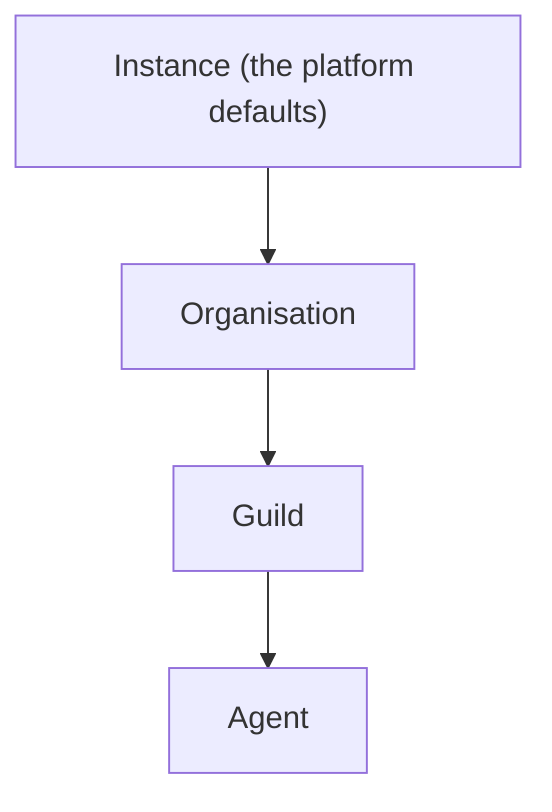

# Access

Access decides what each agent may use. It answers four questions:
which tools the agent is offered, which login a connector's tools act
as, which [secrets](secrets.md) reach the agent's commands, and which
[notes](notes.md) and [collections](collections.md) the agent may read
or write.

Every grant is set at a scope. There are four scopes, nested like
boxes: the instance, an [organisation](organisations.md), a
[guild](guilds.md), and an [agent](agents.md). A guild sits inside one
organisation and an agent inside one guild. What is set at a wide
scope reaches everything inside it, and a narrower scope can change
it for itself. The tools themselves are listed in the
[Catalog](../tools-and-connectors/catalog.md).

## Why it exists

An organisation sets things once for every agent: which connectors
are on, which login they use, which default tools exist. A guild then
adjusts that for its own agents, and one agent can be held back or
given something extra. Nobody has to repeat a setting for each agent,
and narrowing one agent never touches the others.

## How it works

### Scopes and inheritance



The instance is the whole box. It holds the platform defaults: the
native tools that start on, and the logins that the instance's own
platform keys provide. An operator does not change the instance scope
from an access view.

To decide whether something is on for an agent, the orchestrator
walks the chain from the top: instance, then organisation, then the
agent's guild, then the agent. Each scope that has its own setting
replaces the value it inherited. A scope with no setting leaves it as
it is. When no scope says anything, the item is off.

That one walk covers every pattern an operator needs:

- **Enable downward**: switch a tool on at the organisation, and every
  guild and agent gets it.
- **Opt out**: switch it off at one guild or one agent.
- **Enable extra**: switch on, for one guild or agent, a tool the
  organisation left off.
- **Re-enable**: switch it back on below a scope that turned it off.
- **Override the login**: sign in to a connector at a narrower scope,
  so that scope's agents act as a different account.

### The kinds of grant

| What | How it is granted | Scopes | Details |
| --- | --- | --- | --- |
| Native tools | A switch per tool, inherited down the chain | instance, organisation, guild, agent | [Catalog](../tools-and-connectors/catalog.md), [Native tools](../tools-and-connectors/native.md) |
| Connectors and their tools | A switch per connector and per listed tool, inherited down the chain | instance, organisation, guild, agent | [Connectors](../tools-and-connectors/connectors.md) |
| Logins (connections) | Owned at one scope, usable at that scope and below | instance, organisation, guild, agent | [below](#logins) |
| Note reach | Four switches: read and write guild notes, read and write organisation notes, inherited down the chain | instance, organisation, guild, agent | [Notes](notes.md) |
| Collections | A mode per guild and per agent: read, write, or (for an agent) none | guild, agent | [Collections](collections.md) |
| Secrets | Organisation-wide, or granted to guilds and agents; grants add up | organisation, guild, agent | [Secrets](secrets.md) |

The switches for tools, connectors, and note reach are all
**bindings**: one row per scope that says on or off. A binding is the
grant. Collections and secrets have grants of their own, with no
inheritance switch:

- A collection grant gives a guild a base mode, and an agent's own
  grant overrides its guild's.
- A secret reaches exactly the agents its access names. There is no
  way to switch it off for one agent inside a granted guild.

### Bindings for tools

A native tool, such as `note_write` or `group_post`, has one switch.
A connector has a switch for the whole server, and each tool the
connector lists has a switch of its own. A listed tool follows its
server until a scope sets the tool itself. A server that is off keeps
every one of its tools off.

Out of the box, the instance switches on the note tools, the record
tools, `memory_write`, the script tools, the routine tools, the two
secret tools, and `group_post`. New agents inherit that set. An
organisation, a guild, or an agent can turn any of them off.

Some tools have no switch:

- `report_issue` is always offered.
- The browser tools follow the agent's **browser** capability
  ([Browser](browser.md)).
- The code tools follow the agent's **coding** capability
  ([Coding agents](coding/index.md)).

The script tools and `memory_write` have switches, but they are also
dropped when the agent's **scripting** or **memory** capability is
off, whatever the switches say ([Scripts](scripts.md),
[Memory](memory.md)).

### Logins

A login, also called a connection, is one signed-in account on one
connector: a Notion workspace, a Gmail account, an API key for a
data service. It is owned by one scope, and it can be used at that
scope and below:

- an instance login anywhere
- an organisation login at that organisation and its guilds and
  agents
- a guild login at that guild and its agents
- an agent login only at that agent

When an agent's chain reaches a scope that has its own login on a
connector, that login replaces the inherited one. Signing in at a
guild therefore makes that guild's agents act as the guild's account,
while the rest of the organisation keeps the organisation's.

The credentials of a login stay in the orchestrator. An agent never
holds them: it calls the connector's tools, and the orchestrator
makes the call with the login. A login shared from a guild or an
organisation is shared agency: every agent that inherits it acts as
that one account.

A login can carry settings, such as the one folder a Drive login
reads or the repositories a GitHub login picks. They live on the
login and show on its card in the **Tools** view.

## In the app

### The access view

One access view shows at every scope, the same screen over a
different subject:

- the organisation's under **Settings**, on **Tools** and **Secrets**
- a guild's on its **Tools** and **Secrets** pages
- an agent's on its **Tools** and **Secrets** tabs

Each view shows what the scope inherits from the scopes above it.

### Tools

The organisation's **Tools** has three sub-tabs:

- **Integrations**: each catalog server with its brand mark when
  there is one, its login, a switch for the server, and its listed
  tools behind a toggle with **All**, **Active**, and **Disabled**
  counts. GitHub shows its connected account without a switch, and
  the repositories that login's coding agents clone, at organisation,
  guild, or agent.
- **Native tools**: grouped by family (notes, collections under **Tables**, memory,
  scripts, routines, group chat, secrets, browser, coding, issues,
  and any others), each family collapsible. `secret_store` and
  `secret_request` are grouped as **Secrets**.
- **Artifact scope**: the four note-reach switches.

A guild's and an agent's **Tools** have **Integrations** and
**Native tools**. Their artifact scope is on each **State** tab.

Each switchable item is an on/off switch captioned with where its
state comes from: inherited from a wider scope, or set at this one.
A switch writes this scope's own binding. When removing this scope's
binding already gives the wanted state, the switch removes it
instead. A row that carries this scope's own setting, a native tool
or a note-reach switch, offers a reset that removes it, so the value
is inherited again. A server card offers **Reset to inherit** for its
tools set at this scope.

Browser and coding tools follow the agent's capabilities and have no
switch. The coding tools listed are `code_task`, `shell`,
`shell_status`, `file_read`, and `code_search`. `report_issue` is
always offered.

A server shows **Connect** at the current scope, or **Use own login**
when it already uses an inherited one. It shows **Disconnect** when
this scope owns the login. Disconnecting also removes the bindings
that use the login, and the tools go back to a login inherited from a
wider scope, if there is one.

Key-based servers ask for the inputs their connector declares in a
dialog: X labels its key a bearer token, and Qonto asks for a login
and a secret key. A connector with settings adds its settings form
below, its searchable fields searched with the keys typed so far.

Notion, Gmail, Sentry, and Drive open a browser sign-in. A login that
still needs its settings, such as Drive's one folder, reads signed
in, and its card shows the settings form with **Save and connect**.

A login's settings show on its card from the connector's schema, with
a search box on each looked-up property. They are editable on the
scope's own login and read-only when inherited.

An organisation's owners and admins add a remote MCP server of its
own under **Settings › Tools** with **Add a remote server**: a slug, a
URL, how it signs in, and an optional name and description. Its card
reads **This organisation's** and has **Remove server**, which asks
before it removes the server with every login to it.

A connector the box cannot sign in to is marked **Not set up**, with
the fields its integration lacks, and its **Connect** is disabled. A
platform admin gets **Set up**, a link to **Admin**, **Platform keys**
with that integration preselected and a way back. A native tool that
waits for a platform key has no switch and says it is offered once a
platform admin sets up its integration there.

Local adapters group their tools under one server like any other
connector.

### Secrets

The **Secrets** side lists the secrets that reach the scope, with who
gets each, and adds, edits, deletes, and changes access to them as the
viewer's role allows. It has no switches. It is described in
[Secrets](secrets.md#in-the-app).

### Collections

A guild's and an agent's collection grants are set on their
**State › Databases** tab ([Collections](collections.md)).

## Rules and limits

| Rule | Behaviour |
| --- | --- |
| Inheritance order | Instance, organisation, guild, agent; the narrowest setting wins |
| Nothing set anywhere | Off |
| Instance defaults | Seeded by the box; no access view changes them |
| A connector's tools | Follow the server until set one by one; server off keeps them all off |
| Logins | One per connector per owner; usable at the owner's scope and below |
| Note reach defaults | Read and write guild notes on, read organisation notes on, write organisation notes off |
| Secrets | Grants add up; no per-agent off switch |
| Collections | An agent's own grant overrides its guild's; none refuses |
| Never a switch | `report_issue`, the browser tools, the code tools |

### What an operator relies on

- A secret reaches every agent its access names.
- An alias copies a secret's value under a second variable name for
  the agents the secret already reaches. It grants nothing.
- While such an agent's command runs, any process on its machine can
  read the secret and send it out.
- Agents on one machine trust each other. Grant narrowly
  ([SEC-24](../architecture/security-register.md#sec-24--agents-on-one-machine-can-read-each-others-homes-tokens-and-sessions)).
- An agent whose secrets must stay apart goes on a machine of its
  own ([Machines](machines.md)).
- Members read a secret's name, description, and access, never its
  value. A value leaves the orchestrator only into the commands of
  the agents it reaches.
- Connection credentials never enter a sandbox: an agent calls a
  connected account through the orchestrator, and only for tools that
  are On. A guild-shared connection is shared agency: every inheriting
  agent acts as that account.
- Redaction catches exact values only. What the model has already seen
  stays in its history.
- The CLI tab is a root shell in the agent's machine's container.
  Any operator of the agent can open it.
- The CLI tab reaches the files and processes of every agent on that
  machine.
- The CLI tab carries no secret values. It can read those of a
  command running on the machine.
- An agent writes a secret only through `secret_store`, granted to
  itself, and cannot read one back.

The assumptions these rest on are in [System](../architecture/system.md).

## Reference

### Three objects

Access is built on three objects:

- **Catalog**: what exists ([Catalog](#catalog)).
- **Connections**: the logins ([Connections](#connections)).
- **Bindings**: which scope offers which catalog item. Bindings are
  the grant ([Bindings](#bindings)).

An agent's configuration does not hold its native tools or its
environment. Tools come from bindings and the environment from
secret grants ([Secrets](secrets.md)). The browser, code, script
(when `scripting` is off), and memory (when `memory` is off) tools
follow their capability flags, not only bindings.

### Bindings

A binding is one `bindings` row:

| Column | Holds |
| --- | --- |
| `id` | The binding id |
| `catalog_kind` | `native_tool`, `mcp`, `mcp_tool`, or `artifact_grant` |
| `catalog_id` | A native tool's name, a server id, a namespaced tool `{slug}_{name}`, or a grant id |
| `scope` | `platform`, `org`, `guild`, or `agent` |
| `scope_id` | The organisation, guild, or agent id; null at `platform` |
| `enabled` | On or off |
| `connection_id` | The login an `mcp` binding uses, or null |
| `created_at`, `updated_at` | Times |

An `mcp` binding may carry a `connection_id`. Native-tool, `mcp_tool`,
and `artifact_grant` bindings never do. A listed MCP tool inherits
the server grant until a tool overlay replaces `enabled`. Server Off
keeps every tool from that server Off. A listed tool with no binding
at any scope follows its server.

Resolution walks `platform`, then the organisation, then the agent's
guild, then the agent. Each present row replaces `enabled` and, when
it carries a connection, the current connection. An absent row leaves
the current state. The empty chain is disabled. That walk covers
enable-downward, opt-out, enable-extra, override-login, and
re-enable.

A connection may be bound where it is visible, which follows its
owner:

- a platform connection may be bound anywhere
- an organisation one at that organisation or its guilds and agents
- a guild one at that guild or its members
- an agent one only at that agent

Platform seed bindings, written at boot when the platform row is
absent, enable:

- the note tools (`note_find`, `note_get`, `note_write`,
  `note_delete`)
- the record tools (`record_search`, `record_list`, `record_add`,
  `record_update`, `record_remove`)
- `memory_write`
- the five script tools
- the six schedule tools
- `secret_store`
- `secret_request`
- `group_post`

and set the four artifact grants: `read_guild`, `read_org`, and
`write_guild` on, `write_org` off. A grant with no row at any scope
reads the same default.

New agents inherit that set. An organisation, guild, or agent can
turn any of them Off.

The artifact grants govern notes only. `guild` always means the
agent's own guild ([Notes](notes.md)). Collection reach is the
separate `collection_access` grant ([Collections](collections.md)).

`report_issue` and the eight browser tools are never bindings; a
binding on one is 422 `NAME is not a binding`. The code tools are not
in the native registry's bindable set either. Deleting a connection,
agent, or guild cascades the bindings that point at it. Deleting an
organisation's own MCP server removes the bindings that name it.

```text
PUT    /api/bindings     { catalog_kind, catalog_id, scope, scope_id, enabled, connection_id? }
DELETE /api/bindings     ?catalog_kind=&catalog_id=&scope=&scope_id=
```

- `PUT` writes the scope's row, replacing an existing one. Without a
  `connection_id` key, an `mcp` row keeps the connection it had.
  `catalog_kind=mcp` needs a server row as `catalog_id`, and
  `catalog_kind=mcp_tool` a namespaced tool `{slug}_{name}` listed on
  a connection.
- `DELETE` removes the scope's row and is 204, or 404 when there is
  none.
- Any other `catalog_kind`, an unknown native tool or grant, a bad
  scope, a missing `scope_id`, a connection for another server, or a
  connection not visible at the scope is 422.
- `scope=platform` is 400: platform bindings are not changed here.
- The caller must be a member of the organisation, and see the guild
  for a guild or agent scope; otherwise 404. An unknown or another
  organisation's server or connection is 404.

### Access views

```text
GET /api/access                     the current organisation
GET /api/guilds/:guild_id/access    one guild
GET /api/agents/:agent_id/access    one agent
```

Each returns `{ tools, grants, mcp }`:

- `tools`: every bindable native tool
- `grants`: the four artifact grants
- `mcp`: each connector with its connection, its listed tools, and
  their resolved state

Every entry carries its effective value, the scope it comes from
(`source_scope`), and this scope's own setting (`overlay`).
`GET /api/secrets?guild_id=` and `?agent_id=` are the Secrets side
([Secrets](secrets.md#http)). `PUT` and `DELETE /api/bindings` write
a switch at one scope.

Every connector's access entry carries `oauth_setup_state`:

- `not_applicable`
- `dynamic`
- `configured`
- `unsupported` when the box holds no OAuth client or App for it

The Tools view marks an unsupported connector **Not set up**. It
names the fields its integration lacks, disables Connect, and offers
a platform admin **Set up**, a link to **Admin**, **Platform keys**
with that integration preselected
([Integrations](../tools-and-connectors/catalog.md#integrations)).

### Catalog

Native tools are the TypeScript registry. MCP servers are platform
catalog rows: transport, connect config, `auth` of `none`, `token`,
or `oauth`, plus operator-facing copy (`description`, `limitations`,
`setup_hint`).

Every connector is a folder under
`apps/orchestrator/src/connectors/<slug>/`: `connector.json` (the
manifest: everything that is not code), `adapter.ts` when the
connector has code, the client code it needs, and an optional
`logo.svg` (24×24, `currentColor`). `src/connectors/index.ts` lists
core's folders; an edition adds its own through
`ServerExtension.connectors`
([Extension points](../architecture/extension-points.md)).

Installed connectors are rows of one table, `connectors`: the
manifest as a JSON document beside the box's state for it.

| Column | Holds |
| --- | --- |
| `id`, `slug`, `tool_prefix` | The server id, its slug, and the prefix of its tool names, unique on the box |
| `owner_org_id` | Null for a platform connector |
| `manifest` | The manifest, as its folder or the Admin form wrote it |
| `source`, `verified`, `publisher`, `version` | Where it came from: `core` (a folder in the image), `registry`, or `local` (made on this box) |
| `enabled` | The connector's switch; on at install |
| `oauth_client` | The client a `dynamic` OAuth connector registered |
| `overrides` | The instance admin's edits, applied on read |

Boot projects every installed folder into its row, replacing the
manifest and where it came from whole, so a manifest fix reaches the
row with or without a version bump; the switch, the OAuth client, and
the overrides stay. One loader (`connectors/load.ts`) applies
`overrides` to the manifest for every reader. A server the instance
admin adds by hand is a `local` row with no folder: its row is its
source of truth.

A connector has an endpoint, an adapter, or both:

- **Endpoint only**: Notion, Sentry, Cigale, and Etherscan. The pool's
  MCP client lists and calls the remote server.
- **Adapter only**: CoinGecko, Alchemy, X, TwitterAPI.io, Qonto,
  DexPaprika, Tavily, and Gmail call their APIs from adapter code.
  GitHub has neither tools nor endpoint
  ([GitHub](../tools-and-connectors/github.md)).
- **Both**: Drive and OpenSea. The adapter wraps the endpoint's
  session ([Adapters](../tools-and-connectors/connectors.md#adapters)).

The manifest's keys:

| Key | Meaning |
| --- | --- |
| `slug` | Equals the folder name; the server id is `mcp_<slug>` |
| `display_name`, `description`, `limitations`, `setup_hint` | Operator copy |
| `endpoint.url` | The remote MCP server, public HTTPS |
| `auth.kind` | `token`, `oauth`, or `none` |
| `auth.fields` | A token login's inputs `{ name, label, secret, optional, multiline, placeholder }` (`multiline` is a text area); omitted means one field named `token` |
| `auth.header` | The header an endpoint's token travels in; default a bearer `Authorization` header |
| `auth.oauth` | `{ strategy, provider, scopes }`: `dynamic`; `configured` with a `provider` (the client that shipped integration holds); `configured` with none (a client of the connector's own, `connector:<slug>` under Platform keys, which needs an `endpoint` to discover its authorization server); or `github_app` |
| `auth.instance` | `{ integration, field }`: that field of a shipped integration serves the connector's platform login while the integration is on, for a connector the box ships. `{ own: true }`: a token connector's own platform key, `connector:<slug>`, whose fields are its login fields ([Instance keys](../tools-and-connectors/connectors.md#instance-keys)) |
| `requires.integration` | The instance integration the connector needs |
| `tools[]` | `{ name, description, input_schema, mutating }`, the curated list |
| `policy.default_off` | Name patterns (`*` matches any run) that start Off |
| `state` | `{ key, intro }`: the State key the adapter's `state` hook fills |
| `builder` | `{ searchable, role, guidance }` for the builder |
| `prompt.guidance` | A paragraph the agent prompt adds when one of the connector's tools is offered |

TypeBox validates each manifest at load, and the slug against its
folder. A connector that lists tools with no endpoint must have an
adapter `call`, and a `state` key comes with a `state` hook.

A server's tools are its manifest's (Cigale, CoinGecko, Alchemy, X,
TwitterAPI.io, Qonto, DexPaprika, Tavily, Gmail) and, for an
organisation, the tools its connected logins have listed (Notion,
Drive, Sentry, OpenSea, and Etherscan list theirs from a session).
GitHub has none. The builder names an enabled server's manifest tools
always, and its listed tools once the organisation has a connected
login on it; another organisation's listings never reach it.
Capability search runs in memory over those.

A new login's tool starts Off at its owner when the admin set it Off,
or, with no admin default, when the manifest marks it `mutating` or a
`policy.default_off` pattern matches it. A tool the manifest does not
name, listed from a session, also starts Off when its listing marks
it `destructiveHint` or its name carries a writing verb
(`src/mcp/verbs.ts`: create, update, delete, send, and the like); it
starts On otherwise. An absent hint decides nothing and
`readOnlyHint` never turns a tool On. Each listed tool keeps its
`readOnlyHint` and `destructiveHint` in `mcp_tools`, null when the
listing gave none
([SEC-16](../architecture/security-register.md#sec-16--a-listed-tool-whose-name-reads-as-harmless-now-starts-on)).

`GET /api/mcp/servers` lists the installed servers, each with
`enabled` and the connector's `auth_fields`, `source` (`core` for a
folder in the image), `verified`, `publisher`, and `logo_url`
(`GET /api/mcp/servers/{id}/logo`, the folder's `logo.svg` served
with a `default-src 'none'` policy). The instance admin edits the
catalog under **Admin → Connector catalog**
(`/api/admin/mcp/servers`), where a connector whose integration is
not on is marked **Not set up** with a **Set up** link to Platform
keys, opened on that integration:

- `PATCH /api/admin/mcp/servers/{id}` switches a connector on or off;
  on a `local` row it edits the fields, on any other it writes
  `display_name`, `description`, `limitations`, and `setup_hint` into
  `overrides`, where `null` clears one. The endpoint, auth, and slug
  of a connector the box did not write come from its manifest.
- `PATCH /api/admin/mcp/servers/{id}/tools/{name}` writes one tool's
  `description`, `input_schema`, and `default` (On or Off for a new
  login) into `overrides.tools[name]`; a listed tool takes the
  description and schema edits at its next listing.
- `GET /api/admin/mcp/servers/{id}/export` returns the connector in
  the folder's `connector.json` format, overrides applied.
- `POST /api/admin/mcp/servers` adds a remote MCP server by hand: a
  `local` row on public HTTPS, `auth` `none`, `token`, or `oauth`
  (`dynamic` or `configured`), its tool prefix generated from the
  slug.

A disabled connector is out of the builder and refuses Connect; its
existing logins keep showing.

An organisation adds remote MCP servers of its own. Its owners and
admins do it under **Settings → Tools**:

- `POST /api/orgs/{org}/mcp/servers` with a slug, a URL on public
  HTTPS, an optional display name and description, and `auth` `none`,
  `token`, or `oauth` (a dynamically registered client; `configured`
  needs an instance client and stays the platform's). The row is
  `local` with `owner_org_id` set, on at creation, its tool prefix
  generated from the slug against every prefix on the box, since tool
  bindings and recipe overlays name a tool by its prefixed name alone.
  `OrgLimits.maxMcpServers` caps how many an organisation adds; core's
  open policy sets none.
- `PATCH` and `DELETE /api/orgs/{org}/mcp/servers/{id}` edit it or
  remove it with its logins and the bindings that name it.

A slug is unique per owner: two organisations may each add a server
under one slug, but an organisation's slug may not be a platform
connector's, nor a platform server's an organisation's; the refusal
names the other side. An organisation's server is visible to it
alone: `GET /api/mcp/servers`, the access views, the builder, and
recipe apply read the platform's servers and the caller's own, and
another organisation's id is a 404 at Connect, at a binding, and at
its routes. Its card reads **This organisation's**. Connect fills a
blank display name (the slug) and description from the server's
`initialize` reply (`serverInfo` and `instructions`), and an OAuth
start answers `authorization_host`, which the sign-in dialog names
before the operator goes.

Every request a session sends to an endpoint first resolves its host
and refuses a private, loopback, link-local, or metadata address,
beside the save-time URL check, so a public name later pointed inward
is caught
([SEC-17](../architecture/security-register.md#sec-17--an-organisations-own-mcp-server-makes-the-orchestrator-call-a-url-it-chose)).

### Connections

A connection is one login for one catalog server (a remote MCP server
or a local adapter), owned at a scope, with `account_hint` for
display and `status` of `pending`, `connected`, or `disconnected`.

Token and OAuth payloads stay in the orchestrator, encrypted. One
connection per server per owner. Connect creates a pending connection
at that scope, or retries a pending or disconnected one. It is a 409
while a connected login exists.

A token Connect goes through one operation, `connect`
(`src/connectors/connect.ts`): it reads the inputs the manifest's
`auth.fields` names (a missing required one is a 422 naming it), runs
the connector's `validate`, stores the credentials encrypted under
those names with the hint `validate` returns, and lists the login's
tools. A rejected key is a 422 and stores nothing. Its `on_existing`
says what happens to a connected login: `refuse` (the 409), `keep`,
`replace`, or `{ replace_when_hint }`, which replaces only a login
with that account hint; credentials equal to the stored ones answer
`current`. The connect route uses `refuse`.

Token connect marks it `connected` and writes the enabled binding in
the same request:

- Cigale
- CoinGecko
- Alchemy
- OpenSea
- Etherscan
- X
- TwitterAPI.io
- Qonto
- DexPaprika

Browser OAuth (Notion, Gmail, Drive, Sentry) and the GitHub App
install leave the connection pending and write the enabled binding on
a successful callback
([Connectors](../tools-and-connectors/connectors.md),
[Gmail and Drive](../tools-and-connectors/google.md),
[GitHub](../tools-and-connectors/github.md)).

List and get return metadata only. Delete cascades bindings that
point at it.

A login's settings (the folder a Drive login reads, the repositories a
GitHub login picks) live on that connection, not in the agent's
configuration.

An organisation login to a connector whose manifest sets
`builder.searchable` (Notion) is searchable from the guild builder, so
the coach can suggest existing databases. A connector with
`builder.role` `system_of_record` stays the home for long-lived
operator records. Queues and working files stay in local notes or
collections.
