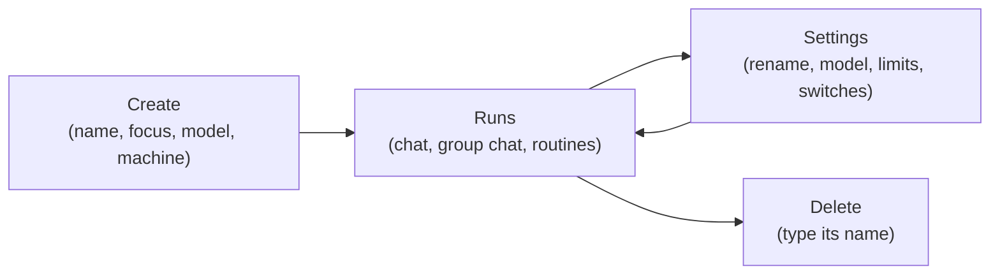

# Agents

An agent is one worker in a [guild](guilds.md). It has a name, a
short focus that says what it is for, a model it thinks with, and a
few switches that decide what it can do. It works in
[runs](runs.md): a chat with an operator, a wake-up from the
[group chat](group-chat.md), or a [routine](routines.md).

Every agent belongs to exactly one guild for its whole life, and sits
on one of the organisation's [machines](machines.md). What it is told
to do lives in its [Task](task.md). What it remembers between runs
lives in its [Memory](memory.md). The tools and secrets it may use
come from [access](access.md), not from the agent itself.

## When you use it

You add an agent when the guild needs a new role: a researcher, a
writer, a reviewer, a coder. You change an agent when it should think
with another model, take longer runs, or gain a capability such as
its own browser.

There are two kinds of agent:

- an **agent** talks, researches, and works with tools and connectors
  on one of the organisation's models;
- a **coding agent** also leads code work in the guild's
  repositories, delegated to a coding harness. See
  [Coding agents](coding/index.md).

## How it works

### Identity

- **Name**: lowercase letters, digits, and hyphens, starting with a
  letter. A name is unique across the whole instance. `user` is
  reserved: it is the tag that reaches every operator. The name can
  change later.
- **Focus**: one short line on what the agent is for, up to 150
  characters. Every member of the guild sees the others' focus in its
  system prompt, so the agents know each other's role. A new agent's
  Task starts from its focus.
- **Wake triggers**: an optional text, up to 500 characters, that
  completes "Wake me when…". It describes the untagged group-chat
  messages the agent should answer. The field shows the focus while
  it is empty. The operator writes it, and recipes carry it. Nothing reads it at run time: it is not in the
  system prompt, and the group-chat router does not weigh it
  ([Group chat](group-chat.md#who-wakes-up)).
- **Avatar**: a mascot and an identity colour. They only change how
  the agent looks in the app. The agent never sees them.

### Model

The agent thinks with one model, written as `provider/model`. The
provider must be connected for the organisation under **Settings**,
**Model keys** ([Model keys](model-keys.md)). No model is assumed: a
new agent starts on the organisation's default model when it has
one, otherwise the operator picks one.

Next to the model sit three options:

- **Thinking level**: none, low, medium, or high. It is greyed out for
  a model that does not think.
- **Temperature**: sent with every request, unless the model does not
  take one.
- **Attachments**: whether the operator can send images in the Chat
  tab. This follows the model; it is not a setting.

Each run freezes the model it starts with. Changing the model affects
new runs only.

### Run limits

Run limits stop a run that goes on too long:

| Limit | What it bounds | Default |
| --- | --- | --- |
| Max output tokens | the length of one model reply | 8192 |
| Max steps | model calls in one generation | 30 |
| Max tool calls | tool calls in one run | 50 |
| Max input tokens | the size of the prompt sent to the model | 100000 |
| Keep tool results | how many user turns keep full tool output in the prompt; older large results are stubbed | 1 |

A coding agent starts at 200 steps and 200 tool calls. What happens
at each limit is on [Runs](runs.md).

### Capabilities

Four switches turn whole areas of the product on or off for one
agent. They are not tool bindings: when a switch is off, its tools are
not offered, whatever the bindings say.

| Switch | Gives the agent | Default | Page |
| --- | --- | --- | --- |
| Browser | its own Chrome on its machine, and the browser tools | off | [Browser](browser.md) |
| Coding | the code tools and a coding harness; makes it a coding agent | off | [Coding agents](coding/index.md) |
| Scripting | reusable Python scripts and the script tools | on | [Scripts](scripts.md) |
| Memory | a Memory that it reads and rewrites after each run | on | [Memory](memory.md) |

Browser and Coding need a large enough machine. A coding agent stays
one: Coding cannot be switched off once saved.

Every agent also has a terminal on its machine, the **CLI** tab. It is
not a capability and no switch turns it off
([Agent home](agent-home.md)).

### Life of an agent

- **Create.** The agent gets its Task (from its focus, or a default
  text) and an empty Memory. It joins the group chat at the current
  message: it does not replay older chat.
- **Rename.** The name can change while the agent is idle. Its stored
  records keep the same id, so nothing breaks.
- **Delete.** The agent, its runs, its routines, and its own files go.
  Its posts in the group chat stay, under the name it had.

## In the app

### Sidebar

Each guild folds open to its agents and an **Add agent** row. The row
is disabled once the guild is full. Each agent row shows:

- its avatar;
- a live state dot: signal green while it runs, a quiet dot when idle;
- a code marker on a coding agent;
- a marker for browser access;
- a marker naming the notes or collections its Task embeds that the
  agent cannot reach ([Task](task.md#an-embed-the-agent-cannot-reach)).

### Create an agent

**Add agent** opens **Create an agent** on two cards, one per kind:

- **Agent**: "Talks, researches, and works with tools and connectors
  on one of the organisation's models."
- **Coding agent**: "Leads code work in the guild's repositories,
  delegated to a coding harness (Claude Code, Codex, Cursor, or
  Antigravity) on your own subscription." This card opens its own
  dialog, described on [Coding agents](coding/index.md).

**Agent** opens three steps on a stepper. The header reads
"Step n of 3 · `<step>`". **Back** and **Next** move between steps, and
**Cancel** is always there. Each step must be complete before
**Next**.

1. **Identity**: the name (it can change later in Settings), an
   optional focus, and an avatar picker: a mascot set, a random
   variant, and one of six identity colours.
2. **Model**: the model, from the organisation's chosen models grouped
   by provider, preselected with its default when it has one. With no
   provider connected, the step shows a guide to **Model keys** in its
   place. Then the thinking level and the temperature, each switched
   off only for a model that does not take it. Then **Agent
   capabilities**, three buttons: Browser, scripting, and Memory.
   Scripting and Memory start on; Browser starts off. The browser
   language shows while Browser is on. **Run limits** sit folded under
   a disclosure: the five run limits and **Max scripts**.
3. **Machine**: which machine the agent goes on, and **Disk** under
   it. With one machine the step names it in place of the picker. See
   [Machines](machines.md) and [Agent home](agent-home.md).

This dialog has no Coding button, because a coding agent is the other
card. An existing agent's Settings has one.

**Create agent** creates the agent. It opens on its **Prompt** tab.

### Agent inspector

Selecting an agent opens its inspector, a sheet over the guild's
group chat. The expand control fills the window instead; the choice
is remembered.

The header shows the avatar, the name, whether the agent is running,
and its focus. Two warnings can sit there:

- a coding agent that is not ready shows a warning icon
  ([Coding agents](coding/index.md));
- when the Task embeds notes or collections the agent cannot reach,
  an unlink button names them and opens the Prompt tab
  ([Task](task.md#an-embed-the-agent-cannot-reach)).

A **Browser login needed** strip can show after a recipe apply
([Browser](browser.md)).

The menu deletes the agent after the operator types its name.

The tabs, one route each, with an icon each. The tab strip scrolls
sideways when they do not fit.

| Tab | What it holds | Explained in |
| --- | --- | --- |
| **Chat** | sessions with the agent, their transcripts, and **History** | [Runs](runs.md), [Run transcript](run-transcript.md) |
| **Prompt** | the standing Task | [Task](task.md) |
| **State** | Memory, Notes, Tables, Access, Scripts (with scripting on) | [Memory](memory.md), [Notes](notes.md), [Collections](collections.md#what-a-guild-or-an-agent-reaches), [Access](access.md#what-a-guild-or-an-agent-reaches), [Scripts](scripts.md) |
| **Routine** | the agent's routines | [Routines](routines.md) |
| **Browser** | the agent's live Chrome, only with Browser on | [Browser](browser.md) |
| **CLI** | a terminal on the agent's machine | [Agent home](agent-home.md) |
| **Tools**, **Secrets** | the agent-scope access view | [Access](access.md) |
| **Usage** | tokens, cost, calls, and disk | [Usage](usage.md) |
| **Settings** | everything on this page | below |

### Settings tab

Settings shows the create dialog's steps as sections on a stepper.
They open in any order. Clicking a step opens its section, and the URL
keeps it as `?section=` (`identity`, `model`, `machine`, `harness`,
or `repositories`), so a link can open Settings on one section.
Without one, Settings opens on Identity. A section the agent's kind
lacks opens where its content lives: `harness` or `repositories`
opens Model on an agent without Coding.

An agent has **Identity**, **Model**, and **Machine**. A coding agent
has **Identity**, **Machine**, **Harness**, **Lead model**, and
**Repositories**. The sections follow the form's Coding button, so
turning Coding on changes them before the save. A step whose fields
have an error, or that holds a coding-readiness problem to fix,
carries a warning in place of its number. One **Save** and one **Discard** at
the bottom cover every section. Enter in a field saves.

- **Identity**: the name, the focus, the avatar picker, and **Wake me
  when** under **Group chat**, which shows the focus while it is
  empty.
- **Model** (**Lead model** on a coding agent): the model, thinking,
  and temperature. **Agent capabilities** has four buttons: Browser,
  Coding, scripting, and Memory. **Run limits** sits under a
  disclosure, with the five run limits and **Max scripts**. Browser
  and Coding are greyed out while off on a machine below the minimum
  they need, with a line naming both sizes. Coding is greyed out on a
  saved coding agent, which stays one. The browser language shows
  while Browser is on.
- Turning **Coding** on before the first save turns scripting on, and
  moves max steps and max tool calls from 30 and 50 to 200 each when
  they are still at their defaults. Turning it off again moves them
  back, clears the harness, and swaps a Kimi Code model for the
  organisation's default.
- **Machine**: the machine picker and **Disk**
  ([Machines](machines.md), [Agent home](agent-home.md)).
- **Harness** and **Repositories**, on a coding agent:
  [Harnesses](coding/harnesses.md) and
  [Repositories](coding/repositories.md).

## Rules and limits

| Rule | Value or behaviour |
| --- | --- |
| Name | `a`–`z`, `0`–`9`, `-`; starts with a letter; at most 63 characters |
| Name uniqueness | unique across the instance; never `user`; never the name of an operator of the guild |
| Focus | at most 150 characters |
| Wake triggers | at most 500 characters |
| Secret aliases | at most 32 |
| Coding agent | needs a harness |
| Agents per guild | the guild's `max_agents` ([Guilds](guilds.md)) |
| Model | its provider must be connected for the organisation |
| Kimi Code models | only on a coding agent |
| Coding | cannot be switched off on a coding agent |
| Rename | refused while the agent generates, or while its guild is being deleted |
| Delete | refused while the agent generates |
| Configuration change | affects new runs only |

## Reference

### Configuration keys

Agent configuration is a JSON object of nineteen keys. A missing key
takes its default, then the check runs. `model` has no default, so a
configuration without it is 422 `missing keys: model`. Unknown keys
are rejected. The tier, CPU, and memory belong to the machine, not to
the agent.

| Key | Type | Default | Explained in |
| --- | --- | --- | --- |
| `model` | `provider/model` | none, must be chosen | [Model](#model-id-and-options) |
| `temperature` | number | `1` | [Model](#model-id-and-options) |
| `thinking_level` | `none`, `low`, `medium`, `high` | `none` | [Model](#model-id-and-options) |
| `max_tokens` | positive integer | `8192` | [Runs](runs.md) |
| `max_steps` | positive integer | `30` (`200` for a new coding agent) | [Runs](runs.md#generation) |
| `max_tool_calls` | positive integer | `50` (`200` for a new coding agent) | [Runs](runs.md#generation) |
| `max_input_tokens` | positive integer | `100000` | [Runs](runs.md#generation) |
| `keep_tool_result_generations` | positive integer | `1` | [Runs](runs.md#tool-result-stubbing) |
| `max_scripts` | positive integer | `10` | [Scripts](scripts.md) |
| `max_workspace_mib` | positive integer | `10240` | [Agent home](agent-home.md) |
| `browser` | boolean | `false` | [Browser](browser.md) |
| `browser_language` | Chrome language tag | `en-US` | [Browser](browser.md) |
| `coding` | boolean | `false` | [Coding agents](coding/index.md) |
| `harness` | `claude-code`, `codex`, `cursor`, `antigravity`, or null | `null` | [Harnesses](coding/harnesses.md) |
| `harness_model` | model name of at most 120 characters, or null; needs a harness | `null` | [Harnesses](coding/harnesses.md) |
| `harness_effort` | effort or null; needs a harness | `null` | [Harnesses](coding/harnesses.md#model-and-effort) |
| `secret_aliases` | map of variable name to secret name, at most 32 entries | `{}` | [Secrets](secrets.md#aliases) |
| `scripting` | boolean | `true` | [Scripts](scripts.md) |
| `memory` | boolean | `true` | [Memory](memory.md) |

An agent created with `coding` on and no `max_steps` or
`max_tool_calls` starts with 200 of each instead of the defaults. An
agent with `coding` on and no `harness` is 422 `coding agents need a
harness: claude-code, codex, cursor, antigravity`.

Validation errors are 422 with the message, for example
`name must match ^[a-z][a-z0-9-]{0,62}$`, `max_steps must be a
positive integer`, `missing keys: …`, or `unknown keys: …`.

Native tools come from bindings (instance → organisation → guild →
agent) and sandbox environment values from secret grants, not from
this JSON ([Access](access.md), [Secrets](secrets.md)). A login's settings, such as the folder a Drive
login reads or the repositories a GitHub login picks, live on that
login in Tools. The browser, code, script (when `scripting` is off),
and memory (when `memory` is off) tools follow their flags, not only
the bindings.

Turning `browser` off, or changing `browser_language` while it is on,
stops this agent's Chrome. Other agents on the machine keep theirs. No
configuration change replaces the machine's container
([Machines](machines.md)).

### Model id and options

`model` is `{provider}/{model}`: a provider core speaks to (`openai`,
`anthropic`, `openrouter`, `xai`, `deepinfra`, `local`, or `kimi`) and the id that
provider knows the model by. On save and on run the provider must be
connected for the organisation (422 `connect a <provider> key on
Model keys` otherwise). Whether the catalog lists the id, or the
organisation chose it, is not checked: a catalog change or an
unticked model never breaks an existing agent.

The picker lists the organisation's chosen models, grouped by
provider, from `GET /api/orgs/:id/models`
([Model keys](model-keys.md)). Each model carries what it takes
(`thinking`, `temperature`, `attachments`), its `context` window, and
its `price` per million tokens, as the catalog says. A stored model
the organisation no longer offers still shows as the current value.

- `thinking_level`: when it is not `none`, the model request carries
  the effort in the field the provider takes
  ([Orchestrator](../architecture/orchestrator.md#model-client)).
  `off`, `disabled`, and an empty value save as `none`. The picker
  greys it out for a model the catalog flags `thinking: false`, and
  saves `none` for it.
- `temperature` is sent unless the catalog flags the model
  `temperature: false`. The picker greys it out for such a model.
- `attachments` on a model of `GET /api/orgs/:id/models` is true when
  the catalog says it takes image parts. The Chat composer always
  shows a paperclip. It is disabled with a tooltip when the flag is
  false, and when the agent's model is not among the organisation's
  chosen models ([Runs](runs.md#attachments)). Group chat does not
  take attachments.

Kimi Code ids (`kimi/…`) belong to a coding-only provider. They are
valid only when `coding` is on (422 `coding API models are only for
coding agents`). The picker lists coding rows only for an agent with
`coding` on.

Studio and Builder stay on marketplace models. Each run freezes the
chosen model string.

### Appearance

Appearance lives beside the configuration, not inside it.

`avatar_shape` is a seed matching `^[a-z0-9][a-z0-9:-]{0,62}$`,
optionally prefixed with a [DiceBear](https://www.dicebear.com/) style
(`critters`, `cameo`, `clay`, `cutouts`, `voxel-bot`,
`bottts-neutral`, or `pixelbot`) as `style:seed`. With no prefix the
renderer uses `clay`. The stored default is `teardrop` (clay).

`avatar_color` is a six-digit hex colour, default `#7c5cff`.

The create dialog starts on a random `critters:<seed>` in the signal
identity colour (`#1fafd1`). The create dialog and agent Settings pick
critters, cameo, clay, cutouts, voxel-bot, or bottts-neutral, a random
seed, and one of six identity colours. Stored `pixelbot:` shapes still
render. A builder write picks one mascot family for the guild and a
unique variant and identity colour for each role.

The orchestrator renders `GET /avatars/:style.svg?seed=…&color=…`
with `apps/orchestrator/src/avatars/`.

### Focus and wake triggers

`focus` (at most 150 characters) is hydrated into each member's entry
of the State snapshot's `group.members`
([System prompt](system-prompt.md)). It also seeds the agent's `task`
at create, and it is part of each option the group-chat router weighs
([Group chat](group-chat.md#recipient-routing)).

`wake_triggers` (at most 500 characters) is stored on the agent,
written by the operator, and carried in recipes. The Guild builder's
write schema leaves it out. It is not
hydrated into the system prompt, and it is not part of the recipient
Choice.

### HTTP

| Route | Does | Success | Refusals |
| --- | --- | --- | --- |
| `GET /api/guilds/:id/agents` | lists the guild's agents with their busy state | 200 | |
| `POST /api/guilds/:id/agents` | creates an agent from `name`, `config`, and optional `focus`, `wake_triggers`, `avatar_shape`, `avatar_color`, `machine_id` | 201 | 422 validation or model not connected; 409 guild being deleted, `this guild is limited to N agents`, name taken, or an operator of that name; a placement refusal; an extension's policy limit |
| `GET /api/agents/:id` | the agent | 200 | 404 |
| `PUT /api/agents/:id/config` | saves `config` plus optional `name`, `avatar_shape`, `avatar_color`, `focus`, `wake_triggers`, `machine_id` | 200 | 422 validation; 409 rename while generating or while the guild is being deleted, name taken; a placement refusal; an extension's policy limit |
| `PUT /api/agents/:id/machine` | moves the agent to `machine_id` ([Machines](machines.md#move-rules)) | 200 | a placement refusal |
| `DELETE /api/agents/:id` | deletes the agent | 204 | 409 generating; 404 |
| `GET /api/guilds/:id/embed-status` | each agent's `broken_embeds` | 200 | |

`name`, `focus`, `wake_triggers`, `avatar_shape` and `avatar_color`
are strings, and `machine_id` a string or null; a field of another
type is 422 naming it. `config` is checked by the agent's config
rules.

`machine_id` on create or update places or moves the agent
([Machines](machines.md)). Placement refuses a full machine (409
`machine <name> is full`) and a machine below what the agent needs
(`<what> needs a machine with at least <size>; <machine> has <size>`).
The organisation policy of an extension may cap agents, browser
agents, and coding agents per organisation; core sets no cap. A
policy refusal is 409 `<source> limit reached: <cap>`.

### Create

Creating an agent writes PostgreSQL. A new agent gets:

- a `task` column, from the focus when one was given, otherwise from
  `task.md` in `TEMPLATES_ROOT` (`apps/orchestrator/src/prompts/task.md`
  by default), or a one-line default Task when that file does not
  exist; a `task.md` that exists but cannot be read fails the create;
- a `memory` artifact row;
- a group-chat cursor at the guild's current sequence, so it does not
  replay old chat.

### Rename

A new name passes the same rules as on create. It stays unique across
the instance (409 `agent name already exists`) and must not match an
operator of the guild (409 `<name> is already an operator in this
guild`). A generating agent cannot be renamed (409). An agent whose
guild is being deleted cannot be renamed (409).

Database ids stay stable across a rename, and when a name is reused
after a delete. Display paths use those ids, so artifact paths stay
on the id. Host notes folders that still use the name move with it.

### Delete

Deletion is the only way to retire an agent.

Deleting an agent refuses while it is generating (409 `agent is
already generating`). It then:

- stops the agent's Chrome and terminal on its machine, and removes
  its home and its `/run/guilds/<agent id>/` files; the machine's
  container stays up for the other agents on it;
- deletes the access-list rows that name the agent, and the rows on
  its notes (`artifact_access`);
- deletes every secret granted only to that agent;
- deletes the agent row.

PostgreSQL cascades the agent's runs, messages, schedules, secret
grants, connections, scoped bindings, and agent-level artifacts. A
secret the agent stored that reaches others stays, with no creator.

The agent's usage counter goes with it. Guild, organisation, and
global totals stay ([Usage](usage.md)).

Authored group messages stay, with the agent-name snapshot. Their
agent and source-run references become empty.

The name may be reused.

### Code

- `apps/orchestrator/src/agents/config.ts`: configuration keys,
  defaults, and their checks
- `apps/orchestrator/src/agents/validation.ts`: name, focus, wake
  triggers, and avatar rules
- `apps/orchestrator/src/avatars/`: the default look, the stored shape
  and colour formats, and the renderer
- `apps/orchestrator/src/agents/service.ts`: create, configure, move,
  and delete
- `apps/orchestrator/src/http/agent-routes.ts`: agent routes
- `apps/web/src/features/agent/`: the create dialog, inspector, and
  Settings
