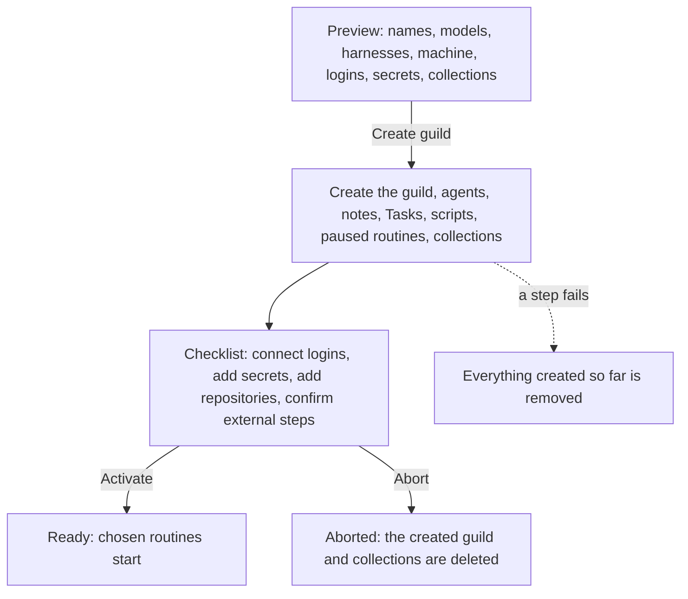

# Applying recipes

Applying a [recipe](recipes.md) turns it into a live
[guild](guilds.md). Apply creates the guild, its [agents](agents.md)
with their Tasks, [scripts](scripts.md), and paused
[routines](routines.md), its [collections](collections.md), and its
seed [notes](notes.md). Then it walks the operator through what a
recipe cannot carry: logins, secret values, repositories, and setup
outside the platform. When the checklist is done, the operator
activates the guild and its routines start.

The [Guild builder](guild-builder.md)'s **Deploy guild** uses this same
flow. There is no builder-specific credential path.

## When you use it

- You approved a recipe and want a guild from it.
- You captured a guild and want a second copy of its design.
- You imported a recipe from a file or the registry and want to run it.

Apply always builds a new guild, or fills an **empty** guild (one with
no agents). It never restores a recipe onto a guild that already has
agents. To change the Tasks of a live guild, use
[Prompt Studio](prompt-studio.md).

## How it works

Apply has three stages: a preview that writes nothing, the creation of
the guild, and a checklist. Activation ends it. Abort undoes it.



### The preview

The preview resolves everything apply needs before it writes
anything:

- **Names.** The new guild's name and each agent's name. An agent name
  already taken on the box is a collision, and the agent must be
  renamed.
- **Models.** A role's model in the recipe is a recommendation. Each
  agent gets the model the operator picks.
- **Harnesses.** Each coding role needs a [harness](coding/harnesses.md).
  There is no default.
- **Machine.** Every agent of the apply goes on one
  [machine](machines.md). The machine must be big enough for the
  largest agent and have room for all of them.
- **Connectors.** For each connector, the operator reuses a live login
  of the organisation or connects one after the guild exists.
  Connectors the box lacks are listed for install.
- **Secrets.** A secret the organisation already holds is reused by
  default. The operator may rename or skip it.
- **Collections.** A collection whose name is free is created. A live
  collection of that name is reused when its columns accept the
  recipe's. Otherwise it is a conflict the operator resolves by
  renaming the recipe collection.
- **Limits.** The organisation must have room for all the agents,
  browser agents, and coding agents at once.

[Models and harnesses](#models-and-harnesses) says where each picker
starts.

### Creating the guild

**Create guild** builds the guild in an order that never leaves a
broken state. Notes come before Tasks, because a Task that embeds a
missing note cannot be written. Routines are created paused. If any
step fails, everything the apply created so far is removed. The
[steps](#create) are listed under Reference.

### The checklist

The checklist lists what the operator still has to do:

- **Connect** each connector the recipe needs, unless a reused login
  already covers it.
- **Add each secret** so it reaches every agent that needs it.
- **Connect GitHub** and **add each repository** in the guild's
  Settings, when the recipe lists repositories.
- **Confirm** each external setup step.

Steps the platform can check are verified, not just ticked: **Check**
looks at the live guild. Connection, secret, repository, and tool
steps can be skipped. A skipped step leaves a warning: agents that
need that access fail those tasks until it is added later from the
guild's Tools, Secrets, or Settings.

Browser logins are not checklist work. After activation, each agent
whose role needs a browser login shows a strip asking the operator to
log in from its Browser tab (see [Browser](browser.md)).

### What apply never does

- It never writes a secret value. The operator adds each secret from
  the guild's Secrets view.
- It never makes a secret organisation-wide.
- It never writes an organisation-wide or platform-wide binding. It may
  reuse an organisation login, but the grant lands on the new guild or
  one of its agents.

## In the app

### Apply preview

**Apply** on a recipe's page opens the apply preview. It shows:

- the new guild's name (**Guild name**)
- each agent's card, with its **Agent name**, its **Model**, and for a
  coding agent its **Harness**. The model list is the organisation's
  chosen models. A coding agent's logo follows the harness picked.
  A taken name says *An agent already has this name. Rename it before
  creating.*
- a **Machine** picker. Machines below the recipe's minimum are
  disabled. The chosen machine shows its planned load bars with what
  the recipe's agents add, and its `machine.*` findings.
- for each connector, a **Login**: a live login to reuse, or
  **Connect after the guild exists**
- **Connectors to install**: each connector the box lacks. An instance
  admin installs a registry one there (**Install unverified** for an
  unverified one). An owner or admin adds one the recipe carries as
  the organisation's own server.
- **Connectors to set up**: each connector the box has but a platform
  admin has not set up, GitHub included when the recipe lists
  repositories. A platform admin gets a **Set up** link. Anyone else
  reads that a platform admin sets it up under **Admin**,
  **Platform keys**.

**Create guild** waits until every agent has a model, every coding
agent has a harness, and, with several machines, one is chosen. While
no model provider is connected, a guide to
[Model keys](model-keys.md) stands in for the model pickers. A
**Not ready to apply** banner names the first thing missing. The
preview leaves out `connection.missing`, which is a note on how the
recipe is written.

### Apply checklist

After **Create guild**, the checklist page opens. Its header names the
guild and shows **Abort** and **Activate**. A progress bar counts the
steps done, starting with two milestones: **Recipe validated** and
**Guild created**.

Each step shows its title, what it asks for, and its status:

- A connection step has **Connect `<name>`**, which opens the same
  Connect dialog as the Tools view, and **Check**. A connector a
  platform admin has not set up shows that gap, keeps Connect
  disabled, and offers **Set up** (**Admin**, **Platform keys**) to a
  platform admin. The step still closes once the login is connected or
  the step is skipped.
- A secret step has **Check** and a **Guild secrets** link.
- A repository step has **Check** and a **Guild settings** link.
- Connection steps also link to **Guild tools**.
- An external step has **Done**.
- Connection, secret, and repository steps have **Skip**, after a
  confirmation.
- The last step, **Activate paused routines**, has
  **Activate routines**.

Browser and tool overlay steps are not listed: logins happen on the
live agent, and tool overlays close with their connection.

**Activate** (or **Activate routines**) is enabled once every other
step is closed. It starts the routines and opens the guild. **Abort**
asks for confirmation (**Abort and delete**), deletes what the apply
created, and returns to the library.

### Strips on the guild

- While a guild's checklist is open, a strip under its tabs says
  *Recipe setup is open: the routines stay paused until its checklist
  is done.* **Open checklist** links to it.
- After activation, each agent the recipe required a browser login for
  shows a **Browser login needed** strip on its inspector, with
  **Open Browser** and **Mark as done**. It stays hidden while the
  guild's checklist is open. See [Browser](browser.md).

## Rules and limits

| Rule | Behaviour |
|---|---|
| Recipe status | Must be ready (approved) |
| Blocking errors | Refuse the apply |
| Destination | A new guild, or an existing guild with no agents |
| One open checklist per guild | A guild has at most one open apply |
| Agent names | Must be free on the whole box |
| Model | Every agent needs one; none is picked for you when the organisation has no fitting model |
| Harness | Every coding agent needs one; no default |
| Machine | One machine for all agents; at least the largest agent's minimum; room for all of them, at most 32 agents per machine or the policy's lower cap |
| Organisation limits | Checked once for the whole batch: agents, browser agents, coding agents, guilds |
| Routines | Created paused; start on Activate |
| Secret values | Never written by apply |
| Organisation-wide secrets and bindings | Never created by apply |
| Skipped step | Recorded as a warning |
| Activate | Refused while a step other than browser logins is open |
| Abort | Refused once the apply is ready |

## Reference

### Scope of what apply writes

Apply reuses existing organisation or platform connections, and the
organisation's secrets. It creates new connections only at guild or
agent scope. Tool overlays are upserted at the resolved connection's
owner scope: right away for a reused login, after Connect for a new
one. A namespaced tool the destination does not list is left out, and
the apply goes on.

The destination is a guild apply creates, or an **empty** guild (no
live agents) named by `guild_id`. A guild with agents is refused
(`destination guild is not empty`).

### Choices

The preview and apply requests take the same body:

```text
{
  guild_name?, guild_id?,
  names?:       [{ role, name }],
  models?:      [{ role, model }],
  harnesses?:   [{ role, harness }],
  machine_id?,
  connections?: [{ server, action: "reuse" | "create", scope: "guild" | "agent", role?, connection_id? }],
  secrets?:     [{ name, action: "reuse" | "rename" | "skip", dest_name? }],
  activate_keys?: [routine key]
}
```

`activate_keys` lists the routines Activate unpauses; by default every
routine of the recipe.

### Models and harnesses

A role's `config.model` is a recommendation, kept exactly as written.
Validation warns about one that is unknown, not connected for the
organisation, or a coding-API model on a role without `coding`, and
never refuses a recipe for a model reason. The apply preview shows a
picker per role, preselected with the recommendation when the
organisation has its provider, else the organisation's default, else
nothing.
The apply request carries `models`, the model chosen for each role,
and nothing is created while a role has none (`choose a model for …`).
A chosen model must be `{provider}/{model}` and offered to that role,
or it is refused. The Builder writes the coach's model into the roles
it drafts without one. Capturing a guild keeps each agent's live
model.

A coding role's `config.harness` works the same way, with no default.
The preview shows a harness picker per coding role, preselected with
the role's harness unless the box turns that harness off. The apply
request carries `harnesses` (`[{ role, harness }]`), and apply refuses
with `choose a harness for …` while a coding role has none. A harness
for a role without `coding`, or one the box turns off, is refused. Only a coding role keeps a harness. A role keeps
the recipe's `harness_model` only when it applies with the harness the
recipe names; with another harness, its model is the subscription's
default. It keeps the recipe's `harness_effort` under the same
condition, and only when its model runs at that effort; otherwise the
model runs at its default effort. A role's `secret_aliases` apply as written when they
validate; otherwise apply leaves them out.

Agents from roles with `config.coding: true` are created with coding
on.

### Preview

`POST /api/recipes/:id/preview` resolves, without writing:

- the guild name: `guild_name`, else `guild.name_suggestion`, under the
  guild name rule
- each role's name: the operator's, else `name_suggestion`, against the
  charset and reserved `user`. A name any agent on the box already
  holds is listed in `collisions`
- each role's model and each coding role's harness, as
  [Models and harnesses](#models-and-harnesses) describes. The
  preview's `models` lists each role's `recommended` and resolved
  `model`; its `harnesses` lists each coding role's `recommended` and
  resolved `harness`
- the organisation's remaining capacity for the whole batch: agents,
  browser agents, and coding agents (roles with `config.coding: true`),
  each against the organisation's limit, `null` where nothing caps it.
  The preview's `remaining` carries `agents`, `browser_agents`, and
  `coding_agents`
- the machine every role goes on: the operator's choice
  (`machine_id`), else the organisation's only machine, else null
  until the operator picks one. A recipe does not name a machine. It
  needs one of at least its agents' largest
  [minimum](machines.md), which the preview returns as `minimum_cpu`
  and `minimum_mib`. The preview's `machines` lists each machine with
  its `id`, `name`, `box`, `cpu`, `memory_mib`, `planned_cpu`,
  `planned_mib`, number of `agents`, and `fits`, whether it meets that
  minimum. `adds_cpu` and `adds_mib` are the planned load the roles
  add. On the chosen machine it is a blocking finding when the machine
  is below a role's minimum (`machine.size`, one per role), when the
  roles would take the machine past 32 agents or the policy's agents
  per machine (`machine.full`), and when the machine hosts an agent of
  a guild the operator cannot see (`machine.private`). An unknown
  `machine_id` is 404. Apply without a machine is refused
- catalog presence of each `connections.server`. The preview's
  `installs` lists each one the box lacks that can be added: from the
  registry (`server`, `from: "registry"`, `version`, `verified`), which
  an instance admin installs, or from the recipe (`server`,
  `from: "recipe"`, `display_name`, `description`, `url`, `auth`),
  which an owner or admin adds as the organisation's own server
- which of the connectors the recipe needs the box has but a platform
  admin has not set up, GitHub included when the recipe lists
  repositories. The preview's `setups` lists each one (`server`,
  `integration`, `label`). The apply goes on; those connections cannot
  connect until the integration is filled under **Admin**,
  **Platform keys** (see
  [Configure](../operations/configure.md#platform-keys))
- existing destination organisation connections that can satisfy a
  server: each `connections` entry lists `reusable` logins (connected,
  owned by the organisation or the platform), and defaults to `reuse`
  of the first one, else `create`. A recommended `org` scope becomes
  `guild`
- each secret name against the organisation's secrets. A name the
  organisation holds is a collision and defaults to `reuse`. The
  operator may `rename` (with `dest_name`) or `skip`. A free one is
  `create`. A recommended `org` scope becomes `guild`
- org-level seed note collisions
- each recipe collection against the organisation's live collections
  (see [Collections](#collections))
- provenance of builder-authored fields (`unreviewed`; informational,
  not a gate)

The answer also carries `recipe_id`, `recipe_name`, `guild_id`,
`names`, `findings`, `errors` (the blocking ones), and `creates`, the
inventory of everything the apply would create: the guild, each agent
(name, focus, model, browser, coding, Task, enabled native tools),
collections, notes, scripts, routines, connections, secrets, and
repositories.

A role without a Task gets one made of its focus, the guild's
objective, and its about text. A role without routines gets one per
`design.routines` entry whose `cadence` is a valid cron; its
instruction is the role's Task.

### Collections

Each recipe collection is planned as:

- `create` when the name is free in the organisation
- `reuse` when every recipe column exists on the live collection of
  that name with the same type and, for a closed value list, every
  recipe value is accepted (extra live columns are fine)
- otherwise `conflict`, a blocking `collection.conflict` finding
  listing the differences

A `scope: "guild"` collection cannot be shared, so a name the
organisation already holds is always a conflict for it. The operator
resolves a conflict by renaming the recipe collection.

A reused collection keeps its records and the other rows of its
access list.

### Access

Apply gives the new guild and its agents what the recipe says on each
collection and seed note, and only raises. The new guild is brought up
to the recipe's `guild` mode, and each `writers` role's agent up to
`write`. A subject that already holds as much gets no row: the guild
counts the organisation's row and its own, and an agent counts its own
row, else its guild's mode. An existing row is never lowered, so
applying `read` to a reused table the guild already writes leaves it at
`write`.

### Create

`POST /api/recipes/:id/apply` re-runs the preview, then requires
`status=ready`, no blocking errors, a machine, no name collision, a
model for every role, and a harness for every coding role. It answers
201 with the apply. The steps are ordered so no intermediate state is
broken:

1. assert the whole batch against the organisation's limits once, the
   machine's `maxAgentsPerMachine` included, plus the guild limit when
   apply creates the guild. The roles must also fit the guild's
   `max_agents`: the destination guild's, or the default for a new
   guild (see [Guilds](guilds.md))
2. create the guild (or attach an empty one)
3. create guild- and org-level seed notes
4. create the agents on the chosen machine, each with empty Memory and
   a first Task whose `@{role}` tags already name the new agents
5. create agent-level seed notes (a note without a role goes to the
   first agent), then raise each seed note's access list to the
   recipe's `guild` and `writers` (see [Access](#access))
6. for each role in turn:
   - rewrite the Task's note links
     ([embeds and note paths](recipe-format.md#embeds-and-tags)) to
     live display paths, and write the Task again over the first one.
     An unresolved link fails the apply. An empty Task is not written
   - insert its scripts; more scripts than the role's `max_scripts`
     fail the apply
   - insert its routines paused, with tags and note paths rewritten the
     same way. An empty instruction takes the role's Task. Each
     instruction is cut to 2,000 characters, the routine limit
   - write its native-tool bindings at agent scope
7. create each `create` collection with the recipe's columns. A
   collection that appeared under that name since preview is a
   conflict: preview again (409). A `scope: "guild"` collection is
   created for the new guild, with the guild at `write` as its
   starting row. A created `org` collection starts with the
   organisation at `read`. Every created or reused collection's access
   list is then raised to the recipe's `guild` and `writers` (see
   [Access](#access))
8. write the tool overlays of each reused login
9. save the apply row with its checklist

Failure deletes the agents the apply created, a guild apply created
(`created_guild`), and the collections this apply created. Reused
collections stay. An empty guild the operator already made stays
standing.

Once the apply is saved, and when the applying user is an org owner or
admin, each `reuse` secret that is not organisation-wide and does not
reach the guild yet is granted to it. Secret steps that then pass
close.

### Checklist

Each step has a derived id, a `kind`, a `title`, optional `setup`
text, a `closure` (`verified` or `confirmed`), and a `status` (`open`,
`verified`, `confirmed`, or `skipped`). Examples of ids:

- `conn:notion`
- `overlays:notion`
- `secret:TAVILY_KEY`
- `repo:api`
- `browser:scout`
- `external:0`
- `activate`

A step for a reused login, and its overlay step, start verified.

A recipe with `repositories` adds a `conn:github` step (Connect
GitHub) when its connections do not already name `github` (see
[GitHub](../tools-and-connectors/github.md)). It adds one
`repo:<name>` step per repository. That step's setup is the
repository's purpose and where to add it (the guild's Settings, under
Repositories, with that name).

The Connect GitHub setup tells the operator to install the GitHub App
on the account that owns the repositories, to pick the guild's or
agent's repositories on the GitHub card in Tools, and to set Commit
author email in the guild's Settings to a verified email on the
GitHub account that owns any deploy project. Recipes do not store that
email.

A secret the operator chose to `skip` has no step.

| Step | Closes when |
|---|---|
| Reuse or Connect server S | connection `status=connected` for the guild (verified), or operator skips with a warning |
| Secret `NAME` | a secret of the destination name reaches every agent of the roles that need it, the recipe secret's `roles` or else every planned role (verified), or skipped |
| Tool overlays for S | the server has a guild- or agent-scope binding (verified); a verified Connect step writes the overlays and closes it; skipped with the Connect step |
| Repository `name` | the guild has a repository of that name (verified), or skipped |
| Browser for role R | deferred until after activate; the live agent asks the operator to log in |
| External item | operator attests (confirmed) |
| Activate paused routines | Activate |

A browser step's setup is the role's login instructions, or a default
that says to take control of the agent's Chromium after apply and log
into the site, that session cookies stay in the browser profile, and
to mark the reminder done.

`POST /api/applies/:id/steps/:step_id/verify` re-derives destination
state. It works on `verified` steps only (`step is attestation-only`
otherwise). A step that does not pass answers 422 with the reason:

- a connection step says the server is not connected yet
- a secret step names the agents the secret does not reach yet
- a repository step says the guild has no repository of that name yet
- an overlay step says the tools are not bound yet

`…/confirm` is for browser and external steps (`step must be verified
by the server` otherwise), and for skipping a connection, secret,
overlay, or repository step with `skip: true`. A skip also closes the
connection's overlay step and records a `step.skipped` warning. Any
other step cannot be skipped. On a browser step, `later: true` records
the login for after activation. An unknown step is 404.

`POST /api/applies/:id/overlays` (`{ server, connection_id }`) writes
planned tool overlays after listing. Overlays bind at guild scope when
every role enables the connector with the same tools and its
recommended scope is not `agent`; otherwise each enabled role's agent
gets its own binding.

### Activate and abort

`POST /api/applies/:id/activate` defers any remaining browser logins
(`resolution: "later"`), closes the activate step, unpauses the
routines in `activate_keys`, and moves the row to `ready`. While any
other step is open it is 422 (`checklist still open: …`).

`POST /api/applies/:id/abort` deletes a guild apply created, with its
agents, and the collections the apply created, then moves the row to
`aborted`. Reused collections and their records stay. Org-level logins
created during the checklist stay. Only an apply that created its
guild deletes anything: on an empty guild the operator brought, abort
moves the row to `aborted` and leaves the guild, the agents apply made
in it, and the collections it created in place. A `ready` apply cannot
be aborted (422).

### Apply HTTP

```text
POST   /api/recipes/:id/preview
POST   /api/recipes/:id/apply
GET    /api/applies/:id
GET    /api/guilds/:guild_id/apply
POST   /api/applies/:id/overlays
POST   /api/applies/:id/steps/:step_id/verify
POST   /api/applies/:id/steps/:step_id/confirm
POST   /api/applies/:id/activate
POST   /api/applies/:id/abort
```

| Route | Answer |
|---|---|
| `POST /api/recipes/:id/preview` | The preview; 404 for an unknown destination guild or machine; 422 for a guild that is not empty or a bad choice |
| `POST /api/recipes/:id/apply` | 201 with the apply. 422 when the recipe is not approved, has blocking errors, has no machine, or lacks a model or harness. 409 for a name collision, a limit reached, a full guild, or a collection that appeared since preview |
| `GET /api/applies/:id` | The apply; 404 outside the organisation |
| `GET /api/guilds/:guild_id/apply` | `{ apply, browser_logins }` |
| `POST /api/applies/:id/overlays` | `{ ok: true }` |
| `POST …/steps/:step_id/verify` | The apply with the step closed; 422 with the reason |
| `POST …/steps/:step_id/confirm` | The apply with the step closed or skipped |
| `POST /api/applies/:id/activate` | The apply at `ready`; 422 while a step is open |
| `POST /api/applies/:id/abort` | The apply at `aborted`; 422 once ready |

In `GET /api/guilds/:guild_id/apply`, `apply` is the open checklist,
or null once it is done or aborted.
`browser_logins` is the agent ids a ready apply still asks to log in
by hand.

### Storage

```text
recipe_applies (
  id, org_id, recipe_id, created_by_user_id,
  guild_id, created_guild,
  status,                 -- preview | skeleton | checklist | ready | aborted
  recipe_body_version,
  preview jsonb, plan jsonb, checklist jsonb, warnings jsonb,
  created_at, updated_at
)
```

The row is written once the guild stands, at `checklist`. Activate
moves it to `ready`; abort moves it to `aborted`. The status values
`preview` and `skeleton` are allowed by the schema; the apply never
writes them, because the preview is not stored. A guild has at most
one apply at `skeleton` or `checklist`. `plan` holds the agent ids by
role, the connections, secrets, collections, and `activate_keys`.
`warnings` starts with the preview's findings and gains each skipped
step.

### Screens

| Screen | Route |
|---|---|
| Apply preview | `/recipes/<recipe_id>/apply` |
| Apply checklist | `/applies/<apply_id>` |
