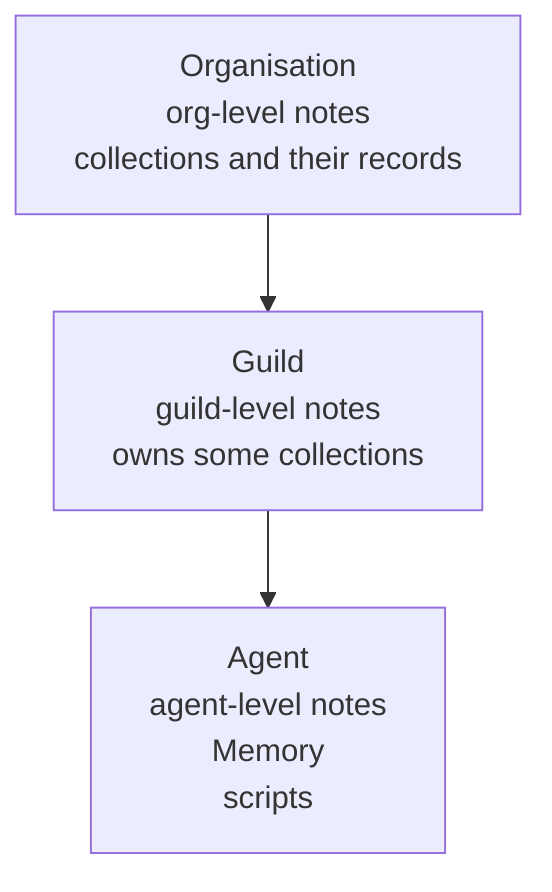

# Artifacts

The artifact store is where an organisation keeps what its agents
read and write from one run to the next. It holds four kinds of
things: [notes](notes.md) (Markdown files), [collection](collections.md)
records (typed rows), each agent's [Memory](memory.md), and each
agent's [scripts](scripts.md). Every organisation has one store.

Each item has a level: the organisation, one guild, or one agent.
The level says who owns it and who can reach it. Each item also has
a display path, a text address that names it exactly. Agents and
operators use display paths to point at an item.

The agent's [Task](task.md) is not in the store. It lives on the
agent itself, and only the operator writes it.

## Why it exists

An agent forgets everything when a run ends. Each run starts from a
fresh prompt ([System prompt](system-prompt.md)). The artifact store
is what survives: findings, shared knowledge, structured work items,
code the agent wants to run again.

Each kind of knowledge has one home, so an agent knows where to look
and where to write:

| What | Home |
|---|---|
| The operator's standing purpose | the [Task](task.md), on the agent |
| What the agent wants its future runs to remember | its [Memory](memory.md) |
| Long-form knowledge for one agent's work | agent-level [notes](notes.md) |
| Long-form knowledge shared by a team | guild- and organisation-level [notes](notes.md) |
| Structured records | [collections](collections.md) |
| Python the agent runs in its sandbox | agent-level [scripts](scripts.md) |
| The exact messages of a conversation | run and group-chat history ([Runs](runs.md), [Group chat](group-chat.md)) |

A note may summarise a conversation into a durable finding. The
exact transcript stays in the run or group history.

## How it works

### Levels



- **Notes** exist at all three levels. Four grant switches on the
  agent decide how far it reaches beyond its own notes
  ([Notes](notes.md)).
- **Collections** live at the organisation. A collection is either
  an organisation collection, reached through a read or write grant
  the operator sets, or a guild's own collection, written by every
  member of that guild and reached by nobody else
  ([Collections](collections.md)).
- **Memory** and **scripts** belong to one agent.

### Agents use tools, never files

Agents never see the store as a folder. The orchestrator's tools
read and write it: note tools for notes, record tools for records,
`memory_write` for Memory, script tools for scripts. The families
stay separate so the model does not mix Markdown, records, memory,
and executable source.

A record reaches the agent's sandbox only inside a tool result.

At the start of each run the system prompt carries a read-only
snapshot, State, that lists the collections and scripts the agent
can use ([System prompt](system-prompt.md)).

### Display paths

A display path is the unique reference to an item. It starts with
the organisation id, then the level's owner, then the item:

```text
org/<org_id>/agents/<agent_id>/research.md     an agent-level note
org/<org_id>/guilds/<guild_id>/glossary.md     a guild-level note
org/<org_id>/collections/leads/42              record 42 of the leads collection
```

Paths use ids, not names. Renaming a guild or an agent does not
change its paths, and a reused name gets fresh paths.

A tool returns the display path of what it wrote. That path is the
canonical way to link to the item elsewhere. A short `[[name]]` in
prose is plain text and is never rewritten into a link.

The model never supplies an organisation, guild, or agent id. For a
note it sends a `level` and a `key` (the file name). For a record it
sends the collection name and the record id.

### Every change is recorded

Every successful write to a note, Memory, a record, a script, or the
Task records a change: which item, what operation, the version it
produced, who did it, and when. A change made by a run also records
the run and the exact tool call. This record is the file's
provenance.

## In the app

A provenance strip under a file says who changed it last and when.
It appears:

- in the notes browser ([Notes](notes.md))
- on the agent's **Prompt** tab ([Task](task.md))
- on the agent's **State** tab, in the **Memory** and **Scripts**
  views ([Memory](memory.md), [Scripts](scripts.md))
- in the record dialog of the **Databases** page
  ([Collections](collections.md))
- in the Prompt Studio inspector ([Prompt Studio](prompt-studio.md))

**Open step** opens the run that wrote the file at that tool call:
in the agent's Chat tab, or in Studio's History tab inside Studio.
**History** expands the full list of changes, each with its own
**Open step**.

## Rules and limits

| Rule | Value or behaviour |
|---|---|
| Size of one write | 256 KB |
| Live artifacts per owner | 10 000 (collection records are counted per collection instead) |
| `task.md` and `memory.md` | reserved names at the agent root; neither can be deleted |
| Previous Memory versions | read only, and only by the operator |
| Paths | built from ids, never names |
| Who checks access | the application: the four note grants and the collection grants. The database has no row-level security on these tables |

## Reference

### Kinds

One PostgreSQL table, `artifacts`, holds every item. Its `kind` is:

| Kind | What | Levels |
|---|---|---|
| `note` | a Markdown note | agent, guild, org |
| `object` | a collection record | org |
| `memory` | an agent's Memory | agent |
| `script` | an agent's Python script | agent |

A collection itself is an `artifact_collections` row, not an
artifact kind. The live Task is `agents.task`.

### Display paths

```text
org/<org_id>/agents/<agent_id>/task.md
org/<org_id>/agents/<agent_id>/memory.md
org/<org_id>/agents/<agent_id>/history-archive/<stamp>-<source>.md
org/<org_id>/agents/<agent_id>/scripts/<name>
org/<org_id>/agents/<agent_id>/<note>.md
org/<org_id>/guilds/<guild_id>/<note>.md
org/<org_id>/collections/<name>
org/<org_id>/collections/<name>/<id>
org/<org_id>/<note>.md
```

- The owner prefix is a property of the level:
  `org/<org_id>/agents/<agent_id>/`, `org/<org_id>/guilds/<guild_id>/`,
  or `org/<org_id>/`.
- Notes are flat: `{ownerPrefix}{key}`, where `key` is one `.md`
  file name with no `/`. Because a note key ends in `.md`, it never
  shadows `collections/`, `agents/`, `guilds/`, `scripts/`, or
  `history-archive/`.
- A collection is `org/<org_id>/collections/<name>`. A record is that
  path plus the record id.
- Scripts are `{ownerPrefix}scripts/{name}`, at the agent level only.
- `task.md` is a virtual path over `agents.task`. `memory.md` is the
  agent's `memory` artifact. Neither is deletable (422
  `cannot delete this file`).
- `history-archive/<stamp>-<source>.md` names a previous Memory
  version. Only the operator resolves it; it is read only (422
  `history-archive is read-only` on delete) ([Memory](memory.md)).
- A path that does not parse is 404 `unknown artifact path`.

Code: `apps/orchestrator/src/artifacts/paths.ts`.

### File provenance

Every successful note, memory, record, script, or task mutation
appends a `file_changes` row in the same transaction as the write.

| Column | Meaning |
|---|---|
| `display_path` | the canonical display path |
| `artifact_id` or `task_agent_id` | the item changed; exactly one is set (`task_agent_id` for a Task) |
| `operation` | `create`, `update`, or `delete` |
| `version` | the version the write produced |
| `actor_type`, `actor_id`, `actor_name` | `user`, `agent`, or `run`, and who |
| `run_id`, `tool_call_id`, `tool_name` | set on a run-owned change |
| `created_at` | when |

The orchestrator supplies this context. Agent tool schemas carry
only the arguments the operation needs. A human edit uses the
authenticated user as actor.

HTTP, organisation-authorized:

```text
GET  /api/file-changes?display_path=…            newest-first history of one path; 422 without display_path
GET  /api/file-changes/latest?display_paths=a,b   the newest change per path, comma-separated
POST /api/file-changes/latest                     the same, with { display_paths: [...] } in the body
```

A run-owned change in the history expands to the run's agent,
guild, kind, status, and routine.

A path with no recorded change but a live row falls back to that
row's last-saved facts: `recorded: false`, the saver's name, the
version, and the time. A Task falls back to its version and time.

Code: `apps/orchestrator/src/artifacts/file-changes.ts`,
`apps/orchestrator/src/http/artifact-files.ts`.

### What is not an artifact

- Routines stay on `schedules.instruction` ([Routines](routines.md)).
- The live Task stays on `agents.task`. Previous Task saves stay on
  `task_revisions` (cap 50) ([Task](task.md)).
- Previous Memory versions stay on `memory_revisions` (cap 50)
  ([Memory](memory.md)).
- Collection grants are `collection_access` rows
  ([Collections](collections.md)).
- Run transcripts are run rows. There is no search over runs
  ([Runs](runs.md)).

None of those are kinds. None appear in `note_find` or
`record_search`.

Scripts are an artifact kind (`script`, agent only) with their own
tools. They do not appear in note or record search, and the Notes
view does not list them ([Scripts](scripts.md)).
