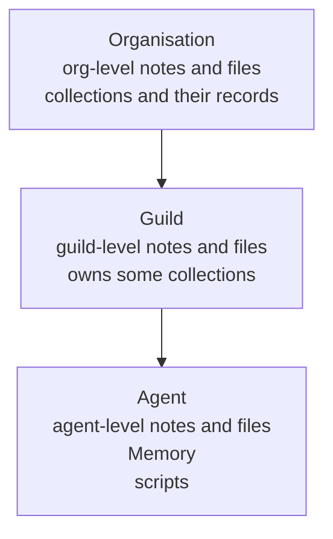

# Artifact store

The artifact store is the storage layer under an organisation's
[notes](notes.md), [files](files.md), [collection](collections.md)
records, each agent's [Memory](memory.md), and each agent's
[scripts](scripts.md). Every
organisation has one store. Agents read and write it with tools, and
operators read and edit it in the app.

Each item has a level: the organisation, one guild, or one agent.
The level says where it sits. Each item also has a display path, a
text address that names it exactly. Notes, collections, and files each
carry an access list that decides which agents read and write them
([Access](access.md#access-lists-for-notes-collections-and-files)).

## Why it exists

An agent forgets everything when a run ends. Each run starts from a
fresh prompt ([System prompt](system-prompt.md)). The artifact store
is what survives: findings, shared knowledge, structured work items,
code the agent wants to run again.

Each kind of knowledge has one home, so an agent knows where to look
and where to write:

| What | Home |
|---|---|
| The operator's standing purpose | the [Task](task.md), on the agent, outside the store |
| What the agent wants its future runs to remember | its [Memory](memory.md) |
| Long-form knowledge for one agent's work | agent-level [notes](notes.md) |
| Long-form knowledge shared by a team | guild- and organisation-level [notes](notes.md) |
| Structured records | [collections](collections.md) |
| Bytes that are not Markdown: a report, a dataset, an image | [files](files.md) at any level |
| Python the agent runs in its sandbox | agent-level [scripts](scripts.md) |
| The exact messages of a conversation | run and group-chat history ([Runs](runs.md), [Group chat](group-chat.md)) |

A note may summarise a conversation into a durable finding. The
exact transcript stays in the run or group history.

## How it works

### Levels



- **Notes** exist at all three levels. Each note's access list decides
  who reaches it beyond its owner agent ([Notes](notes.md#how-far-an-agent-reaches)).
- **Files** exist at all three levels. Each file's access list decides
  who reaches it ([Files](files.md#how-far-an-agent-reaches)).
- **Collections** live at the organisation. Some belong to one guild.
  Each collection's access list decides who reaches it ([Collections](collections.md#who-reaches-a-collection)).
- **Memory** and **scripts** belong to one agent. They have no access
  list: only that agent and the operators reach them.

The level is placement. A note's or a file's level and a collection's guild set
its display path and where it is listed. The access list alone
decides who reads and writes it.

### Agents use tools, never a folder

Agents never see the store as a folder. The orchestrator's tools
read and write it: note tools for notes, record tools for records,
file tools for files, `memory_write` for Memory, script tools for
scripts. The families stay separate so the model does not mix
Markdown, records, bytes, memory, and executable source.

A record reaches the agent's sandbox only inside a tool result. A
file reaches it only through `file_fetch`, as a file in the agent's
home ([Files](files.md)).

At the start of each run the system prompt carries a read-only
snapshot, State, that lists the collections and scripts the agent
can use ([System prompt](system-prompt.md)).

### Display paths

A display path is the unique reference to an item. It starts with
the organisation id, then the level's owner, then the item:

```text
org/<org_id>/agents/<agent_id>/research.md     an agent-level note
org/<org_id>/guilds/<guild_id>/glossary.md     a guild-level note
org/<org_id>/collections/leads/42              record 42 of the leads collection
```

Paths use ids, not names. Renaming a guild or an agent does not
change its paths, and a reused name gets fresh paths.

A tool returns the display path of what it wrote. That path is the
canonical way to link to the item elsewhere. A short `[[name]]` in
prose is plain text and is never rewritten into a link.

The model never supplies an organisation, guild, or agent id. For a
note it sends a `level` and a `key` (the file name). For a record it
sends the collection name and the record id.

### Every change is recorded

A write to a note, a file, Memory, a record, a script, or the Task records a
change: which item, what operation, the version it produced, who did
it, and when. A change made by a run also records the run and the
exact tool call. A change the operator applies from a Prompt Studio
card also records the coach message that proposed it. This record is
the file's provenance.

Three operator actions change a collection's records as a whole:
**Delete all**, deleting the collection, and renaming or removing a
column. Each records one entry in the configuration change log,
against the collection, instead of one change per record.

## In the app

A provenance strip under a file says who changed it last and when.
It appears:

- in the notes browser ([Notes](notes.md))
- on the agent's **Prompt** tab ([Task](task.md))
- on the agent's **State** tab, in the **Memory** and **Scripts**
  views ([Memory](memory.md), [Scripts](scripts.md))
- in the record dialog of the **Tables** page
  ([Collections](collections.md))
- in the Prompt Studio inspector ([Prompt Studio](prompt-studio.md))

**Open step** opens the run that wrote the file at that tool call:
in the agent's Chat tab, or in Studio's History tab inside Studio.
**History** expands the full list of changes, each with its own
**Open step**.

## Rules and limits

| Rule | Value or behaviour |
|---|---|
| Size of one write | 256 KB |
| Size of one file | 10 MiB ([Files](files.md)) |
| Live files of an organisation together | 1 GiB |
| Live notes, Memory, scripts, and files per owner | 10 000 |
| Live records per collection | 10 000 ([Collections](collections.md)) |
| `task.md` and `memory.md` | reserved names at the agent root; neither can be deleted |
| Previous Memory versions | read only, and only by the operator |
| Paths | built from ids, never names |

## Reference

### Kinds

One PostgreSQL table, `artifacts`, holds every item. Its `kind` is:

| Kind | What | Levels |
|---|---|---|
| `note` | a Markdown note | agent, guild, org |
| `object` | a collection record | org |
| `memory` | an agent's Memory | agent |
| `script` | an agent's Python script | agent |
| `file` | a shared file; its bytes sit in the blob store | agent, guild, org |

A collection itself is an `artifact_collections` row, not an
artifact kind. The live Task is `agents.task`.

Access is checked in the application, from the `artifact_access`
rows ([Access](access.md#access-lists)). The database has no
row-level security on these tables.

### Display paths

```text
org/<org_id>/agents/<agent_id>/task.md
org/<org_id>/agents/<agent_id>/memory.md
org/<org_id>/agents/<agent_id>/history-archive/<stamp>-<source>.md
org/<org_id>/agents/<agent_id>/scripts/<name>
org/<org_id>/agents/<agent_id>/files/<name>
org/<org_id>/guilds/<guild_id>/files/<name>
org/<org_id>/files/<name>
org/<org_id>/agents/<agent_id>/<note>.md
org/<org_id>/guilds/<guild_id>/<note>.md
org/<org_id>/collections/<name>
org/<org_id>/collections/<name>/<id>
org/<org_id>/<note>.md
```

- The owner prefix is a property of the level:
  `org/<org_id>/agents/<agent_id>/`, `org/<org_id>/guilds/<guild_id>/`,
  or `org/<org_id>/`.
- Notes are flat: `{ownerPrefix}{key}`, where `key` is one `.md`
  file name with no `/`. Because a note key ends in `.md`, it never
  shadows `collections/`, `agents/`, `guilds/`, `scripts/`, `files/`,
  or `history-archive/`.
- A collection is `org/<org_id>/collections/<name>`. A record is that
  path plus the record id.
- Scripts are `{ownerPrefix}scripts/{name}`, at the agent level only.
- Files are `{ownerPrefix}files/{name}`, at every level ([Files](files.md#storage)).
- `task.md` is a virtual path over `agents.task`. `memory.md` is the
  agent's `memory` artifact. Neither is deletable (422
  `cannot delete this file`).
- `history-archive/<stamp>-<source>.md` names a previous Memory
  version. Only the operator resolves it. It is read only (422
  `history-archive is read-only` on delete) ([Memory](memory.md)).
- A path that does not parse is 404 `unknown artifact path`.

Code: `apps/orchestrator/src/artifacts/paths.ts`.

### File provenance

Every note, file, memory, record, script, or task create, update, or
delete appends a `file_changes` row in the same transaction as the
write. **Delete all** (`DELETE /api/collections/:id/records`),
deleting a collection, and a column rename or removal append a
`config_changes` row instead
([Configuration change log](#configuration-change-log)).

| Column | Meaning |
|---|---|
| `id` | the change id |
| `org_id` | the organisation |
| `display_path` | the canonical display path |
| `artifact_id` or `task_agent_id` | the item changed; exactly one is set (`task_agent_id` for a Task) |
| `operation` | `create`, `update`, or `delete` |
| `version` | the version the write produced |
| `actor_type`, `actor_id`, `actor_name` | `user`, `agent`, or `run`, and who |
| `run_id`, `tool_call_id`, `tool_name` | set on a run-owned change; a Studio apply sets `tool_call_id` and `tool_name` to the coach's edit call |
| `studio_session_id`, `studio_seq` | set on a change applied from a Prompt Studio card: the session and the sequence of the coach message that proposed it |
| `created_at` | when |

The orchestrator supplies this context. Agent tool schemas carry
only the arguments the operation needs. A human edit uses the
authenticated user as actor.

HTTP, organisation-authorized:

```text
GET  /api/file-changes?display_path=…            newest-first history of one path; 422 without display_path
GET  /api/file-changes/latest?display_paths=a,b   the newest change per path, comma-separated
POST /api/file-changes/latest                     the same, with { display_paths: [...] } in the body
```

A run-owned change in the history expands to the run's agent,
guild, kind, status, and routine. Each change carries `studio`:
`{ session_id, seq }` for a change applied from a Studio card, or
null. Changes written before the Studio link existed carry null.

A path with no recorded change but a live row falls back to that
row's last-saved facts: `recorded: false`, the saver's name, the
version, and the time. A Task falls back to its version and time.

Code: `apps/orchestrator/src/artifacts/file-changes.ts`,
`apps/orchestrator/src/http/artifact-notes.ts`.

### Configuration change log

`config_changes` records changes that are not file writes, one row per
change, in the same transaction as the write:

| Target kind | Logged when |
|---|---|
| `routine` | a routine is created, edited, paused, resumed, or deleted ([Routines](routines.md#change-log)) |
| `access` | an organisation, guild, or agent binding is set or removed ([Access](access.md)); platform bindings are not logged |
| `guild_text` | a guild's about or description changes |
| `collection` | **Delete all** removes at least one record, a collection is deleted, a column is renamed or removed, or a row of its access list is added, changed, or removed |
| `note` | a row of a note's access list is added, changed, or removed ([Access](access.md#access-lists)) |

A write that changes nothing logs nothing.

| Column | Meaning |
|---|---|
| `id` | the change id (`cchg_…`) |
| `org_id`, `guild_id`, `agent_id` | where the target sits; the guild and organisation follow from the agent or guild |
| `target_kind`, `target_id` | the target: a schedule id, a catalog id (tool or connector), a guild id, a collection id, or a note's artifact id |
| `operation` | `create`, `update`, or `delete` |
| `summary` | one line in words, such as `Paused "Morning digest"` |
| `actor_type`, `actor_id`, `actor_name` | `user`, `agent`, or `run`, and who |
| `run_id`, `tool_call_id`, `tool_name` | set when an agent's run made the change through a tool call |
| `studio_session_id`, `studio_seq` | set on a change applied from a Prompt Studio card |
| `created_at` | when |

`listConfigChanges` reads one target's changes, newest first. Deleting
the organisation, guild, or agent deletes its rows; deleting the run or
the Studio session clears the link. Changes made before the log
existed have no row.

Code: `apps/orchestrator/src/db/config-changes.ts`.

### Kept outside the store

- Routines: `schedules.instruction` ([Routines](routines.md)).
- The live Task: `agents.task`. Previous Task saves: `task_revisions`,
  50 kept ([Task](task.md)).
- Previous Memory versions: `memory_revisions`, 50 kept
  ([Memory](memory.md)).
- Access lists of notes, collections, and files: `artifact_access` rows
  ([Access](access.md#access-lists)).
- The bytes of files: the blob store ([Files](files.md#storage)).
- Run transcripts: run rows ([Runs](runs.md)).

`note_find` and `record_search` search the store only. Scripts and
files are artifact kinds with their own tools. Note and record search
skip them, and the notes browser does not list them
([Scripts](scripts.md), [Files](files.md)).
