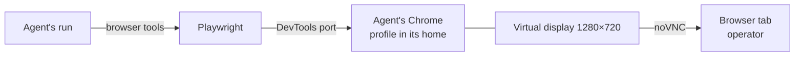

# Browser

The browser is a capability an [agent](agents.md) can have: its own
Chrome on its [machine](machines.md). With the browser on, the agent
gets tools to open pages, read them, click, type, and run JavaScript.
The operator watches the same Chrome live in the agent's **Browser**
tab, and can take over the keyboard and mouse.

The browser keeps its profile in the agent's [home](agent-home.md).
Sites the operator logs the agent in to stay logged in across runs.

## When you use it

Turn the browser on when the agent works on websites that have no
connector: reading a dashboard, filling a form, checking a web front
end. A coding agent that debugs a web page can have both the browser
and [coding](coding/index.md) on.

Use the Browser tab to log the agent in to a site once. The login
stays in its profile, so later runs start logged in.

## How it works

### One Chrome per agent

Each agent with the browser on has its own Chrome. Two agents on one
machine each have their own Chrome, profile, logins, and tab. So they
can hold two accounts on one site.

The agent's slot on its machine sets the Chrome's display and ports
([Machines](machines.md#placement-and-slots)). The display is a
virtual screen of 1280×720.

### When Chrome runs

Chrome starts on the agent's first browser call in a generation, or
when the operator opens its Browser tab. Opening the tab wakes the
machine first if it is down. Chrome stops 5 minutes after the agent's
last browser call or the operator's last input in the tab. Its
profile and logins stay in the agent's home.

Turning the browser off, or changing its language, stops that agent's
Chrome only. Other agents on the machine keep theirs. The next start
uses the new settings.

### Language and timezone

The browser language sets Chrome's interface language and the
language sites see. It is `en-US` by default. The timezone comes from
the machine's public IP address, not from a setting.

### The browser tools

With the browser on, the agent's runs offer eight browser tools. They
drive the agent's Chrome through Playwright
([Native tools](../tools-and-connectors/native.md)). The browser is
not a binding: the switch alone decides whether these tools are
offered, whatever the bindings say.

### Machine size

An agent with the browser on needs at least 1 CPU and 2 GiB of memory
on its machine ([Machine sizing](machines.md#machine-sizing)). The
browser cannot be turned on while the agent's machine is smaller.

## In the app

**Browser** tab, in the agent's inspector, only when the browser is
on:

- Opening it wakes the agent's machine and starts the agent's Chrome
  if needed. While it starts, the tab shows **Starting the browser**
  and says it can take up to a minute when the machine is asleep.
- It embeds the live 1280×720 Chromium view, scaled to the pane. The
  remote desktop keeps its size. Keyboard and mouse go to the remote
  desktop.
- A line says the signed-in profile stays in
  `/home/<agent id>/.browser`. A status badge reads Live, Starting, or
  Failed. **Restart the browser view** reconnects.
- When the browser cannot start, the tab shows **Browser
  unavailable** with the error and **Try again**.
- A clipboard strip moves text in and out. **Paste into the browser**
  pastes the host clipboard, or the field's text, into the page.
  **Copy the browser's selection** copies the remote selection back to
  the host.
- This is where the operator logs the agent in to its sites.

On an agent with the browser off, the tab's address shows **This
agent has no browser** with **Open Settings**.

Sidebar agents with the browser on show a marker.

**Settings**, Model section (**Lead model** on a coding agent): the **Browser** button under **Agent
capabilities** turns it on and off. The create dialog offers the same
button. **Browser language** shows while the browser is on; changing
it restarts the browser. The button is greyed out while off on a
machine below the browser minimum, with a line naming both sizes.

**Browser login needed** strip: after a recipe apply that required a
browser login, that agent's inspector shows a strip that says to take
control of the agent's browser and log in to its site before it can
use it ([Applying recipes](applying-recipes.md)). It has **Open
Browser**, hidden while the Browser tab is open, and **Mark as done**.
Nothing detects the login, so the operator marks it done. The strip
stays hidden while the guild's recipe checklist is open, or while an
apply is in progress. Turning the browser on in Settings does not
show it.

## Rules and limits

| Rule | Value or behaviour |
| --- | --- |
| Default | off |
| Machine minimum | 1 CPU and 2 GiB |
| Display | 1280×720, fixed |
| Language | `en-US` by default; one of a fixed list of tags |
| Timezone | from the machine's public IP |
| Chrome start | first browser call in a generation, or opening the Browser tab |
| Chrome stop | 5 minutes after the last browser call or tab input; on browser off or a language change |
| Profile and logins | kept in the agent's home across runs and containers |
| Browser agents per organisation | the plan may cap them; no cap in core |

## Reference

### Config keys

- `browser` is whether this agent has its own Chrome on its machine.
  Default false. It selects the Browser pane, a live 1280×720
  Chromium/noVNC session on the agent's display, and the eight
  Playwright tools on that agent's runs: `browser_navigate`,
  `browser_snapshot`, `browser_click`, `browser_type`, `browser_fill`,
  `browser_scroll`, `browser_screenshot`, and `browser_eval`. It is not
  a binding. The runtime image is instance-wide: a toolchain the flags
  leave off stays in the image and is not offered.
- `browser_language` is Chrome's UI and Accept-Language when `browser`
  is on. Stored default `en-US`. It is one of these tags, else 422
  (`browser_language must be a supported Chrome language`): `ar`,
  `bg`, `cs`, `da`, `de-DE`, `el`, `en-GB`, `en-US`, `es-419`,
  `es-ES`, `et`, `fi`, `fr-FR`, `he`, `hi`, `hr`, `hu`, `id`, `it-IT`,
  `ja`, `ko`, `lt`, `lv`, `ms`, `nb`, `nl`, `pl`, `pt-BR`, `pt-PT`,
  `ro`, `ru`, `sk`, `sl`, `sr`, `sv`, `th`, `tr`, `uk`, `vi`, `zh-CN`,
  `zh-TW`. A stored config with a missing or unknown tag runs Chrome in
  `en-US`.

Turning `browser` off, or changing `browser_language` while it is on,
stops this agent's Chrome. Other agents on the machine keep theirs. No
configuration change replaces the machine's container.

Turning `browser` on, on create or on update, is 422 when the agent's
machine is below the browser minimum
([Machines](machines.md#placement)). The organisation policy's
`maxBrowserAgents` caps the browser-enabled agents of an organisation.
Above it, creating a browser agent or turning `browser` on is refused
with a limit error (409, `… limit reached: browser-enabled agents`).
Core sets no cap.

### Starting Chrome

The orchestrator computes the slot's display and ports and runs
`agent-browser-start <agent id> <display> <vnc port> <devtools port> <novnc port> <language>`
on the machine. The helper starts, when they are not already
answering:

- an Xtigervnc display `:10+slot` at a locked 1280×720, its VNC
  server on loopback port `5910+slot`
- Google Chrome, or Chromium in an image built with
  `BROWSER=chromium`, with `--no-sandbox`,
  `--user-data-dir=/home/<agent id>/.browser`, and CDP on
  `127.0.0.1:<9300+slot>`
- websockify serving noVNC on port `6100+slot`

It prints the two ports once both answer. Playwright in the image
attaches to the agent's Chrome over its CDP port.

`browser_screenshot` writes `screenshots/latest.jpg` in the agent's
home.

### HTTP

| Route | What it does |
| --- | --- |
| `GET /api/agents/:id/browser` | wakes the machine and starts the agent's Chrome; `{ "status": "ready" }`; 409 `browser is not enabled` with `browser` off; 503 when Chrome fails to start |
| `/api/agents/:id/browser/vnc` and `/api/agents/:id/browser/vnc/*` | proxies the agent's noVNC view, HTTP and WebSocket |

The orchestrator proxies the agent's noVNC view into its Browser tab.
The tab embeds noVNC, scales the framebuffer to the pane, and keeps
the remote desktop size. Operator input on the proxied view restarts
the machine's idle timer and the Chrome's 5-minute timer, at most once
every 30 seconds ([Machines](machines.md#the-container)).

### Browser login strip

The strip's **Mark as done** is remembered per agent in
`localStorage` as `guilds-setup-dismissed:<agent>:browser-login`.
