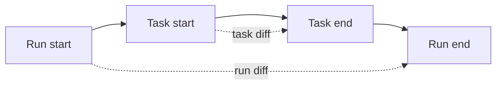

# Reviewing changes

Every change a [coding agent](index.md) makes to a repository can be
reviewed from its run. The platform takes **checkpoints**: snapshots of
each working tree, uncommitted files included, at the start and end of
a run and around every [`code_task`](code-tools.md#code_task). The
difference between two checkpoints is the diff the operator reviews:
what the whole run changed, or what one harness turn changed.

Checkpoints are separate from the agent's own commits. The agent
commits, pushes, and opens pull requests with `shell`, and those go
through the project's usual review on its git host. A commit made by
the agent or its [harness](harnesses.md) also names the run and the
agent in its message.

## Why it exists

An agent's work is only as trustworthy as what the operator can check.
A checkpoint records exactly what was on disk, whatever the agent
committed, stashed, or left uncommitted, without touching its branch or
its index. So the diff of a run is the authoritative link between a run
and a change. The commit trailers are the convenient one.

## How it works

### Checkpoints

A checkpoint is a commit of the working tree built through a temporary
index, recorded under a ref of the run. Uncommitted and untracked files
are included; ignored files are not. The current branch and the index
stay as they are.



- **Run checkpoints.** At a run's first generation, every repository
  in the agent's home gets a `start` checkpoint, once. At the end of
  every generation, each gets an `end` checkpoint, replaced each time.
  The run records, per repository, its branch, its head commit, and the
  diffstat from start to end.
- **Task checkpoints.** Each `code_task` call takes its own `start`
  before the harness starts and its own `end` after it ends, in the
  repository it worked in. Its result and metadata carry the diffstat
  between them and the changed files.

Checkpoints are local to the agent's clone. They are never pushed and
never deleted. Each keeps its commits from `git gc`, so they count
toward the agent's disk cap ([Agent home](../agent-home.md)).

### Diffs

A diff is computed on demand, on the agent's machine, waking it as the
**CLI** tab does. It is redacted with the agent's secret values and cut
at 256 KiB.

### Commit trailers

A commit made through `shell` or by a harness gets two trailers in its
message:

```text
Guild-Run: <run id>
Guild-Agent: <agent id>
```

A `prepare-commit-msg` hook in the image's git template adds them. A
commit made elsewhere, such as from the **CLI** tab, gets none.

## In the app

### The Changes panel

On the **Chat** tab, a coding run's transcript ends with a **Changes**
panel once the run has checkpoints. Each repository shows its name,
its branch, and its diffstat, such as "3 files · +40 −2", or "no
changes". **Show diff** fetches the run's diff from the agent's
machine, and **Hide diff** folds it. It is disabled with no changes.

### The Diff of a code task

A `code_task` row in the run flow opens on its details. Once the task
has an end checkpoint, its views include **Diff**: the change that one
harness turn made. **Metadata** gives its status, harness, repository,
session, diffstat, and its checkpoints as short commit ids, start →
end.

### Reading a diff

A diff shows added lines, removed lines, hunk headers, and file
headers in their own colours, with a copy button. "Loading the diff
from the agent's machine…" shows while it loads. A diff past the cap
ends with "The diff is cut at 256 KiB." A diff that cannot be loaded
shows "Couldn't load the diff" with the reason.

### A review routine

1. Read the agent's final reply: what it changed, what it ran, and what
   failed.
2. Open the **Changes** panel and **Show diff** for each repository.
3. For a surprising change, open the `code_task` row that made it and
   read its **Result** and **Diff**.
4. Review the pull request the agent opened on the git host, where the
   project's own checks run.

## Rules and limits

| Rule | Value or behaviour |
| --- | --- |
| Run checkpoints | `start` once per run, `end` after every generation |
| Task checkpoints | `start` and `end` around each `code_task` |
| What is captured | Committed, uncommitted, and untracked files; not ignored ones |
| Where | Local refs in the agent's clone, never pushed, never deleted |
| Diff size | At most 256 KiB, then cut |
| Redaction | Every diff, with the agent's secret values |
| Trailers | On commits made through `shell` or by a harness |

## Reference

### Refs

| Ref | Written |
| --- | --- |
| `refs/guild/runs/<run id>/start` | Once, at the run's first generation, in every repository under `repos/` |
| `refs/guild/runs/<run id>/end` | At the end of every generation, in every repository |
| `refs/guild/runs/<run id>/tasks/<call id>/start` | Before the harness starts, in the call's repository |
| `refs/guild/runs/<run id>/tasks/<call id>/end` | After the harness ends, in the call's repository |

`guilds-code checkpoint` builds each snapshot: it copies the index to a
temporary one, runs `git add --all` against it, writes the tree, and
records a commit with `git commit-tree`, parented on `HEAD` when there
is one, as `guilds checkpoint <checkpoint@guilds.invalid>`, with the
message `guild run <run id> start` (or `… task <call id> start`). A
generation cut short by an orchestrator restart has no end checkpoint:
the working tree is intact, and the change is attributed to the run
that checkpoints next. A `code_task` the restart cut short gets its own
end checkpoint at startup when its machine is running, so its task diff
is available ([Lifecycle](code-tools.md#lifecycle)).

The run stores `metadata.repos`:
`[{ name, branch, head_sha, start_sha, end_sha, files_changed, insertions, deletions }]`.
The run payload carries it as `repos`.

### HTTP

```text
GET /api/runs/:id/changes                     diffstat per repository
GET /api/runs/:id/changes/:repository/diff    the run's start..end
GET /api/runs/:id/tasks/:call_id/diff         one code_task's start..end
```

- `changes` returns `{ repositories }`, the run's `metadata.repos`.
- Each diff returns `{ repository, diff, truncated }`. It runs
  `guilds-code diff`, which is `git diff --no-color --no-ext-diff`
  between the two refs, on the agent's machine, cut at 256 KiB and
  redacted with the agent's secret values.
- A repository the run did not record is 404 ("the run changed nothing
  in that repository").
- A call that is not a `code_task`, or has no end checkpoint, is 404
  ("that call has no task diff"). The task diff names the call's
  repository.
- Missing checkpoints in the repository, or a failing `git diff`, is
  404. Generation unavailable is 503.

### Commit trailers

The hook is `prepare-commit-msg` in `/usr/local/share/guilds/git-template`,
the image's `init.templateDir`. It runs `git interpret-trailers` with
`--if-exists addIfDifferent`, only when `GUILD_RUN_ID` is set, and
`Guild-Agent` falls back to `unknown`. `shell` and the harness set both
variables. Clones and `git init` take the hook from the template. A
repository that sets its own hooks path skips it.

### Code

`runtime/guilds-code` (`checkpoint`, `diff`),
`runtime/git-template/hooks/prepare-commit-msg`,
`apps/orchestrator/src/http/coding-routes.ts`, and in the app
`apps/web/src/features/agent/chat/ChangesPanel.tsx`.
