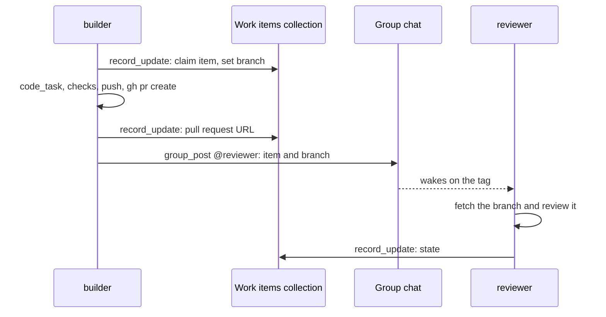

# Coding teams

A guild can hold several [coding agents](index.md): one that builds a
feature, one that reviews, one that fixes what the tests find. They
share the guild's [repositories](repositories.md) but never a working
tree: each clones its own copy into its home. Work moves between them
the way it moves between people, as branches and pull requests on the
remote.

A coding team needs nothing beyond what every guild has. Its
[group chat](../group-chat.md) carries the hand-offs, a
[collection](../collections.md) tracks the work items, and a guild
[note](../notes.md) holds what the code does not say.

## When you use it

You split coding work between agents when the roles differ: different
focus, different harness, different model, or a reviewer that should
not have written the code it reviews. One agent with one repository
needs none of this.

## How it works

### Branches and pull requests

The `coding` section of every coding agent's system prompt tells it
to:

- work on a branch named `agent/<its name>/<topic>`, never on the
  default branch;
- push and open pull requests itself, with `shell` and
  `gh pr create`;
- record the pull request's URL where the work item is tracked.

So each agent's branches are recognisable by name, and the pull
request is the unit of hand-off. A commit also carries `Guild-Agent`
and `Guild-Run` trailers that name who made it and in which run
([Reviewing changes](reviewing-changes.md#commit-trailers)).

### Dividing the work

A guild that divides coding work between roles uses:

- **a collection of work items**, with fields such as state,
  repository, branch, pull request, and owner. Agents find open items
  with `record_list` and claim one with `record_update`
  ([Collections](../collections.md));
- **a tagged `group_post`** that names the item and the branch for the
  next agent. The tag wakes that agent ([Group chat](../group-chat.md));
- **a guild note per repository** holding what the code does not say:
  layout, build and test commands, and conventions. Each coding agent's
  [Task](../task.md) embeds it, and `code_task` can append it to a
  brief through `notes`.

### Sharing a machine

Coding agents of a team often sit on one `code` machine. Agents on one
machine can read each other's homes, tokens, and sessions
([Machines](../machines.md),
[SEC-24](../../architecture/security-register.md#sec-24--agents-on-one-machine-can-read-each-others-homes-tokens-and-sessions)).
An agent whose data must stay apart goes on a machine of its own.

## Rules and limits

| Rule | Value or behaviour |
| --- | --- |
| Working trees | One per agent, never shared |
| Repositories | The guild's, shared by every coding agent of the guild |
| Branch name | `agent/<agent name>/<topic>` |
| Pushes and pull requests | By the agent with `shell`; the harness never pushes |
| Commit trailers | `Guild-Run` and `Guild-Agent` on commits made through `shell` or by a harness |
| Coding agents per organisation | Bounded by the policy's `maxCodingAgents`, where an edition sets it |

## Reference

- The branch and pull request rules live in the `coding` section of
  `apps/orchestrator/src/prompts/system.md`
  ([Coding agents](index.md#what-the-agent-is-told)).
- Each agent clones into `/home/<agent id>/repos/<name>`
  ([Repositories](repositories.md#identity-and-clone)).
- A pushing agent needs its repository added with a GitHub login,
  which gives it a token with contents and pull requests write
  ([Repositories](repositories.md#tokens)).
