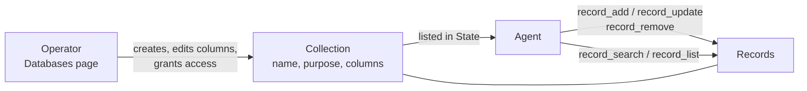

# Collections

A collection is a set of typed records that an operator defines and
agents fill. It is like a small spreadsheet: the operator declares
the columns, and each record is one row of values that fit them. A
lead list, a queue of work items, or a log of published posts are
collections.

Collections live in the organisation's [artifact store](artifacts.md).
A collection belongs either to the whole organisation or to one
guild. Agents read and write records with record tools. They never
create, change, or delete a collection itself. Long-form text belongs
in a [note](notes.md) instead.

The app names it three ways: a **database** on the **Databases** page
and the **New database** button, **Tables** for the record tools on the
Tools view, and **Insert › Table** in the Task and note editor.

## When you use it

- Agents produce or consume many items of the same shape: leads,
  tickets, articles, prices.
- Agents hand work to each other: one adds a record with a status,
  another finds the records in that status.
- A routine picks up what changed since it last fired
  ([Routines](routines.md)).
- An operator wants to browse, filter, or export what agents found.

## How it works

### The operator defines it, agents fill it



The operator creates a collection on the **Databases** page, or
applies a Prompt Studio coach's proposal
([Studio proposals](studio-proposals.md)). A collection has a name, a
purpose, and columns. Each column has a type (text, number, boolean,
date and time, or a list of strings) and a description. The agent
reads the purpose and the descriptions to know what goes where.

Every run's system prompt lists the collections its State catalog
holds, with their columns ([System prompt](system-prompt.md)). The
agent does not need to look them up. The catalog holds the agent's
guild's own collections and the organisation collections its guild
has a grant on, as the agent's own grant adjusts them. An
organisation collection the agent reaches only through its own grant
is not listed. The record tools still accept it by name.

### Records

A record is one row. Its values must match the columns exactly:
a number column takes a number, not the text `"42"`. A record that
breaks a rule is refused, and the error lists every problem at once.

Each record gets a number, its id, from 1 upwards. An id is never
reused, even after the record is removed.

A collection can mark one column as unique, such as an email or a
URL. Adding a record whose unique value already exists updates the
existing record instead of creating a duplicate.

### Finding records

- `record_search` finds records by the words in their values, in one
  collection or in every collection the agent can read.
- `record_list` lists one collection, filtered by column values,
  changes since a time, and sorted.

A queue or hand-off collection keeps its state in a text column with
a fixed list of allowed values, written on every record. Consumers
find work by filtering on that column. A check for an existing record
filters on the unique column, or runs one `record_search` with `OR`.

### Organisation and guild collections

- A **guild's own collection** belongs to one guild. Every agent of
  that guild can write it. No other guild reaches it. Deleting the
  guild deletes the collection and its records.
- An **organisation collection** is reached only through a grant the
  operator sets.

A name is unique in the whole organisation, whatever the owner. Two
guilds cannot both own a collection called `queue`.

### Who reaches a collection

Access to a collection is a grant, separate from the note grants.
For scopes and grants in general, see [Access](access.md).

- A **guild grant** gives every agent of the guild `read` or `write`,
  including agents added later.
- An **agent grant** overrides its guild for one agent. It can be
  `none`, `read`, or `write`.

```text
effective = agent grant ?? guild grant        write implies read
```

So one member can be held back or raised:

- `none` keeps it out of a collection the rest of the guild reaches
- `read` holds it to reading where the guild writes
- `write` raises it above a guild that only reads

On a guild's own collection, every agent of that guild starts at
`write`. The guild takes no grant on it. An agent grant still
overrides it, so a single member can be held back.

A collection the agent cannot read behaves as if it did not exist. A
write to a collection the agent can only read is refused and names
the collection.

Every organisation member reaches every collection with `write`
through the **Databases** page and the HTTP API. That includes the
own collections of private guilds the member cannot see
([SEC-37](../architecture/security-register.md#sec-37--any-organisation-member-can-read-and-change-a-private-guilds-notes-and-databases-through-organisation-wide-routes)).

## In the app

### The Databases page

The **Databases** page, at `/databases`, is where the organisation
builds its collections and browses their records.

The left column lists them by owner: the organisation's first, then
each guild's own under its name. Each row shows the name, purpose,
live record count, and when it last changed.

**New database** asks for a name, a purpose, an owner (the
organisation, or one guild), and columns.

A collection opens at `/databases/<id>` with three views, each with
its own `?tab=`:

- **Records**: a grid over the declared columns plus `id` and
  `updated_at`.
  - Sort by clicking a header. Pages hold 50 records, with the total.
  - The search box runs the text search on Enter (top 50, unsorted).
  - **Filters** filter by column type: an exact `id`; "contains" for
    text and for an open list (an item, same as text); a select for a
    column with allowed values or a boolean, including "(empty)",
    which matches a missing value; from and to bounds for numbers and
    dates.
  - **Add record**, or clicking a row, opens the record dialog: a
    field per column (a list as comma-separated items) and the
    provenance strip ([Artifact store](artifacts.md#every-change-is-recorded)).
    When the server rejects the record, the dialog shows its answer
    verbatim, including a multi-line `record rejected` list.
  - After a save, a notice says when the record merged into an
    existing one (`Merged into record #N`) and which values still do
    not fit their columns.
  - A stored value that does not fit its column shows as a marked
    chip in the grid.
  - **Delete record**, in the dialog or on the row after a confirm,
    removes the record.
  - **Delete all** empties the collection after a confirm. The
    collection, its columns, and its access stay, and ids are not
    reused.
  - **Refresh** re-reads the records.
- **Columns**: one row per column: name, type (text, number,
  boolean, datetime, array), **required**, **unique** (text and
  number only), description, and for a text or array column its
  allowed values.
  - Rows move up and down. Columns are added and removed. Rule breaks
    show inline.
  - **Save columns** on a collection with live records first asks to
    apply the listed changes to its records: a rename moves the value
    in every record, a removal deletes the values, a retype or a
    changed value list leaves values as they are.
  - Adding columns applies directly.
  - A column that cannot become unique because values repeat is
    refused by the server, with the duplicates listed.
- **Access**: **Guilds** with their grant, and **Agents** with their
  guild's mode, their own setting, and the effective mode. It is
  read only. Each entry links to the guild's or the agent's
  **State › Databases** tab, where access is changed. A guild's own
  collection says that only that guild's agents reach it, that the
  guild writes it, and that an agent can narrow its own access.

The header shows the name, the owner chip, the record and column
counts, and the purpose. It also has:

- a pencil to rename the collection, edit its purpose, or move it
  between the organisation and a guild. A warning explains that
  moving to a guild drops every grant, and moving to the
  organisation keeps the former guild's reach as Read & write.
- **Export**, which downloads the records as JSONL.
- **Delete**, which confirms with the record count and the name typed
  out, and removes every grant with it.

Records re-read after every write and when the window regains focus.

The Prompt Studio inspector shows the same records under its
**Databases** tab ([Prompt Studio](prompt-studio.md)). The coach can
propose to create, change, or delete the source guild's own
collections and the organisation's. A proposal can also change the
grants of the source guild and its agents
([Studio proposals](studio-proposals.md)).

### The guild's State › Databases tab

The guild's **State › Databases** tab lists:

- the guild's own collections, each marked **Guild only · Read &
  write**
- every organisation collection, with a None / Read / Read & write
  control that writes the guild's grant on click

Other guilds' collections are not listed. **New database** opens the
creation form with this guild as the owner. A name opens that
collection on the **Databases** page.

### The agent's State › Databases tab

The agent's **State › Databases** tab lists every collection the
agent can be given, with:

- a **Guild** control (None / Read / Read & write), what every member
  gets. It is fixed at Read & write on the guild's own collections.
- a **This agent** control (Inherit / None / Read / Read & write).
- the effective access.

The agent's own setting replaces what its guild gives it, so **None**
keeps this one agent out of a collection the rest of the guild
reaches. Each click writes at once. A name opens that collection on
the **Databases** page.

### Embedding in the Task

The Prompt tab's **Insert › Table** adds a collection to the Task as
`![[display-path]]`. In the run's prompt it becomes the collection's
name; records are not inlined ([Task](task.md)).

## Rules and limits

| Rule | Value or behaviour |
|---|---|
| Name | lowercase letter first, then lowercase letters, digits, `_`, `-`; 63 characters at most; unique in the organisation among live collections |
| Purpose | required, 400 characters at most |
| Collections per organisation | 100 live |
| Records per collection | 10 000 live |
| Columns per collection | 64 |
| Unique columns | at most one, text or number |
| Indexed text per record | 32 KB; text past it is not searched |
| Ids | start at 1, never reused |
| Who creates, changes, deletes a collection | the operator only |
| Size of one record | 256 KB of JSON |
| Column values | text, number, boolean, datetime, or a list of strings; a many-to-many of records is a second collection |
| Agent queries | the record tools only; a script reads records only from a tool result |
| Collections listed in State | 50 at most |
| Unknown or unreadable collection | 404, as if it did not exist |
| Write with `read` access | 403, naming the collection |

## Reference

### Storage

A collection is an `artifact_collections` row: `name`, `purpose`,
`columns`, `next_id`, and `guild_id`.

- `guild_id` set: the collection belongs to that guild
  (`scope: "guild"`).
- `guild_id` null: an organisation collection (`scope: "org"`).

Records are organisation-level artifacts of `kind` `object`. `key` is
the decimal id. `content_json` holds the declared columns only.
`identity` holds the normalised unique value. There is no guild or
agent form of a record, and no folder inside a collection.

Name rule: `^[a-z][a-z0-9_-]{0,62}$`.

Code: `apps/orchestrator/src/artifacts/store.ts`.

### Columns

`apps/orchestrator/src/artifacts/columns.ts` is the column dialect.
Each column is `{ name, type, description, required, unique,
values }`:

| Field | Rule |
|---|---|
| `name` | `^[a-z][a-z0-9_]{0,63}$`, unique in the collection; `id`, `created_at`, `updated_at`, `created_by`, and `updated_by` are reserved |
| `type` | `text`, `number`, `boolean`, `datetime`, or `array` |
| `description` | required, at most 200 characters; State prints it to the agents |
| `required` | default false |
| `unique` | default false; `text` or `number` only; at most one per collection |
| `values` | `text` or `array` only: 1 to 50 distinct non-empty strings of at most 64 characters; the column then accepts only those |

A value is accepted by its column's type only:

- a string for `text` (one of `values` when the column lists them)
- a finite JSON number for `number`
- `true` or `false` for `boolean`
- an ISO 8601 string with a timezone for `datetime` (stored
  normalised to UTC)
- a JSON list of distinct non-empty strings for `array` (at most 50
  items, each at most 200 characters; one of `values` when the
  column lists them)

`[]` is a value, not a missing column. There is no coercion (`"42"`
in a number column is an error). There is no nested object type.

Changing the columns of a live collection is applied to the records
in the same transaction:

- a renamed column (`rename_from` on the new definition) moves its
  key in every live record
- a removed column drops it
- a column that becomes unique is refused with 409 while live
  records repeat a value
- the search text is rebuilt

Retyping a column or changing its `values` leaves stored values as
they are. They surface as `warnings` on the next `record_update` of
that record.

### Writes and ids

`record_add` validates the whole body. An unknown column, a missing
required column, a wrong type, a value outside `values`, or an
unparsable datetime is a problem. Every problem is reported in one
422 with nothing written:

```text
record rejected
- column "status": expected one of new, contacted, won, lost; got "pending"
- column "score": expected number; got "42"
- column "notes": unknown column; declared columns are email, status, score, signed_up_at
```

The store then locks the collection row, takes `next_id` as the
record's id, writes the record with `key` equal to its decimal form,
and increments the counter in the same transaction.

`record_update` merges a patch. The columns present are validated by
the same rules. `null` clears an optional column and is a problem on
a required one. The rest of the record is kept. After the merge the
store checks the whole record against the current columns. It returns
problems in columns the patch did not touch as `warnings` without
rejecting the write.

`record_remove` soft-deletes one record.

All three need `write`. An unknown id is 404.

The operator can drop every live record at once without deleting the
collection. Ids are still never reused.

### Unique column

The store derives `identity` from the unique column on every write.
Text is NFC-normalised, trimmed, and lowercased. A number is its
decimal string.

A `record_add` whose identity already exists among the live records
becomes an update of that record, with the sent body as the patch.
The tool result carries `note: merged into existing record <id>`; the
HTTP API returns `merged: <id>`.

A `record_update` that moves the unique column onto another record's
value fails with 409 naming that record.

A partial unique index on (`collection_id`, `identity`) over live
records backs the rule. The comparison is exact, never by similarity.

### Records as returned

Every record a tool or the API returns carries `id`, `collection`,
the declared columns, `created_at`, `updated_at`, `updated_by`, and
`version`. The API adds `display_path`. The body holds declared
columns only.

### Record tools

Five tools, each naming the collection by `collection`:

```text
record_search  { collection?, query, where?, limit? }
record_list    { collection, where?, since?, order?, limit?, offset? }
record_add     { collection, body }
record_update  { collection, id, body }
record_remove  { collection, id }
```

- `record_add` takes `body` (declared columns only). It validates
  every value and rejects with every problem at once (422
  `record rejected`). It assigns the id and returns `{ record }`, plus
  `note: merged into existing record <id>` when the unique column
  matched a live record.
- `record_update` takes `id` and a `body` of the columns that change
  (`null` clears an optional column). It returns
  `{ record, warnings? }`.
- `record_remove` soft-deletes by `id` and returns `{ removed }`.
- A successful `record_add` publishes `guild.files.changed` for the
  collection path. `record_update` and `record_remove` publish it for
  the record path.

### Search

`record_search` is lexical: PostgreSQL text search (`tsvector`,
`simple` configuration), with `pg_trgm` similarity on one text or open
array column at a time. There are no embeddings.

Each record is indexed on its id and `search_blob`: every value in
the body as text, keys left out so that a column name shared by every
record never matches. `identity` is not indexed. The blob is cut at
32 KB.

`query` uses the `websearch_to_tsquery` grammar:

- terms are ANDed
- `OR` widens
- quotes keep a phrase
- `-` excludes

A query that is one token also matches the value text by substring,
so a partial identifier hits. Search is not fuzzy: a misspelled word
finds nothing.

Without `collection`, it runs over every collection the agent can
read, and each hit carries `collection`. With `collection`, `where`
narrows the hits by column. `where` without `collection` is 422
`where needs a collection`.

Results are ranked by `ts_rank_cd` plus the similarity of every text
or open-array `where` term, then by `updated_at`. `limit` is 20 by
default and at most 100.

The **Databases** page's record search runs the same predicate.

### `record_list`

`record_list` lists one collection:

- `where`: `{ column: term }`, at most 8 columns, a term at most 200
  characters; `id` is allowed.
- `since`: an ISO 8601 timestamp; only records created or updated at
  or after it.
- `order`: `{ column, direction }` (or the string `"column desc"`)
  over a declared column (not an `array`), `id`, `created_at`, or
  `updated_at`. Default `id asc`. With `since`, default
  `updated_at asc`. A schedule wake-up carries `previous_run_at`, so
  a routine can pick up exactly what changed since it last fired.
- `limit` 20 by default and at most 100; `offset` 0 or more.

A `where` term matches by the column's type:

| Column | Term matches by |
|---|---|
| `text` | substring, plus similar spelling (`word_similarity` ≥ 0.5) when the term has no digit |
| `text` with `values` | exact; a term outside the list is a 422 naming the allowed values |
| `number`, `datetime` | exact, or `{ "gte": v }`, `{ "lte": v }`, or both |
| `boolean`, `id` | exact |
| `array` | an item by substring, plus similar spelling when the term has no digit |
| `array` with `values` | contains that text item exactly; a term outside the list is a 422 |
| any | `null` matches a missing or null value |

The result is `{ total, records }`. `total` counts every record
matching `where` and `since`, regardless of paging. `where` with `id`
reads one record.

Similar spelling applies to one text or open array column at a time,
never to a whole record or to a term with a digit. At the 0.5 floor a
transposition in a five-letter word still matches.

A narrowed `record_list` (`where` or `since`) that matches nothing
returns a `hint` that explains:

- what was asked
- how many records the collection holds and when the newest changed
- the declared columns with their types and flags
- that a larger limit will not change the answer

With `since`, it adds that existence checks use `where` on the
unique column or `record_search`. Otherwise it restates how `where`
matches by type and that `record_search` matches words in the
values.

### Access grants

A grant is one `collection_access` row: `subject_type` `guild` or
`agent`, `subject_id`, and `mode`, one row per subject and
collection. A guild row's mode is `read` or `write`. An agent row's
mode is `none`, `read`, or `write`.

On a guild's own collection:

- a guild row is refused with 422 (`<name> belongs to <guild>: it is
  written by that guild and takes no guild grant`)
- an agent row is accepted only for an agent of that guild (422
  otherwise)

Moving a collection to a guild drops every grant. Moving it to the
organisation keeps the former guild's reach as a `write` grant.

Deleting a guild or an agent deletes its grant rows. Deleting a
collection soft-deletes its records and drops its grants. Clearing a
collection's records leaves the collection and its grants.

The four note grant bindings do not touch collections
([Notes](notes.md)).

A tool call on a collection the agent cannot read fails with 404
`unknown collection <name>`. A write with `read` fails with 403
`no write access to <name>`.

### In State

State lists, in name order and capped at 50, the agent's guild's own
collections and the organisation collections with a grant row for
its guild, each at its effective mode. An entry whose effective mode
is no access is left out. Each entry has `name`, `purpose`, `access`
(`read` or `write`), `scope` (`guild` or `org`), `display_path`, and
`columns`. Past the cap, one more entry carries `truncated: true`.

An organisation collection with only an agent row for this agent is
not in State. `record_list`, `record_add`, `record_update`,
`record_remove`, and `record_search` with or without `collection`
still reach it at that row's mode.

### HTTP

Organisation-authorized routes behind the **Databases** page, all
acting as the operator:

```text
GET    /api/collections                          every live collection with its record count
POST   /api/collections                          { name, purpose, columns, guild_id? }; 201
GET    /api/collections/:id                      the collection, its count, and access_list (guilds, agents)
PATCH  /api/collections/:id                      { name?, purpose?, columns?, guild_id? }; a renamed column carries rename_from; guild_id null moves it to the organisation
DELETE /api/collections/:id                      204
GET    /api/collections/:id/export               the live records as JSONL, without collection and version
GET    /api/collections/:id/records              query, where, since, order, limit, offset; { total, records, columns }
POST   /api/collections/:id/records              { body }; 201 { record, merged }
DELETE /api/collections/:id/records              every live record; the collection, grants, and next_id stay; 204
GET    /api/collections/:id/records/:rid
PATCH  /api/collections/:id/records/:rid         { body }; { record, warnings }
DELETE /api/collections/:id/records/:rid         204
GET    /api/guilds/:id/collection-access         the guild's own collections (scope guild, write) and every organisation collection with the guild's grant
PUT    /api/guilds/:id/collection-access         { collection_id, mode }; mode null removes the grant; 204
GET    /api/agents/:id/collection-access         the guild's own collections and every organisation collection, with the guild's grant, the agent's grant, and the effective mode
PUT    /api/agents/:id/collection-access         { collection_id, mode }; mode none, read, write, or null to inherit; 204
```

- `where` and `order` travel as JSON in the query string. `order_by`
  and `direction` are accepted in place of `order`.
- A `query` runs the text search instead of a listing; `total` is
  then the number of hits.
- Records carry `display_path`, so the provenance strip can look them
  up.
- The routes act as the operator for any organisation member. They
  list and change every collection of the organisation, private
  guilds' own collections included. The `access_list` of
  `GET /api/collections/:id` names every guild and agent the
  collection reaches, private guilds included.
- **Delete all**, deleting a collection, and a column rename or
  removal record no file change
  ([Artifact store](artifacts.md#file-provenance)).

Code: `apps/orchestrator/src/http/routes.ts`,
`apps/orchestrator/src/http/artifact-files.ts`,
`apps/orchestrator/src/artifacts/search.ts`,
`apps/orchestrator/src/toolbox/artifacts.ts`.
