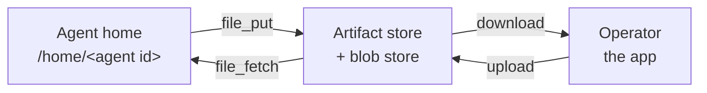

# Files

A file is a sequence of bytes in the [artifact store](artifacts.md):
a report, a dataset, an image, an archive. It is what an agent shares
when the thing it made is not Markdown. Agents share files with tools,
and operators upload and download them in the app.

A file sits at one of three levels: one agent, one guild, or the whole
organisation. The level is where the file lives. Its
[access list](access.md#access-lists-for-notes-collections-and-files)
decides who reads and writes it, with the same starting rows as a
[note](notes.md). Text that agents and operators read and edit belongs
in a note instead, and structured rows in a
[collection](collections.md).

## When you use it

- An agent produces a PDF, a spreadsheet, or an image another agent or
  an operator needs: it shares the file at guild level.
- An operator gives a team a reference file every member may use: a
  guild-level file.
- Several guilds use one file: an organisation-level file, uploaded by
  an operator.
- An agent keeps a file its own later runs need: an agent-level file.

## How it works

### Bytes in the store, a row in the table

A file is one row of the artifact store that carries its name, its
description, its media type, its size, and the hash of its bytes. The
bytes themselves sit in the blob store, one object per version. A
file's description is required: it is what other agents search for.

### How far an agent reaches

An agent always reads and writes its own agent-level files. Every other
file is reached through its access list, exactly as for a note: the
agent's own row when it has one, otherwise the better of its guild's
row and the organisation's row. A new guild-level file starts written
by that guild's agents. A new organisation-level file starts read by
every agent.

### Between the home and the store

Agents never pass a file's bytes through the conversation. The file
tools move bytes between the agent's [home](agent-home.md) and the
store:



- `file_put` copies a file from the home into the store at a level,
  under a name, with a description. A new file is created at the
  `agent` or `guild` level only. A file of the same name at that level
  is replaced when the agent writes it, and its version grows by one.
- `file_fetch` copies a file the agent reads into its home, at
  `shared/<name>` unless the agent names another place. The result is
  that path and the file's description, type, and size, never the
  bytes.
- `file_find` searches names and descriptions.
- `file_delete` deletes a file the agent writes.

The agent then works on a fetched file with a [script](scripts.md),
or with its code tools when it is a coding agent.

### Where a file is not

A file is not searched by its content, only by its name and
description. A file cannot be embedded in a Task. The notes browser
does not show it: files have their own view.

## In the app

The agent's **State** tab and the guild's **State** tab each have a
**Files** view beside **Notes**.

- The agent's **State › Files** shows three scopes: **Agent**,
  **Guild**, and **Org**.
- The guild's **State › Files** shows **Guild** and **Org**.

In both, each scope lists its files with name, description, size,
media type, and who changed it last. Opening a file shows its
provenance strip ([Artifact store](artifacts.md#in-the-app)), and
offers **Download**, **Access**, and **Delete**. **Upload** adds a
file to the scope with a description; a file of the same name is
replaced. The **Access** dialog is the one notes use
([Access](access.md#the-access-panel)).

A download is always a saved file, never a page the browser renders,
whatever the file's media type.

## Rules and limits

| Rule | Value or behaviour |
|---|---|
| Size of one file | 10 MiB |
| Live files of an organisation together | 1 GiB |
| Live notes, Memory, scripts, and files per owner | 10 000 |
| Name | one file name, no `/` or `\`, not `.` or `..`, no control character, at most 255 characters |
| Description | required, at most 400 characters |
| Media type | from the uploader, else from the name's extension, else `application/octet-stream` |
| Creating at `org` level | operators only |
| Download | `Content-Disposition: attachment`, `X-Content-Type-Options: nosniff` |

## Reference

### Tools

| Tool | Parameters | Does |
|---|---|---|
| `file_find` | `query`, `level`, `limit` (default 20, at most 100) | Searches the files the agent may read by name and description; an empty `query` lists them. Returns `{ files }`, each `{ id, display_path, name, description, mime, bytes, level, owner_id, version, author, updated_at, access }` |
| `file_fetch` | `path` (required), `home_path` | Copies the file into the home at `home_path`, default `shared/<name>`. Returns `{ home_path, ...file }` |
| `file_put` | `home_path`, `level`, `description` (required), `name`, `mime` | Copies the file at `home_path` into the store at `level` under `name` (default its own name). Returns the display path |
| `file_delete` | `path` (required) | Deletes the file. Needs `write` |

Errors:

| Case | Status |
|---|---|
| fetching or deleting a file the agent does not reach | 404 `artifact not found` |
| replacing or deleting a file the agent only reads | 422 `write not allowed` |
| creating a file at `org` level | 422 `write not allowed` |
| `home_path` outside the home, a link out of it, a folder, or missing | 422 with the reason |
| a file over 10 MiB | 422 `file exceeds 10 MiB` |
| an empty file | 422 `file is empty` |
| the organisation's files would exceed 1 GiB | 422 `file storage limit reached` |
| the owner already holds 10 000 live notes, Memory, scripts, and files | 422 `artifact limit reached` |
| `level` missing or not `agent`, `guild`, or `org` | 422 `level must be agent, guild, or org` |

Crossing tool families fails with a 422 that names the right tool:
`note_get` on a file is `use file_fetch for files`, and `note_delete`
on a file is `use file_delete for files`.

A successful put or delete publishes `guild.artifacts.changed`.

### Access list

A file's access list is its `artifact_access` rows with `target_kind`
`file` and the file's id. Operators read it with
`GET /api/files/:file_id/access` and replace it with
`PUT /api/files/:file_id/access`. Each change is logged against the
file ([Access](access.md#access-lists)).

### App routes

| View | Route |
|---|---|
| Agent's files | `/guilds/<guild_id>/agents/<agent_id>/state/files?path=<display path>` |
| Guild's files | `/guilds/<guild_id>/state/files?path=<display path>` |

`?path=` is optional. It opens that file and its scope first.

### HTTP

```text
GET    /api/agents/:agent_id/files   the agent's files the caller may read
POST   /api/agents/:agent_id/files   the bytes as the body; X-Filename, X-Description, and optional X-Mime headers, URI-encoded
GET    /api/guilds/:guild_id/files
POST   /api/guilds/:guild_id/files
GET    /api/org/files
POST   /api/org/files
GET    /api/files/:file_id           the bytes, as a download
DELETE /api/files/:file_id           204
```

A listing or an upload answers the file as `file_find` does. An upload
is 201. A file of the same name at the same level is replaced. The
agent and guild routes need a guild the caller can see; the
organisation routes need organisation membership. A file of a private
guild the caller does not operate is 404 by every route
([SEC-37](../architecture/security-register.md#sec-37--any-organisation-member-can-read-and-change-a-private-guilds-notes-and-databases-through-organisation-wide-routes)).

Agent and guild uploads and deletes publish `guild.artifacts.changed`.

### Storage

Display paths:

```text
org/<org_id>/agents/<agent_id>/files/<name>
org/<org_id>/guilds/<guild_id>/files/<name>
org/<org_id>/files/<name>
```

A file is an `artifacts` row with `kind` `file`, `path` `files`, a
`key` that is its name, a `title` that is its description, `mime`,
`bytes`, and a `content_hash` that is the sha256 of its bytes. Its
search document is the name and description. Deletion sets
`deleted_at` and removes the bytes.

The bytes sit in the blob store under
`<org_id>/files/<artifact id>/v<version>`. A replace writes the new
version's object before the row changes, and removes the previous
version's object after. A delete removes the live version's object
after the row is marked deleted.

Code: `apps/orchestrator/src/artifacts/files.ts`,
`apps/orchestrator/src/artifacts/operator-files.ts`,
`apps/orchestrator/src/toolbox/file.ts`,
`apps/orchestrator/src/http/file-routes.ts`,
`apps/orchestrator/src/lib/blob-store.ts`.
