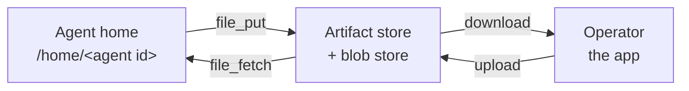

# Files

A file is a sequence of bytes in the [artifact store](artifacts.md):
a report, a dataset, an image, an archive. It is what an agent shares
when the thing it made is not Markdown. Agents share files with tools,
and operators upload and download them in the app.

A file has an [access list](access.md#access-lists-for-notes-collections-and-files),
which decides who reads and writes it, and a home guild, which groups
it in the app's lists, as a [note](notes.md) does. A file's name is
unique in its organisation: one
name is one file. Text that agents and operators read and edit
belongs in a note instead, and structured rows in a
[collection](collections.md).

## When you use it

- An agent produces a PDF, a spreadsheet, or an image another agent or
  an operator needs: it shares the file, and an operator gives its
  guild or the operator a row on it.
- An operator gives a team a reference file every member may use: an
  upload whose row is the guild.
- Several guilds use one file: an upload whose row is the
  organisation, or one row per guild.
- An agent keeps a file its own later runs need: a file it shares,
  which only it writes until an operator shares it.

## How it works

### Bytes in the store, a row in the table

A file is one row of the artifact store that carries its name, its
description, its media type, its size, and the hash of its bytes. The
bytes themselves sit in the blob store, one object per version. A
file's description is required: it is what other agents search for.

### How far an agent reaches

An agent reaches a file through its access list alone, exactly as
for a note: the agent's own row when it has one, otherwise the better
of its guild's row and the organisation's row. A file an agent shares
starts with that agent at `write`. A file an operator uploads starts
with the one row the upload names, the organisation at `write` when
it names none. An operator reads and writes every file that is not
hidden from them
([Access](access.md#access-lists-for-notes-collections-and-files)).

### Home guild

Every file has a home guild, as a note has
([Notes](notes.md#home-guild)): the guild it was made in, or none
when it is the organisation's. A file an agent shares is homed in the
agent's guild. A file an operator uploads in the app is homed in the
guild of the page it is uploaded on; over HTTP, in the guild
`X-Home-Guild` names, or in none. Replacing a file keeps its home,
and no write changes it. The home groups the lists in the app and
hides the file from every operator who cannot see that guild,
whatever its rows say. It decides nothing about which agent reaches
the file.

### Between the home and the store

Agents never pass a file's bytes through the conversation. The file
tools move bytes between the agent's [home](agent-home.md) and the
store:



- `file_put` copies a file from the home into the store under a
  name, with a description. A file of the same name in the
  organisation is replaced when the agent writes it, and its version
  grows by one; the agent is refused when it does not. A missing one
  is created with the agent at `write`.
- `file_fetch` copies a file the agent reads into its home, at
  `shared/<name>` unless the agent names another place. The result is
  that path and the file's description, type, and size, never the
  bytes.
- `file_find` searches names and descriptions.
- `file_delete` deletes a file the agent writes.

The agent then works on a fetched file with a [script](scripts.md),
or with its code tools when it is a coding agent.

### Where a file is not

A file is not searched by its content, only by its name and
description. A file cannot be embedded in a Task. The notes browser
does not show it: files have their own view.

## In the app

The agent's **State** tab and the guild's **State** tab each have a
**Files** view beside **Notes**, over the organisation's one set of
files. It lists them in the two sections the notes browser has
([Notes](notes.md#in-the-app)):

- **Guild files**: the files homed in the page's guild, whatever their
  rows. On an agent's page, the page's guild is the agent's.
- **Shared with this guild**: the files homed in another guild or in
  the organisation whose access list has a row for the guild, one of
  its agents, or the organisation. Each one names its home before its
  facts: the guild's name, or **Organisation**.

A file is in one section at most, and a file hidden from the operator
is in neither. Each section has a label with its count, folds open
and closed, and says what it holds when it holds nothing.

- Each section lists its files by name, with description, size, media
  type, who changed it last, and when. The search box filters both
  sections by name and description.
- Each file carries the tag a note carries: on a guild's page **All
  agents · read & write**, **All agents · read**, **Some agents**, or
  **No access**; on an agent's page **Read & write**, **Read**, or
  **No access**.
- A file tagged **No access** is greyed. Clicking it opens its access
  dialog instead of the file. The browser never opens a greyed file by
  itself.
- An open file shows its provenance strip
  ([Artifact store](artifacts.md#in-the-app)), then its description,
  type, size, version, and display path. Its history holds the changes
  of the files that held this name and that the operator reads
  ([Artifact store](artifacts.md#file-provenance)).
- Its header offers **Access**, **Download**, and a delete button.
  The **Access** dialog is the one notes use, and a greyed file opens
  it too ([Access](access.md#the-access-panel)). A change to the list
  refreshes both sections at once.
- Deleting asks first. Agents that fetched the file keep their
  copies.
- **Upload a file** takes a file, a description of at most 400
  characters, and the file's first access row: a subject and a mode.
  The row starts as the page's guild or agent at `write`; any subject
  and mode can be picked instead. The dialog shows the file's
  **Home**, the page's guild, read only, beside the row. It refuses an
  empty file, a file over 10 MiB, or no description before it sends
  anything. The dialog reads: "A file of the same name in this list is
  replaced and keeps its access list and home; a name another file of
  the organisation holds is refused." It sends the version of the file
  of that name in the page's sections, so it replaces that version, or
  `0` when neither section holds a file of that name. A name another file of the organisation holds
  is then refused with "A file with this name already exists in the
  organisation, outside this list.", and a file replaced since the
  list loaded with "The file was replaced since this list loaded.
  Upload again to replace the new version." Every files list refreshes
  after an upload, refused or not. The media type is the one the
  browser gives.

A download is always a saved file, never a page the browser renders,
whatever the file's media type.

## Rules and limits

| Rule | Value or behaviour |
|---|---|
| Size of one file | 10 MiB |
| Live files of an organisation together | 1 GiB |
| Live notes and files per organisation | 10 000 together |
| Name | one file name, no `/` or `\`, not `.` or `..`, no control character, at most 255 characters; unique in the organisation |
| Description | required, at most 400 characters |
| Media type | from the uploader, else from the name's extension, else `application/octet-stream` |
| Starting access | one row: the sharing agent at `write`, or the subject the upload names (the organisation at `write` by default) |
| Home guild | the guild the file is made in, or none; set once; groups the lists and hides the file from operators who cannot see that guild; never decides an agent's reach |
| Download | `Content-Disposition: attachment`, `X-Content-Type-Options: nosniff`, `Cache-Control: private, no-store` |

## Reference

### Tools

| Tool | Parameters | Does |
|---|---|---|
| `file_find` | `query`, `limit` (default 20, at most 100) | Searches the files the agent may read by name and description; an empty `query` lists them by name. Returns `{ files }`, each `{ id, display_path, name, description, mime, bytes, version, author, updated_at, access }` |
| `file_fetch` | `path` (required), `home_path` | Copies the file into the home at `home_path`, default `shared/<name>`. Returns `{ home_path, ...file }` |
| `file_put` | `home_path`, `description` (required), `name`, `mime` | Copies the file at `home_path` into the store under `name` (default its own name): replaces the organisation's file of that name with `write` on it, else creates it with the agent at `write`. Returns the display path |
| `file_delete` | `path` (required) | Deletes the file. Needs `write` |

Errors:

| Case | Status |
|---|---|
| fetching or deleting a file the agent does not reach | 404 `artifact not found` |
| replacing a file the agent does not write, or deleting one it only reads | 422 `write not allowed` |
| `home_path` outside the home, a link out of it, a folder, or missing | 422 with the reason |
| `file_put` of a file over 10 MiB | 422 `file_path is larger than 10485760 bytes` |
| an empty file | 422 `file is empty` |
| the organisation's files would exceed 1 GiB | 422 `file storage limit reached` |
| the organisation already holds 10 000 live notes and files | 422 `artifact limit reached` |

Crossing tool families fails with a 422 that names the right tool:
`note_get` on a file is `use file_fetch for files`, and `note_delete`
on a file is `use file_delete for files`.

A successful put or delete publishes `guild.artifacts.changed`.

### Access list

A file's access list is its `artifact_access` rows with `target_kind`
`file` and the file's id. Operators read it with
`GET /api/files/:file_id/access` and replace it with
`PUT /api/files/:file_id/access`. Each change is logged against the
file ([Access](access.md#access-lists)). Deleting the file deletes its
rows.

### App routes

| View | Route |
|---|---|
| Agent's files | `/guilds/<guild_id>/agents/<agent_id>/state/files?path=<display path>` |
| Guild's files | `/guilds/<guild_id>/state/files?path=<display path>` |

`?path=` is optional. It opens that file first, in whichever section
lists it, greyed or not. A path neither section lists opens the first
file the page reaches.

### HTTP

```text
GET    /api/org/files                every file of the organisation the caller may read, by name
POST   /api/org/files                the bytes as an application/octet-stream body; X-Filename and X-Description headers, URI-encoded, an optional X-Mime, an optional X-Expected-Version, optional X-Access-Type, X-Access-Id, and X-Access-Mode, and an optional X-Home-Guild
GET    /api/guilds/:guild_id/files   { own, shared }: the guild's page, by name
GET    /api/agents/:agent_id/files   { own, shared }: the agent's page, by name
GET    /api/files/:file_id           the bytes, as a download
DELETE /api/files/:file_id           204
```

An upload answers the file in the shape `file_find` gives. A listing
gives each file `{ id, display_path, name, description, mime, bytes,
version, author, updated_at, home, viewer_mode }`: the `file_find`
shape without `access`, with `home`, `{ id, name }` of its home guild
or null for the organisation's, and the page viewer's `viewer_mode`,
as notes have them ([Notes](notes.md#http)). The guild and agent
routes answer the page's `own` and `shared` sections, which hold the
files the notes routes' sections hold for notes. `file_find` keeps
its own shape. An upload is
201. A file of the same name in the organisation is replaced, and
keeps its access list and its home. `X-Expected-Version` is a whole number: `0`
means the file must not exist yet, and a live file of that name is
409 `artifact already exists`; any other value must be the live
file's version, else 409 `version conflict`; left out, the upload
replaces a file of that name unchecked. Another value is 422
`X-Expected-Version must be a whole number`. The upload dialog sends
the version of the file of that name in the page's list, or `0` when
the list holds none. A new file starts
with the row the three `X-Access-*` headers name, a subject type
(`org`, `guild`, or `agent`), its id, and a mode; without them the
organisation writes it. Some of the three without the others is 422
`X-Access-Type, X-Access-Id, and X-Access-Mode go together`, and a bad
row is 422 with the message the access routes give, prefixed
`access: `. A new file is homed in the guild `X-Home-Guild` names;
without it the file is the organisation's. The upload dialog sends
the page's guild. A replaced file keeps its home, whatever
`X-Home-Guild` names. An `X-Home-Guild` naming a guild that does not exist, is outside
the organisation, or is a private guild the caller does not operate is
404 `unknown guild`. An upload without `X-Filename` or `X-Description` is 422
`X-Filename and X-Description are required`. An upload over 10 MiB is
422 `file exceeds 10 MiB`, and an empty one 422 `file is empty`. The
guild and agent routes need a guild the caller can see; the
organisation routes need organisation membership. A file hidden from
the caller, by its rows
([SEC-55](../architecture/security-register.md#sec-55--a-notes-or-a-files-reach-came-from-its-owner-as-well-as-its-access-list))
or by its home
([SEC-57](../architecture/security-register.md#sec-57--an-operator-could-see-a-private-guilds-notes-and-files-through-an-organisation-row)),
is left out of every listing and is 404 by every route.

An upload or a delete publishes the file's change to each guild whose
page lists the file: its home guild, and each guild in its scope,
which is every guild of the organisation when its access list has an
organisation row, otherwise each guild a row names, through a row for
the guild or for one of its agents. A replaced access list publishes
it the same way, to the guilds whose page listed the file before the
change and those that list it after.

### Storage

A file's display path is `org/<org_id>/files/<name>`.

A file is an `artifacts` row with `kind` `file`, no `agent_id`, `path`
`files`, a `key` that is its name, a `title` that is its description,
`mime`, `bytes`, and a `content_hash` that is the sha256 of its bytes.
Its `origin_guild_id` is its home guild, null for the organisation's.
The name is unique among the organisation's live files. Its search
document is the name and description. Deletion sets `deleted_at` and
removes the bytes; the tombstone keeps its access rows and its home,
so a file hidden from an operator stays hidden once deleted. A file
homed in a deleted guild that stays is the organisation's from then
on. Deleting a guild
or an agent removes every file, live or deleted, whose only rows
named it or its agents, with its change history
([Access](access.md#access-lists)); a live file removed that way
keeps its bytes in the blob store
([SEC-46](../architecture/security-register.md#sec-46--deleting-an-agent-a-guild-or-an-organisation-leaves-its-files-bytes-in-the-blob-store)).

The bytes sit in the blob store under
`<org_id>/files/<artifact id>/v<version>`. A replace writes the new
version's object before the row changes, and removes the previous
version's object after. A delete removes the live version's object
after the row is marked deleted.

Code: `apps/orchestrator/src/artifacts/files.ts`,
`apps/orchestrator/src/artifacts/operator-files.ts`,
`apps/orchestrator/src/db/artifact-lists.ts`,
`apps/orchestrator/src/toolbox/file.ts`,
`apps/orchestrator/src/http/file-routes.ts`,
`apps/orchestrator/src/lib/blob-store.ts`.
