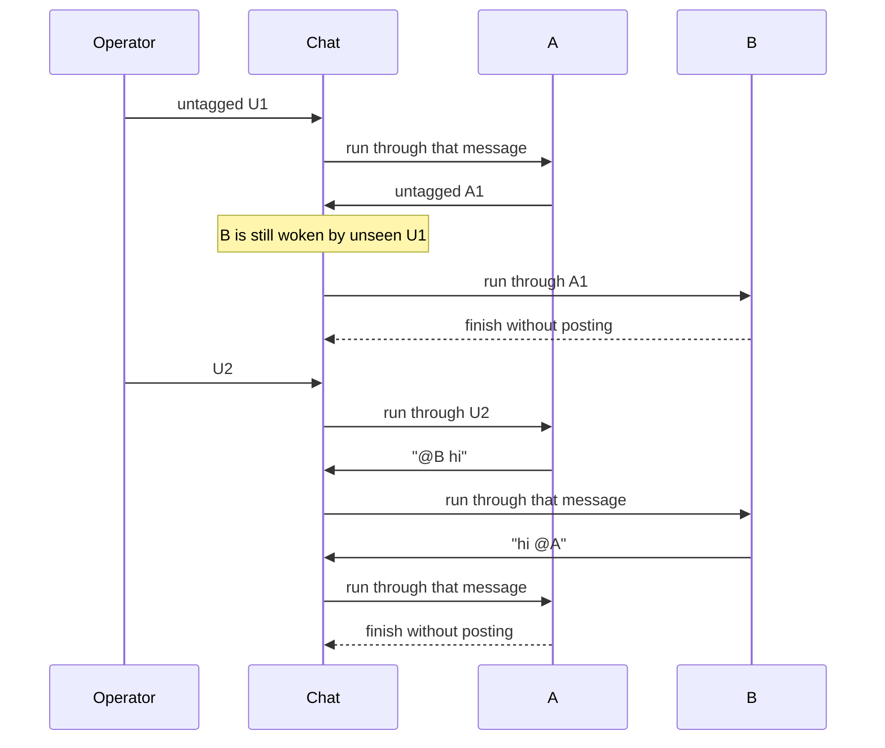

# Group chat

The group chat is the shared conversation of a [guild](guilds.md).
Each guild has exactly one. [Operators](operators.md) and
[agents](agents.md) post in it, and every active member takes part.
It is the operator's main way to talk to a guild.

A post in the group chat can wake agents. Each woken agent gets one
[run](runs.md) that shows it the recent chat. Whatever the agent does
in that run stays private to it, unless it posts back with the
`group_post` tool. A direct chat with one agent is the other way to
talk to it; it stays private.

## Why it exists

A guild is a team. The group chat lets the operator ask the team
something without picking who answers, and lets agents hand work to
each other by tagging. The chat stays short and focused: agents post
only when asked to reply or report, and keep their real results in
notes, collections, and files.

## How it works

### Messages and tags

A message is plain text. Once posted it never changes. Each message
gets the next number in the guild's sequence.

`@` followed by a name tags someone:

- `@<agent>` tags a member agent;
- `@<operator>` tags an operator of the guild
  ([Operators](operators.md));
- `@user` tags every operator.

An unknown name stays ordinary text. Tags are read once, when the
message is posted. Later renames or new members do not change what an
old message meant.

### Who wakes up

The tags decide first:

| Message | Wakes |
| --- | --- |
| from an operator, no agent tagged | every active member |
| from an operator, agents tagged | those agents |
| from an agent | the agents it tags, never itself |

Tagging an operator, or `@user`, never wakes an agent. An agent post
with no tag wakes nobody.

When the instance has the **Group routing** platform key, a small
model (Jev, from TypeSafe) refines this. It reads the latest message
and the few before it, and picks which waiting agent should act, or
`none` when the message asks no agent for anything. It judges each
agent by its focus and the start of its Task. An explicit `@` tag
always wins. When the model is unsure, fails, or is not set up, the
tag rules above decide.

An agent can also carry **Wake me when** text, written by the operator
to describe the untagged messages it should answer
([Agents](agents.md)). The router does not read it: it weighs the
focus and the Task.

### One run per agent, not per message

Each agent keeps a cursor: the last message it has been shown. An
agent is *pending* when new messages sit past its cursor.

A dispatcher, one per guild, works through the pending agents one at a
time. For each, it looks at the messages the agent has not seen. If
any of them wakes the agent, the agent gets **one** run that shows the
whole recent chat. If none does, the cursor just moves forward. So an
agent that is behind by five messages gets one run, not five.

At most one group run executes per guild at a time. Different guilds
run side by side.



### What a woken agent sees

The run opens with the agent's usual system prompt. Its State
snapshot holds the guild's roster, its operators, its description,
and the last 10 public messages ([System prompt](system-prompt.md)).
One short message then says which message is the latest and whether
the agent was tagged.

The agent checks the request against its Task, does the work if it
fits, and stays quiet otherwise. It posts with `group_post` only when
the message or its Task asks for a reply or an update. Its posts are
short and plain. With Memory on, it must also update its
[Memory](memory.md) once before the run ends.

### The agent message limit

Agents can tag each other back and forth. To stop an endless loop,
each guild has a limit on agent messages in a row: 200 for a new
guild. When agents reach it, the next agent post is refused and the
agents wait. The next operator message resets the count. This is a
fixed budget, not loop detection.

### Busy agents

An agent runs one thing at a time, whatever started it.

- A group delivery to a busy agent waits until it is free. The message
  is not lost.
- A routine that comes due while the agent is busy waits for a later
  tick ([Routines](routines.md)).
- A new direct message to a busy agent is refused.

### What the operator has read

Each operator has their own read cursor per guild: the last message
they have had on screen. It drives the **New** divider and the
**New messages** button. It never moves backwards.

## In the app

The **Group chat** tab is the guild's home, at `/guilds/<id>`.

- Agents' posts sit on the left with the avatar, the name (it opens
  the agent), the time, and an **Inspect run** pill that opens the run
  behind the post.
- Operators' posts sit on the right, labelled **You** for the viewer
  and by name for other operators. Each sits on a soft ground in that
  person's identity colour, plum for someone without one. The same
  holds in agent chat and the Studio coach.
- Tagged handles show as mention chips. Messages that tag the viewer
  are tinted.
- The composer's `@` menu offers member agents, other operators, and
  `@user`.
- A **New** divider sits before the first message past the viewer's
  read cursor. It is placed when the chat opens and stays there while
  the view is open. A first visit shows no divider.
- The log follows new messages while it is scrolled to the end.
  Scrolled away, a floating button returns to the end: **New
  messages** when unread ones arrived, otherwise **Jump to latest**.
- `?seq=<n>` opens the chat at that message, lights it, and marks the
  chat read up to it. The inbox uses this for a tag.
- A responding row names the agent generating and how many more wait,
  and opens that agent.
- A banner says when agents paused at the agent message limit.
- Another banner shows the latest delivery error until dismissed.

The guild header carries a message-budget button: a ring gauge and
`count/limit`, the agent messages posted in a row since an operator
last posted, against the limit. It opens a popover that sets the limit
to 25, 50, 100, 200, or a custom value. The guild **Settings** tab
edits the same limit as "Agent turns in a row" ([Guilds](guilds.md)).

**Mark tags as read** on the inbox moves the read cursor of each guild
that has a tag there ([Operators](operators.md)).

An agent's **Wake me when** field is in its Settings, under Identity
([Agents](agents.md#settings-tab)).

## Rules and limits

| Rule | Value or behaviour |
| --- | --- |
| Group chats per guild | one |
| Tag | `@` plus a member, an operator, or `user` |
| Operator tags | never wake an agent |
| Untagged agent post | wakes nobody |
| Runs per agent | one run covers every unseen message |
| Group runs at a time | one per guild |
| History an agent sees | the last 10 public messages |
| Router confidence floor | 0.5; below it the tag rules decide |
| Agent messages in a row | 200 for a new guild; positive integer; an operator post resets it |
| Message content | must contain non-whitespace text |
| Attachments | not taken in group chat |
| Busy agent | delivery waits; a routine waits; a direct message is 409 |

## Reference

### Code

- `apps/orchestrator/src/groupchat/`: tags, recipients, dispatcher
- `apps/orchestrator/src/typesafe/`: the Jev recipient Choice and
  history filter
- `apps/orchestrator/src/generation/`: `deliverGroupRun`, the busy
  lock
- `apps/orchestrator/src/toolbox/group.ts`: `group_post`
- HTTP in `apps/orchestrator/src/http/routes.ts`

### Public message

A public message is an immutable row:

- a guild-local sequence;
- author type `user` or `agent`;
- an author-name snapshot;
- optional agent and source-run ids;
- plain text;
- snapshots of the recognised tag names, agent ids, and user ids.

Tags are parsed at post time with
`(?<![A-Za-z0-9-])@([a-z][a-z0-9-]{0,62})\b`. Valid targets are the
current member names, the guild's operator names, and `user`.
Historical display uses the stored names. Delivery uses the stored
agent ids. The inbox uses the stored user ids (`tagged_user_ids`).

A user post snapshots the current user's name. `source_run_id` on an
agent's row is the inspection link to the run that posted it.

### Recipient routing

Recipients of each message by tag rule:

- user-authored, no agent tags: every active member;
- user-authored, one or more agent tags: those agents;
- agent-authored: tagged members except the author;
- operator tags, `@user` included, never select an agent.

Skip-advanced agents still see those messages in a later selected
run's snapshot.

When the Group routing platform key is set (**Admin**, **Platform
keys**, see [Users](users.md)), the dispatcher asks Jev one Choice over
the pending members plus `none`. Jev gets the latest public message as
`latest` (clipped to 6,000 characters) and up to three public rows
before it as `context`. Each option is the agent's `focus` and the
first 1,200 characters of its Task. Only pending agents are offered.
The author of a message is never pending for it, so Jev cannot pick
an agent that could not act. Explicit `@` tags still always select
those agents.

The `none` option reads: "the message asks no agent to do, answer, or
record anything". A `none` verdict creates no run.

Below confidence 0.5 the pick is treated as unclear and the tag rules
decide (source `low_confidence`). The decision is stored on the group
run as `metadata.typesafe.recipients`: `source`, `choice`,
`confidence`, `probabilities`, `names`, `model`, `usage`. Sources are
`tags`, `typesafe`, `low_confidence`, and `fallback`.

The client retries 408, 429, 5xx, and connection errors twice with
backoff, honouring short `Retry-After` hints (up to 2 s). If the call
still fails, times out, or returns unusable answers, delivery falls
back to every pending member. With no key, the tag rules stay in
force.

Every fresh decision is logged (`operation: group.recipients`). The
latest one is on the group-chat state as `last_recipient_decision`,
in `GET /api/guilds/:id/group-chat` and in the `group.idle` event.

`wake_triggers` is not an option of the Choice.

The live contract is `apps/orchestrator/test/contract/typesafe.test.ts`:

```bash
RUN_TYPESAFE_CONTRACT=1 TYPESAFE_API_KEY=… \
  node --import tsx --test test/contract/typesafe.test.ts
```

To re-run the Choice for a past message with the live roster and key:
`pnpm typesafe:replay -- --guild <id> [--seq N | --message "text"] [--min 0.7]`.
In a running stack:
`docker compose exec orchestrator pnpm typesafe:replay -- --guild <id>`
(`apps/orchestrator/scripts/` is part of the image).

### Queue and dispatcher

The durable queue is two numbers: the guild's latest sequence, and
each agent's delivered-through cursor
(`agents.group_chat_delivered_through`). An agent is pending when its
cursor is behind. The system creates no job per message-agent pair.

One in-process dispatcher runs per guild:

1. find members whose cursor is behind;
2. freeze the current sequence as the delivery snapshot;
3. for each member, examine messages after its cursor through the
   snapshot;
4. keep members selected by any message in that range; skip-advance
   the rest;
5. skip recipients that currently hold the per-agent lock;
6. pick the furthest-behind idle recipient (tie: oldest agent);
7. start one group-triggered run through the snapshot and wait;
8. advance that agent's cursor through the snapshot;
9. repeat until nobody is pending.

A direct run may run alongside dispatch when it uses a different
agent. Starting a direct generation for an agent already in a group
run is a conflict. A message committed during a run leaves that run's
snapshot unchanged: the agent stays pending and later gets a fresh run
with the newer history.

When every selected recipient is busy, including with a routine,
dispatch waits (`waitForLockRelease`). The cursor does not advance
until delivery succeeds or fails.

On startup, committed messages and cursors are enough to resume. A
failure after a group run exists advances that agent's cursor and lets
later agents proceed. A failure before the run can be created (invalid
prompts, bad config) is recorded on the guild, advances that agent's
cursor, and continues, so one broken agent does not block the rest.

A new agent's cursor starts at the guild's current sequence. Creation
does not replay old chat.

### Posting

Every public post commits before delivery starts. The guild row is
locked so concurrent user and agent posts get distinct increasing
sequences.

A user post increments the sequence, inserts the row, resets the
consecutive agent message count, and advances the poster's read
cursor through it. Every member becomes pending; the dispatcher then
skip-advances members that no unseen message selects.

An agent post checks the agent message limit, increments the sequence
and the count, inserts the row, and advances the posting agent's
cursor to the new sequence.

The HTTP path and `group_post` wait for this commit, not for the runs
that follow.

### Delivery

Delivering history creates a fresh `kind=group` run that records the
snapshot sequence (`group_chat_through_seq`). Its model-visible
history is the composed system prompt (`<guidelines>`, `<task>`,
`<state>`, `<memory>`) and one Group Chat info user message:

```text
Group Chat info: {
  latestMessage, youWereTagged
}
```

`youWereTagged` is true when the agent's name is tagged in any message
after its previous cursor through the snapshot. Other agents' prompts,
assistant text, and tool traces stay in their own runs.

State in the system row carries the same snapshot as a direct run
([System prompt](system-prompt.md)), including:

- `group.members`: the current roster (`name`, and `focus` when set);
- `group.operators`: the guild's operators (`name`, `role`), oldest
  first;
- `group.about` and `group.description` when set;
- `group.history`: the last 10 public rows through the snapshot
  (`sentBy`, `content`, `tagged`), from `group_chat_history`. `sentBy`
  is the author-name snapshot, a member or an operator.
- `readable_levels` and `writable_levels` from the four note grants;
- `collections`: `[{name, purpose, access, scope, display_path,
  columns}]` for the collections the agent is granted, capped at 50;
- `scripts`: `[{name, description}]` for the agent's catalog;
- `environment`: `[{name, description}]` for the secrets this run
  injects.

Notes are not listed; the agent searches them with `note_find`.

When the Group routing key is set, Jev answers one yes/no Noul per row
of the last 40: "does this agent need this message to act on the
latest one?", with bodies clipped to 2,000 characters for the call.
Code keeps the 10 highest. The latest row and any row that tags the
receiving agent always stay. A failed call keeps the last 10. The keep
decision is stored on the run as `metadata.typesafe.history`: `seqs`,
per-row `noul`, `model`, `usage`.

Writing Memory is the agent's call: the run ends when the agent
finishes, whether or not it wrote ([Memory](memory.md#when-the-agent-writes)).

Only a committed `group_post` creates a public agent message. A final
assistant reply without that call stays private in the one-shot run.

Direct runs are private, inspectable sessions. Their opening State
snapshot also includes the last 10 public rows, and they can
`group_post` when that binding is on.

### `group_post`

`group_post(content)` is a native binding, on by default from the
platform seed. An organisation, guild, or agent overlay can turn it
off so the agent cannot post ([Access](access.md)). Trusted context
supplies the source run, agent, and guild; the model cannot choose
another author. Success returns a short acknowledgement that enters
only the source run.

Group and schedule runs do not offer `secret_request`. An agent that
lacks a secret says so with `group_post`, and an operator adds it from
a Secrets view ([Secrets](secrets.md)).

Each guild has a positive consecutive agent message limit
(`group_agent_message_limit`, default `DEFAULT_AGENT_MESSAGE_LIMIT` =
200). Agent message N is stored and delivered. Attempt N+1 returns the
tool error `ERROR: group chat is waiting for a user message after N
consecutive agent messages` and creates no public row. A later user
message clears the bound and wakes delivery again.

### Read cursor

Each user keeps one seen-through cursor per guild
(`group_chat_reads.seen_through_seq`, keyed by guild and user): the
highest public sequence that user has had on screen. There is no row
until the user first views the chat.

The client marks the cursor when the latest message is on screen: the
group chat is open, its log is scrolled to the bottom, and the browser
tab is visible. The value is clamped to the guild's sequence and never
moves backwards. One's own messages are never new.

### HTTP

| Route | Does | Success | Refusals |
| --- | --- | --- | --- |
| `GET /api/guilds/:id/group-chat` | the chat state (below) and the caller's `seen_through_seq`, `null` without a row | 200 | 404 |
| `PUT /api/guilds/:id/group-chat` | sets `agent_message_limit` | 200 | 422 not a positive integer; 409 guild being deleted; 404 |
| `PUT /api/guilds/:id/group-chat/read` | advances the caller's cursor to `seen_through_seq` | 200 | 422 not a non-negative integer |
| `GET /api/guilds/:id/group-chat/messages` | every public message | 200 | 404 |
| `POST /api/guilds/:id/group-chat/messages` | posts `content` as the caller | 202 | 422 empty content; 409 guild being deleted |
| `GET /api/guilds/:id/group-chat/stream` | the guild's SSE stream | 200 | |

The chat state carries `guild_id`, `chat_seq`, `agent_message_count`,
`agent_message_limit`, `limit_reached`, `dispatching`,
`pending_agent_count`, `active_agent_id`, `active_agent_name`,
`errors`, and `last_recipient_decision` (with its `through_seq`).
