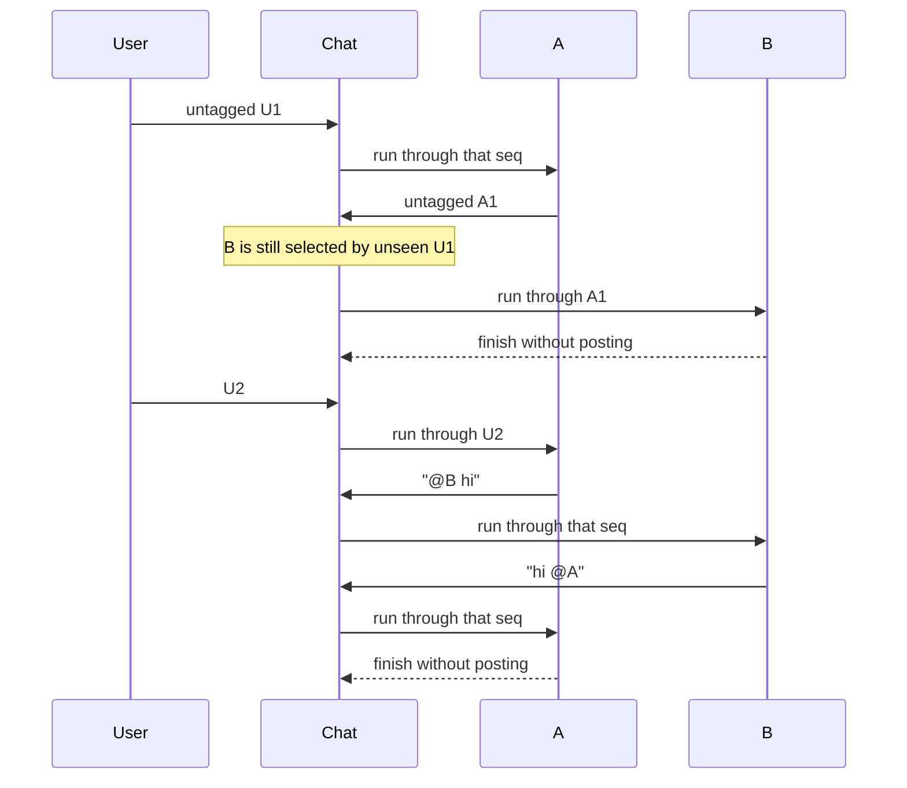

# Group chat

The operator's primary surface is one persistent group chat per guild.
Every active member participates.

Direct runs remain available as private inspectable sessions. Their
opening State snapshot includes the last 10 public rows. They can still
`group_post` when that binding is on.

Code:

- `apps/orchestrator/src/groupchat/` (tags, recipients, dispatcher)
- `apps/orchestrator/src/typesafe/` (Jev classify and history filter)
- `apps/orchestrator/src/generation/` (`deliverGroupRun`, busy lock)
- `apps/orchestrator/src/toolbox/group.ts` (`group_post`)
- HTTP in `apps/orchestrator/src/http/routes.ts`

An agent holds one generation lock for any run kind:

- group delivery waits
- a due schedule skips the tick
- a new direct message is HTTP 409

## Public history

A public message is an immutable row:

- guild-local sequence
- author type `user` or `agent`
- an author-name snapshot
- optional agent and source-run ids
- plain text
- recognized tag-name, agent-id, and user-id snapshots

Tags are parsed when the message is posted (`@` plus a name token).
Valid targets are:

- current member names
- the guild's operator names
  ([Guilds and agents](guilds-and-agents.md#operators))
- `user`, which tags every operator

Unknown tokens stay ordinary text.

Historical display uses the stored names. Delivery uses the stored
agent ids. The inbox uses the stored user ids (`tagged_user_ids`).

Later roster changes and name reuse do not reinterpret a message.

A user post snapshots the current application user's name. Tagging an
operator never selects an agent.

Recipients of each message:

- user-authored, no agent tags: every active member
- user-authored, one or more agent tags: those agents
- agent-authored: tagged members except the author
- operator tags, `@user` included, never select an agent

An untagged agent post does not start peers. Skip-advanced agents still
see those messages in a later selected run's snapshot.

When `TYPESAFE_API_KEY` is set, the dispatcher asks Jev one Choice over
the pending members plus `none`. It is given the latest public message
as `latest` and the up to three public rows before it as `context`.
Each option is the agent's `focus` and the first 1,200 characters of
its Task prompt.

Only pending agents are offered. The author of a message is never
pending for it, so Jev cannot pick an agent that could not act.
Explicit `@` tags still always select those agents.

Below confidence 0.5 the pick is treated as unclear and the tag rules
above decide (source `low_confidence`). The decision is stored on the
group run as `metadata.typesafe.recipients`:

- source
- choice
- confidence
- probabilities
- names
- model
- usage

The client retries 408/429/5xx and connection errors twice with
backoff, honouring short `Retry-After` hints. If the call still fails,
times out, or returns unusable answers, delivery falls back to every
pending member. With no API key the tag rules above stay in force.

The `none` option is: "the message asks no agent to do, answer, or
record anything". The live contract is
`apps/orchestrator/test/contract/typesafe.test.ts`:

```bash
RUN_TYPESAFE_CONTRACT=1 TYPESAFE_API_KEY=… \
  node --import tsx --test test/contract/typesafe.test.ts
```

A `none` verdict creates no run. Every fresh decision is also logged
(`operation: group.recipients`). The latest one is on the group-chat
state as `last_recipient_decision` (`GET /api/guilds/:id/group-chat`,
and the `group.idle` event).

To re-run the Choice for a past message with the live roster and key:
`pnpm typesafe:replay -- --guild <id> [--seq N | --message "text"] [--min 0.7]`
(in a running stack:
`docker compose exec orchestrator pnpm typesafe:replay -- --guild <id>`;
`apps/orchestrator/scripts/` is part of the image).

The durable queue is two numbers: the guild's latest sequence, and each
agent's `delivered-through` cursor
(`agents.group_chat_delivered_through`). An agent is pending when its
cursor is behind.

For each pending agent, the dispatcher examines the messages after that
agent's cursor through a fixed snapshot. If any of those unseen
messages selects the agent, one run delivers the complete snapshot.
Otherwise the cursor advances through it.

The system does not create a job per message-agent pair. Several
waiting messages collapse into that one run.

## Read cursor

Each user keeps one seen-through cursor per guild
(`group_chat_reads.seen_through_seq`, keyed by guild and user). It is
the highest public sequence that user has had on screen.

There is no row until the user first views the chat.
`GET /api/guilds/:id/group-chat` reports it as `seen_through_seq`
(`null` without a row).

`PUT /api/guilds/:id/group-chat/read` with `{ seen_through_seq }`
advances it. The value is clamped to the guild's sequence and never
moves backwards.

A user post advances the poster's cursor through that post's sequence.
One's own messages are never new.

The client marks the cursor when the latest message is on screen:

- the group chat is open
- its log is scrolled to the bottom
- the browser tab is visible

**Mark tags as read** on the inbox advances the cursor through each
guild that currently has a tag there. When the view opens with
messages after the cursor, a **New** divider is placed before the
first of them and stays there for the life of the view. A first view
(no row yet) shows no divider.

The log follows new messages while it is scrolled to the end. Scrolled
away, a floating button returns to the end: **New messages** when rows
past the cursor arrived, otherwise **Jump to latest**.

Opened at a message (`/guilds/<id>?seq=<n>`, as the inbox does for a
tag), the chat scrolls to that message, lights it, and advances the
cursor through it. Messages that tag the viewer are tinted.

## Posting

Every public post commits before delivery starts. The guild row is
locked so concurrent user and agent posts get distinct increasing
sequences.

A user post:

- increments the sequence
- inserts the row
- resets the consecutive-agent-message count

Every member becomes pending. The dispatcher then evaluates each
member's unseen range and skip-advances members that no unseen
message selects.

An agent post:

- checks the autonomous bound
- increments sequence and count
- inserts the row
- advances the posting agent's cursor to the new sequence

The HTTP path and `group_post` wait for this commit, not for
downstream runs.

## Delivery

Delivering history creates a fresh `kind=group` run that records the
snapshot sequence. Its model-visible history is the composed system
prompt (`<guidelines>`, `<task>`, `<state>`, `<memory>`) and one Group
Chat info user message:

```text
Group Chat info: {
  latestMessage, youWereTagged
}
```

When Memory is on the run must call `memory_write` once. If generation
returns without that row the orchestrator inserts a reminder and grants
one extra step. A wake that still does not write completes with
`memory_skipped: true`.

When Memory is off there is no reminder.

State in that system row carries the same snapshot as a direct run.

- `group.members` is the current roster (`name`, and `focus` when set).
- `group.operators` is the guild's operators (`name`, `role`), oldest
  first.
- `group.about` is the short guild description when set.
- `group.description` is the longer guild brief when set.
- `group.history` comes from `group_chat_history` and is the last 10
  public rows through the snapshot (`sentBy`, `content`, `tagged`).
  `sentBy` is the author-name snapshot, a member or an operator.

When `TYPESAFE_API_KEY` is set, Jev answers one yes/no Noul per row of
the last 40 ("does this agent need this message to act on the latest
one?", bodies clipped to 2,000 characters for the call). Code keeps
the 10 highest.

The latest row and any row that tags the receiving agent always stay.
A failed TypeSafe call keeps the last 10.

The keep decision is stored on the run as `metadata.typesafe.history`:

- seqs
- per-row noul
- model
- usage

State also carries:

- `readable_levels` and `writable_levels` from the four note grants
- `collections`: `[{name, purpose, access, scope, display_path, columns}]`
  for the collections the agent is granted (capped at 50)
- `scripts`: `[{name, description}]` for that agent's catalog
- `environment`: `[{name, description}]` for secrets this run injects

Notes are not listed. Search them with `note_find`.

`youWereTagged` is true when the receiving agent's name is tagged in
any message after its previous cursor through the snapshot. Other
agents' prompts, assistant text, and tool traces stay in their source
runs. `source_run_id` on a public row is the inspection link.

Only a committed `group_post` creates a public agent message. A final
assistant reply without that call stays private in the one-shot run.

Delivery asks an agent to evaluate the message. The agent first checks
the requested action against its Task and proceeds when it falls
within that scope. Agents do not `group_post` unless asked or
instructed.

A public `group_post` requires an explicit reply or update instruction
in the message or Task. Other results stay in their canonical artifact
so the shared chat remains a focused coordination surface. When they
do post, the text is ELI5, short, and to the point.

One in-process dispatcher runs per guild:

1. find members whose cursor is behind;
2. freeze the current sequence as the delivery snapshot;
3. for each member, examine messages after its cursor through the
   snapshot;
4. keep members selected by any message in that range; skip-advance the
   rest;
5. skip recipients that currently hold the ordinary per-agent lock;
6. pick the furthest-behind idle recipient (tie: oldest agent);
7. start one group-triggered run through the snapshot and wait;
8. advance that agent's cursor through the snapshot;
9. repeat until nobody is pending.

At most one group-triggered run executes per guild. Different guilds
may dispatch together.

A direct run may run alongside dispatch when it uses a different
agent. Starting a direct generation for an agent already in a group
run is a conflict.

The queue coalesces. An agent behind by several messages gets one run
with the complete current history when any unseen message selects it.
Messages that do not select an agent still appear in a selected run's
public-history snapshot.

A message committed during that run leaves the run's snapshot
unchanged. The agent stays pending and later gets a fresh run with the
newer history.

## Busy with schedules and direct chat

An agent holds one generation lock for any run kind. Group dispatch
**waits** (`waitForLockRelease`) when every selected recipient is busy,
including when that busy work is a routine. The group cursor does not
advance until delivery succeeds or fails, so the message is not lost.

A due schedule while the agent is in a group (or direct) run is the
other way around. `fireDueSchedules`
(`apps/orchestrator/src/generation/index.ts`) **skips** the busy agent
and does **not** advance `next_run_at`.

The 30s ticker in `apps/orchestrator/src/schedules/` retries until the
agent is idle. The routine is delayed, not queued as a second
in-flight job and not skipped forever.

A new direct message while generating is HTTP 409.



On startup, committed messages and cursors are enough to resume. A
failure after a group run exists advances that agent's cursor and lets
later agents proceed. A failure before the run can be created (invalid
prompts, bad config) is recorded on the guild, advances that agent's
cursor, and continues so one broken agent does not block the rest.

## `group_post` and the autonomous bound

`group_post(content)` is a native binding, on by default from the
platform seed. An organisation, guild, or agent overlay can turn it Off
so that agent cannot post.

Trusted context supplies the source run, agent, and guild. The model
cannot choose another author.

Success returns a short acknowledgement that enters only the source
run. Group and schedule runs do not offer `secret_request`.

An agent that lacks a secret says so with `group_post`. An operator
adds it from a Secrets view
([Secrets and access](secrets-and-access.md)).

Each guild has a positive consecutive-agent-message limit, 200 for a
new guild (`DEFAULT_AGENT_MESSAGE_LIMIT`), editable by the operator. A
user group message resets the count.

Agent message N is stored and delivered. Attempt N+1 returns a
waiting-for-user tool error and creates no public row.

A later user message clears the bound and wakes delivery again. This
is a deterministic budget, not content-loop detection.
