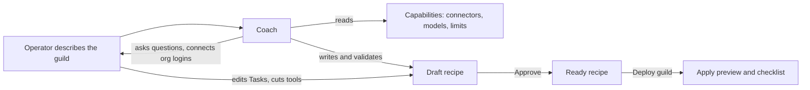

# Guild builder

The Guild builder turns a sentence or two about what you want into a
[recipe](recipes.md): a full design for a [guild](guilds.md). You
describe an outcome. A coach, an AI designer, interviews you, splits
the work into specialised [agents](agents.md), writes their Tasks and
[routines](routines.md), and names the access each one needs. The
result is a draft recipe you review, approve, and deploy.

The Builder is a design surface only. The coach never logs into
anything, never creates a live agent, and never holds a credential.
**Deploy guild** hands the recipe to the same
[apply](applying-recipes.md) flow as the Recipes library.
[Prompt Studio](prompt-studio.md) is its counterpart for a guild that
already runs: it improves a live guild and does not design new ones.

## When you use it

- You know what a guild should achieve but not how to split the work
  into agents.
- You want a design grounded in the connectors and limits of your own
  organisation, before anything is created.
- You want to review and edit a blueprint, and discuss it, before it
  costs anything to run.

## How it works



### A session owns one draft

Starting the Builder opens a *session* and creates its draft recipe at
once. Every message to the coach is one generation. The coach reads
the draft, the organisation's capabilities, and your answers, and
rewrites the draft as a whole. The draft is an ordinary recipe in the
library: you can open it from **Recipes** too.

### How the coach designs

The coach follows a design method:

- **Ground every system.** The coach looks up what the organisation
  can actually use. It never names a connector that is not in the
  catalog. Each system you name gets one
  [resolution](#named-systems).
- **Specialise.** Work with more than one standing purpose becomes two
  or more agents. One agent stays one only when the whole job is one
  skill, one cadence, one login, and one playbook, and the coach
  records why.
- **Keep each agent narrow.** An agent carries only the Task, notes,
  and tools its own work uses. Agents meet only in the collections and
  tagged messages their Tasks name.
- **Seed files with working content.** A new note starts with the
  rules, rows, or entries its agent acts on at its first wake, never a
  line describing what the file will hold. A part still unknown is one
  line saying what is missing.
- **Write for a human reader.** Every Task, note, routine
  instruction, table purpose, and guild description is ELI5, in a
  clear structure, each thing said once, and as short as it can be.
- **Write every Task to one shape.** An opening line, then Inputs,
  Work, Outputs, and Files, in headings and bullets, about 300 words.
  The coach's own system message carries what every agent already
  reads: the [system prompt](system-prompt.md)'s Guidelines, Task and
  State intros, and Memory rules. A Task repeats none of it.
- **Hand off through a collection.** Agents pass work through a queue
  [collection](collections.md) by default. Tagged messages in
  [group chat](group-chat.md) are only for small, budgeted batches.
- **Remember what was seen in a collection.** A routine that watches
  for new items keeps the items it has seen in a collection with a
  unique key, not in Memory.
- **Ask, do not guess.** Interview questions come as option cards. A
  login comes as a connect card. Both pause the coach until you
  answer.

### Reviewing what the coach wrote

Everything the coach writes is marked as written by the Builder and
not reviewed. That is provenance, not a gate. You read the blueprint,
edit a Task yourself or ask the coach to revise, switch off tools or
drop connectors, and approve. A cut you make is sent back to the coach
so it can fix the Tasks that relied on it, or ask why.

### Looks

When the coach writes a draft, the Builder picks one
[DiceBear](https://www.dicebear.com/) family for the guild and a
unique variant and identity colour for each role. The coach does not
choose the mascots.

## In the app

### Landing

**Builder** opens the landing page, *Describe the guild you want.*

- A text box takes a sentence or two about the guild.
- **Coach** picks the coach's model, from the organisation's chosen
  marketplace models, preselected with its default. While no provider
  is connected, a guide to [Model keys](model-keys.md) shows instead.
  The coach's model is written into the roles it drafts without one,
  as their recommendation.
- **Draft the recipe** (or Cmd/Ctrl+Enter) starts a session with that
  description as its first message.
- **Try** offers example descriptions that fill the box to edit before
  sending.
- **Your drafts** lists your earlier sessions.

### Workspace

A session's workspace has two panes: the blueprint of its draft recipe
and the coach chat. A draggable bar splits them, and its share
persists. On a narrow screen one pane shows at a time, switched with
**Show**: **Coach** or **Blueprint**.

The header shows the recipe's name, its body version, and a status:
*draft* or *approved*, and *coach designing…*, *waiting for you*, or
*coach ready*. Its buttons are:

- **Builder**, back to the landing
- **Approve**, on a draft: it moves the recipe to ready so it can be
  applied. A later Builder write returns it to draft.
- **Deploy guild**: it approves a draft first, then opens the
  [apply preview](applying-recipes.md#in-the-app)

The blueprint is the same plan as a [recipe's page](recipes.md#a-recipes-page).
In it you rewrite Tasks, switch connector tools per role, or drop
connectors. **Save and tell the coach** writes those access cuts and
posts them to the coach.

The coach chat shows the coach's reasoning as it streams, then its
reply. Connect cards and question cards appear inline. A question card
offers options plus **Other**. A connector that is not set up on the
box shows as **Not set up**, with Connect disabled. Open questions the
coach recorded in the design show as a question card above the message
box. While a card waits for an answer, the message box is disabled.
When the session reaches the coach's input limit, a banner says so:
the session stays readable, its draft stays in Recipes, and a new
session continues the design.

The coach's spend counts toward the organisation's usage. Settings ›
**Usage** shows it in the **Builder** row ([Usage](usage.md)).

## Rules and limits

| Rule | Value |
|---|---|
| Coach model | A marketplace model whose provider the organisation has connected |
| Coach temperature | 0.2 by default |
| Steps per generation | 24 |
| Output tokens per generation | 25,000 by default |
| Tool calls per generation | 40 by default |
| Input tokens | 200,000 by default; when a generation's projected input passes it, the session is blocked |
| Monthly runs | Each generation counts against the organisation's monthly Studio and Builder runs, when a limit is set |
| One generation at a time | A message while the coach works is refused |
| Sessions | Visible only to the user who started them |
| Drafts | One recipe per session |
| Coach writes | Refused when every role has an empty Task, or when they drop roles from a roster of two or more |
| Connectors | Only those in the catalog; never invented |
| Credentials | The coach never holds one |
| Logins in chat | An organisation login connects in the chat. A guild or agent login is chosen in the chat and connected on the apply checklist. Browser logins happen on the live agent after apply |

## Reference

### Design rules

The coach's system message is
`apps/orchestrator/src/builder/system.md`. Five blocks in
`apps/orchestrator/src/conversation/` are shared with Prompt Studio:
`content-trust.md` (what is authoritative and what is evidence),
`prompt-placement.md` (the design rules and where each kind of text
belongs, stated once for both coaches), `writing.md`
(how every document the coach writes reads: ELI5, structured, each
thing once, short), `task-shape.md` (the shape every Task takes), and
`agent-prompt.md`
(what every agent already reads, with the live Guidelines template,
the Task and State intros, and the Memory rules inlined). The rules
below are the ones the [checks](recipe-format.md#findings) enforce or
the recipe records.

- **Grounding.** `builder_list_capabilities` is the grounding tool.
  The coach may not name a server that is not in that result.
- **Specialisation.** Any of these justifies a split: narrower tools,
  narrower access, narrower context (a distinct memory or playbook),
  volume, browser against non-browser work, coding against non-coding
  work, and failure isolation. A single role records its reason in
  `design.specialization`.
- **Hand-offs.** Two or more roles need a queue collection or a
  tagged protocol with a budget, recorded in `design.handoffs`. Each
  Task names its own side of a hand-off, not the peer's job. N items
  never produce N group messages.
- **Routines.** Each trigger is a `schedules` row, recorded under the
  same `key` in `design.routines` with a cadence and a dedupe
  collection whose unique column carries the identity.
- **Narrow roles.** A role's own rules and working files are
  agent-level notes. A guild- or organisation-level note holds only
  what every role that embeds it uses. No note describes each role's
  job: agents see their peers' `focus` in State. The coach sets
  `false` in `native_tools` and in each connection role's `tools` for
  every tool a role does not call, and turns `config.scripting` off
  for a role that writes no scripts.
- **Working files.** A file the agent revises is named in the Task and
  read with `note_get`. A file that must enter every run is embedded
  with `![[guild/<key>]]`, `![[org/<key>]]`, or
  `![[agent/<role>/<key>]]` ([Task](task.md)). Tasks name systems and
  outcomes, not namespaced tool ids.
- **Coding.** A role that reads, changes, runs, and ships code sets
  `config.coding`. Its code tools (`code_task`, `shell`,
  `shell_status`, `file_read`, `code_search`) come with the flag (see
  [Code tools](coding/code-tools.md)). The coach sets
  `config.harness`, `config.harness_model`, `config.harness_effort`,
  and `config.secret_aliases` only when the operator named them;
  otherwise apply asks for the harness. The recipe lists the
  repositories by name and purpose, never a URL or credential. Each
  coding role's Task names its repositories, the checks it runs, and
  how work reaches its reviewer.
- **Scripts.** Builder-written scripts are documents. They cannot run
  in the Builder.

### Named systems

Each system the operator names becomes one `design.systems` entry. The
coach tries a published catalog connector first (`resolution:
"catalog"`). Otherwise it falls back, in order, to:

1. a native capability (`native`)
2. a reviewed script adapter plus a named secret (`script`)
3. a browser role plus an operator login after apply (`browser`)
4. a narrowed composition of available capabilities (`composition`)
5. an explicit operator decision (`decision`), or a refusal
   (`refused`)

An entry whose fact is still unknown records `accepted: false` and a
`reason` that starts with `OPEN QUESTION.`, and the coach asks with
`builder_ask_question`.

### Collections

Every collection the Builder declares carries typed columns designed
from how the records are used:

- a queue or hand-off collection has one required `text` column with
  `values`, the closed list of states whose first value is what the
  producer writes
- a collection whose records are entities carries their natural
  identity in one `unique` column, so `record_add` merges a repeat
- a seen-set is a collection with a unique key column
- each collection holds one record shape
- free text lives in a named text column
- a category lives in a text column with `values`
- a short list of text lives in an `array` column
- a count lives in a `number`
- a moment lives in a `datetime`
- no id or timestamp column is declared
- `purpose` says what one record is and who writes it

Both Tasks name the state column. The producer writes every required
column with `record_add`. The consumer finds work with `record_list`
and `where` on it, and moves the record to the next state with
`record_update` by id.

`scope: "guild"` is for the guild being built, whose agents all read
and write it. `scope: "org"` is for a collection other guilds can
share: the whole organisation reads it, and `guild` and `writers` say
what the new guild and its roles get on its access list (see
[Recipe format](recipe-format.md#collections)). A seed note takes the
same `guild` and `writers` (see [Recipe format](recipe-format.md#notes)).

### Writes

`builder_write_recipe` replaces the whole draft. It sends the
`expected_body_version` it last saw; a stale one returns
`recipe body_version conflict` with the current `body_version`. A
write is refused when every role has an empty `task.body`, and when it
would drop roles from a roster of two or more. A column that breaks a
rule is refused (`collections[i].columns: column "x": …`). Each
accepted write:

- recommends the coach's model on every role without `config.model`
- keeps a reviewed field's author when its content did not change, and
  marks every other field `{ by: "builder", reviewed: false }`
- assigns the guild's looks: one DiceBear family, and a unique variant
  and colour per role, keeping the looks roles already had
- returns the recipe to `draft` and emits `recipe.changed`

Approve assigns looks too when a role still lacks one.

### Tools

| Tool | Purpose |
|---|---|
| `builder_list_capabilities` | Native tools, the browser and coding capabilities (tools, sandbox cost, the limit each counts against), published connectors, models, the organisation's limits and remaining capacity (agents, browser agents, coding agents; `null` where nothing caps it), reusable connections |
| `builder_search_capabilities` | Search connector copy and canonical tool names |
| `builder_describe_server` | One published connector's catalog record |
| `builder_search_connected` | Search an organisation-connected workspace (Notion databases and pages) |
| `builder_ask_org_connection` | Chat widget: connect one published connector to the organisation now |
| `builder_ask_connection` | Chat widget: pick a connector and its scope. An organisation login connects now; a guild or agent login is confirmed and created at apply |
| `builder_ask_question` | Chat widget: option card, plus **Other**, that pauses until the operator submits an answer |
| `builder_validate_recipe` | Mechanical and design findings against the current blueprint |
| `builder_write_recipe` | Create or revise the draft, sending `body_version` |

A connect or question widget pauses the coach until the operator
answers, connects, or skips.

The coach uses the shared conversation runner
(`apps/orchestrator/src/conversation/`). Studio tools are absent.

Each generation composes the system message again and stores it over
`seq` 0, so the stored transcript holds what the model saw. After the
template it holds, in this order: the coach's model, temperature, and
run limits; the write example
(`apps/orchestrator/src/builder/write-example.json`) only while the
recipe has no roles; the current recipe; the operator's access cuts;
and the Session block (the UTC clock and `expected_body_version`)
last, so the prefix before it stays the same between steps. The
field-name hint is stated once, in `builder_write_recipe`'s
description.

An older tool result at or over 2048 bytes is stubbed in what is sent;
the stub tells the coach to call the tool again and that the current
recipe is in the system message.

Catalog copy (`description`, `limitations`, `setup_hint`) comes from
each connector's manifest, with the instance admin's overrides applied
(see [The catalog in Admin](../tools-and-connectors/connectors.md#the-catalog-in-admin)). Platform admins
edit it at **Admin → Connector catalog** (`/admin`). The Builder names
the enabled connectors' manifest tools, and the tools the
organisation's own logins have listed.

An empty stored tool list means "not connected here yet", never "this
server cannot do that."

A connector whose `oauth_setup_state` is `unsupported` is not set up
on this box. The coach says that a platform admin fills its keys under
**Admin**, **Platform keys** before anyone can connect it, and asks
the operator to do that or to pick another service. The connect widget
shows the connector as **Not set up** with Connect disabled.

### Validation

`builder_validate_recipe` runs the same checks as a recipe's
validation. Every finding is listed in
[Recipe format](recipe-format.md#findings). Operator tool and
connector removals from the blueprint become `access.tool_removed` /
`access.connector_removed` info findings, so the coach can update
standing prompts or ask why they were cut.

### Connected workspaces

When Notion is connected at organisation scope, the coach searches
that workspace and asks which databases to use for **long-lived**
records. Confirmed ones land on `connections[].resources` and a local
map note.

Queues, seen-sets, drafts, playbooks, and Memory stay in local notes at
organisation, guild, or agent scope, or in collections.

### Stream

The workspace follows the session's stream: `generation.started`,
`assistant.delta`, `assistant.reasoning.delta`, `message.committed`,
`recipe.changed`, `generation.finished`, `session.error`. The stream
sends a keepalive every 15 s. While the coach works, the workspace
also re-reads the session and its messages every 2.5 s.

### Storage

```text
builder_sessions (
  id, org_id, created_by_user_id, created_by_name,
  recipe_id,                        -- unique
  config_snapshot jsonb,
  status,                           -- active | blocked | archived
  blocked_reason,                   -- input_token_limit
  generation_state,                 -- idle | generating | cancelling
  generation_number, generation_token, generation_started_at,
  errors jsonb,
  created_at, updated_at, archived_at
)
builder_messages (id, session_id, seq, generation, payload, metadata, cost_usd, created_at)
```

One session owns one `recipes` row, with `source_kind=builder` and
`source_builder_session_id` pointing back at it. The recipe cannot be
deleted while its session exists. `config_snapshot` holds the coach's
model, temperature, run limits, system prompt hash, and tool schemas;
the system message shows only the model, temperature, and run limits.
The first message (`seq` 0) is the system prompt, refreshed each
generation.

The schema allows `status=archived` and `archived_at`. No route sets
them: a Builder session is `active`, or `blocked` at the input limit.

Usage is charged to the organisation, global, and monthly counters.

### HTTP

```text
GET    /api/builder/sessions
POST   /api/builder/sessions                    { model, temperature? }
GET    /api/builder/sessions/:id
GET    /api/builder/sessions/:id/messages
POST   /api/builder/sessions/:id/messages
POST   /api/builder/sessions/:id/cancel
GET    /api/builder/sessions/:id/stream
PUT    /api/builder/sessions/:id/recipe
POST   /api/builder/sessions/:id/review
POST   /api/builder/sessions/:id/access
POST   /api/builder/sessions/:id/validate
POST   /api/builder/sessions/:id/publish
POST   /api/builder/sessions/:id/deploy
GET    /api/builder/capabilities
GET    /api/builder/capabilities/search
GET    /api/builder/servers/:server_ref
```

- `GET /api/builder/sessions` lists the current user's sessions in the
  organisation.
- A session of another user or organisation is 404.
- `POST /api/builder/sessions` is 422 without a model, or with one that
  is not a marketplace model of a connected provider.
- Posting an empty message is 422. Posting while the coach generates,
  or to a session that is not active, is 409. A month past
  `monthlyCoachRuns` is 409.
- `review`, `access`, `validate`, and `publish` behave like the recipe
  routes of the same names (see [Recipes](recipes.md#recipe-http)).
  `publish` is 422 with the blocking errors.
- `deploy` takes the apply choices and creates the apply, exactly like
  `POST /api/recipes/:id/apply` (see
  [Applying recipes](applying-recipes.md#create)), so it needs a ready
  recipe. The app does not call it: **Deploy guild** approves and opens
  the apply preview, which applies through the recipe route.

### Screens

| Screen | Route |
|---|---|
| Landing | `/builder` |
| Workspace | `/builder/<session_id>` |
