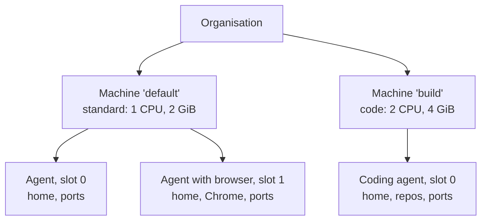
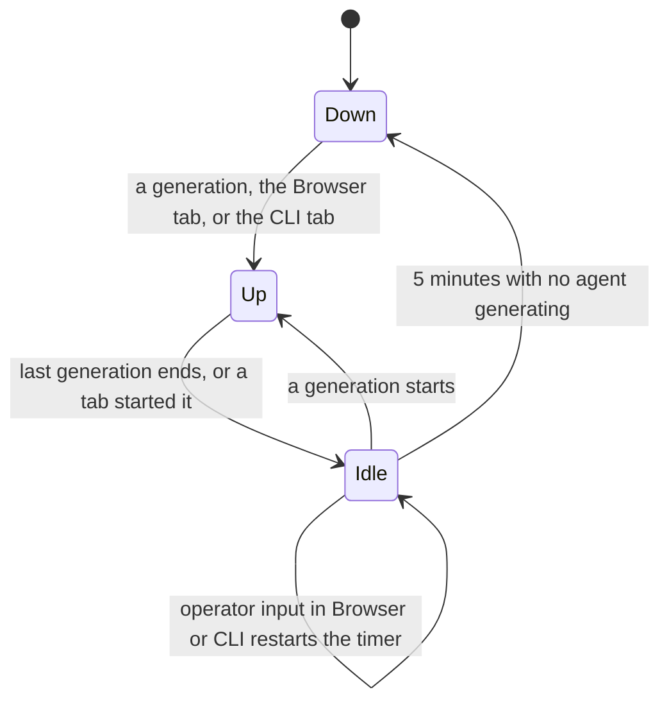

# Machines

A machine is where agents do their work. It is one container that
runs commands, a browser, and coding tools, plus one folder on the
host that keeps the agents' files. An [organisation](organisations.md)
owns a pool of machines. Every [agent](agents.md) sits on exactly one
machine of its organisation, and many agents share one machine. A
machine never spans organisations.

Each agent on a machine has its own [home](agent-home.md), its own
[browser](browser.md) when it has one, and its own block of ports.
The machine's size decides which agents it can take: an agent with a
browser or with [coding](coding/index.md) on needs a bigger machine.

## Why it exists

Agents need a computer to run commands, open web pages, and edit
code. One container per agent would waste memory, because most
agents sit idle most of the time. So agents share machines, and the
organisation decides how many machines it runs and how big they are.

Sharing has a price: agents on one machine trust each other. An agent
whose data must stay apart goes on a machine of its own
([Trust between agents](#trust-between-agents)).

## How it works

### Tiers

A machine has a tier. Two tiers have a fixed size, and the third lets
the organisation pick one.

| Tier | CPU | Memory |
| --- | --- | --- |
| Standard | 1 | 2 GiB |
| Code | 2 | 4 GiB |
| Custom | 0.5 to 4, in steps of 0.25 | 512 to 8192 MiB |

Which agents a machine takes depends on its size, not its tier
([Machine sizing](#machine-sizing)).

Every machine runs the same runtime image. It carries Chromium and
the coding toolchains. A machine also has a disk cap: the most its
agents' homes may hold together, 10240 MiB by default.

Every new organisation starts with one Standard machine named
`default`. An organisation that needs more room resizes a machine or
adds another one.

### Machine sizing

Machine sizing has two rules: each agent has a minimum, and a machine
may take more agents than it could run all at once.

**An agent's minimum.** Each capability has the smallest machine it
runs on:

| What the agent has on | CPU | Memory |
| --- | --- | --- |
| Every agent | 0.5 | 256 MiB |
| Browser | 1 | 2 GiB |
| Coding | 2 | 4 GiB |

An agent's minimum is the largest of the minimums of what it has on,
CPU and memory each. It is not their sum: Chrome and the coding
toolchains run only while the agent works. A machine below an agent's
minimum refuses it. With these values a Standard machine takes browser
agents, a Code machine takes coding agents, and a Custom machine takes
whatever its size meets.

**Overcommit.** A machine's planned load is the sum of its agents'
minimums. Few agents work at once, so a machine takes more than it
could run together. Its capacity is its size times the overcommit
factors:

| Resource | Factor | Capacity of a Standard machine |
| --- | --- | --- |
| CPU | 5× | 5 CPUs |
| Memory | 3× | 6 GiB |

Memory gets the lower factor. Too little CPU slows agents down. Too
little memory gets their processes killed.

A placement past either capacity still saves. The app warns that
agents on the machine may slow down or run out of memory when many
work at once. Agents of guilds the viewer cannot see still count
toward the planned load and toward the machine's 32 slots.

**Disk.** Disk is reserved the same way. Each agent has its own disk
cap. The sum of the caps of the agents on a machine is what they
reserve of the machine's disk cap. What the sum leaves is unreserved.
An agent whose cap is no larger than the unreserved room can fill its
own cap before the machine reaches its cap. A placement past it still
saves, and the app warns.

### Placement and slots

An agent is placed on a machine when it is created. With one machine
in the organisation the agent goes on it. With more, the operator
picks one. An agent goes only on a machine at or above its minimum.
Turning the browser or coding on is refused when the agent's machine
is below the minimum that sets.

Each agent holds a slot on its machine, the lowest free one from 0
to 31. So a machine holds at most 32 agents. The slot sets everything
the agent listens on inside the container: its display, its browser's
ports, its terminal's port, and a block of 100 ports for servers the
agent starts itself. That is how two agents on one machine each keep
their own Chrome and terminal, and generate at the same time.

### Moving an agent

An agent can move to another machine of its organisation. Its home
moves with it ([Move rules](#move-rules)).

### The container's lifecycle

A machine's container does not run all the time. It starts when it
is needed and stops when it is idle. Its folder, and every home in
it, stays.

The container starts on the first generation of any agent on the
machine, or when the operator opens an agent's Browser tab or starts
its CLI tab. It stops 5 minutes after the last generation on the
machine ends, or after the last operator input in those tabs. The
next work on the machine starts a new one
([Idle timer](#idle-timer)).

So:

- runs of every agent on a machine share its container and, while it
  is up, its processes; agents on other machines do not
- each agent keeps its own home, and two runs of one agent share it
- only one generation runs at a time for an agent; agents on one
  machine generate at the same time
- files in the agent's home, its browser profile included, survive a
  new container
- packages installed outside the home and live processes end when
  the container stops

Changing a machine's tier or size replaces its container. The next
work on the machine starts a container of the new size. Nothing else
replaces a container: not a secret change, not an agent's
configuration.

### Trust between agents

Agents on one machine trust each other. Commands run as root in the
shared container, for every agent. So an agent can read every other
agent's home, git tokens, Chrome profile and cookies, and the
environment of a command running at the same moment
([Security register](../architecture/security-register.md#sec-24--agents-on-one-machine-can-read-each-others-homes-tokens-and-sessions)).
An agent whose data must stay apart goes on a machine of its own.

For the same reason, an operator cannot place an agent on a machine
that hosts an agent of a guild they cannot see
([Security register](../architecture/security-register.md#sec-26--a-member-could-place-an-agent-beside-a-private-guilds-agents)).

## In the app

### Settings › Machines

The organisation's **Settings** page has a **Machines** tab. It lists
every machine of the organisation with:

- its tier, CPUs, and memory
- the agents on it, each with its guild and its Browser and Coding
  flags; an agent's name opens its Settings on the Machine section
- the planned load bars, CPU and memory, against its capacity
- the disk it uses against its disk cap

A **Sizing** line above the machines states the agent minimums and
the overcommit factors. Owners and admins create a machine (name,
tier, on Custom the CPUs and memory, and the disk cap), resize one,
and delete one that holds no agents. A machine cannot shrink below
the minimum of an agent on it. Other members see the tab read-only.

### The machine picker

The create dialog and the agent's Settings place the agent with the
**Machine** picker, when the organisation has more than one machine.
With one machine, the dialog's Machine step names it in place of the
picker.

The picker shows each machine's tier and size. Machines below the
agent's minimum are disabled and marked too small. Under the chosen
machine, the planned load bars show CPU and memory: the sum of the
minimums of the agents already on it, what this agent adds, and the
capacity. The sizing rules are stated under the bars. Past either
capacity, the app still saves and warns that agents on this machine
may slow down or run out of memory when many work at once; resize it
or pick another machine. One line says that agents on one machine can
read each other's files and sessions.

The coding agent dialog's Machine step hints that coding agents need
a Code machine.

**Disk** shows under the picker. It sets the agent's own disk cap
([Agent home](agent-home.md#in-the-app)).

In the agent's **Settings**, the **Machine** section holds the picker
with its planned load bars and **Disk** under it, as in the create
dialog. Saving another machine moves the agent: its processes stop,
and its home moves with it. A move is refused while the agent
generates.

The **Model** section greys out **Browser** and **Coding** while they
are off and the machine is below the minimum they would set, with a
line naming both sizes.

The recipe apply preview has the same picker, and warns the same way
([Applying recipes](applying-recipes.md)).

## Rules and limits

| Rule | Value or behaviour |
| --- | --- |
| Machines in a new organisation | one Standard machine named `default` |
| Machine name | lowercase letter first, then lowercase letters, digits, `-`; up to 63 characters; unique in the organisation |
| Custom size | 0.5 to 4 CPUs in steps of 0.25; 512 to 8192 MiB |
| Machine disk cap | 10240 MiB by default |
| Agents on one machine | at most 32, whatever the organisation's plan says |
| Agent minimum | 0.5 CPU and 256 MiB; 1 CPU and 2 GiB with a browser; 2 CPUs and 4 GiB with coding |
| Overcommit | planned load up to 5× the CPUs and 3× the memory; past it the app warns but saves |
| Disk reservation | agents' caps past the machine's cap: the app warns but saves |
| Who manages machines | owners and admins; other members read |
| Delete | refused while the machine has agents, or when it is the last machine |
| Resize | refused below the minimum of an agent on it; replaces the container |
| Idle stop | 5 minutes after the last generation or tab input |
| Move | refused while the agent generates |

## Reference

### The machine row

A machine is a row in `machines`:

- `name`, matching `^[a-z][a-z0-9-]{0,62}$` and unique in the
  organisation
- `box`, the tier: `standard`, `code`, or `custom`
- `cpu` and `memory_mib`, on a custom machine only
- `max_workspace_mib`, the disk cap over every home on it, default
  10240
- `workspace_mib`, the size of its directory as last measured
- `harnesses`, the coding harness CLIs its image carries, as the
  image lists them in `/usr/local/share/guilds/harnesses`. The
  orchestrator reads the list when it creates the machine's
  container and stores it when it changes. It is null until the
  container first started ([Harnesses](coding/harnesses.md))

Every path that creates an organisation (user creation,
`POST /api/orgs`, the boot seed) creates one `standard` machine named
`default` with it.

Every machine runs the one runtime image (`SANDBOX_IMAGE`), an
OpenSandbox container at its tier's size, with memory in `Mi`: CPU
`1` and `2048Mi` for `standard`, CPU `2` and `4096Mi` for `code`, and
the machine's `cpu` and `memory_mib` for `custom`. Its directory on the host is
`WORKSPACE_ROOT/<machine id>`, mounted at `/home` in the container
([Agent home](agent-home.md)).

### HTTP

| Route | Who | Body or result |
| --- | --- | --- |
| `GET /api/orgs/:id/machines` | members | each machine with `cpu`, `memory_mib`, `max_workspace_mib`, `workspace_mib`, `allocated_workspace_mib`, `harnesses`, `planned_cpu` and `planned_mib` (its planned load), `agents` (id, name, guild, `browser`, `coding`), and `hidden_agents`, the number of agents of guilds the caller cannot see, which `agents` leaves out |
| `POST /api/orgs/:id/machines` | owners, admins | `name`, `box`, `cpu`?, `memory_mib`?, `max_workspace_mib`?; 201 with the machine |
| `PATCH /api/orgs/:id/machines/:machine_id` | owners, admins | the same fields; the body fills in what it leaves out from the machine |
| `DELETE /api/orgs/:id/machines/:machine_id` | owners, admins | 204 |
| `PUT /api/agents/:id/machine` | anyone who sees the guild | `machine_id`; moves the agent and returns it |

- Another organisation's id, or an unknown machine, is 404.
- A write by a member who is neither owner nor admin is 403.
- A key other than `name`, `box`, `cpu`, `memory_mib`, and
  `max_workspace_mib` is 422. A create without `name` is 422. A
  create without `box` makes a `standard` machine.
- `cpu` or `memory_mib` on a tier other than `custom` is 422. A
  custom machine needs both; an update that keeps it custom keeps the
  current ones. A body that moves a machine to `standard` or `code`
  drops them.
- `cpu` outside 0.5 to 4 or off a 0.25 step, `memory_mib` outside 512
  to 8192 or not an integer, and a `max_workspace_mib` that is not a
  positive integer are 422.
- A name the organisation already has is 409.
- Deleting a machine that still has agents is 409.
- Deleting the organisation's last machine is 409.
- Deleting a machine removes its container and its directory.
- Changing a machine's tier or size to below the minimum of an agent
  on it is 409.
- The organisation policy's `maxMachines` caps the machines. Past
  it, a create is refused with a limit error (409).
- The policy's `maxAgentsPerMachine` caps the agents on one machine.
  Past it, a placement is refused with a limit error (409).
- Both caps are unset in core.

### Sizing in code

Both sizing rules live in `apps/orchestrator/src/machines/index.ts`
(`AGENT_MINIMUMS` and `OVERCOMMIT`). The app mirrors them in
`apps/web/src/features/machines/machines.ts`, and states them on
Settings › Machines, under every planned-load meter, and on the recipe
page.

- `planned_cpu` and `planned_mib` in `GET /api/orgs/:id/machines` are
  the sums of the agents' minimums, agents of hidden guilds included.
- `allocated_workspace_mib` is the sum of the agents' own
  `max_workspace_mib`, agents of hidden guilds included. What it
  leaves of the machine's `max_workspace_mib` is unreserved.
- The Machines tab, the machine picker, and the apply preview warn
  past either capacity, and past the unreserved disk.

### Placement

Agent create takes `machine_id`. With one machine in the
organisation the agent goes on it, and the field may be left out.
With more, it is required (422 without it). `PUT
/api/agents/:id/config` takes `machine_id` too, and moves the agent
when it names another machine. Agent payloads carry `machine_id` and
`machine` (`id`, `name`, `box`).

- Creating an agent on a machine below its minimum is 422.
- Turning `browser` or `coding` on is 422 when the agent's machine is
  below the minimum that sets.
- Moving an agent to a machine below its minimum is 422.
- Agent create, a `machine_id` in `PUT /api/agents/:id/config`, and a
  move are 403 on a machine that hosts an agent of a guild the caller
  cannot see
  ([SEC-26](../architecture/security-register.md#sec-26--a-member-could-place-an-agent-beside-a-private-guilds-agents)).
- A full machine (32 slots taken) is 409.

### Slots and ports

The slot `s` sets everything the agent listens on inside the
container:

| What | Value |
| --- | --- |
| X display | `:10+s`, its VNC server on `5910+s`, on loopback |
| Chrome DevTools | `9300+s` |
| noVNC | `6100+s` |
| ttyd | `7700+s` |
| The agent's own servers | `20000+100·s` to `20000+100·s+99` |

### Move rules

`PUT /api/agents/:id/machine` moves an agent. The move:

1. stops the agent's processes on the machine it leaves
2. renames its home on the host
3. gives it the lowest free slot on the other machine

The move is refused in these cases:

- The body has no `machine_id` (422).
- The agent is generating (409).
- The two machines keep their directories under different
  workspace roots (409).
- The target machine already holds a home for the agent (409).
- The target machine hosts an agent of a guild the caller cannot
  see (403).
- The target machine is below the agent's minimum (422).
- The edition does not support moving agents (501, `agents cannot
  move here`).

### The container

The container carries these labels:

- `machine_id`
- `kind`, the tier
- `cpu` and `memory`
- `image`, a fingerprint of the image reference
- `host_id`, when the provider places machines on hosts

If several running containers carry one machine id, the orchestrator
keeps the earliest and destroys the others. A running container of
another tier, size, or image is replaced. The helpers the tools call
are part of that image.

At generation start the orchestrator ensures the agent's machine,
then the agent's home.

### Idle timer

- After a generation ends, or after the Browser or CLI tab starts the
  machine's container, an idle timer of 5 minutes starts for the
  machine.
- A generation of any agent on the machine cancels that timer.
- Operator input on a proxied Browser or CLI view restarts it, at most
  once every 30 seconds.
- When the timer fires with no agent on the machine generating, the
  orchestrator destroys the container and leaves the machine's
  directory in place.
- On orchestrator startup, every running machine container on which
  no agent generates gets the same timer.
- A change of the machine's tier or size destroys an idle container at
  once, and a busy one when the last generation on it ends.

No configuration change of an agent replaces the machine's container
([Browser](browser.md#when-chrome-runs)).
