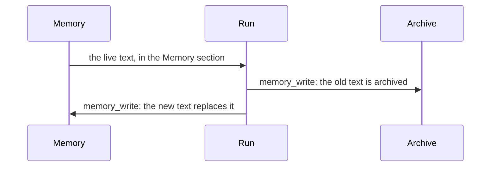

# Memory

Memory is the agent's own Markdown file for remembering things from
one run to the next. The agent writes it with one tool,
`memory_write`. Every run reads it back in its
[system prompt](system-prompt.md). There is no required format: the
agent writes whatever will help it next time.

Memory sits next to the [Task](task.md). The Task is what the
operator asks, and only the operator writes it. Memory is what the
agent chose to keep, and the agent writes it. Long-form knowledge
belongs in [notes](notes.md), and structured records belong in
[collections](collections.md). Memory lives in the
[artifact store](artifacts.md) as one file per agent.

## Why it exists

Each run starts from a fresh prompt. Without Memory, an agent woken
by a routine every morning would not know what it did yesterday.
Memory is a short, private place for the agent to carry its
continuity: what it already handled, what is pending, what it
learned about how to do the job.

Memory is private to one agent. For coordination, agents share a
note and link to it from their own Memory. A file every member
rewrites would be a constant source of conflicts.

## How it works

### Reading and writing



- At run creation, the live Memory goes into the `<memory>` section
  of the system prompt, with short write rules.
- `memory_write` replaces the whole file. The agent sends the full
  text it wants to keep.
- Before every replacement, the previous text is archived as a
  version. The operator can read every version. The agent only sees
  the live one.

A new agent starts with an empty Memory.

### When the agent writes

No run has to write. Memory is worth only what it saves the next run,
and a file rewritten on every wake fills with run logs and copies of
things that live elsewhere. The `<memory>` section gives the agent one
test: write only when the next run would make a mistake, repeat work,
or waste steps without something this run learned.

What passes the test:

- how to do the job better: an approach that worked or failed, a quirk
  of a tool or source, a preference the operator stated
- where to resume: unfinished work, a commitment, a position the next
  run cannot recover from records or history
- where things live: a pointer to the note, record, or collection that
  holds the detail

What does not: a log of the run, anything the Task, State, notes,
records, or history already hold, anything one tool call finds again,
and secrets. Since a write replaces the whole file, each write is also
the moment to drop what is done or stale.

Every run kind follows the same rule. The run ends when the agent
finishes, whether or not it wrote. When 8 tool calls or fewer are
left, the Guidelines ask the agent to write Memory then if the next
run needs something this one learned
([Runs](runs.md)). In a direct run the operator can also say
"remember this".

### Turning it off

The agent's `memory` switch turns Memory off. Then the system prompt
has no `<memory>` section, the Guidelines drop their memory
instructions, and `memory_write` is not offered, whatever the tool
bindings say. The Memory tab stays.

`memory_write` is also a tool binding. Turning only the tool off
keeps the `<memory>` section in the prompt, without write rules or
the tool's name. The operator then manages Memory alone.

### Memory in an open chat

An agent is busy only while it generates. A routine can wake it and
rewrite its Memory between two turns of an open direct run. Later
turns of that direct run keep the `<memory>` section they started
with.

### Memory and other knowledge

- Records that need querying go in a [collection](collections.md).
- Run transcripts are not artifacts. No agent tool searches runs or
  earlier Memory versions. `note_find` searches notes.

## In the app

The agent's **State › Memory** view shows Memory and every earlier
version. It is the first view of the agent's **State** tab:
`/guilds/<id>/agents/<id>/state` opens it.

- Versions are listed newest first. Each shows who wrote it (a run of
  the agent, or an operator), when, and how many lines it added and
  removed.
- The live version opens in a Markdown editor with the provenance
  strip ([Artifacts](artifacts.md#every-change-is-recorded)). Save
  writes the text as given and archives the text it replaces, with
  you as the author.
- An earlier version opens read only, as the change against the
  version before it or as the whole text.
- **Open step** opens the run that wrote a version at its
  `memory_write` call.
- Leaving with unsaved edits asks first.

Agents never see the earlier versions. The version list is the
operator's view of what the agent chose to keep or drop between
wakes. To see exactly what was said in a run, use the **History**
drawer in the agent's Chat tab ([Runs](runs.md#chat-tab)).

Prompt Studio reads the same versions, and its list can be filtered
by author ([Prompt Studio](prompt-studio.md)).

The **Memory** button under **Agent capabilities**, in the Model
section of the agent's Settings, is the `memory` switch
([Agents](agents.md)).
The `memory_write` binding is in the **Memory** group of the agent's
Tools view ([Access](access.md)).

## Rules and limits

| Rule | Value or behaviour |
|---|---|
| `memory_write` size | 12 000 characters |
| Operator save size | 256 KB |
| Format | none required |
| Writing the same text | nothing changes, no version is archived |
| Versions kept | the newest 50 |
| Who reads earlier versions | the operator only |
| Required write | none, on every run kind |
| Deleting Memory | refused |
| `memory` switch missing | on |

## Reference

### `memory_write`

```text
memory_write(content: str) -> str
```

- `content` is required. The call replaces the whole file. There is
  no `unchanged` argument.
- `content` is at most 12 000 characters. Over the cap the tool
  answers `ERROR: memory exceeds 12000 characters`.
- It returns the Memory's display path.
- When the new content is byte-identical to the live row, the write
  is a no-op and nothing is archived. Otherwise the previous version
  is appended to `memory_revisions` first.
- It publishes `guild.artifacts.changed` for `memory.md`.
- It is offered on direct, group-triggered, and schedule-triggered
  runs. It is a native tool binding, with the note and record tools
  ([Access](access.md)): the instance seeds enable it and any scope
  can turn it off. When it resolves off, the run does not offer it,
  Guidelines and Memory do not name it, and the row still hydrates.

Code: `apps/orchestrator/src/toolbox/memory.ts`,
`apps/orchestrator/src/memory/index.ts`.

### The `memory` config key

`memory` in the agent's config is whether the agent hydrates Memory
and may call `memory_write`. When it is `false`:

- the system prompt omits the `<memory>` section
- the Guidelines drop their memory instructions
- the Task intro does not mention `memory_write`
- `memory_write` is not offered, whatever the bindings say

The Memory tab stays. Missing means on. It is not itself a binding.

### The Memory section

With `memory_write` offered, the `<memory>` section opens with
`### Your Memory`. Its text says that Memory is private, that
`memory_write` rewrites it, and that the Task stays as written. It
then states the test and the lists of
[When the agent writes](#when-the-agent-writes), and that a write
replaces the whole file. The text is `MEMORY_INTRO` in
`apps/orchestrator/src/memory/index.ts`.

With `memory_write` resolved off, the section says only that Memory
is a private place for whatever future runs should remember, that
the Task stays as written, and that there is no required format.

The live text follows. A missing row hydrates as empty. The prompt
never mentions earlier versions.

### Storage

Memory is an `artifacts` row of `kind` `memory`, at the agent level,
with key `memory.md`. Agent create inserts an empty row. A missing
row hydrates as empty, and the next write recreates it. Its display
path is `org/<org_id>/agents/<agent_id>/memory.md`. It is not
deletable (422 `cannot delete this file`).

Only the agent itself or an operator may write it (422
`memory is not writable` otherwise).

### Archive

Every replacement archives the outgoing version first, whether it
comes from `memory_write` or from a save on the Memory view. An
operator edit never silently discards the agent's version.

- Rows live in `memory_revisions`: `content_text`, `replaced_at`,
  `replaced_by_type`, `replaced_by_id`, `replaced_by_name`, and
  `replaced_by_detail`.
- `replaced_by_detail` names what replaced the version:
  - `run <run_id> (direct)`
  - `run <run_id> (group delivery: @name, …)`, or
    `run <run_id> (group delivery)` without tags
  - `run <run_id> (schedule wake-up: "<instruction>")`
  - `run <run_id> (continuation of <run_id>)` for a run chain
  - `host <user name>` for a save on the Memory view
- Each version has a display path,
  `org/<org_id>/agents/<agent_id>/history-archive/<stamp>-<source>.md`:
  the UTC stamp `YYYYMMDDTHHMMSSZ` first, so listing order is time
  order, then `replaced_by_name` with `/` and `:` turned into `-`.
- Retention is the newest 50 rows. Each archive prunes older ones.
  There is no time-based rule.
- The archive is the operator's. The Memory view and Prompt Studio
  read it. No agent tool does: `note_find` does not return versions,
  and `note_get` and `note_delete` answer a `history-archive/…` path
  as unknown. There is no search over the archive.
- State and the `<memory>` section carry only the live version.

Memory answers *what you carried N wakes ago*. *What exactly did I
say* stays a question for the run history.

### Timeline

The Memory view and Prompt Studio read the archive as a timeline
(`apps/orchestrator/src/memory/timeline.ts`, served by
`apps/orchestrator/src/memory/history.ts`):

- revision *k* holds version *k−1* and names the actor and time of
  version *k*
- the live row is the newest version
- the oldest archived version has no recorded author
- each version carries who wrote it (a run, an operator, or the
  agent), when, and its added and removed line counts
- a run-written version links to the run and, through
  `file_changes`, to its `memory_write` call

The Studio coach reads the same timeline with
`studio_list_memory_revisions` and `studio_get_memory_version`.

### HTTP

```text
GET  /api/agents/:agent_id/memory              the timeline, newest first
GET  /api/agents/:agent_id/notes/memory.md     the live text, with display_path and version
PUT  /api/agents/:agent_id/notes/memory.md     { content }; archives the replaced text with the user as source
```
