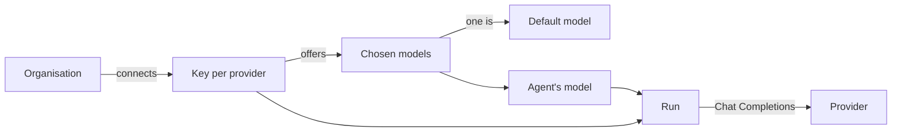

# Model keys

A model key is the API key an [organisation](organisations.md) gives
guilds.run so its [agents](agents.md) can call a language model. The
organisation connects one key per model provider, picks the models it
offers from each, and names one default. Every run of every agent in
the organisation goes through one of those keys.

The box has no key of its own. Nothing in `.env` names a model, and
no integration serves one. Until an organisation connects a provider,
none of its agents can run, and the app waits on the welcome dialog.

## Why it exists

The organisation pays for its own models. The provider bills the
account the key belongs to, so each organisation chooses its
providers, its models, and its spend. The key stays with the
orchestrator. An agent never sees it.

## How it works

### A run is a provider, a key, and a model

A run is one provider, that provider's key, and one of the models the
organisation chose. Every provider is called through its
OpenAI-compatible Chat Completions endpoint, by the orchestrator
alone. The key is sent to that provider and nowhere else.

### Providers

| Provider | Models | Key from | Kind | Cost shown |
|---|---|---|---|---|
| OpenAI | GPT models, from OpenAI | [platform.openai.com/api-keys](https://platform.openai.com/api-keys) | Marketplace | Yes |
| OpenRouter | Hundreds of models behind one key, Claude and Gemini included | [openrouter.ai/settings/keys](https://openrouter.ai/settings/keys) | Marketplace | Yes |
| xAI | Grok models | [console.x.ai](https://console.x.ai/) | Marketplace | Yes |
| DeepInfra | Open-weight models, priced low | [deepinfra.com/dash/api_keys](https://deepinfra.com/dash/api_keys) | Marketplace | Yes |
| Local endpoint | Ollama, LM Studio, vLLM, or any OpenAI-compatible server you run | None required | Marketplace | No |
| Kimi Code | Kimi models on a Kimi Code plan, for coding agents | [kimi.com/code](https://www.kimi.com/code) | Coding API | No |

A **Marketplace** provider serves agents, [Prompt
Studio](prompt-studio.md), and the [Guild builder](guild-builder.md).

A **Coding API** provider serves [coding agents](coding/index.md)
only. Its models are offered only to an agent with **Coding** on.
They cannot be the default. Studio and the Builder do not use them.
Kimi Code is the one coding provider in core.

### Chosen models and the default

The organisation ticks the models it offers from each connected
provider. Those are the models every picker in the app offers, and
nothing else.

One chosen marketplace model can be the organisation's default. A new
agent starts on it. The Studio and Builder landings preselect it.
Without a default, the create-agent form waits for a choice. Any
agent can be switched to another chosen model in its **Settings**.

### Cost

The provider bills the account the key belongs to. guilds.run sets
no spend cap. A limit set on the provider's side is the only one.

On a provider marked **Cost shown**, each run records what it cost.
The figure comes from the provider when it reports one, and from the
catalog's rates otherwise. The **Usage** tabs add it up
([Usage](usage.md)). A local endpoint and Kimi Code record no cost.

### Three kinds of key

Three kinds of key reach the box. Only the first is a model key.

| Key | Who holds it | Where |
|---|---|---|
| Model key | The organisation, for its agents' runs | **Settings**, **Model keys** |
| Secret | The organisation, handed to the agents it names as an environment variable | **Secrets** ([Secrets](secrets.md)) |
| Platform key | The box, for everyone on it: web search, group routing, the GitHub App, Google | **Admin**, **Platform keys** ([Configure](../getting-started/configure.md#platform-keys)). Sentry and the registry are `.env` settings |

An agent never sees a model key. Its commands get secrets only.

### The local endpoint

**Local endpoint** is any server that speaks the OpenAI Chat
Completions API: Ollama, LM Studio, vLLM, or one of your own. It
takes a base URL and an optional key. Its catalog is whatever the
server lists. It records no cost.

## In the app

### The welcome dialog

A box with no provider connected opens on a welcome dialog over every
page. It cannot be dismissed. An owner or admin walks through one
provider in four steps.
[Connect a model](../getting-started/model-keys.md) is that walk.

1. **Pick a provider.** One tile per provider, with its logo and a
   line on what it is for. Coding providers stand apart under **For
   coding agents only**.
2. **Connect.** The key goes into **API key**. The field links to
   where the provider issues one. **Connect** checks the key with
   the provider before saving it. A rejected key is not saved, and
   the dialog says why. The local endpoint takes a **Base URL** and
   an optional key.
3. **Choose models.** The provider's catalog, with a search over
   name and id. At least one model must be ticked. These are the
   models every picker in the app offers, and nothing else.
   **Continue** saves the list.
4. **Pick a default.** One of the ticked models. New agents, Studio,
   and the Builder start on it. **Finish** saves it. **Skip for now**
   leaves none, and the create-agent form then waits for a choice. A
   coding provider ends at step 3.

The dialog stays open through steps 3 and 4 once the key is saved,
so the pickers are not left empty. Then it closes. On a box with no
guild, the page says **No guilds yet** and offers **Create a guild**
or the Builder.

A member who is not an owner or admin sees the dialog with a note to
ask an owner or admin to connect the first provider. The page opens
on its own once a provider is connected.

### Settings, Model keys

**Settings**, **Model keys** holds the same controls as the dialog,
for every provider at once. It is the one place the full catalog is
browsed. The providers are split into **Marketplace** and **Coding
APIs**.

The top of the page names the default model. With none, it says that
every picker starts empty until one is marked.

Each provider has a card:

- its state: **Not connected**, or **Connected · key ends in** and
  the key's last characters. The local endpoint shows its URL. A key
  is never shown again in full.
- a key field, and a base URL field for the local endpoint, with
  **Connect**, or **Replace** once connected
- **Choose models**, which opens the provider's catalog
- **Remove**
- the chosen models, each with its id, what it takes (thinking,
  images), its context window, and its price per million tokens

Owners and admins connect, replace, remove, choose models, and set
the default. Every member can read the page.

### Choose models

**Choose models** opens the provider's catalog with a search over
name and id. Each row shows the model's id, whether it thinks and
takes images, its context window, and its price. Ticked rows are the
organisation's chosen models. **Save models** writes the list.

Unticking a model removes it from every picker. An agent already on
it keeps running. Its picker shows the model under **Not offered**.

### The default

**Make default** on a chosen marketplace model names the
organisation's default. **Clear default** leaves none.

**Investigate in Studio** on an issue needs a default, and asks for
one on Model keys when there is none
([Operators](operators.md)).

Unticking the default model, or removing its provider, clears the
default.

### Replace or remove a key

**Replace** saves a new key for a connected provider, after the same
check as **Connect**. The chosen models and the default stay.

**Remove** drops the key, its chosen models, and the default when it
was among them. It asks for confirmation first. Agents on that
provider keep their model. They cannot run until a key is connected
again.

A key does not rotate on its own. Rotate it on the provider's side,
then **Replace** it here.

### Without a key

| Where | What shows |
|---|---|
| Create an agent, Studio, the Builder, and recipe apply, while no provider is connected | **Connect a model provider first**, with **Open Model keys**, in place of the model picker |
| Saving an agent on a provider that is not connected | `Connect a <Provider> key on Model keys first.` |
| An agent with **Coding** off, on a Kimi Code model | `Turn Coding on to use this model.` |
| A run on a provider whose key was removed | The run ends with `connect a <Provider> key on Model keys` |

Connecting the provider again, with any valid key, lets those agents
run as they were.

## Rules and limits

| Rule | Value or behaviour |
|---|---|
| Keys on the box | None. Every key belongs to an organisation |
| Keys per provider | One per organisation |
| Who changes keys, models, and the default | Owners and admins |
| Who reads the Model keys page | Every member |
| Models ticked in the welcome dialog | At least one |
| Chosen models per provider | At most 500 |
| Default model | One chosen model on a connected marketplace provider, or none |
| Coding API models | Only on an agent with **Coding** on. Never the default |
| Key check | One request to the provider, up to ten seconds. Nothing is saved on failure |
| Spend cap | None in guilds.run. Only the provider's own |
| Key shown | Its last four characters only |
| Local endpoint base URL | Required. Starts with `http://` or `https://` |
| Local endpoint key | Optional |

## Reference

### Provider ids

| Id | Label | Kind | Cost computed | Chat Completions base URL | Catalog source |
|---|---|---|---|---|---|
| `openai` | OpenAI | `marketplace` | Yes | `https://api.openai.com/v1` | models.dev `openai` |
| `openrouter` | OpenRouter | `marketplace` | Yes | `https://openrouter.ai/api/v1` | models.dev `openrouter` |
| `xai` | xAI | `marketplace` | Yes | `https://api.x.ai/v1` | models.dev `xai` |
| `deepinfra` | DeepInfra | `marketplace` | Yes | `https://api.deepinfra.com/v1/openai` | models.dev `deepinfra` |
| `local` | Local endpoint | `marketplace` | No | The saved `base_url` | The endpoint's `/models` |
| `kimi` | Kimi Code | `coding` | No | `https://api.kimi.ai/coding/v1` | models.dev `kimi-code-plan-global` |

A stored model id is `{provider}/{model}`. The provider id is its
prefix. An unbilled provider's calls record `cost_source:
unavailable`. Providers live in `apps/orchestrator/src/llm/providers.ts`
([Orchestrator](../architecture/orchestrator.md#model-client)).

### Storage

Per connected provider, the organisation holds one
`org_model_providers` row:

- the credentials, encrypted as every credential is: `api_key`, and
  `base_url` for the local endpoint
- `key_hint`, the key's last four characters, or the whole key when
  it has four or fewer; none on a local endpoint saved without a key
- `models`, the chosen ids as plain data

The organisation holds one `default_model` on its `orgs` row, or
none.

Removing a key removes the provider's row and its chosen models, and
clears the default when it was among them. Saving a provider's
models without the current default clears the default too.

A provider is **connected** when credentials resolve for the
organisation. In core, that is when a key is saved.

### Where keys live

A key is encrypted with AES-GCM under `SECRETS_MASTER_KEY` and stored
in the database, like every connector login and secret. Only its
last four characters are kept in the clear, for the card.

- `.env` never carries a model key. The `MODEL_CONTRACT_*` variables
  are for the development stack's contract tests, not the running
  stack ([Configure](../getting-started/configure.md#development)).
- A key never enters an agent's sandbox. An agent that needs an API
  key in its own scripts gets it as a [secret](secrets.md).
- A backup of `STATE_ROOT` holds the keys. It decrypts only with the
  `.env` it was made under
  ([Operate](../getting-started/operate.md#back-up)).

### HTTP

`:id` is the organisation id. A caller who is not a member gets 404.
An owner or admin route called by a member is also 404. An unknown
provider is 422.

- `GET /api/orgs/:id/models`, for every member. It returns the
  organisation's `default`, its `providers` (`id`, `label`, `kind`,
  `connected`, `key_hint`, and `base_url` for the local endpoint),
  and its chosen `models` with their capacities (`thinking`,
  `temperature`, `attachments`, `context`, `price` per million
  tokens, `kind`, `coding_only`). Every picker reads this.
- `GET /api/orgs/:id/model-providers/:provider/catalog`, for every
  member. It returns `{ models }`: the provider's full catalog, or
  the local endpoint's live list once its URL is saved (422 `save the
  local endpoint's URL first` before). Only Model keys reads this.
- `PUT /api/orgs/:id/model-providers/:provider`, for owners and
  admins. The body takes `api_key` (kept when left out on a connected
  provider), `base_url` for the local endpoint, and `models`, the
  chosen ids as `{provider}/{model}`. `models` left out on a
  connected provider keeps the current list. Ids are trimmed and
  deduplicated, in the order given. The key is probed before the row
  is written; a rejected key answers 422. It returns the provider
  item. Other 422s: `api_key is required`, `base_url is required`,
  `base_url must start with http:// or https://`, `models must
  be <provider>/{model} ids`, `at most 500 models per provider`.
- `PUT /api/orgs/:id/default-model`, for owners and admins. The body
  takes `model`: one of the chosen models on a connected marketplace
  provider, or null (an empty string also clears). It returns
  `{ default }`. 422 when the id is not `{provider}/{model}`, when
  the provider is a coding one (`the default must be a marketplace
  model`), or when the model is not chosen (`choose <id>
  under <Provider> on Model keys first`).
- `DELETE /api/orgs/:id/model-providers/:provider`, for owners and
  admins. 204, or 404 when the provider is not connected.

Routes live in `apps/orchestrator/src/http/model-provider-routes.ts`.
The service is `apps/orchestrator/src/llm/models.ts`. The Model keys
tab is `/settings?tab=keys`.

### The key check

**Connect** and **Replace** send one request to the provider:
`GET {base URL}/models` with the key as a bearer token. They wait up
to ten seconds. The key is saved when that request succeeds.

A `401` or `403` reads `<Provider> rejected the key`. Another status
reads `<Provider> did not accept the key (<status>)`. A connection
failure gives the connection error. Nothing is written on failure,
so a failed Replace leaves the previous key in place.

### The catalog

The catalog is [models.dev](https://models.dev). The box fetches it
once an hour and keeps a snapshot for a box without network
([Configure](../getting-started/configure.md#model-catalog)). A model
is listed when it calls tools, is not deprecated, and takes and
returns text.

### The local endpoint

- **Base URL** is required. It starts with `http://` or `https://`.
  It is the API root, with `/v1` included where the server uses it.
- **API key** is optional. Leave it empty when the server asks for
  none. The check then calls `/models` without one.
- The catalog is the endpoint's live `/models` list. It is read each
  time **Choose models** opens. Each model is offered with thinking
  on, temperature on, and images off.
- No cost is recorded.

The orchestrator calls the URL from inside its container. There,
`127.0.0.1` is the container, not your machine. On Docker Desktop, a
server on the host is `http://host.docker.internal:<port>/v1`. On a
Linux host the orchestrator has no `host.docker.internal`. Use the
host's address on the Compose network's bridge, and have the server
listen on that interface rather than on loopback alone.

### Editions

An edition built on core may resolve model credentials its own way,
with usage reporting and a policy
([Extension points](../architecture/extension-points.md)).
