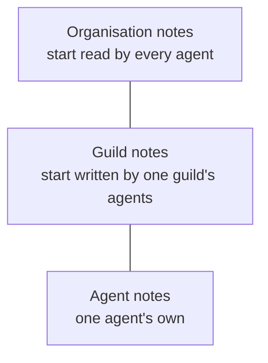

# Notes

A note is a Markdown file in the [artifact store](artifacts.md). It
holds long-form knowledge: a finding, a procedure, a glossary, a
decision. Agents write notes with tools, and operators read and edit
them in the app.

A note sits at one of three levels: one agent, one guild, or the
whole organisation. The level is where the note lives. Its
[access list](access.md#access-lists-for-notes-collections-and-files)
decides who reads and writes it. A new guild-level note starts
written by that guild's agents, and a new organisation-level note
starts read by every agent. Structured rows belong in a
[collection](collections.md) instead, bytes that are not Markdown in a
[file](files.md), and what an agent wants its next runs to remember
in its [Memory](memory.md).

## When you use it

- An agent keeps long-form knowledge for its own work: an agent-level
  note.
- A team shares knowledge every member needs: a guild-level note.
- Several guilds share knowledge: an organisation-level note.
- Two guilds share one note: a guild-level note whose access list
  adds the second guild.
- An operator wants a rule in every run of an agent: a note embedded
  in the agent's [Task](task.md).

## How it works

### Three levels, flat files



Each level holds its notes side by side. There are no folders. A
note's name is one `.md` file name, its key.

### How far an agent reaches

An agent always reads and writes its own agent-level notes. Every
other note is reached through its access list: the agent's own row
when it has one, otherwise the better of its guild's row and the
organisation's row. No row is no access
([Access](access.md#access-lists-for-notes-collections-and-files)).

A note starts with these rows:

| Level | Starting rows | Who reaches it then |
|---|---|---|
| agent | none | that agent only |
| guild | the guild at `write` | that guild's agents read and write it |
| org | the organisation at `read` | every agent reads it, none writes it |

An operator changes the rows of one note. Opening a guild note to a
second guild, letting one agent write an organisation note, or
keeping one agent out of a note is a row on that note.

There is one kind of agent. A curator that maintains shared
knowledge is an ordinary agent with `write` on the notes it keeps.

### Writing a note

An agent writes a note in one of two ways:

- **By level and key.** The agent names the level (`agent`, `guild`,
  or `org`) and the key. The level decides the owner: the agent
  itself, its own guild, or the organisation. A new note is created
  only at the `agent` or `guild` level, and it starts writable by the
  writer. At the `org` level the agent only updates a note that exists
  and that it may write.
- **By display path.** The agent rewrites any existing note whose
  access is `write`, whatever its level and owner.

The agent never names an organisation, guild, or agent id. "Guild"
always means the agent's own guild.

### Finding and linking

Notes are not listed in the system prompt. An agent searches them
with `note_find`, then reads one with `note_get`. Each note
`note_find` returns carries its `access`: `read` or `write`.

`note_write` returns the note's display path. That path is how the
agent links to the note elsewhere, for example from its Memory.

### Embeds

An operator embeds a note in an agent's Task with
`![[display-path]]`. Each run then carries the note's text in its
system prompt. A note can embed other notes and collections the same
way. A Task's embeds expand two levels deep: the Task's own embeds,
and the embeds inside those notes. All embedded text in one run
shares a 64 KB budget ([Task](task.md#embeds)).

Embeds are resolved as the agent whose Task it is. A note is inlined
only when its access list gives that agent, its guild, or the
organisation `read` or `write`. Any other embed, a note the agent
cannot read as much as a deleted one, becomes a marker saying the file
is not reachable, and the run still starts
([Task](task.md#an-embed-the-agent-cannot-reach)).

A note that a live Task embeds cannot be deleted. A note that only
another note embeds can be, and that embed then stops reaching a file.

A display path written in a note without `![[…]]` names the other
note without embedding it. Prompt Studio's **References** view shows
what embeds or names each note, which agents' prompts it reaches, and
each broken embed with its reason, including the agents whose runs
cannot reach it ([Prompt Studio](prompt-studio.md#state)).

## In the app

The agent's **State** tab and the guild's **State** tab share one
notes browser. The agent's view is **State › Notes**. The guild's
view is **State › Notes**.

- The agent's **Notes** view shows three scopes: **Agent**, **Guild**,
  and **Org**.
- The guild's **Notes** view shows **Guild** and **Org**.

In both:

- Each scope lists its notes side by side, with no folders.
- **New note** takes a name. The name cannot hold a `/`, and it gets
  `.md` added. At the agent level it cannot be `task.md` or
  `memory.md`.
- A note opens in the same Markdown editor as the Task. Its embed
  picker inserts other notes and collections.
- Unsaved edits are kept per note while the operator moves between
  notes. Leaving the page with unsaved edits asks **Leave without
  saving?**, with **Discard changes**.
- Save, or Cmd/Ctrl+S, writes the note.
- A provenance strip under the file header says who saved it last.
  **Open step** opens the run that wrote it in its agent's Chat tab
  at that tool call. **History** lists every recorded change
  ([Artifact store](artifacts.md#every-change-is-recorded)).
- A link with a display path opens that note first. A `note_write`
  chip in the chat leads there.
- Notes can be created and deleted.

The notes browser lists notes only. The agent's Task and Memory have
their own tabs ([Task](task.md), [Memory](memory.md)). Scripts appear
on the agent's **State › Scripts** view ([Scripts](scripts.md)).

An open note has an **Access** button in its header, wherever notes
are browsed: the guild's **State › Notes**, the agent's
**State › Notes**, and Studio. It opens a dialog titled
**Access to `<path>`** with the note's **Access** panel: the
organisation, the guilds, and the agents on its access list, each
with its mode ([Access](access.md#the-access-panel)).

The **Access** sub-tab of the guild's and the agent's **State** lists
the notes that guild's agents, or that agent, reach, each with its
mode. The listing is read only
([Access](access.md#what-a-guild-or-an-agent-reaches)).

The Prompt Studio coach can propose a new note, an edit to a note,
or a note's deletion. The operator applies or declines each one
([Studio proposals](studio-proposals.md)).

## Rules and limits

| Rule | Value or behaviour |
|---|---|
| Note name | one `.md` file name, no `/`, no folders |
| Reserved at the agent level | `task.md`, `memory.md` |
| Size of one write | 256 KB |
| Live notes per owner | 10 000, counted with Memory and scripts |
| `note_find` results | 20 by default, 100 at most |
| Who reaches a note | its owner agent for an agent-level note, and the subjects on its access list |
| Starting access | agent level: no row; guild level: the guild at `write`; org level: the organisation at `read` |
| A new note written by an agent | `agent` or `guild` level only |
| Changing a note's access list | operators only |
| Deleting a note a live Task embeds | refused (409) |
| Embed depth | two levels from the Task |
| Embedded text per run | 64 KB in total |

## Reference

### Note tools

```text
note_find    { query?, level?, limit? }   results { notes }
note_get     { path }                     path is a display path
note_write   { level, key, content }      returns the display path
note_write   { path, content }            returns the display path
note_delete  { path }                     returns the display path
```

- `note_find` searches the notes the agent may read: its own
  agent-level notes and every note whose access list gives it `read`
  or `write`. With a `query` it matches whole words of the content
  (PostgreSQL `simple` text search, `websearch_to_tsquery` grammar) or
  a substring of the title and key, ranked by text rank then
  `updated_at`. An empty `query` lists notes by level and key.
  `level` limits it to one level. `limit` defaults to 20 and is capped
  at 100. Each note is `{ display_path, kind, level, key, title,
  author, version, updated_at, access, content }`, with `access`
  `read` or `write`.
- `note_get` returns the display path and the note's text, for a note
  the agent may read. A soft-deleted note returns a tombstone.
- `note_write` with `level` (`agent`, `guild`, or `org`) and `key`,
  the `.md` file name, writes the note at that level of the agent. An
  existing note needs `write`. A new note is created at `agent` or
  `guild` level only, with the starting rows of its level. A key with
  a `/` or without `.md` is 422 `note key must be a .md file name;
  notes have no folders`. `task.md` and `memory.md` at the agent
  level are 422 `<key> is reserved`.
- `note_write` with `path` rewrites the live note that display path
  names, with `write` on it. The note keeps its owner, key, and
  title. `level` and `key` are then ignored.
- `note_delete` soft-deletes the note. It needs `write`. `task.md` and
  `memory.md` cannot be deleted.
- A successful write or delete publishes `guild.artifacts.changed`.

Crossing tool families fails with a 422 that names the right tool:

| Call | Answer |
|---|---|
| `note_get` on a collection or record path | `Use record_search or record_list for collection records.` |
| `note_get` on a script | `use script_read for scripts` |
| `note_delete` on a record path | `use record_remove for collection records` |
| `note_delete` on a collection path | `collections are managed by the operator` |
| `note_delete` on a script | `use script_delete for scripts` |
| `note_get` on a file | `use file_fetch for files` |
| `note_delete` on a file | `use file_delete for files` |

`note_get` and `note_delete` answer a `history-archive/…` path as
unknown (404). The Memory archive is not the agent's to read
([Memory](memory.md)).

Other errors:

| Case | Status |
|---|---|
| reading or deleting a note the agent does not reach, or writing one by `path` | 404 `artifact not found` |
| writing or deleting a note the agent only reads, or writing by `level` and `key` a note it cannot write | 422 `write not allowed` |
| creating a note at `org` level | 422 `write not allowed` |
| `note_write` with neither `path` nor a valid `level` | 422 `level must be agent, guild, or org` |
| `note_write` with a `path` that names no live note | 404 `artifact not found` |
| more than 256 KB | 422 `write exceeds 256 KB` |
| the owner already holds 10 000 live notes, Memory, and scripts | 422 `artifact limit reached` |
| deleting a note embedded in a live Task | 409 `note is embedded in task (<agent ids>)` |

### Access list

A note's access list is its `artifact_access` rows with `target_kind`
`note` and the note's id. Operators read it with
`GET /api/notes/:note_id/access` and replace it with
`PUT /api/notes/:note_id/access`. Each change is logged against the
note ([Access](access.md#access-lists)).

Code: `apps/orchestrator/src/artifacts/access.ts`.

### App routes

| View | Route |
|---|---|
| Agent's notes | `/guilds/<guild_id>/agents/<agent_id>/state/notes?path=<display path>` |
| Guild's notes | `/guilds/<guild_id>/state/notes?path=<display path>` |
| Open step | the agent's Chat tab with `?run=<run_id>&call=<tool_call_id>` |

`?path=` is optional. It opens that note and its scope first.

### HTTP

The notes browser reads and writes notes over these routes, acting as
the operator:

```text
GET    /api/agents/:agent_id/notes        the agent's notes, by key: id, path, display_path, kind, title, version
GET    /api/agents/:agent_id/notes/*      one note, or task.md or memory.md
PUT    /api/agents/:agent_id/notes/*      { content, expected_version? }
DELETE /api/agents/:agent_id/notes/*      204
GET    /api/guilds/:guild_id/notes        the guild's notes
GET    /api/guilds/:guild_id/notes/*
PUT    /api/guilds/:guild_id/notes/*      { content }
DELETE /api/guilds/:guild_id/notes/*      204
GET    /api/org/notes                     the organisation's notes
GET    /api/org/notes/*
PUT    /api/org/notes/*                   { content }
DELETE /api/org/notes/*                   204
GET    /api/org/embeddable-notes          every live note of the organisation, by level and key (500 at most)
GET    /api/org/embeddable-notes?display_path=…   one note: display_path, title, level, content; 404 if missing
```

A listing gives each note its `id`, which names it to the access
routes. A read or a write answers
`{ id, path, display_path, content, version }`; `task.md` and
`memory.md` carry no `id`. A deleted or missing note is
404. The agent route also serves `task.md` and
`memory.md` ([Task](task.md), [Memory](memory.md)); only `task.md`
checks `expected_version`. Agent and guild writes and deletes
publish `guild.artifacts.changed`.

The guild and agent routes need a guild the caller can see. The
`/api/org/…` routes need only organisation membership.
`/api/org/embeddable-notes` lists and returns notes of every guild
and agent, except those of private guilds the caller does not operate
([SEC-37](../architecture/security-register.md#sec-37--any-organisation-member-can-read-and-change-a-private-guilds-notes-and-databases-through-organisation-wide-routes)).

### Storage

Display paths ([Artifact store](artifacts.md#display-paths)):

```text
org/<org_id>/agents/<agent_id>/<note>.md
org/<org_id>/guilds/<guild_id>/<note>.md
org/<org_id>/<note>.md
```

A note is an `artifacts` row with `kind` `note`, a `level`, an
`owner_id` (the agent, guild, or organisation id), a `key` ending in
`.md` with no `/` or `\`, a `title`, and `content_text`. Its search
document is the content; its search text is the title and key.
Deletion sets `deleted_at`.

Code: `apps/orchestrator/src/artifacts/notes.ts`,
`apps/orchestrator/src/artifacts/service.ts` (`writeNote`,
`writeNoteAt`, `planNote`, `notesNamed`),
`apps/orchestrator/src/artifacts/memory.ts`,
`apps/orchestrator/src/db/artifacts.ts`,
`apps/orchestrator/src/toolbox/artifacts.ts`.
