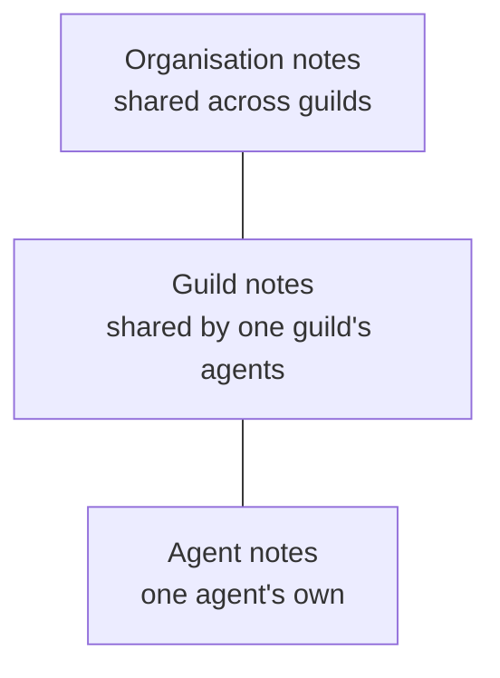

# Notes

A note is a Markdown file in the [artifact store](artifacts.md). It
holds long-form knowledge: a finding, a procedure, a glossary, a
decision. Agents write notes with tools, and operators read and edit
them in the app.

A note lives at one of three levels: one agent, one guild, or the
whole organisation. An agent-level note is that agent's own working
knowledge. A guild-level note is shared by the agents of one guild.
An organisation-level note is shared across guilds. Structured rows
belong in a [collection](collections.md) instead, and what an agent
wants its next runs to remember belongs in its [Memory](memory.md).

## When you use it

- An agent keeps long-form knowledge for its own work: an agent-level
  note.
- A team shares knowledge every member needs: a guild-level note.
- Several guilds share knowledge: an organisation-level note.
- An operator wants a rule in every run of an agent: a note embedded
  in the agent's [Task](task.md).

## How it works

### Three levels, flat files



Each level holds its notes side by side. There are no folders. A
note's name is one `.md` file name, its key.

An agent writes a note by naming the level (`agent`, `guild`, or
`org`) and the key. It never names an organisation, guild, or agent
id: the level decides the owner. "Guild" always means the agent's
own guild.

### How far an agent reaches

An agent can always read and write its own agent-level notes. Four
grants decide the rest:

| Grant | Lets the agent | Default |
|---|---|---|
| `read_guild` | read its guild's notes | on |
| `write_guild` | write its guild's notes | on |
| `read_org` | read the organisation's notes | on |
| `write_org` | write the organisation's notes | off |

No agent reads another guild's guild-level notes. Sharing across
teams goes through an organisation-level note or a collection.

There is one kind of agent. A curator that maintains shared
knowledge is an ordinary agent with `write_org` on.

These grants govern notes only. Collections have their own grants
([Collections](collections.md)). The grants are bindings, so they
can be set at the organisation, the guild, or the agent, and the
closest setting wins ([Access](access.md)).

### Finding and linking

Notes are not listed in the system prompt. An agent searches them
with `note_find`, then reads one with `note_get`. State tells the
agent which levels it may read and write
([System prompt](system-prompt.md)).

`note_write` returns the note's display path. That path is how the
agent links to the note elsewhere, for example from its Memory.

### Embeds

An operator embeds a note in an agent's Task with
`![[display-path]]`. Each run then carries the note's text in its
system prompt. A note can embed other notes and collections the same
way. A Task's embeds expand two levels deep: the Task's own embeds,
and the embeds inside those notes. All embedded text in one run
shares a 64 KB budget ([Task](task.md#embeds)).

A note that a live Task embeds cannot be deleted. A note that only
another note embeds can be, and that embed then breaks
([Task](task.md#a-broken-embed-stops-the-agent)).

A display path written in a note without `![[…]]` names the other
note without embedding it. Prompt Studio's **References** view shows
what embeds or names each note, which agents' prompts it reaches, and
each broken embed with its reason
([Prompt Studio](prompt-studio.md#state)).

## In the app

The agent's **State** tab and the guild's **State** tab share one
notes browser. The agent's view is **State › Notes**. The guild's
view is **State › Files**.

- The agent's **Notes** view shows three scopes: **Agent**, **Guild**,
  and **Org**.
- The guild's **Files** view shows **Guild** and **Org**.

In both:

- Each scope lists its notes side by side, with no folders.
- **New note** takes a name. The name cannot hold a `/`, and it gets
  `.md` added. At the agent level it cannot be `task.md` or
  `memory.md`.
- A note opens in the same Markdown editor as the Task. Its embed
  picker inserts other notes and collections.
- Unsaved edits are kept per note while the operator moves between
  notes. Leaving the page with unsaved edits asks **Leave without
  saving?**, with **Discard changes**.
- Save, or Cmd/Ctrl+S, writes the note.
- A provenance strip under the file header says who saved it last.
  **Open step** opens the run that wrote it in its agent's Chat tab
  at that tool call. **History** lists every recorded change
  ([Artifact store](artifacts.md#every-change-is-recorded)).
- A link with a display path opens that note first. A `note_write`
  chip in the chat leads there.
- Notes can be created and deleted.

The notes browser lists notes only. The agent's Task and Memory have
their own tabs ([Task](task.md), [Memory](memory.md)). Scripts appear
on the agent's **State › Scripts** view ([Scripts](scripts.md)).

The **Artifact scope** view, on both the guild's and the agent's
**State** tab, holds the four grants as on/off switches. Each switch
is captioned with where its state comes from, as on the Tools view
([Access](access.md)). On the guild it sets how far the guild's
agents reach beyond their own notes. On the agent it sets how far
this agent reaches.

The Prompt Studio coach can propose a new note, an edit to a note,
or a note's deletion. The operator applies or declines each one
([Studio proposals](studio-proposals.md)).

## Rules and limits

| Rule | Value or behaviour |
|---|---|
| Note name | one `.md` file name, no `/`, no folders |
| Reserved at the agent level | `task.md`, `memory.md` |
| Size of one write | 256 KB |
| Live notes per owner | 10 000, counted with Memory and scripts |
| `note_find` results | 20 by default, 100 at most |
| Reading another guild's notes | never |
| Deleting a note a live Task embeds | refused (409) |
| Embed depth | two levels from the Task |
| Embedded text per run | 64 KB in total |

## Reference

### Note tools

```text
note_find    { query?, level?, limit? }   results { notes }
note_get     { path }                     path is a display path
note_write   { level, key, content }      returns the display path
note_delete  { path }                     returns the display path
```

- `note_find` searches the notes the agent may read. With a `query`
  it matches whole words of the content (PostgreSQL `simple` text
  search, `websearch_to_tsquery` grammar) or a substring of the title
  and key, ranked by text rank then `updated_at`. An empty `query`
  lists notes by level and key. `level` limits it to one level.
  `limit` defaults to 20 and is capped at 100.
- `note_get` returns the display path and the note's text. A
  soft-deleted note returns a tombstone.
- `note_write` takes `level` (`agent`, `guild`, or `org`; anything
  else is 422) and `key`, the `.md` file name. A key with a `/` or
  without `.md` is 422 `note key must be a .md file name; notes have
  no folders`. `task.md` and `memory.md` at the agent level are 422
  `<key> is reserved`.
- `note_delete` soft-deletes the note. `task.md` and `memory.md`
  cannot be deleted.
- A successful write or delete publishes `guild.files.changed`.

Crossing tool families fails with a 422 that names the right tool:

| Call | Answer |
|---|---|
| `note_get` on a collection or record path | `Use record_search or record_list for collection records.` |
| `note_get` on a script | `use script_read for scripts` |
| `note_delete` on a record path | `use record_remove for collection records` |
| `note_delete` on a collection path | `collections are managed by the operator` |
| `note_delete` on a script | `use script_delete for scripts` |

`note_get` and `note_delete` answer a `history-archive/…` path as
unknown (404). The Memory archive is not the agent's to read
([Memory](memory.md)).

Other errors:

| Case | Status |
|---|---|
| reading a note at a level the agent's grants do not allow | 404 `artifact not found` |
| writing at a level the agent's grants do not allow | 422 `write not allowed` |
| more than 256 KB | 422 `write exceeds 256 KB` |
| the owner already holds 10 000 live notes, Memory, and scripts | 422 `artifact limit reached` |
| deleting a note embedded in a live Task | 409 `note is embedded in task (<agent ids>)` |

### Grant bindings

The four grants are `artifact_grant` bindings with ids `read_guild`,
`read_org`, `write_guild`, and `write_org`. Each resolves like any
binding across the instance, organisation, guild, and agent scopes
([Access](access.md#bindings)). A grant with no binding at any scope
takes its default from the table above.

State carries the result as `readable_levels` and `writable_levels`,
each a list starting with `agent`.

Code: `apps/orchestrator/src/artifacts/grants.ts`.

### App routes

| View | Route |
|---|---|
| Agent's notes | `/guilds/<guild_id>/agents/<agent_id>/state/notes?path=<display path>` |
| Guild's notes | `/guilds/<guild_id>/state/files?path=<display path>` |
| Open step | the agent's Chat tab with `?run=<run_id>&call=<tool_call_id>` |

`?path=` is optional. It opens that note and its scope first.

### HTTP

The notes browser reads and writes notes over these routes, acting as
the operator:

```text
GET    /api/agents/:agent_id/files        the agent's notes, by key: path, display_path, kind, title, version
GET    /api/agents/:agent_id/files/*      one note, or task.md or memory.md
PUT    /api/agents/:agent_id/files/*      { content, expected_version? }
DELETE /api/agents/:agent_id/files/*      204
GET    /api/guilds/:guild_id/files        the guild's notes
GET    /api/guilds/:guild_id/files/*
PUT    /api/guilds/:guild_id/files/*      { content }
DELETE /api/guilds/:guild_id/files/*      204
GET    /api/org/files                     the organisation's notes
GET    /api/org/files/*
PUT    /api/org/files/*                   { content }
DELETE /api/org/files/*                   204
GET    /api/org/embeddable-notes          every live note of the organisation, by level and key (500 at most)
GET    /api/org/embeddable-notes?display_path=…   one note: display_path, title, level, content; 404 if missing
```

A read answers `{ path, display_path, content, version }`. A deleted
or missing note is 404. The agent route also serves `task.md` and
`memory.md` ([Task](task.md), [Memory](memory.md)); only `task.md`
checks `expected_version`. Agent and guild writes and deletes
publish `guild.files.changed`.

The guild and agent routes need a guild the caller can see. The
`/api/org/…` routes need only organisation membership.
`/api/org/embeddable-notes` lists and returns notes of every guild
and agent, except those of private guilds the caller does not operate
([SEC-37](../architecture/security-register.md#sec-37--any-organisation-member-can-read-and-change-a-private-guilds-notes-and-databases-through-organisation-wide-routes)).

### Storage

Display paths ([Artifact store](artifacts.md#display-paths)):

```text
org/<org_id>/agents/<agent_id>/<note>.md
org/<org_id>/guilds/<guild_id>/<note>.md
org/<org_id>/<note>.md
```

A note is an `artifacts` row with `kind` `note`, a `level`, an
`owner_id` (the agent, guild, or organisation id), a `key` ending in
`.md` with no `/` or `\`, a `title`, and `content_text`. Its search
document is the content; its search text is the title and key.
Deletion sets `deleted_at`.

Code: `apps/orchestrator/src/artifacts/store.ts`,
`apps/orchestrator/src/toolbox/artifacts.ts`.
