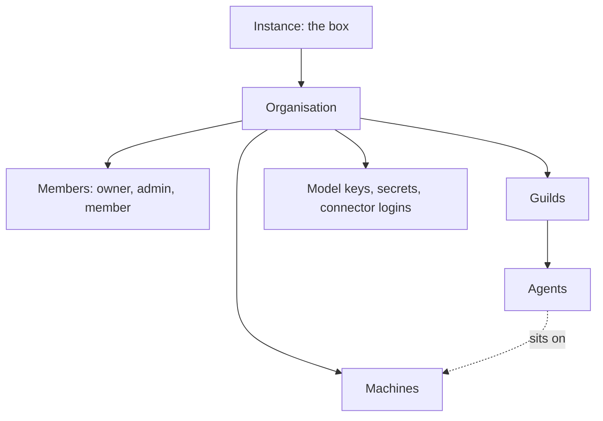

# Organisations

An organisation is the root of ownership on the box. It owns
[guilds](guilds.md), the [machines](machines.md) its agents run on,
[secrets](secrets.md), connector logins, [model keys](model-keys.md),
organisation [notes](notes.md) and [collections](collections.md), and
its [usage](usage.md). Nothing is shared between organisations.

People join an organisation as members. A [user](users.md) can be a
member of several organisations and works in one at a time. Inside a
guild, a member who works with its agents is an
[operator](operators.md).

## Why it exists

An organisation keeps one team's work, credentials, and bills apart
from another's on the same box. Its members decide together which
models it pays for, which machines it runs, and which secrets its
agents receive. Its owners and admins decide who else joins.

## How it works

### The hierarchy

Guild names are unique within an organisation. Agent names are
unique on the whole box. Every agent sits on one machine of its own
organisation. A machine is never shared with another organisation.

### Members and roles

Each member has one role:

| Role | Can |
|---|---|
| `owner` | Everything an admin can, plus add, promote, demote, and remove owners |
| `admin` | Change the organisation's name and slug, add and remove members and admins, change their roles, manage machines, model keys, and every secret |
| `member` | Read the organisation's settings, use every guild they can see, and manage secrets granted inside guilds they can see |

Every member lists every secret of the organisation, as metadata,
never a value. Owners and admins manage any secret and decide who
gets it. A member manages only secrets granted inside guilds they
can see ([Secrets](secrets.md)).

An organisation always keeps one owner. The last owner cannot be
demoted and cannot leave. A member who is the only admin of a guild
cannot be removed until that guild has another admin.

### The personal organisation

A new user gets a personal organisation with themselves as owner. It
takes the user's name. It stays visually implicit while it is the
user's only membership.

Every new organisation, whichever path creates it, starts with one
`standard` machine named `default`.

### The current organisation

A user works in one organisation at a time. Every list the app shows
belongs to it:

- its visible guilds: the guilds open to the organisation, plus the
  private guilds the user operates
- its secrets
- its connector logins

Anything in another organisation answers as if it did not exist.

### Limits

An organisation's limits come from the organisation policy:

- how many agents, browser agents, coding agents, and guilds it may
  hold
- how many machines it may hold, and how many agents one machine
  takes (never above 32)
- how many generations run at once

Core's policy sets none of them. The box-wide ceiling on concurrent
generations is `MAX_CONCURRENT_GENERATIONS`
([Configure](../getting-started/configure.md)). An edition may supply
a policy of its own
([Extension points](../architecture/extension-points.md)).

### Deleting an organisation

There is no delete control and no delete route. An organisation is
deleted when [deleting a user](users.md) leaves it with no member and
no guild. An organisation that still has guilds keeps at least one
owner, since the last owner of an organisation with guilds cannot be
deleted.

A deleted organisation's usage appears in no listing. The box-wide
total keeps it.

## In the app

### Switching organisation

The account menu switches organisation when the user has several
memberships. The page reloads at that organisation's home. The
**General** tab of **Settings** offers the same choice as **Working
in**.

### The Settings page

**Settings** (`/settings`) holds the organisation's settings. It
opens from the account menu. Its header names the organisation. Its
tabs (`?tab=`), in this order, with any an edition adds placed among
them:

- **General**: the user's own profile ([Users](users.md)), then the
  organisation's name and slug
- **Members**: every member with their role
- **Machines**: [Machines](machines.md)
- **Model keys**: [Model keys](model-keys.md)
- **Secrets**, **Tools**: the organisation-scope access view
  ([Access](access.md))
- **Usage**: [Usage](usage.md)

### General, Organisation

The **Organisation** group shows **Working in** when the user has
several organisations, then **Name** and **Slug**. Owners and admins
edit and **Save** them. Other members read them, with a line that
owners and admins change them.

### Members

**Members** lists every member with their role. Owners and admins
change roles from a picker. An admin never touches an owner. They
remove a member after a confirm, which says the member loses access
to every guild in the organisation and that their messages and notes
stay.

## Rules and limits

| Rule | Value or behaviour |
|---|---|
| Organisation name | Required, at most 80 characters, no control characters |
| Slug | Lowercase letter first, then lowercase letters, digits, and hyphens; 63 characters at most; unique on the box |
| Who creates an organisation | Anyone on `compat-cookie`; the instance admin otherwise |
| First machine | One `standard` machine named `default` |
| Guild names | Unique in the organisation |
| Agent names | Unique on the box |
| Last owner | Cannot be demoted or leave |
| Only admin of a guild | Cannot be removed from the organisation |
| Owners | Only an owner adds, promotes, demotes, or removes one |
| Another organisation's data | Answers 404 |
| Limits in core | None, except 32 agents per machine at most |

## Reference

### Fields

The `orgs` table:

| Column | Meaning |
|---|---|
| `id` | The organisation id |
| `name` | At most 80 characters |
| `slug` | Matches `^[a-z][a-z0-9-]{0,62}$`, unique (`orgs_slug_key`) |
| `default_model` | The default model, `{provider}/{model}`, or null ([Model keys](model-keys.md)) |
| `created_at`, `updated_at` | Timestamps |

`org_members` holds `org_id`, `user_id`, `role` (`owner`, `admin`, or
`member`), and `created_at`. Deleting a user or an organisation
deletes its rows. A guild's operator rows hang off the membership,
so leaving the organisation removes the user from its guilds.

Code: `apps/orchestrator/src/organisations/index.ts`.

### Selection

The selected organisation is the `X-Guilds-Org` header or the
`guilds_org` cookie.

- One membership and no header selects that organisation.
- Several memberships and no header is 400.
- An organisation the user is not a member of is 404.

Cross-organisation reads and writes return 404.

### HTTP

`:id` is the organisation id. A caller who is not a member gets 404.
A route the caller's role does not allow is also 404.

- `GET /api/orgs`: the user's organisations, each with their `role`.
- `POST /api/orgs`: `name` and `slug`. Anyone on `compat-cookie`, the
  instance admin otherwise. The caller becomes its owner. 201. 422
  for an invalid name or slug. 409 when the slug exists.
- `GET /api/orgs/:id`: the organisation with the caller's `role`.
- `PATCH /api/orgs/:id`: `name`, `slug`, or both, for owners and
  admins. 422 for an invalid value. 409 when the slug exists. A new
  slug moves the organisation's host notes folder `orgs/<slug>` when
  the new one does not exist yet.
- `GET /api/orgs/:id/members`: every member with `user_id`, `name`,
  `image`, `color`, `role`, and `created_at`.
- `POST /api/orgs/:id/members`: `user_id` and an optional `role`
  (default `member`). Adding an owner takes an owner; adding anyone
  else takes an owner or admin. 201. 422 for an unknown role. 404 for
  an unknown user. 409 when the user is already a member.
- `PATCH /api/orgs/:id/members/:user_id`: `role`. Promoting to owner
  or changing an owner takes an owner. Other changes take an owner or
  admin. 409 `last owner cannot be demoted`. 404 for an unknown
  member.
- `DELETE /api/orgs/:id/members/:user_id`: 204. Any member may remove
  themselves. Removing an owner takes an owner; removing anyone else
  takes an owner or admin. 409 `last owner cannot leave`. 409 when the
  user is the only admin of a guild in the organisation. 404 for an
  unknown member.
- usage: `GET /api/usage` returns the current organisation's guilds
  the caller may see, by guild and agent ([Usage](usage.md))
- machines: `GET /api/orgs/:id/machines` for members; `POST`,
  `PATCH`, and `DELETE` for owners and admins
  ([Machines](machines.md))
- model providers: `/api/orgs/:id/models`,
  `/api/orgs/:id/model-providers/:provider`, and
  `/api/orgs/:id/default-model` ([Model keys](model-keys.md))

### Policy

The organisation policy (`apps/orchestrator/src/policy/index.ts`)
returns one cap per key, or none:

| Key | Caps |
|---|---|
| `maxAgents` | Agents |
| `maxBrowserAgents` | Agents with **Browser** on |
| `maxCodingAgents` | Agents with **Coding** on |
| `maxGuilds` | Guilds |
| `maxMachines` | Machines |
| `maxAgentsPerMachine` | Agents on one machine; core's ceiling of 32 holds above it |
| `maxConcurrentRuns` | Generations at once |
| `monthlyCoachRuns` | Studio and Builder generations a month, counted together |
| `maxMcpServers` | Remote MCP servers the organisation adds of its own |
| `monthlyConnectorCalls` | Calls a month on a connector's platform login, by connector slug |

A refusal is 409 `<source> limit reached: <cap>`. Core's policy caps
nothing.

### Deletion

`DELETE /api/users/:id` deletes, in the same transaction, every
organisation with no member and no guild. A guild row refers to its
organisation, so an organisation with guilds is never deleted.

Usage counters are not deleted with the organisation. The
organisation's row stops appearing in usage, and the `global`
counter keeps every call. Core serves no route that lists every
organisation's usage.
