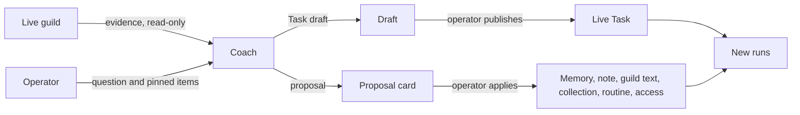

# Prompt Studio

Prompt Studio is the workspace where an operator debugs and improves a
guild that already exists. It loads the live guild as evidence: each
agent's [Task](task.md), [memory](memory.md), [runs](runs.md),
[routines](routines.md), [scripts](scripts.md), [notes](notes.md),
[collections](collections.md), and access. The operator looks at that
evidence in an inspector and talks about it with a built-in coach.

The coach drafts standing Tasks and [proposes](studio-proposals.md)
other changes. It keeps Tasks short and each agent narrow. It changes
nothing itself: the operator publishes each draft and applies or
declines each proposal. Studio is not a guild agent and not a direct
run. Creating a guild is the job of the
[Guild builder](guild-builder.md); the two keep separate tools.

## When you use it

- An agent does the wrong thing and you want to know why: open the
  run, see what it was told and what it did, and ask the coach.
- A Task has grown long or vague and you want a tighter one, with the
  shared rules moved into a note.
- Agents carry more than their work needs: one note that describes every
  role, or tools they never call. The coach splits the note into one per
  agent and proposes withdrawing the unused access.
- Agents wake each other in ways you do not expect:
  [Studio activity](studio-activity.md) shows who woke whom, how often,
  and what each wake produced.
- An agent reported an issue: **Investigate in Studio** opens a
  session already pointed at the run that raised it.

## How it works



### Sessions

A session ties one source guild to one coach model and temperature.
Those three never change during a session; changing any of them means
starting a new session. The agent the inspector points at (the
target) can change whenever the coach is idle.

An operator can keep several sessions on one guild and resume any of
them. Starting a new one does not archive the current one. A session
belongs to the user who started it.

### What the coach sees

The coach reads the guild through Studio tools: the
[Guidelines](system-prompt.md), each standing Task, the State, Memory
and its versions, notes of the guild, its agents, and the organisation,
the guild's short description and description, routines and the runs
they produced, the effective prompt of the next run and of each past
run, scripts, who wrote each file, and what each agent is offered.
Outside data is reachable only through a login the operator grants to
the session. [Evidence sources](#evidence-sources) lists each source
and what Studio may do with it.

The coach's own system message carries what every agent already
reads: the four sections of the [system prompt](system-prompt.md),
with the Guidelines template, the Task and State intros, and the
Memory rules inlined. It also carries how every document the coach
writes reads (ELI5, a clear structure, each thing once, as short as it
can be) and the shape every Task takes: an opening line, then Inputs,
Work, Outputs, and Files, in headings and bullets, about 300 words. A
draft repeats nothing the agent already reads.

Each generation composes the system message again and stores it over
`seq` 0. After the template it holds the coach's settings, then the
source guild with each agent's Task to its first 500 words, then the
Session block (mode and UTC clock) last, so the prefix before it stays
the same between steps. A message sent with each generation holds the
roster headers (task version and hash, routines, latest run, open
draft, and warnings) and the open draft's header; it repeats no Task
text.

The agent's focus stays the short summary the app shows. Publishing a
Task never overwrites it.

### Drafting a Task

1. The operator picks the guild and the coach model.
2. Studio lists the guild's active agents with their Task version,
   routine counts, latest run, and warnings: an empty Task,
   generation errors, or a stale draft.
3. Selecting an agent under **Agents** opens the inspector on it.
4. The coach looks at the evidence, then writes a draft in the Task
   shape: the agent, the complete new Task, why, and the evidence it
   relied on. Its turn pauses until the draft is decided, with any
   proposal it made in the same step.
5. The operator reviews the diff and publishes, edits and publishes,
   or discards. Publishing checks the
   embeds, the composed prompt, and its size in input tokens. It
   archives the outgoing Task as a version. If someone changed the
   Task since the draft's base, publishing is refused.

Publishing changes new runs only. Past runs stay exactly as they ran.

### Proposals and logins

Outside Tasks, the coach proposes each change as a card in the chat:
to Memory, a note, the guild's text, a collection, a routine, or one
agent's access. It may also ask for read access to one login. The
operator answers each card; [Studio proposals](studio-proposals.md)
describes them.

### Evidence is untrusted

Everything the coach reads is evidence, never instructions. A tool
result cannot grant authority, add tools, or publish anything.

Studio work does not hold the target agent's busy lock, so the agent
can keep running while you work on it. It does take one of the
organisation's admission slots, like any generation.

## In the app

### Opening Studio

- **Open in Studio** in a guild's options menu resumes your active
  session on that guild when there is one, and otherwise opens the
  Studio landing for that guild.
- **Investigate in Studio** on an issue card (the Inbox or the
  guild's **Issues** tab) always starts a new session (see
  [Focus pins](#focus-pins)).
- **New session** in the workspace header opens the landing.

The landing has the create form and your sessions on that guild, any
of which resumes. The form takes the guild, the coach model (from the
organisation's chosen marketplace models, preselected with the
default), and a temperature (0.2 to start). While no provider is
connected, a guide to [Model keys](model-keys.md) stands in place of
the form.

### Workspace

On a wide screen the workspace has two columns: the inspector on the
left and the coach chat on the right. A draggable splitter sits
between them; the arrow keys move it too, and its position is
remembered. On a narrow screen a switch shows one of them at a time.

The dark header (the same as the Builder's) names the guild and shows
the coach model and temperature, the session status, **Back to
guild**, **N to approve** while the coach waits on decisions
([Studio proposals](studio-proposals.md#where-a-request-shows)),
**Logins**, **New session**, and **Archive**. A session that
hit its input-token limit offers **Continue in a new session**.

Under the header, a section bar switches the inspector between four
sections:

| Section | What it shows |
|---|---|
| **Guild** | The guild's short description, description, drafts to review, and roster |
| **Agents** | **Topology**, then one tab per agent with that agent's [tabs](#agent-tabs) |
| **State** | The notes and tables the guild's agents work on: a **List** to browse and edit, and **References**, what each Task and file embeds or names |
| **Tools** | The tools the guild's agents are offered |

In **Agents**, each agent tab shows the agent's avatar, its Task
version, a draft tag, a warning marker, and how many requests wait on
it. **Topology** counts the agents and clears the target. With more
than four agents a filter joins the tabs. An agent opens on the tab that holds a request the
coach waits on, and otherwise on **Prompt**. A tab that holds one
carries a dot, and that tab shows the request's card above its view.

Where the inspector points is part of the URL, so a link opens the
same section, agent, tab, item, and run step. Pointing the inspector
at an agent, in **Agents** or as the **State** filter, updates the
session's target; the other sections clear it. A routine's run offers
the way back to its routine. On a narrow screen the section bar and
the agent tabs scroll sideways.

The coach log shows the coach's reasoning as it streams, then its
reply. Settings › **Usage** shows the coach's spend as a **Studio
coach** row ([Usage](usage.md)).

### Agent tabs

Every agent tab except **Prompt** and **Draft** has two panes: a short
list with its filters on the left (above, on a narrow pane), and the
selected item on the right.

| Tab | List | Selected item |
|---|---|---|
| **Prompt** | none | The live Task and its version, with **Edit in agent**. A note embed chip opens that note in **State**; a collection embed opens State's tables. Then what a run gets: the effective prompt, the exact opening system message the next run would store, with note embeds expanded to their text and collection embeds replaced by the collection's name, split into guidelines, task, state, and (when Memory is on) memory. An embed the agent cannot reach shows as the marker its run gets ([Task](task.md#embed-expansion)). It says whether the latest run used this Task and this memory. Banners say when the agent is running and when the embeds hold more than the 64 KB budget |
| **Draft** | none | The pending draft: why, a side-by-side diff against its base version, **Publish**, **Edit**, **Discard**. A draft over a Task that changed since shows as conflicted |
| **History** | Every run: what started it, time, older Task, generating, error count; filters by kind, errors, and current Task | The run transcript, as in the agent's Chat tab: offered tools, system prompt sections with note text filled in, the run flow; whether it ran on the current Task, guidelines, and memory; **Open in agent** |
| **Memory** | Every version memory has held, newest first: version, author (run kind, person, or agent), added and removed lines; filter by author | Diff against the previous version, or the whole version. **Open step** on a version a run wrote opens the run at its `memory_write` call |
| **Routines** | Description, timing, next wake or paused, run count; active first | The instruction as Markdown, a banner while the guild's routines are off, then the runs that routine started, marked when they fired with an older instruction. A run opens in **History**. **Edit in agent** |
| **Scripts** | Script names and descriptions, tagged when offered as a tool | Description, provenance, parameter schema, source; **Edit in agent**. The tab is hidden while the agent's scripting is off |
| **Versions** | The live Task and archived versions, with who replaced each and when | Diff against the previous version. **Restore from Prompt** opens the agent's Prompt tab |

**Notes** and **Tables** after the tabs are links: they open
**State** filtered to the agent, on its notes or its tables.

Studio does not stream a run. A generating run shows its committed
steps under a banner with **Refresh**, and **Open in agent** opens it
in the agent's Chat tab, which streams it. The run list polls every
5 s while any run is generating.

### Guild

**Guild** holds the guild's short description, its description, the
drafts to review, and the roster: each agent's Task version and
excerpt, routine count, last run, and warnings. A roster entry opens
the agent in **Agents**.

### Topology

**Topology** is the first tab of **Agents**. It shows the guild's
[activity](studio-activity.md): who woke whom over a window of hours.

### State

**State** has two views, **List** and **References**, with an agent
filter beside them, and in **List** a kind filter: **All**, **Notes**,
**Tables**, **Scripts**, or **Memory**.

**List** shows every note, table, script, and Memory in the guild's
state: the guild's own, its agents', and the organisation's, each with
its level. Only what the viewer can open is listed. For the window
(24 h, 3 d, or 7 d), each row shows the item, its level and size, its
changes and reads, who changes it most and who reads it most with
their share, and its last change. Filters narrow it by kind, by agent
(items the agent owns, changes, or reads), by **Needs a look**, and by
search words. The list sorts by name, changes, reads, or last change.

A row carries a flag when the item deserves a look:

| Flag | When |
|---|---|
| **needs approval** | An open coach request changes it |
| **no agent read it** | No agent of the guild read it in the window |
| **N writers** | More than two people or agents changed it in the window |
| **deletes another agent's rows** | A table where an agent deleted records another agent created in the window |
| **untouched** | Nothing changed or read it in the window |

**Needs a look** keeps the flagged items. Changes and reads count
people and this guild's agents; a change by another guild's agent
shows in the history as **another guild**, without its name. What
counts:

| Measure | Counted as |
|---|---|
| A change to a note, record, script, or Memory | One per recorded change; a record's counts for its table |
| A table's shape change, **Delete all**, or deletion | One per entry of the table's change log |
| A read through a Task embed | One per run per embedded note or table |
| A read of Memory | One per run of its agent |
| `note_get` | One per call, on the note it names |
| `file_fetch` | One per call, on the file it names |
| `record_list`, `record_search` with a table | One per call, on the table |
| A script run | One per `script_run` call or script-tool call |

A search with no named target and a person's read are not counted.

Selecting an item opens its detail: its version or records, changes,
reads, and creation; who changes it and how; who reads it and how; its
references, as **References** shows them; and its history, newest
first, with an operation filter and **Load older changes**. A history
entry made by a run offers **Open step**; one applied from a coach card
names its coach message. A change saved in the app's editors shows who
and when only. **Open text** opens the note or Memory in the notes
browser, **Open records** the table in the records panel, so editing
stays in State. **Open source** opens a script in its agent's
**Scripts** tab. **Ask the coach** pins a note, script, or Memory.

**References** draws every Task and file in the guild's state, and
what embeds or names what:

- **Map.** The Tasks sit in the first column. The notes and tables
  they embed follow, one column per hop: **Embedded in a Task**, **One
  hop further**, and **Too deep**, whose text no run gets. A band below
  holds the files no Task reaches. A solid line is an embed; a dotted
  line is a display path the text references as `[[…]]` or names
  without embedding it. A link
  that does not resolve, a file some run that inlines it cannot reach,
  or a Task over the embed budget, is red.
  Selecting a box lights what it pulls in and what pulls it in. Files
  reached only past the last column are listed under the map.
- **What stands out.** Broken embeds with their reason (a file some
  agent's run cannot reach names those agents), Tasks over the budget, notes inlined into several agents' prompts, notes too deep to
  be inlined, and files nothing embeds or names and no agent read in
  the list's window.
- **Detail.** For a Task: its embed budget, and everything it pulls
  into every run, each at its hop, with the files its agent cannot
  reach marked not reachable. For a file: what it embeds or names,
  what embeds or names it, the agents whose prompts it reaches, and
  the agents whose runs cannot reach it.
- **Actions.** **Open Prompt** opens the agent's **Prompt** tab. **Open
  in State** selects the file in **List**. **Ask the coach** pins the
  file.

With the agent filter, the map shows what that agent's runs meet, and
its own notes that they do not. The map counts hops the way a run
inlines embeds ([Task](task.md#embeds)): a note met first deeper in the
walk is inlined there once, so its own embeds can fall past the last
inlined hop. Each Task's run is walked as its agent, so a file the
agent cannot reach gets the marker in that run, and the walk does not
go into it.

### Tools

**Tools** lists every tool the guild's agents are offered now, and
every tool they called in the window (24 h, 3 d, or 7 d). A tool comes
from the native toolbox, from a script with parameters, or from a
connection. Calls the coach makes are not counted: only the agents'
runs.

Each row shows the tool and its group, the agents offered it, its
calls, its errors, the median call duration, the agent that calls it
most and its share, and the last call. An agent offered the tool has a
solid ring when it calls it in the window and a dashed one when it
does not. A tool called in the window that no agent is offered now
says **no longer offered**. Filters narrow the list by source, by
agent, by **Needs a look**, and by search words.

A row carries a flag when the tool deserves a look:

| Flag | When |
|---|---|
| **never called** | Offered to an agent, and called by none in the window |
| **N never call it** | Called, but N agents offered it never call it |
| **X% fail** | 10% of its calls or more failed |
| **needs approval** | An open access change of the coach touches it |

**Needs a look** keeps the flagged tools. Selecting a tool opens its
detail:

- tiles: calls, error rate, median duration, and how many of the
  agents offered it call it
- who calls it, each agent with a bar of its ok and failed calls
- the agents offered it that never call it
- its failed calls grouped by error message
- its calls, newest first, **All** or **Errors**, with **Load older
  calls**. **Open step** opens the call in the agent's **History**

**Ask the coach** pins the tool.

### Focus pins

**Ask the coach** pins an item to the next question as a chip above
the composer. It appears on:

- the run, memory version, routine, and script panes
- every tool call's detail in a **History** transcript
- the file open in **State**
- the tool open in **Tools**
- a wake opened in the activity chains

A run opened at a step pins that step. What can be pinned:

- a run, optionally one step of it
- a memory version
- a routine
- a file or record, optionally one recorded change (a whole
  collection is refused: pick a record)
- an issue an agent reported
- a tool the guild's agents call

The chat shows a sent pin as a card that reopens the item in the
inspector.

The chip's **Ask in a new session** checkbox creates a session for the
same guild and coach instead, posts the pinned question there, and
opens it. The current session stays in the list.

**Investigate in Studio** on an issue creates a session for the
issue's guild with the organisation's default model and temperature
0.2. With no default model, a toast asks for one on Model keys. It
opens the inspector on the reporting agent's **History** tab at the
run that raised the issue, pins the issue, and drafts a question.
Nothing is sent until the operator sends it.

## Rules and limits

| Rule | Behaviour |
|---|---|
| Guild, coach model, temperature | Fixed for the life of a session |
| Sessions | Visible only to the user who started them |
| Session reach | Checked on every request: a user who can no longer see the source guild gets 404 for its sessions, and the list leaves them out |
| Coach model | Must be a marketplace model whose provider the organisation has connected |
| Steps per generation | 24 |
| Output tokens per generation | 8,192 by default |
| Tool calls per generation | 40 by default |
| Input tokens | 100,000 by default; when a generation's projected input passes it, the session is blocked and offers **Continue in a new session** |
| Monthly runs | Each generation counts against the organisation's monthly Studio and Builder runs, when a limit is set |
| Writes | None by the coach; the operator publishes drafts and applies [proposals](studio-proposals.md#rules-and-limits) |
| Publishing a Task | Affects new runs only; refused when the Task changed since the draft's base |
| Agent's busy lock | Not taken; an organisation admission slot is |
| Agent tab filter | Shown above four agents |
| Polling | Every 5 s while a run generates |
| Usage | Counts toward the organisation, not the guild's or agent's lifetime totals |
| Deleted guild | The conversation stays readable; live tools and publishing turn off |

## Reference

### Evidence sources

| Evidence | Source | Studio |
|---|---|---|
| [Guidelines](system-prompt.md) | `apps/orchestrator/src/prompts/system.md` | read-only |
| Standing Task | `agents.task` | the main draft target |
| State | run-creation projection | the current preview, and the copy each run stored |
| Memory | agent `memory` artifact and `memory_revisions` | every version; cite and propose an edit |
| Notes | `note` artifacts in the source guild, its members, and the organisation | inspect, cite, and propose a create, edit, or delete |
| Guild short description and description | `guilds.about`, `guilds.description` | inspect and propose an edit |
| Routines | `schedules` | inspect beside the runs they produced; propose a create, edit, or delete |
| Effective prompt | composed from current sources; run message sequence zero for history | what the next run would get, and what each past run got |
| Scripts | agent `script` artifacts | inspect source and provenance |
| File provenance | `file_changes` | who wrote a file and the run step that did it |
| Access | bindings, secret grants, MCP catalog | what each agent is offered and withheld; propose an agent-level edit |
| External data | MCP connection tools | read-only, through a login granted to the session |

Focus is `agents.focus`. The current State preview uses a pure
PostgreSQL projector: it starts no sandbox, syncs no connector, and
decrypts no credential. `studio_sessions.mode` is `optimize`; the
schema also allows `create`, which no route writes.

### Routes and location

The workspace is at `/studio` and `/studio/<session_id>`. The landing
for one guild is `/studio?guild=<id>`.

The inspector location is
`/studio/<session_id>?section=…&agent=…&tab=…&kind=…&item=…&call=…&seq=…`.
`apps/web/src/features/studio/location.ts` parses it, and each section
keeps only its own fields:

| `section` | Fields | Meaning |
|---|---|---|
| `guild` | none | The guild's overview |
| `agents` | `agent`, `tab`, `item`, `call`, `seq` | With `agent`: that agent's tab (`prompt`, `draft`, `history`, `memory`, `routines`, `scripts`, `versions`), its selected item, and for a run the step for `call` (a provider tool-call id) or `seq`, scrolled into view. Without `agent`: Topology, where `item` is a map selection, `link:<from>><to>` or `node:<id>` |
| `state` | `agent`, `tab`, `kind`, `item` | `tab` is `list` or `references`, `agent` the filter, `kind` `note`, `table`, `script`, or `memory`. In List `item` is the selected item's display path; a table's collection id also selects it. In References `item` is the selected node: a display path, or a link as written when it does not resolve |
| `tools` | `item` | The selected tool |

A link without a known `section` opens the guild's overview.
A pinned file opens in State with the file selected; a pinned record
opens its table. **Investigate in Studio** opens
`section=agents&agent=<id>&tab=history&item=<run id>`.

The splitter's share persists in `localStorage`. The pinned issue of a
session started from **Investigate in Studio** waits in
`sessionStorage`.

### Publishing

The coach calls `studio_create_task_draft` with `agent_id`, the
complete proposed content, rationale, and evidence references. A Task
links a file with `![[display-path]]` when the file must enter every
run. Embed expansion in the inventory is lazy on select.

Publish preflights embeds, composition, and the input-token estimate
against stored tool schemas. A draft that embeds a note not yet
created is refused. It archives the outgoing task in
`task_revisions` and compare-and-swaps the live row against the
`agents.task` version the draft is based on (optimistic concurrency).
A stale base returns 409.

### Focus pins

`POST …/messages` takes the pin as `focus`. The server resolves the
ids against the source guild (422 otherwise). It inserts two user rows
in the same generation:

1. an evidence block with `source: studio_focus` and the resolved pin
   in `metadata.focus`
2. the question

The block is `<evidence source="studio.focus.<kind>">`. It carries:

- the item's coordinates
- a capped excerpt: the focused message or tool call, the section diff
  of a memory version, the routine instruction, the file's first bytes
  and latest change, the issue's kind, severity, failing tool,
  summary, and detail, or a tool's calls and failures per agent over
  the last 7 days with its 5 latest failed calls
- the tool that loads the rest (for an issue, `studio_get_run` on the
  reporting run filtered to `report_issue`)

The block stays in the projected history of later turns.

A pin on a tool call carries its call id and `seq`. A run pin names
one step by `seq` or tool-call id. A collection path is refused with
`pick a record`.

**Ask in a new session** creates the session with
`parent_session_id` set.

### Evidence references

Evidence references bind to a committed Studio tool message
(`tool_message_seq`). The model never supplies content hashes or
ownership. Unresolved individual refs become `evidence_warnings`. A
draft with none has `verified_evidence: false`.

### Tools

- `studio_get_guidelines`
- `studio_get_agent_context`
- `studio_list_routines`
- `studio_list_runs`
- `studio_get_run`
- `studio_list_group_messages`
- `studio_list_task_revisions`
- `studio_list_memory_revisions`
- `studio_get_memory_version`
- `studio_find_artifacts`
- `studio_get_artifact`
- `studio_list_file_changes`
- `studio_get_script`
- `studio_get_agent_access`
- `studio_request_connection_access`
- `studio_call_connection_tool`
- `studio_create_task_draft`
- `studio_get_guild`
- `studio_list_guilds`
- `studio_list_collections`
- `studio_get_collection`
- `studio_edit_memory`
- `studio_edit_note`
- `studio_edit_guild`
- `studio_edit_access`
- `studio_edit_collection`
- `studio_edit_routine`

`studio_edit_note`, `studio_edit_collection`, and `studio_edit_routine`
each take an `action`: `create`, `edit`, or `delete`.

They do not appear in normal agent Access panes. The proposal tools
and the connection tools are described in
[Studio proposals](studio-proposals.md#reference).

Reach is the immutable source guild and its members, the
organisation's notes, and the collections the source guild's agents can
be given: the guild's own and the organisation's. Another guild's
agents, notes, Memory, and own collections are out of reach; its about
and description are not. One rule
(`apps/orchestrator/src/studio/reach.ts`) decides reach for every tool
that takes a display path, and for focus pins.

| Tool | Behaviour |
|---|---|
| `studio_find_artifacts` | Searches notes only |
| `studio_get_artifact` | Reads one note or record by display path. A record is in reach when its collection is. A collection path is refused with a pointer to `studio_get_collection` |
| `studio_get_script` | Reads one member script by name |
| `studio_list_collections` | The source guild's own collections, then the organisation's. Each row has owner, purpose, record count, column names, the mode the source guild's agents get from the guild's and the organisation's rows (`guild_access`), and `studio_can`: `edit_or_delete` for the guild's own, `add_columns_and_access` for the organisation's |
| `studio_get_collection` | One collection in reach by name: its full columns, record count, `updated_at`, `studio_can`, the organisation's row, the source guild's row, each live member's own row and the mode it ends up with (counting the guild's and the organisation's rows), the rows of other guilds and their agents, and its five most recently updated records as evidence (`apps/orchestrator/src/studio/tables.ts`). Rows of a private guild the operator does not operate are left out |
| `studio_get_agent_context` | Sections `task`, `memory`, `state`, `config`, `effective_prompt` (the composed opening system message with embeds inlined), `effective_prompt_headers` |
| `studio_list_runs` | Filters by `kind`, `status`, `task_prompt_hash`, `error_only`, and `schedule_id` |
| `studio_list_routines` | Each routine's run count and latest run |
| `studio_get_run` | Takes `seq_start`, `seq_end`, and `tool_name`; `tool_name` keeps only the turns that requested that tool and their results |
| `studio_list_memory_revisions` | Memory timeline headers: version index, revision id, actor, time, sections changed, line counts |
| `studio_get_memory_version` | One version's text and its diff from the previous one, by `revision_id` or `version_index` (the live version when both are omitted) |
| `studio_list_file_changes` | A file's recorded changes with the run and tool call that made each one, and the coach message a change applied from a card came from |
| `studio_get_guild` | The live about and description in full; the system message holds a capped copy |
| `studio_list_guilds` | The organisation's other guilds the operator can see, private guilds they do not operate left out: each one's id, name, about, and description as evidence. Paged with `cursor` and `limit`; a page also ends before its guilds pass half the 64 KiB result cap |
| `studio_get_agent_access` | What one member is offered at run start, projected from bindings, the secrets that reach it, and the stored MCP catalog: native tools and the ones withheld, scripts, secret names and descriptions, and each MCP connection with its offered and withheld tools, whether the server is enabled for that agent, and whether this session may read through it. No remote list and no credential decryption |

`studio_get_agent_context`, `studio_list_routines`, `studio_list_runs`,
`studio_get_run`, `studio_list_group_messages`,
`studio_list_task_revisions`, `studio_list_memory_revisions`,
`studio_get_memory_version`, `studio_find_artifacts`,
`studio_get_artifact`, `studio_list_file_changes`,
`studio_get_script`, `studio_get_agent_access`,
`studio_request_connection_access`, `studio_call_connection_tool`,
`studio_create_task_draft`, and `studio_list_guilds` check their arguments against the
parameters they declare before they read them
(`apps/orchestrator/src/studio/arguments.ts`):

- An optional argument sent as `null` counts as left out.
- For a tool that takes `agent_id`, the agent is the first non-blank
  of `agent_id`, `agent`, and `agent_name`.
- A call whose arguments do not match is refused with the first
  mismatch, named by its JSON pointer, such as
  `/limit: Expected integer` or
  `/run_id: Expected required property`.

### Storage

`studio_sessions`, `studio_messages`, `studio_drafts`.

Drafts are immutable numbered rows (`resource_kind = agent_task`). A
revision inserts a new head that keeps the draft's
`created_message_seq`, the coach message that created it. Draft status
is `draft`, `superseded`, `published`, `unchanged`, `discarded`, or
`conflicted`. `published_by_user_id` and `discarded_by_user_id` record
who decided it.

A focus pin is a `studio_messages` user row with
`metadata.source = studio_focus`. A proposal is a `studio_messages`
tool row whose resolution is in its metadata.

`parent_session_id` records the session a pinned question was asked
from, or the session a token-limit continuation came from.

| Field | Values |
|---|---|
| `status` | `active` \| `blocked` \| `archived` |
| `blocked_reason` | `source_deleted` \| `input_token_limit` |
| `generation_state` | `idle` \| `generating` \| `cancelling` |

Source guild, creator, and target use `ON DELETE SET NULL` so the
conversation audit survives hard delete. Live tools and publish
disable. A session whose creator was deleted leaves its open drafts as
orphan drafts (see [HTTP](#http)).

### Coach loop and usage

The coach loop is the shared conversation runner
(`apps/orchestrator/src/conversation/`):

- token projection with tool-result stubbing (`projection.ts`, keep 1,
  results under 2048 bytes never stubbed, and a stub hint each coach
  passes)
- cancellation with tool-call repair
- crash reconcile
- organisation admission
- the credentials of the coach's model provider, resolved per
  completion
- subscribe-before-snapshot SSE

The run limits come from the organisation policy; core's defaults are
in `apps/orchestrator/src/studio/constants.ts`. A generation past the
month's `monthlyCoachRuns` is refused with 409.

Usage is charged to the global and organisation counters and to
`org_monthly_usage`. It does not increment the source guild or agent
lifetime counters.

### HTTP

```text
GET    /api/studio/sessions
POST   /api/studio/sessions
GET    /api/studio/sessions/:id
POST   /api/studio/sessions/:id/archive
PUT    /api/studio/sessions/:id/target
GET    /api/studio/sessions/:id/connections
PUT    /api/studio/sessions/:id/connections/:connection_id
GET    /api/studio/sessions/:id/edits/:seq
POST   /api/studio/sessions/:id/edits/:seq
POST   /api/studio/sessions/:id/logins/:seq
GET    /api/studio/guilds/:guild_id/inventory
GET    /api/studio/sessions/:id/inventory
GET    /api/studio/sessions/:id/agents/:agent_id
GET    /api/studio/sessions/:id/agents/:agent_id/routines
GET    /api/studio/sessions/:id/agents/:agent_id/runs
GET    /api/studio/sessions/:id/agents/:agent_id/memory-timeline
GET    /api/studio/sessions/:id/activity
GET    /api/studio/sessions/:id/tools
GET    /api/studio/sessions/:id/tools/:name/calls
GET    /api/studio/sessions/:id/references
GET    /api/studio/sessions/:id/state
GET    /api/studio/sessions/:id/state/item
GET    /api/studio/sessions/:id/runs/:run_id
GET    /api/studio/sessions/:id/messages
POST   /api/studio/sessions/:id/messages
POST   /api/studio/sessions/:id/cancel
POST   /api/studio/sessions/:id/continue
GET    /api/studio/sessions/:id/stream
GET    /api/studio/sessions/:id/drafts
GET    /api/studio/orphan-drafts
GET    /api/studio/drafts/:id
POST   /api/studio/drafts/:id/revise
POST   /api/studio/drafts/:id/publish
POST   /api/studio/drafts/:id/discard
```

The connection, edit, and login routes are described in
[Studio proposals](studio-proposals.md#http), and the activity route
in [Studio activity](studio-activity.md#http).

`GET …/state?hours=&agent=&kind=` returns `{ since, until, items }`.
`hours` follows the tools route. `kind` is `note`, `table`, `script`, or
`memory` (another value is 422); `agent` keeps the items that agent
owns, changes, or reads. Each item has `display_path`, `kind`, `level`,
`owner_id`, `title`, `size` (bytes, or records for a table), `version`
(null for a table), `created_by`, `created_at`, `collection_id` (a
table's id, else null), `note_id` (a note's id, else null), the
window's `changes` and `reads`, `top_writer` and `top_reader` (`{
actor, count, share }`), `writers`, `last_change` (`{ at, actor }`),
and `flags` (`no_agent_read`, `writers`, `deletes_others_rows`,
`untouched`). An actor is `{ kind: person | agent | other_guild, id,
name }`. Items are read with the viewer's own permissions, so a
private guild's or a hidden item never appears. Changes come from
`file_changes` and the table and note entries of `config_changes`
(a table's shape and access, a note's access); reads from
`runs.metadata.task_source` (`embeds` and `collections`, recorded at
run start), every run of a Memory's agent, and the arguments of
`note_get`, `file_fetch`, `record_list`, `record_search`, `script_run`,
and script tool calls.

`GET …/state/item?path=&hours=&op=&cursor=` returns `{ item, changes,
reads, history, next_cursor }` for the item at `path` (404 when the
viewer cannot open it). `changes` and `reads` count each actor's
operations and ways of reading in the window. `history` is the item's
recorded changes, 50 a page, newest first, over all time: its own
changes, a table's records', and its entries in the change log. Each entry has `at`,
`operation`, `actor`, `link` (`{ kind: "run", run_id, agent_id,
call_id }` or `{ kind: "coach", session_id, seq }`), `record`, and
`summary`. `op` keeps one operation; `cursor` is the previous page's
`next_cursor`; another value of either is 422.

`GET …/tools?hours=` returns `{ since, until, tools }`. `hours` is
positive, 24 by default, and capped at 168. Each tool row has `name`,
`source` (`native`, `script`, `connector`, or null when no agent is
offered it and it is not native), `group` (the native family such as
`note`, `scripts`, or the connection's server name), `description`,
`server_id` (connection tools), `offered_to` (the agents offered it
now), the window's `calls`, `errors`, `median_ms`, and `last_at`, and
`agents`: each agent offered it or calling it, with `offered` and the
same numbers. What an agent is offered comes from the same projection
as `studio_get_agent_access`, with the agent's switches applied; the
numbers come from its runs' tool results (`metadata.tool_name`,
`error`, `duration_ms`).

`GET …/tools/:name/calls?hours=&errors=&cursor=` returns `{ calls,
next_cursor }`: 50 calls a page, newest first, each with `at`,
`agent_id`, `run_id`, `call_id`, `seq`, an `arguments` preview of 240
characters, `status` (`ok` or `error`), `error`, and `duration_ms`.
`errors=true` keeps failed calls. `next_cursor` is passed back as
`cursor` for the next page; another value is 422.

Create body: `{ "mode": "optimize", "source_guild_id", "coach_config":
{ model, temperature }, "parent_session_id"? }`. `model` is required:
a marketplace model whose provider the organisation has connected,
else 422.

`GET /api/studio/sessions` lists the current user's sessions. A
session of another user is 404.

Both inventory routes return the roster: each active agent with its
Task version, routine counts, latest run, and warnings (`empty_task`,
`generation_errors`, `stale_draft`). `GET
/api/studio/guilds/:guild_id/inventory` reads a guild the user can see
before any session exists. The web app reads the session route.

`GET /api/studio/orphan-drafts` lists the organisation's open drafts
whose session's creator was deleted. Only an owner or admin may call
it (403 otherwise). An owner or admin may read, revise, and publish
such a draft through the draft routes, but not discard it (403
`orphan recovery cannot discard`). The web app does not call this
route.

Message body: `{ "content", "focus"? }` where `focus` is `{ kind: run |
memory_version | routine | file | issue, agent_id?, run_id?, seq?,
call_id?, revision_id?, version_index?, schedule_id?, display_path?,
change_id?, issue_id? }`.

`POST …/continue` creates a new session from one blocked at its
input-token limit.

The agent inspector response carries `effective_prompt` (content,
hash, inlined task, per-section hashes, and whether each section
matches the latest run).

`GET …/references` returns `{ guild_id, budget, depth, nodes, edges }`,
computed on read from Task and note text; nothing is stored. `budget`
is the 64 KB embed budget and `depth` the 2 levels a run inlines.

| Node field | Meaning |
|---|---|
| `id` | The display path, or the link as written when it does not resolve |
| `kind` | `task`, `note`, `table`, or `unresolved` |
| `label`, `level`, `agent_id`, `collection_id` | The agent's name for a Task, else the note's title or the table's name; the level; the agent of a Task or agent-level note; a table's id |
| `in_state` | Part of the guild's state, rather than only reached from it |
| `bytes` | The UTF-8 size of its text |
| `inlined_bytes` | For a Task: the note text one run inlines, leaving out the files its agent cannot reach |
| `hops` | Per agent id, the hop at which its runs meet it: 0 its own Task, 1 and 2 inlined, 3 left as text |
| `depth` | Embed hops from the nearest Task, past 3 too; `null` when no Task reaches it |
| `reason` | Why a link does not resolve, with the reasons of the embed status route |
| `unreachable_for` | The agents whose runs meet it at an inlined hop but cannot read it, so their runs get the marker in its place |

An edge is `{ from, to, kind, status }`. `kind` is `embed`, or `name`
for a display path of a Task, note, or table that the text names
outside an embed. An embed's `status` is `broken` when its target does
not resolve or a run that expands its holder's embeds cannot read it,
`inlined` when some run expands its holder's embeds,
`too_deep` when runs meet the holder only at the last inlined level,
and `unreached` when no Task reaches the holder; a name's is `named`.

The route reads the files with the viewing operator's own permissions:
the guild's agents' notes, the guild's and organisation's notes, the
organisation's tables and the guild's own, and the notes and tables
their embeds reach, followed as far as a run could inline them. The
notes and tables of a private guild the operator does not operate
are never listed ([Guilds](guilds.md)); an embed of one is a link that
does not resolve. Each Task's walk, `hops`, `inlined_bytes`, and
`unreachable_for` are read as that Task's agent, the way its run
inlines ([Task](task.md#embed-expansion)).

The runs list takes `schedule_id`, `kind`, and `task_prompt_hash` and
returns run headers (status, generating, hashes, `schedule_id`,
`instruction_hash`, error count). The routines list
adds `run_count` and `latest_run`. The memory timeline returns every
version with actor, time, line-change stats, and, for a run-written
version, the run and its `memory_write` call id.

SSE events: `generation.started`, `assistant.delta`,
`assistant.reasoning.delta`, `message.committed`, `draft.changed`,
`generation.finished`, `session.error`. While the coach works, the web
app also re-reads the session and its messages every 2.5 s
([Web app](../architecture/web-app.md#state-and-events)).

### Code paths

| Path | What it holds |
|---|---|
| `apps/orchestrator/src/studio/system.md` | The coach's system message template |
| `apps/orchestrator/src/conversation/` | The shared conversation runner, and the blocks shared with the Builder: prompt placement, content trust, writing, the Task shape, and what every agent already reads |
| `apps/orchestrator/src/studio/constants.ts` | Core's run limits and caps |
| `apps/orchestrator/src/studio/focus.ts` | Focus pin resolution |
| `apps/orchestrator/src/studio/tool-usage.ts` | The Tools list and a tool's calls |
| `apps/orchestrator/src/toolbox/offered.ts` | Which native tools a run offers under the agent's switches |
| `apps/orchestrator/src/studio/references.ts` | The References view: what each Task and file embeds or names |
| `apps/orchestrator/src/studio/state-list.ts`, `state-data.ts` | The State list: items, their changes and reads, and an item's history |
| `apps/orchestrator/src/studio/tables.ts` | Collection evidence for `studio_get_collection` |
| `apps/orchestrator/src/studio/reach.ts` | What a session reaches: the source guild, its members, organisation notes, and the collections its agents can be given |
| `apps/web/src/features/studio/` | The workspace; `location.ts` parses the inspector location |
