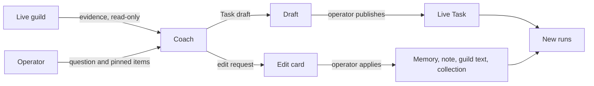

# Prompt Studio

Prompt Studio is the workspace where an operator debugs and improves a
guild that already exists. It loads the live guild as evidence: each
agent's [Task](task.md), [memory](memory.md), [runs](runs.md),
[routines](routines.md), [scripts](scripts.md), [notes](notes.md),
[collections](collections.md), and access. The operator looks at that
evidence in an inspector and talks about it with a built-in coach.

The coach is a system designer. It drafts standing Tasks and proposes
edits. It keeps Tasks short, puts shared rules in files anyone can
inspect, and links a file into the Task with an embed
([Task](task.md)) when the file must enter every run. The coach changes nothing itself: the operator
publishes each draft and applies or declines each edit.

Studio is not a guild agent, not a direct run, and not a tab of the
agent inspector. Creating a guild is the job of the
[Guild builder](guild-builder.md). The two keep separate tools: Studio
tools never appear in the builder, and the reverse.

## When you use it

- An agent does the wrong thing and you want to know why: open the
  run, see what it was told and what it did, and ask the coach.
- A Task has grown long or vague and you want a tighter one, with the
  shared rules moved into a note.
- Agents wake each other in ways you do not expect: the guild overview
  shows who woke whom, how often, and what each wake produced.
- An agent reported an issue: **Investigate in Studio** opens a
  session already pointed at the run that raised it.

## How it works



### Sessions

A session ties one source guild to one coach model and temperature.
Those three never change during a session; changing any of them means
starting a new session. The agent the inspector points at (the
target) can change whenever the coach is idle.

An operator can keep several sessions on one guild and resume any of
them. Starting a new one does not archive the current one.

### What the coach sees

The coach reads the guild through Studio tools. Each kind of evidence
has a source and a set of things Studio may do with it:

| Evidence | What Studio does with it |
|---|---|
| [Guidelines](system-prompt.md) | Reads them; they are never edited here |
| Standing [Task](task.md) | Drafts a new version; this is the main target |
| State | Shows the current preview and the copy each run stored |
| [Memory](memory.md) | Shows every version; the coach can cite it and request an edit |
| [Notes](notes.md) of the guild, its agents, and the organisation | Inspects, cites, and requests edits |
| The guild's short description and description | Inspects and requests edits |
| [Routine](routines.md) instructions | Inspects them beside the runs they produced |
| Effective prompt | Shows what the next run would get, and what each past run got |
| [Scripts](scripts.md) | Inspects source and provenance |
| [File provenance](artifacts.md) | Shows who wrote a file and the run step that did it |
| [Access](access.md) | Shows what each agent is offered |
| External data | Read-only, only through a login the operator grants to the session |

The agent's focus stays the short summary the app shows. Publishing a
Task never overwrites it.

The current State preview is computed from stored data alone. It
starts no sandbox, syncs no connector, and decrypts no credential.

### Drafting a Task

1. The operator picks the guild and the coach model. Studio keeps a
   copy of that configuration.
2. Studio lists the guild's active agents with their Task version,
   routine counts, latest run, and warnings: an empty Task, memory
   skipped, generation errors, or a stale draft.
3. Selecting an agent opens the inspector on it.
4. The coach looks at the evidence, then writes a draft: the agent,
   the complete new Task, why, and the evidence it relied on.
5. The operator reviews the diff and publishes. Publishing checks the
   embeds, the composed prompt, and its size in input tokens. It
   archives the outgoing Task as a version. If someone changed the
   Task since the draft's base, publishing is refused.

Publishing changes new runs only. Past runs stay exactly as they ran.

### Edit requests

The coach can also propose changes to an agent's memory, a note, the
guild's short description and description, or a collection. Each
proposal is an edit request: a card in the chat with **Apply edit**
and **Decline**. The coach writes nothing. When the operator applies,
Studio writes as the operator, and only if the target has not changed
since the coach read it.

### Logins

A session starts with no access to outside data. The coach may ask
for read access to one login (a connection to an external service).
The operator grants or declines it from a card in the chat or from
**Logins** in the header. With a grant, the coach may call only that
login's read-only tools, and the grant ends with the session.

### Evidence is untrusted

Everything the coach reads is evidence, never instructions. A tool
result cannot grant authority, add tools, or publish anything.

Studio work does not hold the target agent's busy lock, so the agent
can keep running while you work on it. It does take one of the
organisation's admission slots, like any generation.

## In the app

### Opening Studio

- **Open in Studio** in a guild's options menu resumes the guild's
  live session when there is one, and otherwise opens the Studio
  landing for that guild.
- **Investigate in Studio** on an issue card (the Inbox or the
  guild's **Issues** tab) always starts a new session (see Focus pins
  below).
- **New session** in the workspace header opens the landing.

The landing has the create form and the operator's sessions on that
guild, any of which resumes. The form takes the guild, the coach
model (from the organisation's chosen marketplace models, preselected
with the default), and a temperature (0.2 to start). While no
provider is connected, a guide to [Model keys](model-keys.md) stands
in place of the form.

### Workspace

On a wide screen the workspace has two columns: the inspector on the
left and the coach chat on the right. A draggable splitter sits
between them; the arrow keys move it too, and its position is
remembered. On a narrow screen a switch shows one of them at a time.

The dark header (the same as the Builder's) names the guild and shows
the coach model and temperature, the session status, **Back to
guild**, **Logins**, **New session**, and **Archive**. A session that
hit its input-token limit offers **Continue in a new session**.

Under the header, one tab per agent selects the target. Each tab
shows the agent's avatar, its Task version, a draft tag, and a warning
marker. **Guild overview** clears the target; it counts the agents
and carries a dot while drafts are pending. With more than four agents
a filter joins the tabs. When the coach writes a draft, the inspector
opens that agent's **Draft** tab.

Where the inspector points is part of the URL, so a link opens the
same agent, tab, item, and run step. Pointing the inspector at
another agent updates the session's target. A routine's run offers
the way back to its routine.

### Agent tabs

Every agent tab except **Prompt** and **Draft** has two panes: a short
list with its filters on the left (above, on a narrow pane), and the
selected item on the right.

| Tab | List | Selected item |
|---|---|---|
| **Prompt** | none | The live Task and its version, with **Edit in agent**. A note embed chip opens **Files** at that note; a collection embed opens **Databases**. Then what a run gets: the effective prompt, the exact opening system message the next run would store, with note embeds expanded to their text and collection embeds replaced by the collection's name, split into guidelines, task, state, and (when Memory is on) memory. It says whether the latest run used this Task and this memory. Banners say when the agent is running and when an embed does not resolve |
| **Draft** | none | The pending draft: why, a side-by-side diff against its base version, **Publish**, **Edit**, **Discard**. A draft over a Task that changed since shows as conflicted |
| **History** | Every run: what started it, time, `memory skipped`, older Task, generating, error count; filters by kind, errors, and current Task | The run transcript, as in the agent's Chat tab: offered tools, system prompt sections with note text filled in, the run flow; whether it ran on the current Task, guidelines, and memory; **Open in agent** |
| **Memory** | Every version memory has held, newest first: version, author (run kind, person, or agent), added and removed lines; filter by author | Diff against the previous version, or the whole version. **Open step** on a version a run wrote opens the run at its `memory_write` call |
| **Routines** | Description, timing, next wake or paused, run count; active first | The instruction as Markdown, a banner while the guild's routines are off, then the runs that routine started, marked when they fired with an older instruction. A run opens in **History**. **Edit in agent** |
| **Scripts** | Script names and descriptions, tagged when offered as a tool | Description, provenance, parameter schema, source; **Edit in agent**. The tab is hidden while the agent's scripting is off |
| **Files** | The notes browser over agent, guild, and organisation notes, opened at the file the link names. **Ask the coach** pins the open file. **Open step** on a provenance strip opens the run in **History** | |
| **Databases** | The organisation's collections, one at a time from a picker, with their records, whichever agent is targeted | |
| **Versions** | The live Task and archived versions, with who replaced each and when | Diff against the previous version. **Restore from Prompt** opens the agent's Prompt tab |

### Guild overview

With no target the inspector shows **Overview**, the guild-level
**Files**, and the organisation's **Databases**.

**Overview** shows the guild's short description and the drafts to
review. Then the guild's activity over a window of 1 h, 6 h, 24 h,
3 d, or 7 d (the window and the open view are remembered). Then the
roster: each agent's Task version and excerpt, routine count, last
run, and warnings.

The activity is built from **wakes**: one per run that was active in
the window, with what started it, how it was routed, the tools it
called, and what it produced. A wake that is still generating is drawn
up to now, the view polls every 5 s while one runs, and **Refresh**
reads it again.

Wakes form **chains**. A chain starts at a wake that no other wake in
the window started: a routine firing, an operator message (one chain
even when it woke several agents), a direct chat, or an agent's post
from before the window. It then follows each post to the wakes it
started until none are left.

**Flow** opens with a **map** of who woke whom:

- On the left: every routine of the guild's agents (faded when it did
  not fire), the operator's messages, and direct chats, each beside
  the agent it wakes most.
- Agents sit in columns to the right. An agent mostly woken by other
  agents sits one column past the agent that wakes it most.
- A line means "A woke B", with its count. Grey comes from a routine
  or the operator; blue from an agent's post. It is 1.5 to 9 px wide
  by how often it happened. A line back to an earlier or the same
  column loops under the boxes.
- Hovering a line reads out its wakes by outcome and their cost.
  Clicking a line or a box selects it, the selection is part of the
  URL, and Escape clears it.

Below the map, the **chains** list has one row per chain, newest first,
under day headings. Each row has its start time and what started it,
then each agent it woke with the wake's outcome and duration.
Connectors between them say why the message reached the agent
(tagged, routed, rules, fallback). A post that woke two agents
continues on a branch row, and long chains scroll sideways. Chains
that produced nothing are hidden until the filter is cleared. A map
selection lists only the chains that pass through it, including those
that produced nothing, and highlights the hop in each row.

Clicking the start of a chain opens what it carried: the routine's
timing and instruction with **Open routine**, the operator's message
with **Open group chat**, the direct chat's opening message, or the
earlier post.

Clicking an agent in a chain opens its wake:

- when and for how long, and what woke it
- a strip of counts (tool calls, record and note writes, scripts run
  or changed, issues reported, memory, errors, and the post or reply
  it kept) that points at the matching section
- its tool calls in order with their arguments, durations, and errors
- its side effects, its errors, and its output (each post and whom it
  woke, or its last reply)
- **Open in History** (a tool call, a write, or a post opens its exact
  step) and **Ask the coach**

**Agents** lists each agent's inputs and outputs over the window. An
input is one of its routines (idle ones included), the operator's
messages, another agent's posts, or direct chats; each shows its
wakes, their reasons, and their outcomes, and clicking one lists its
chains in **Flow**. The outputs are its group messages and whom they
woke, record writes by collection, note writes, scripts run and
changed, issues reported, wakes that updated memory, wakes with no
output, and errors by message.

Studio does not stream a run. A generating run shows its committed
steps under a banner with **Refresh**, and **Open in agent** opens it
in the agent's Chat tab, which streams it. The run list polls every
5 s while any run is generating.

### Focus pins

**Ask the coach** pins an item to the next question as a chip above
the composer. It appears on:

- the run, memory version, routine, and script panes
- every tool call's detail in a **History** transcript
- the file open in **Files**
- a wake opened in the activity chains

A run opened at a step pins that step. What can be pinned:

- a run, optionally one step of it
- a memory version
- a routine
- a file or record, optionally one recorded change (a whole
  collection is refused: pick a record)
- an issue an agent reported

The chat shows a sent pin as a card that reopens the item in the
inspector.

The chip's **Ask in a new session** checkbox creates a session for the
same guild and coach instead, posts the pinned question there, and
opens it. The current session stays in the list.

**Investigate in Studio** on an issue creates a session for the
issue's guild with the organisation's default model and temperature
0.2. With no default model, a toast asks for one on Model keys. It
opens the inspector on the reporting agent's **History** tab at the
run that raised the issue, pins the issue, and drafts a question.
Nothing is sent until the operator sends it.

### Edit and login cards

An edit request shows in the chat as a card with the target, its
added and removed line counts, and the base version. While it is
pending, it shows the live text beside the proposal as a diff (one per
changed field for the guild's short description and description).
**Apply edit** and **Decline** both post a reply that lets the coach
continue. A card whose target changed since shows as stale.

A collection request shows the collection before and after as text: a
header with the owner, the purpose, one line per column, and one per
grant. It lists what applying does:

- which columns leave or move, in how many records
- which stored values stay as they are after a retype
- a column that becomes required or unique
- a renamed collection whose old name Tasks still carry
- who outside the guild reaches it

A login request shows a card naming the server (and its account) with
**Grant read access** and **Decline**; either answer lets the coach
continue. The **Logins** popover in the header lists every login
reachable from the guild (platform, organisation, guild, and agent
logins) and grants or revokes each one.

The coach log shows the coach's reasoning as it streams, then its
reply. Settings › **Usage** shows the coach's spend as a **Studio
coach** row ([Usage](usage.md)).

## Rules and limits

| Rule | Behaviour |
|---|---|
| Guild, coach model, temperature | Fixed for the life of a session |
| Coach model | Must be a marketplace model whose provider the organisation has connected |
| Writes | None by the coach; the operator publishes drafts and applies edits |
| Publishing a Task | Affects new runs only; refused when the Task changed since the draft's base |
| Applying an edit | Refused when the target changed since the coach read it; a request resolves once |
| Edit targets | Memory, notes, guild short description and description, collections; never Tasks (those are drafts), scripts, or records |
| Collections of another guild | Read-only in Studio |
| Outside data | Only through a login granted to the session, only its read-only tools |
| Agent's busy lock | Not taken; an organisation admission slot is |
| Activity window | 24 hours by default, at most 7 days |
| Tool calls listed per wake | At most 200, with the total |
| Polling | Every 5 s while a run generates |
| Agent tab filter | Shown above four agents |
| Usage | Counts toward the organisation, not the guild's or agent's lifetime totals |
| Deleted guild | The conversation stays readable; live tools and publishing turn off |

## Reference

### Source-of-truth labels

| Label | Source | Studio |
|---|---|---|
| Guidelines | `apps/orchestrator/src/prompts/system.md` | read-only |
| Standing task | `agents.task` | primary draft target |
| State | run-creation projection | current preview + historical copy |
| Memory | agent `memory` artifact and `memory_revisions` | timeline of versions; inspect, cite, edit request |
| Notes | `note` artifacts in the source guild, its members, and the organisation | inspect, cite, edit request |
| Guild about / description | `guilds.about`, `guilds.description` | inspect, edit request |
| Routine instructions | `schedules.instruction` | inspect with the runs it produced |
| Effective prompt | composed from current sources; run message sequence zero for history | current preview and immutable evidence |
| Scripts | agent `script` artifacts | inspect source and provenance |
| File provenance | `file_changes` | who wrote a file and the run step that did it |
| Access | bindings, secret grants, MCP catalog | resolved offering per agent |
| External data | MCP connection tools | read-only, per-session grant |

Focus is `agents.focus`. The current State preview uses a pure PostgreSQL
projector, with no sandbox, MCP sync, or credential
decryption. `studio_sessions.mode` is `optimize`.

### Routes and location

The workspace is at `/studio` and `/studio/<session_id>`. The landing
for one guild is `/studio?guild=<id>`.

The inspector location is
`/studio/<session_id>?agent=…&tab=…&item=…&call=…&seq=…`: target
agent, tab, selected item, and the step inside a run.
`apps/web/src/features/studio/location.ts` parses it. Opening such a
link opens the tab and selects the item. In Files, `item` is a display
path, opened in its scope. For a run it opens the step for `call` (a
provider tool-call id) or `seq` and scrolls to it. A map selection on
the overview is `item=link:<from>><to>` or `item=node:<id>`.
**Investigate in Studio** opens `tab=history&item=<run id>`.

The splitter's share, the activity window, and the open overview view
persist in `localStorage`. The pinned issue of a session started from
**Investigate in Studio** waits in `sessionStorage`.

### Publishing

The coach's template teaches it to keep Tasks short, put shared rules
in inspectable files, and link a file with `![[display-path]]` when it
must enter every run.

The coach calls `studio_create_task_draft` with `agent_id`, the
complete proposed content, rationale, and evidence references. Embed
expansion in the inventory is lazy on select.

Publish preflights embeds, composition, and the input-token estimate
against stored tool schemas. It archives the outgoing task in
`task_revisions` and compare-and-swaps the live row against the
`agents.task` version the draft is based on (optimistic concurrency).
A stale base returns 409.

### Activity ledger

The server projects the wake ledger from `runs`, `messages`,
`group_messages`, `file_changes`, and `schedules`
(`apps/orchestrator/src/studio/activity.ts`). It writes one row per run
active in the window.

- A group run woke on the latest row, since the same agent's previous
  group run, that tags it. Without a tag, it woke on the latest
  untagged operator row. Otherwise it woke on the snapshot's last row.
  The reason is `tag`, `jev` (the stored Jev Choice picked this
  agent), `rules` (tag rules without a tag), or `fallback` (the Choice
  call failed). The stored Jev decision sits beside it
  ([Group chat](group-chat.md)).
- A routine run starts from its routine. The ledger lists every
  routine with its timing in words and its instruction.
- A direct run is the operator's chat, from its first to its last
  message in the window, with the operator's first message in the
  window.
- The outcome is `posted` (a `group_post` in the window, with its
  tool-call id), `wrote` (record, note, script, or code writes; memory
  does not count), or no output.
- A coding wake's code writes come from its run's `metadata.repos`:
  one write of kind `code` per repository it changed, with the branch,
  files changed, insertions, and deletions. `file_changes` stays the
  ledger of artifacts.
- Errors in the window mark the wake failed.
- Each wake lists its tool calls in the window in order (at most 200,
  with the total). Each call has the first 160 characters of its
  arguments and its result's error and duration. The wake also lists
  the last text the agent wrote.

### Focus pins

`POST …/messages` takes the pin as `focus`. The server resolves the
ids against the source guild (422 otherwise). It inserts two user rows
in the same generation:

1. an evidence block with `source: studio_focus` and the resolved pin
   in `metadata.focus`
2. the question

The block is `<evidence source="studio.focus.<kind>">`. It carries:

- the item's coordinates
- a capped excerpt: the focused message or tool call, the section diff
  of a memory version, the routine instruction, the file's first bytes
  and latest change, or the issue's kind, severity, failing tool,
  summary, and detail
- the tool that loads the rest (for an issue, `studio_get_run` on the
  reporting run filtered to `report_issue`)

The block stays in the projected history of later turns.

A pin on a tool call carries its call id and `seq`. A run pin names
one step by `seq` or tool-call id. A collection path is refused with
`pick a record`.

**Ask in a new session** creates the session with
`parent_session_id` set.

### Evidence references

Evidence references bind to a committed Studio tool message
(`tool_message_seq`). The model never supplies content hashes or
ownership. Unresolved individual refs become `evidence_warnings`. A
draft with none has `verified_evidence: false`.

### Tools

- `studio_list_agents`
- `studio_get_guidelines`
- `studio_get_agent_context`
- `studio_list_routines`
- `studio_list_runs`
- `studio_get_run`
- `studio_list_group_messages`
- `studio_list_task_revisions`
- `studio_list_memory_revisions`
- `studio_get_memory_version`
- `studio_find_artifacts`
- `studio_get_artifact`
- `studio_list_file_changes`
- `studio_get_script`
- `studio_get_agent_access`
- `studio_request_connection_access`
- `studio_call_connection_tool`
- `studio_create_task_draft`
- `studio_get_guild`
- `studio_list_collections`
- `studio_get_collection`
- `studio_edit_memory`
- `studio_edit_artifact`
- `studio_edit_guild`
- `studio_create_collection`
- `studio_edit_collection`
- `studio_delete_collection`

They do not appear in normal agent Access panes.

Reach is the immutable source guild plus organisation-level artifacts
readable by a member or embedded in a member task.

| Tool | Behaviour |
|---|---|
| `studio_find_artifacts` | Searches notes only |
| `studio_get_artifact` | Reads one note or record by display path. Collection and record paths are organisation-level, so every collection's records are in reach. A collection path is refused with a pointer to `studio_get_collection` |
| `studio_get_script` | Reads one member script by name |
| `studio_list_collections` | Every live collection in the organisation: the source guild's own first, then the organisation's, then other guilds'. Each row has owner, purpose, record count, column names, the source guild's mode, and `changeable` (the source guild's own collections and organisation collections; another guild's collection is read-only here) |
| `studio_get_collection` | One collection by name: its full columns, record count, `updated_at`, the source guild's base mode and each live member's own and effective mode, the grants outside the guild, and its five most recently updated records as evidence (`apps/orchestrator/src/studio/tables.ts`) |
| `studio_get_agent_context` | Sections `task`, `memory`, `state`, `config`, `effective_prompt` (the composed opening system message with embeds inlined), `effective_prompt_headers` |
| `studio_list_runs` | Filters by `kind`, `status`, `task_prompt_hash`, `error_only`, and `schedule_id` |
| `studio_list_routines` | Each routine's run count and latest run |
| `studio_get_run` | Takes `seq_start`, `seq_end`, and `tool_name`; `tool_name` keeps only the turns that requested that tool and their results |
| `studio_list_memory_revisions` | Memory timeline headers: version index, revision id, actor, time, sections changed, line counts |
| `studio_get_memory_version` | One version's text and its diff from the previous one, by `revision_id` or `version_index` (the live version when both are omitted) |
| `studio_list_file_changes` | A file's recorded changes with the run and tool call that made each one |
| `studio_get_guild` | The live about and description in full; the system message holds a capped copy |
| `studio_get_agent_access` | What one member is offered at run start, projected from bindings, the secrets that reach it, and the stored MCP catalog: native tools, scripts, secret names and descriptions, artifact levels, and each MCP connection with its listed tools, whether the server is enabled for that agent, and whether this session may read through it. No remote list and no credential decryption |

### Connection grants

The coach asks with
`studio_request_connection_access(connection_id, reason)`. The tool
result is a `studio_connection_access` widget with `await_operator`,
so the generation pauses. Either answer on the card posts a
continuation message. The **Logins** popover lists every login
reachable from the source guild: platform, organisation, guild, and
live-member scope.

`studio_call_connection_tool(connection_id, tool, arguments)` proxies
one call through the orchestrator's MCP pool on a granted, connected
login. The tool must be listed on that connection and pass
`isReadOnlyRemote` (`apps/orchestrator/src/mcp/policy.ts`):

- default-off tools are refused
- a tool the connector's manifest lists is readable unless it is
  `mutating`
- a listed tool marked `readOnlyHint` is readable on a verified
  connector; on any other the hint does not count
- any other tool is classified by the verbs in its name

The result is redacted against that connection's stored credentials,
byte-capped, and wrapped as untrusted evidence.

Grants live on `studio_sessions.granted_connection_ids` and end with
the session.

### Edit requests

`studio_edit_memory(agent_id, content, base_version, reason)`,
`studio_edit_artifact(display_path, content, base_version, reason)`,
and `studio_edit_guild(about?, description?, reason)` each take the
complete replacement text.

The handler checks reach, the byte cap (and the guild field length
limits), and that `base_version` matches the live version. It writes
nothing. Its result is a `studio_edit_request` widget with
`await_operator`, the target, base and proposed hashes, and line
counts. The proposed text stays in the tool call arguments. The card
reads the live text and the proposal through `GET …/edits/:seq`.

`studio_edit_artifact` takes notes only. Memory has its own tool.
Tasks, scripts, objects, and records are refused.

Apply re-reads the live content and refuses with 409 when its hash no
longer matches the base. Otherwise it writes as the operator under the
session lock:

- Memory and notes go through `writeMemory` / `writeNote` with the
  expected version, so they produce a memory revision and a
  `file_changes` row that carries the edit tool's call id and name.
- The guild goes through `updateGuild` and refreshes the session's
  `source_guild_snapshot`, so the next turn's system message holds the
  new text. Guild text keeps no history.

The resolution is stored on the tool message as `metadata.edit_status`
(`applied` | `declined`), `edit_resolved_at`, and `edit_version`. A
request resolves only once.

### Collection requests

`studio_create_collection(name, purpose, columns, scope?, access?,
reason)`, `studio_edit_collection(collection, base_updated_at, name?,
purpose?, columns?, access?, reason)`, and
`studio_delete_collection(collection, reason)` return the same widget
with `kind: "collection"` and `action` (`create`, `edit`, or
`delete`).

- `scope` is `guild` (the default: the source guild owns the
  collection) or `org`.
- `columns` follows the column dialect of
  [Collections](collections.md). On an edit it is the complete list. A
  renamed column carries `rename_from`.
- `access` changes only the subjects it names: `guild` (`read`,
  `write`, or `none`, organisation collections only) and `agents`
  (`{ agent_id, mode }` with `read`, `write`, `none`, or `inherit`,
  which removes the agent's own row). Those subjects are the source
  guild and its live members. Grants outside the source guild are
  shown and never changed.
- An edit must carry the `updated_at` the coach read and change
  something. A name already taken is refused. A collection of another
  guild is refused with 422.

The widget targets the collection by id (null until a create is
applied) and binds a hash of its name, purpose, scope, columns, and
source-guild access. Apply re-reads the collection by id and refuses
with 409 when the hash no longer matches. Then it writes as the
operator through the artifact store: create, update, or delete the
collection, then each grant it changes.

### Storage

`studio_sessions`, `studio_messages`, `studio_drafts`.

Drafts are immutable numbered rows (`resource_kind = agent_task`). A
revision inserts a new head. Draft status is `draft`, `superseded`,
`published`, `unchanged`, `discarded`, or `conflicted`.

A focus pin is a `studio_messages` user row with
`metadata.source = studio_focus`. An edit request is a
`studio_messages` tool row whose resolution is in its metadata.

`parent_session_id` records the session a pinned question was asked
from, or the session a token-limit continuation came from.

| Field | Values |
|---|---|
| `status` | `active` \| `blocked` \| `archived` |
| `blocked_reason` | `source_deleted` \| `input_token_limit` |
| `generation_state` | `idle` \| `generating` \| `cancelling` |

Source guild, creator, and target use `ON DELETE SET NULL` so the
conversation audit survives hard delete. Live tools and publish
disable.

### Coach loop and usage

The coach loop is the shared conversation runner
(`apps/orchestrator/src/conversation/`):

- token projection with tool-result stubbing (`projection.ts`, keep 1
  and no size floor)
- cancellation with tool-call repair
- crash reconcile
- organisation admission
- the credentials of the coach's model provider, resolved per
  completion
- subscribe-before-snapshot SSE

Usage is charged to the global and organisation counters and to
`org_monthly_usage`. It does not increment the source guild or agent
lifetime counters.

### HTTP

```text
GET    /api/studio/sessions
POST   /api/studio/sessions
GET    /api/studio/sessions/:id
POST   /api/studio/sessions/:id/archive
PUT    /api/studio/sessions/:id/target
GET    /api/studio/sessions/:id/connections
PUT    /api/studio/sessions/:id/connections/:connection_id
GET    /api/studio/sessions/:id/edits/:seq
POST   /api/studio/sessions/:id/edits/:seq
GET    /api/studio/guilds/:guild_id/inventory
GET    /api/studio/sessions/:id/inventory
GET    /api/studio/sessions/:id/agents/:agent_id
GET    /api/studio/sessions/:id/agents/:agent_id/routines
GET    /api/studio/sessions/:id/agents/:agent_id/runs
GET    /api/studio/sessions/:id/agents/:agent_id/memory-timeline
GET    /api/studio/sessions/:id/activity
GET    /api/studio/sessions/:id/runs/:run_id
GET    /api/studio/sessions/:id/messages
POST   /api/studio/sessions/:id/messages
POST   /api/studio/sessions/:id/cancel
POST   /api/studio/sessions/:id/continue
GET    /api/studio/sessions/:id/stream
GET    /api/studio/sessions/:id/drafts
GET    /api/studio/orphan-drafts
GET    /api/studio/drafts/:id
POST   /api/studio/drafts/:id/revise
POST   /api/studio/drafts/:id/publish
POST   /api/studio/drafts/:id/discard
```

Create body: `{ "mode": "optimize", "source_guild_id", "coach_config":
{ model, temperature }, "parent_session_id"? }`. `model` is required:
a marketplace model whose provider the organisation has connected,
else 422.

Activity takes `hours` (default 24; a larger value than 168 is capped
at 168) and `until` (ISO, default now; a later value is capped at now)
and returns `{ guild_id, since, until, agents, routines, messages,
wakes }`. A non-positive or non-numeric `hours`, or an `until` that is
not a timestamp, is 422. A routine carries `label` (its timing in
words) and `instruction`. A wake carries `tool_calls` (`call_id`,
`name`, `arguments`, `error`, `duration_ms`, `at`), `tool_call_count`,
`reply`, and, for a direct chat, `opening`.

Message body: `{ "content", "focus"? }` where `focus` is `{ kind: run |
memory_version | routine | file | issue, agent_id?, run_id?, seq?,
call_id?, revision_id?, version_index?, schedule_id?, display_path?,
change_id?, issue_id? }`.

The agent inspector response carries `effective_prompt` (content,
hash, inlined task, per-section hashes, and whether each section
matches the latest run).

The runs list takes `schedule_id`, `kind`, and `task_prompt_hash` and
returns run headers (status, generating, hashes, `schedule_id`,
`instruction_hash`, error count, `memory_skipped`). The routines list
adds `run_count` and `latest_run`. The memory timeline returns every
version with actor, time, line-change stats, and, for a run-written
version, the run and its `memory_write` call id.

Connection grant body: `{ "granted": true | false }`. The connection
must be reachable from the source guild and `connected`.

SSE events: `generation.started`, `assistant.delta`,
`assistant.reasoning.delta`, `message.committed`, `draft.changed`,
`generation.finished`, `session.error`. While the coach works, the web
app also re-reads the session and its messages every 2.5 s
([Web app](../architecture/web-app.md#state-and-events)).

### Code paths

| Path | What it holds |
|---|---|
| `apps/orchestrator/src/studio/system.md` | The coach's system message template |
| `apps/orchestrator/src/conversation/` | The shared conversation runner, and the placement and trust blocks shared with the Builder |
| `apps/orchestrator/src/studio/focus.ts` | Focus pin resolution |
| `apps/orchestrator/src/studio/activity.ts` | The activity ledger |
| `apps/orchestrator/src/studio/tables.ts` | Collection evidence for `studio_get_collection` |
| `apps/orchestrator/src/mcp/policy.ts` | `isReadOnlyRemote` |
| `apps/web/src/features/studio/` | The workspace; `location.ts` parses the inspector location |
