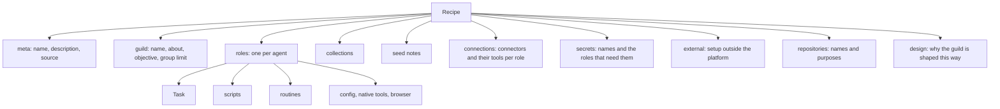

# Recipe format

A [recipe](recipes.md) is one JSON document in the format
`guilds.recipe`, version 2. The [Guild builder](guild-builder.md)
writes it, capturing a guild writes it, a file or the registry brings
it in, and [apply](applying-recipes.md) reads it. This page describes
that document: its parts, what each part means, and the checks it
must pass.

The document describes a guild by its design, not by its live state.
Agents are *roles* with a handle such as `scout`. Tags and file links
inside the text point at roles and at notes of the recipe, not at live
agents or files. Apply turns those into real names and paths.

## Why it exists

Three surfaces share one format: the Builder authors it, capture
produces it, and apply consumes it. One strict format means a recipe
written on one box applies on another, and a recipe the Builder drafts
is checked by the same rules as one captured from a live guild.

The format is strict on purpose. An unknown key is an error, not
something silently dropped. A recipe never carries a credential, so a
file can travel safely.

## How it works

### The parts of a recipe



- **meta** names the recipe and says where it came from.
- **guild** is what the new guild is called and what it is for.
- **roles** are the agents. Each role has a handle, a suggested agent
  name, a focus, an avatar, an [agent configuration](agents.md), a
  [Task](task.md), [scripts](scripts.md), [routines](routines.md), and
  its tool switches.
- **collections** are the [collections](collections.md) the guild uses:
  their columns, who owns them, and who may write.
- **notes** are seed [notes](notes.md) the Tasks rely on.
- **connections** are the connectors each role may use, and which of
  their tools.
- **secrets** are the [secrets](secrets.md) each role needs, by name.
- **external** lists setup the operator does outside the platform.
- **repositories** are the git repositories coding roles work in, by
  name and purpose. See [Repositories](coding/repositories.md).
- **design** records the reasoning behind the guild. It does not run.

### Placeholders that apply resolves

A recipe does not know the names the new agents will get, or where
their files will live. It uses placeholders instead:

- **Role tags.** A tag to another agent is written `@{role}`. Apply
  replaces it with the new agent's name. `@user` stays as it is.
- **Note links.** A Task embeds a seed note by its place in the
  recipe: `![[guild/<key>]]`, `![[org/<key>]]`, or
  `![[agent/<role>/<key>]]`. A Task or routine that names a working
  note for `note_get` uses the same path as plain text, for example
  `note_get agent/<role>/<key>`. Apply writes the note, then points
  both at the note's live path.

### Who wrote each field

Text the Builder can write (a Task, login notes, a script, a routine,
a note, a connector's setup, an external step) carries an `author`:
who wrote it (`operator` or `builder`) and whether it was reviewed.
That is provenance only. An unreviewed field does not block export or
apply.

### Access is resolved, not a matrix

A recipe stores the *effective* access of each role: the connectors it
may use, the tools of each, its native tool switches, and the names
of its secrets.
It adds a recommended scope for each connection and secret. It never
stores binding ids or connection ids.

### Checks

Every recipe is checked before it can be approved and again before it
applies. A check produces a *finding*: an **error** blocks, a
**warning** is advice, and **info** is a note. Findings are listed
under [Findings](#findings).

## In the app

The recipe's page shows the document as a plan, not as JSON. **Export**
downloads the JSON of an approved recipe and **Import JSON** reads one.
See [Recipes](recipes.md#in-the-app).

## Rules and limits

| Rule | Value |
|---|---|
| Format and version | `guilds.recipe`, version 2; any other version is refused |
| Unknown keys | Refused, at every level |
| Whole document | 4 MiB |
| Roles | 20 |
| Scripts, routines per role | 50 each |
| Task body, script source | 256 KiB each |
| Note body | 256 KiB |
| Notes | 64 |
| Collections, connections, secrets, external steps, repositories | 50 each |
| Connection resources | 50 per connection |
| Setup text, login instructions, routine instruction | 8 KiB each |
| Connection hint, repository purpose, collection purpose | 400 characters each |
| Recipe name | 1 to 80 characters |
| Credentials | A document that looks like it holds one is refused at import and export |

## Reference

### Document shape

The document is stored in PostgreSQL and downloads as JSON.

```text
{
  format: "guilds.recipe",
  version: 2,
  meta: { name, description, created_at, source },
  guild: { name_suggestion, about, objective, group_agent_message_limit },
  roles: [{
    role, name_suggestion, focus, wake_triggers?, avatar_shape, avatar_color, config,
    task: { body, embeds[], author },
    scripts, schedules,
    native_tools,
    browser: { required, instructions, author }
  }],
  collections: [{ name, purpose, columns, scope?: "guild" | "org", guild?: "read" | "write", writers?: [role] }],
  notes: [{ id, level, role?, key, body, kind: "seed", author, guild?: "read" | "write", writers?: [role] }],
  connections: [{
    server, auth, recommended_scope, recommended_role?, hint,
    setup, resources?, manifest?, author,
    roles: { [role]: { enabled, tools: { [namespaced]: boolean } } }
  }],
  secrets: [{ name, description, recommended_scope, recommended_role?, roles[] }],
  external: [{ kind, title, setup, author }],
  repositories?: [{ name, purpose }],
  design?: { systems, specialization, routines, handoffs, browser }   // optional
}
```

No object has a key for a `connection_id` or a `secret_id`, so the
closed key lists refuse them. Import and export refuse a document whose
text looks like a credential (see
[Recipes](recipes.md#import-and-export)).

### Parsing

- The body is measured as UTF-8 JSON. Over 4 MiB it is refused.
- Every object is closed: a key it does not list is refused with
  `unknown key <path>.<key>; allowed: …`. For common mistakes the
  message adds a hint. For example, `name` on a role points to `role`
  and `name_suggestion`, `routines` points to `schedules`, `model` on a
  role points to `config.model`, and `memory` says Memory instructions
  belong in `task.body`.
- `version` must be 2. Any other value is refused with
  `unsupported recipe version <n>; this build reads guilds.recipe
  version 2`.
- A parse error is a 422 with the message.

### meta and guild

| Field | Rule |
|---|---|
| `meta.name` | 1 to 80 characters |
| `meta.description` | Text |
| `meta.created_at` | ISO time |
| `meta.source` | `{ kind: "guild" \| "builder" \| "file", guild_id?, session_id? }` |
| `guild.name_suggestion` | 1 to 64 characters; the new guild's name unless the operator changes it |
| `guild.about` | The new guild's about text |
| `guild.objective` | The new guild's description |
| `guild.group_agent_message_limit` | An integer from 1 to 10,000 |

### roles

| Field | Rule |
|---|---|
| `role` | The handle. Matches `^[a-z][a-z0-9-]{0,62}$`, is not `user`, and is unique |
| `name_suggestion` | The agent's name at apply. Same rule as `role`; defaults to `role` |
| `focus` | Text |
| `wake_triggers` | At most 500 characters |
| `avatar_shape`, `avatar_color` | Default `teardrop` and `#7c5cff` |
| `config` | Agent configuration keys only (see below) |
| `task` | `{ body, embeds[], author }`. `body` is at most 256 KiB. `embeds` lists the embeds of `body`; it is informational, since checks and apply read the embeds from `body` itself |
| `scripts` | `[{ name, description, parameters, source, secrets[], author }]`, at most 50. `source` is at most 256 KiB. `secrets` is informational: apply does not grant it, and capture writes it empty |
| `schedules` | `[{ key, cron or window, description, instruction, author }]`, at most 50 |
| `native_tools` | `{ [tool]: boolean }`. Each entry overlays a catalog where every native tool is on, so a tool the map leaves out stays on |
| `browser` | `{ required, instructions, author }`. `required` defaults to `config.browser` and must match it. `instructions` is at most 8 KiB |

A role's `config` holds only [agent configuration keys](agents.md).
Validation errors with `config.unknown` on any other key.

- `config.coding` (boolean) makes a role a coding agent. Any other
  type is the `coding.flag` error. See
  [Coding agents](coding/index.md).
- `config.harness` names a coding role's
  [harness](coding/harnesses.md): `claude-code`, `codex`, `cursor`, or
  `antigravity`. It is optional; apply asks for it.
- `config.harness_model` names the model that harness runs, under the
  agent configuration's rule. It is optional; without it the harness
  runs its subscription's default.
- `config.harness_effort` names the effort that model runs at, under
  the agent configuration's rule. It is optional; without it the model
  runs at its default effort.
- `config.secret_aliases` maps variable names to secret names, under
  the agent configuration's rule (see [Secrets](secrets.md)). It is
  optional.
- `config.model` is a recommendation, kept exactly as written. Apply
  lets the operator pick the model; see
  [Applying recipes](applying-recipes.md#models-and-harnesses).

Schedules:

- `key` matches `^[a-z][a-z0-9-]{0,62}$` and is unique across the
  whole recipe. Design metadata refers to a routine by this key, never
  by an array index.
- A schedule sets exactly one of `cron` or `window`. `window` is
  `{ timezone, start, end, max_wakes }`. See [Routines](routines.md).
- `instruction` is at most 8 KiB.

### collections

Collections are collections of the organisation or of the applied
guild: `{ name, purpose, columns, scope, guild, writers }`.

- `name` matches `^[a-z][a-z0-9_-]{0,62}$` and is unique in the recipe.
- `purpose` is required and at most 400 characters.
- `columns` is the typed column list (`name`, `type`, `description`,
  `required`, `unique`, `values`). It is parsed by the same rules as
  the **Tables** page (see [Collections](collections.md)). A column
  that breaks a rule is refused with `collections[i].columns: …`.
  Every collection declares one; an empty list is the
  `design.untyped_collection` error.
- `scope` is `guild` for a collection the applied guild owns. It
  starts with the guild at `write`, so every member reads and writes
  it. `scope` is `org` (the default) for an organisation collection.
- A `guild` scope takes `guild: "write"` (its default) and no
  `writers`. Anything else is refused.
- An `org` collection starts with the organisation at `read`. Its
  `guild` (`read` or `write`, default `read`) is the new guild's mode
  on the collection's access list. `writers` lists the roles whose
  agents get their own `write` row. A writer that is not a role is the
  `collection.writer` error.
- A recipe carries no rows for other guilds or their agents, and no
  agent row of `read` or `none`.
- A collection carrying `level`, `role`, `schema`, or `key` is refused
  with a hint naming `scope`, `guild`, `writers`, `columns`, and
  `name`.

Apply creates the collection, or reuses a live organisation
collection whose columns accept the recipe's; see
[Applying recipes](applying-recipes.md#collections).

### notes

- `notes[].key` is a `.md` file name with no `/`. Notes are flat at
  their level. A note carrying `path` is refused on import and on
  write.
- `level` is `org`, `guild`, or `agent`. An `agent` note names its
  `role`; a role that does not exist is the `note.role` error.
- `id` defaults to `note-<n>`. `body` is at most 256 KiB. `kind` is
  always `seed`.
- `guild` and `writers` shape a note's access like a collection's, on
  top of the rows the note starts with at its level. `guild` (`read` or
  `write`) is the new guild's mode on the note's access list. `writers`
  lists the roles whose agents get their own `write` row. A writer that
  is not a role is the `note.writer` error.
- A `guild` note takes `guild: "write"` (its default) and no
  `writers`. Anything else is refused. An `org` note's `guild` defaults
  to `read`, which the organisation's starting row already gives. An
  `agent` note has no `guild` unless the recipe sets one: it starts
  reached by its role's agent alone.
- As for collections, a recipe carries no rows for other guilds or
  their agents, and no agent row of `read` or `none`.

### Embeds and tags

`task.body` embed syntax after capture is the destination file:

- `![[guild/<key>]]`
- `![[org/<key>]]`
- `![[agent/<role>/<key>]]`

A leftover `![[recipe:<note-id>]]` still applies when `notes[].id`
matches. An embed that is none of these, nor a live display path, is
the `task.embed` error.

The same destination paths may appear as plain text in `task.body` and
schedule `instruction`, where an agent reads the note with `note_get`.
A plain-text `guild/<key>.md`, `org/<key>.md`, or
`agent/<role>/<key>.md` that matches no note in `notes[]` is the
`task.note_path` error.

Apply rewrites embeds and plain-text note paths to live display paths.
It fails if any stay unresolved.

Agent tags are `@{role}` until apply. They appear in:

- `task`
- schedule `instruction`
- notes
- script source

`@user` is never rewritten. The rewrite uses the
[group-chat](group-chat.md) tag grammar, not a string replace.

### connections

| Field | Rule |
|---|---|
| `server` | The connector's slug |
| `auth` | `oauth`, `token`, or `none` |
| `recommended_scope` | `org`, `guild` (default), or `agent` |
| `recommended_role` | Optional; the role an `agent` scope binds to |
| `hint` | At most 400 characters |
| `setup` | At most 8 KiB |
| `roles` | An object keyed by role, each `{ enabled, tools: { [namespaced tool]: boolean } }`. A tool `tools` leaves out stays on, so `{}` offers every tool of the connection. An array of role names is refused. A role that does not exist is the `connection.role` error |
| `resources` | Optional, at most 50 |
| `manifest` | Optional |
| `author` | Provenance |

Optional `connections[].resources` names confirmed long-lived external
resources, such as Notion databases: `{ kind, id, title, url?, use? }`, where `kind` is
`database`, `page`, or `other`, and `id` and `title` are required. It
is not a live record dump.

Optional `connections[].manifest` carries an organisation's own remote
server whole, in the `connector.json` format, so a box that lacks it
can add it. Its slug is the connection's `server`. It must be
endpoint-only and hold nothing at instance level: an endpoint, no
`auth.instance` of any form, OAuth only `dynamic`, no `state` hook
(`recipeManifestProblem`). Capture writes it for a server the
organisation added of its own.

A connection whose server the box lacks is a blocking error:

- `server.organisation` when the connection carries its manifest
- `server.registry` when the registry offers the slug, naming the
  newest version
- `server.unknown` otherwise

The GitHub connection never appears under `connections`.
`repositories` stands for it.

### secrets and external

- `secrets[]` is `{ name, description, recommended_scope,
  recommended_role?, roles[] }`. `recommended_scope` is `org`, `guild`
  (default), or `agent`. `roles` lists the roles whose agents need it.
  A recipe never holds a value.
- `external[]` is `{ kind, title, setup, author }`, with `setup` at
  most 8 KiB. Each becomes a step the operator confirms at apply.

### repositories

`repositories` lists the git repositories the guild's coding roles
work in, by `name` and a one-line `purpose`.

- `name` matches `^[a-z][a-z0-9_-]{0,62}$`. It is unique. It is the
  folder under `repos/` in each coding agent's home.
- `purpose` is at most 400 characters.
- A URL, an owner, or any other key is refused.

### design

`design` is optional builder metadata. It never runs. Each entry
carries `proposed_by` (`operator` or `builder`), which is required, and
`accepted` (default `false`).

The lists below name the values the Builder and capture write for
`resolution`, `reason`, and `kind`. The parser refuses a `systems`
`resolution` outside its list, and checks only that `reason` and
`kind` are strings.

| List | Entry |
|---|---|
| `systems` | `{ name, resolution, server?, reason }`. `resolution` is `catalog`, `native`, `browser`, `script`, `composition`, `decision`, or `refused` |
| `specialization` | `{ role, reason, detail }`. `reason` is `narrower_tools`, `narrower_access`, `narrower_context`, `volume`, or `other` |
| `routines` | `{ key, role, cadence, dedupe_collection?, dedupe_key? }` |
| `handoffs` | `{ from, to, kind: "collection" \| "tagged", collection?, budget? }` |
| `browser` | `{ role, site, viable, login_failure_policy }`. `viable` defaults to `true` |

When a role has no `schedules`, apply creates its routines from its
`design.routines` entries whose `cadence` is a valid cron expression.

### author

`author` is `{ by: "operator" | "builder", reviewed }`. A missing
`reviewed` is `false`. A missing `author` defaults to the Builder on a
Task, login notes, script, routine, connection, or external step, and
to the operator on a note.

- An edit by the operator sets `by` to `operator`.
- A Builder write keeps a reviewed field's author only when its content
  did not change; otherwise the field becomes
  `{ by: "builder", reviewed: false }`.
- A file import resets every field to `reviewed: false`.
- `reviewed: false` does not block export or apply.

### Findings

Approve blocks on every **error**. Apply blocks on every error except
`design.poll_dedupe` and `design.routine_missing`, and adds the
findings `collection.conflict` and `machine.*`
(see [Applying recipes](applying-recipes.md#preview)).

| Code | Severity | When |
|---|---|---|
| `capacity.agents`, `capacity.browser`, `capacity.coding` | error | The roles, the browser roles, or the coding roles exceed what the organisation may still create under its limits. A limit that is not set never fires. Core sets none |
| `config.unknown` | error | A role's `config` has a key that is not an agent configuration key |
| `coding.flag` | error | `config.coding` is not a boolean |
| `repositories.unused` | warning | Repositories are listed and no role sets `config.coding` |
| `model.unknown` | warning | `config.model` is not a known model; apply asks for one |
| `model.coding` | warning | A coding-API model on a role without `coding`; apply asks for another |
| `model.not_connected` | warning | The model's provider is not connected for the organisation; apply asks for another |
| `harness.unknown` | warning | `config.harness` is not one of the four harnesses; apply asks for one |
| `harness.off` | warning | `config.harness` names a harness the box turns off; apply asks for another |
| `harness.coding` | warning | A role without `coding` names a harness; apply leaves it out |
| `harness.credential` | warning | On every coding role: the harness runs on a subscription credential that cannot be known before apply. It names the fix after apply: the secret to grant, or the login to run in the agent's CLI tab |
| `harness_model.invalid` | warning | `config.harness_model` is not a model name; apply leaves it out |
| `harness_model.harness` | warning | A role names a harness model and no `config.harness`; apply leaves it out |
| `harness_effort.invalid` | warning | `config.harness_effort` is not an effort; apply leaves it out |
| `harness_effort.harness` | warning | A role names a harness effort and no `config.harness`; apply leaves it out |
| `harness_effort.model` | warning | `config.harness_model` does not run at `config.harness_effort`; apply leaves it out |
| `secret_aliases.invalid` | warning | `config.secret_aliases` is not a map of variable names to secret names; apply leaves it out |
| `browser.flag` | error | `browser.required` does not match `config.browser` |
| `task.empty` | error | A role has no Task, no focus, and the guild has no objective or about text |
| `task.derived` | warning | A role has no Task; apply uses its focus and the guild's objective |
| `task.embed` | error | A Task embeds a file the recipe does not know |
| `task.note_path` | error | A Task or routine instruction names a plain-text note path that matches no note in `notes[]` |
| `schedule.missing` | warning | A role has no routine and no `design.routines` entry |
| `schedule.invalid` | error | A routine's timing is invalid |
| `native.unknown` | error | A native tool switch names an unknown tool |
| `script.invalid` | error | A script's name, description, source, or parameters break the script rules |
| `script.literal_secret` | error | A script's source holds what looks like a literal credential |
| `review.script` | info | A Builder-written script nobody reviewed yet |
| `collection.writer` | error | A collection writer is not a role |
| `note.role` | error | An agent note names an unknown role |
| `note.writer` | error | A note writer is not a role |
| `connection.missing` | warning | The recipe has no connectors |
| `server.organisation`, `server.registry`, `server.unknown` | error | The box lacks a connection's server (see [connections](#connections)) |
| `connection.role` | error | A connection names an unknown role |
| `access.tool_removed`, `access.connector_removed` | info | The operator cut a tool or a connector |
| `access.broad_native` | warning | In a Builder recipe with two or more roles, a role's `native_tools` turns no tool off |
| `access.broad_connection` | warning | In a Builder recipe with two or more roles, a connection role lists no tools, so it is offered every one |
| `design.routine_missing` | error | A `design.routines` key is not on any role |
| `design.poll_dedupe` | error | A `design.routines` entry has no dedupe collection or key, or a role has routines and no `design.routines` entry names that role |
| `design.unknown_collection` | error | A routine or hand-off names a collection the recipe lacks |
| `design.specialization_role` | error | A specialization entry names an unknown role |
| `design.single_role` | warning | A Builder recipe has one role and no recorded reason |
| `design.handoff` | error | Several roles and no hand-off collection or budgeted tagged protocol |
| `design.tagged_budget` | error | A tagged hand-off has no budget, or one above the group limit |
| `design.browser_viability` | warning | A browser site failed a viability test |
| `design.browser_login_policy` | error | A browser role has no `design.browser` entry or no login-failure policy |
| `design.unused_access` | warning | A connection no role enables |
| `design.cadence_collision` | warning | A hand-off consumer shares its producer's cadence |
| `design.orphan_collection` | warning | A collection no hand-off or dedupe routine uses |
| `design.shared_note_roles` | warning | In a Builder recipe with two or more roles, a guild or organisation note that a role embeds or names mentions two or more role handles |
| `design.untyped_collection` | error | A collection declares no columns |
| `design.handoff_state` | error | A hand-off collection has no required text column with `values` |
| `design.collection_access` | error | A hand-off producer or consumer, or the role of a dedupe routine, cannot write the collection: `guild` is not `write` and the role is not in `writers` |
