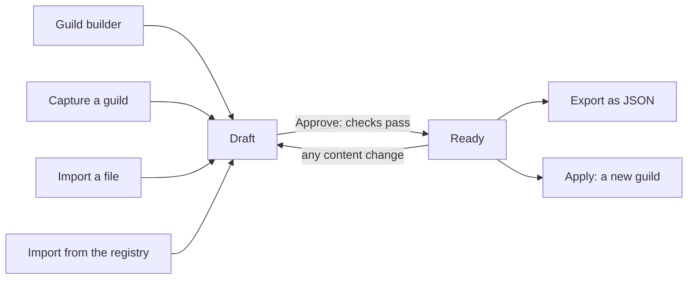

# Recipes

A recipe is a portable snapshot of a guild's configuration. It says
which agents the guild has, what each one is told to do, which tools
and logins it needs, which collections and notes it starts with, and
which routines wake it. A recipe is not a copy of a live guild. It
holds no credentials, no Memory, and no records. It does not run.

A recipe turns into a live guild when you
[apply it](applying-recipes.md). You get one in four ways: the
[Guild builder](guild-builder.md) drafts one from a conversation, you
capture one from a [guild](guilds.md) you already run, you import a
file, or you import one from the registry. Every recipe uses the same
document, described in [Recipe format](recipe-format.md).
[Prompt Studio](prompt-studio.md) improves a guild that already
exists; it does not deal in recipes.

## When you use it

- You built a guild that works and you want a second one like it.
- You want to keep a known-good design of a guild before you change it.
- You want to share a guild design with another organisation or
  another box. A file carries it there.
- You want to start from a design someone published to the registry.
- You described a guild to the [Guild builder](guild-builder.md) and
  want to review its draft before it creates anything.

## How it works

### One document, many sources

Every recipe lives in the organisation's library. It starts as a
**draft**. A draft can change freely. When you **Approve** it, the
recipe is checked against the organisation. If nothing blocks it, it
becomes **ready** (shown as *approved*). Only a ready recipe can be
exported or applied. Any later change to its content puts it back to
draft, so a recipe never applies halfway through an edit.



### What travels and what stays behind

A recipe carries the design of a guild:

- the roster: each agent as a *role*, with its focus, avatar, and
  configuration
- each role's Task, scripts, and routines
- the collections the guild uses, with their columns and who may write
- seed notes the Tasks rely on
- the tools and connectors each role may use
- the secrets each role needs, by name only
- the repositories coding roles work in, by name only
- setup steps the operator does outside the platform

It never carries credentials, Memory, collection records, browser
profiles, repository URLs, or the ids of the box it came from. Those
belong to the live guild. When you apply the recipe, a checklist asks
you to connect logins, add secret values, and add repositories again.

### Capture

Capturing a guild reads it as it is today and writes a new draft. The
agents' names become role handles, and tags and note links become the
recipe's [placeholders](recipe-format.md#placeholders-that-apply-resolves).
Notes a Task embeds come along as seed notes. Secrets come along by
name, with the roles that use them.

### Access cuts

A recipe says which connector tools each role may use. On the recipe's
page you can switch a tool off for one role, or remove a connector
from the recipe altogether. The recipe records each cut. The
[Guild builder](guild-builder.md) sees those cuts so it can fix the
Tasks that relied on them, or ask you why.

## In the app

### The Recipes library

**Recipes** in the app opens the library. It lists every recipe of
the organisation as a card: its name, an **approved** or **draft**
tag, its description, where it came from (*from the Builder*, *from a
guild*, or *imported*), its body version, and when it was last
updated.

The header has four buttons:

- **From a guild** opens **Capture a guild**. Pick a guild and it
  becomes a draft recipe, which then opens.
- **Import JSON** reads a recipe file from your computer and opens the
  new draft.
- **From the registry** opens **Import from the registry**. It lists
  the recipes the registry publishes, each with its version, publisher,
  description, and an **unverified** tag when the registry has not
  verified it. Picking one imports it as a draft. When the box is
  offline, the dialog says so and lists nothing.
- **Open the Builder** goes to the [Guild builder](guild-builder.md).

A guild's menu also has **Save as recipe**. It captures that guild and
opens the draft.

### A recipe's page

A recipe's page shows its status, its source, its body version, its
name, and its description. Its buttons are:

- **Approve**, on a draft. It runs the checks and marks the recipe
  ready. A note under the header reminds you that any later edit
  returns it to draft.
- **Export**, enabled once the recipe is approved. It downloads the
  recipe as a JSON file named after it.
- **Apply** on an approved recipe, **Approve and apply** on a draft.
  It opens the [apply preview](applying-recipes.md#in-the-app).

Below the header is the plan: everything the recipe creates and needs.

- The plan header names the smallest machine the recipe's agents need
  ("Needs a machine of at least …"). Hovering it gives the
  [sizing rules](machines.md).
- Each agent has a card. Pills count its connectors, routines, and
  tools. A routines pill at 0 carries a warning icon; its hover gives
  the coach's advice.
- A **Capabilities** row lists **Browser**, whose hover gives the
  login step and notes, and **Coding**, with the
  [harness](coding/harnesses.md) the role names, or *no harness yet*.
- Each agent's **Task** folds open. It has a copy button and
  **Edit Task**, which lets you rewrite it and **Save Task**.
- Expanding a connector lists its catalog tools per agent. You can
  switch a tool off, or **Remove** the connector (**Keep** undoes it).
  A bar then appears with **Save access** and **Discard**.
- The plan lists the recipe's repositories.
- An issues list under the plan shows the findings of the checks, five
  at a time.

Agent cards leave out the `harness.credential` finding: only apply and
the agent's own setup act on it. The issues list leaves out
`machine.*` findings: the apply preview's machine picker shows them.

## Rules and limits

| Rule | Behaviour |
|---|---|
| New recipes | Start as a draft |
| Approve | Allowed only when the checks find no blocking error |
| A change to the content | Returns the recipe to draft |
| Export | Refused while the recipe is a draft |
| Apply | Needs a ready recipe |
| Capture of a guild with no agents | Refused |
| Credentials, Memory, records, browser profiles, repository URLs | Never captured |
| Secret values | Never captured; only names travel |
| Library size | The library lists the 100 most recently updated recipes |
| Another organisation's recipe | Not found; a file is the way to move a recipe between organisations |

## Reference

### Capture

`POST /api/guilds/:guild_id/recipes` captures a guild. It writes a
recipe with `status=draft`, `visibility=private`, `source_kind=guild`,
`source_guild_id`, and `body_version=1`, and returns it with 201. The
body may carry `include_notes`, a list of note display paths or keys to
capture besides the ones a Task embeds. A guild with no live agents is
refused with 422 (`guild has no agents to capture`). Archived agents
are left out.

What capture writes:

- `meta.name` and `guild.name_suggestion` are the guild's name.
  `meta.description` and `guild.about` are its about text.
  `guild.objective` is the guild's description.
  `guild.group_agent_message_limit` is the guild's limit (20 when
  unset).
- Each agent becomes a role whose `role` and `name_suggestion` are the
  agent's name. Its focus, wake triggers, avatar, and Task travel. The
  Task is marked `author: { by: "operator", reviewed: true }`, like
  every captured field.
- The role's `config` keeps only agent configuration keys, with
  defaults filled in. The machine size keys `box`, `cpu`, and
  `memory_mib` stay behind: apply places the agents on a machine of its
  own. When the agent has more scripts than `max_scripts`, `max_scripts`
  is raised to the number of scripts.
- `config.browser` travels, plus empty login instructions. The
  Chromium profile does not.
- `config.coding` travels. `config.harness` travels as it is; an agent
  without one leaves the key out. `config.harness_model` travels the
  same way; an agent on its harness's default model leaves the key
  out, and `config.harness_effort` likewise on the default effort.
  `config.secret_aliases` travels the same way; an agent without
  an alias leaves the key out.
- A harness subscription token stays behind. On a coding agent, the
  aliases of the harness token variables (`CLAUDE_CODE_OAUTH_TOKEN`,
  `CURSOR_API_KEY`) are left out, and so are the secrets those
  variables read, unless another role gets the same secret for its
  own use. The `harness.credential` finding names the token to set up
  after apply. See [Harnesses](coding/harnesses.md).
- Scripts travel with their name, description, parameters, and
  source.
- Routines travel with their `cron` or `window`, description, and
  instruction. Each gets the key `<role>-<n>`. Apply creates them
  paused.
- Each role's grants (`read_guild`, `write_guild`, `read_org`,
  `write_org`) and native tool switches travel as they resolve for
  that agent.
- Each enabled connector becomes one `connections` entry, with the
  tools each role may use. The entry's `hint` is the connector's
  description, cut to 400 characters, and its `setup` is the
  connector's setup hint. `recommended_scope` is the widest scope
  among the roles' connections (`org`, then `guild`, then `agent`);
  `recommended_role` names the first role only when the scope is
  `agent`. A server the organisation added of its own carries its
  manifest whole, so a box that lacks it can add it.
- The GitHub connection is not captured under `connections`.
  `repositories` stands for it.
- The guild's repositories are captured by name with an empty
  `purpose`. Their URLs, branches, and GitHub connections stay with
  the guild.
- The guild's own collections are written as `scope: "guild"`.
- Every organisation collection the guild reaches is written as
  `scope: "org"`. The guild reaches a collection through its own grant
  or through a member agent's own grant. `guild` is the guild's grant
  (`read` when only members hold grants). `writers` lists the roles
  whose agents override it to `write`. An agent override of `read` or
  `none` is not carried.
- Secrets come from each role's environment. There is one entry per
  name, with its description and the roles whose agents get it.
  `recommended_scope` is `org` when the secret is organisation-wide,
  `guild` when it is granted to the source guild, otherwise `agent`.
  The first role holding it is `recommended_role` when the scope is
  `agent`. Values are never captured.
- Notes a Task embeds are always captured as seed notes. Notes listed
  in `include_notes` are captured too. Memory (`memory.md`) is never
  captured. Lived agent notes, organisation notes, Memory bodies, and
  collection records stay out unless the operator includes them.
- Capture rewrites display paths of captured notes to recipe-local refs,
  in embeds (`![[guild/<key>]]`, `![[org/<key>]]`,
  `![[agent/<role>/<key>]]`) and as plain text (`guild/<key>`, …).
  It rewrites tags of source agent names to `@{role}` in Tasks,
  routine instructions, script sources, and notes. `@user` is never
  rewritten.
- Capture fills the design metadata the checks need, so a captured
  guild can be approved as it is: a single role records why it stays
  one agent, several roles get a tagged hand-off budgeted at the
  guild's group limit, each routine gets a `design.routines` entry, and
  each browser role gets a login-failure policy ("pause the routine and
  ask the operator to log in again").

### Approve, edit, and review

- **Approve** (`POST /api/recipes/:id/publish`, or the Builder's
  publish) runs the checks and moves the recipe to `status=ready` when
  no finding is an error. Otherwise it answers 422 with the error
  messages joined by `; `.
- Every write of the body returns the recipe to `draft`. Those writes
  are Builder chat, edit, access, review, and `PUT`. Apply reads only
  an approved body.
- `POST /api/recipes/:id/review` edits provenance. Its body is
  `{ path, action, value? }`. `action: "confirm"` marks the field
  reviewed. `action: "edit"` sets `value` and marks the field
  `{ by: "operator", reviewed: true }`. Paths are
  `roles.<role>.task`, `roles.<role>.browser`,
  `roles.<role>.scripts.<name>`, `roles.<role>.schedules.<key>`,
  `connections.<server>.setup`, `notes.<id>`, and `external[<n>]`. An
  unknown path is 404 (`field not found`).
- `POST /api/recipes/:id/access` saves access cuts. Its body is
  `{ edits: [...] }`. An edit is
  `{ action: "set_tool", server, role, tool, enabled }` or
  `{ action: "remove_connection", server }`. Switching a tool off sets
  `connections[].roles[role].tools[tool] = false`; switching it back
  on removes the key. Removing a connector drops the entry and records
  it in `design.systems` as `resolution: "refused"`,
  `proposed_by: "operator"`. The answer carries `access_cuts`. An
  unknown connection or role is 404.
- The checks then report each cut as an `access.tool_removed` or
  `access.connector_removed` info finding, so the Builder can update
  prompts or ask why.

The blueprint is a preview: nothing live changes until apply.

### Import and export

- A file import (`POST /api/recipes/import`, body the recipe or
  `{ recipe }`) parses the document, refuses it with 422 when it holds
  anything that looks like a credential (`recipe must not contain
  secrets or ciphertext`), and adds it to the library as a
  draft with `source_kind=file`. It resets every field's review state
  (`reviewed: false`, `by` kept) and sets `meta.source` to
  `{ kind: "file" }`. It answers 201.
- The registry routes list the recipes the box's registry offers and
  add one to the library the same way as a file import, after checking
  it against the index's size and SHA-256. Without `version`, the
  newest version is taken. While the box is offline (`REGISTRY_URL` set
  empty), the list answers `{ offline: true, url: null, recipes: [] }`
  and the import answers 409. A recipe the registry lacks is 404.
- Export (`GET /api/recipes/:id/export`) returns the parsed document as
  JSON. It is 409 while `status=draft`, and 422 when the document holds
  anything that looks like a credential.

A document "looks like a credential" when its JSON text, in any case,
contains `ciphertext`, `oauth_client`, `refresh_token`, `access_token`,
or `private_key`. The check reads every string, so a Task or script
that only names one of these words, for example an `access_token`
parameter, also blocks import and export.

### Screens

| Screen | Route |
|---|---|
| Library | `/recipes` |
| A recipe's page | `/recipes/<id>` |

The apply screens are in
[Applying recipes](applying-recipes.md#screens).

### Storage

```text
recipes (
  id, org_id, created_by_user_id,
  name, description, visibility,     -- private | org
  status,                            -- draft | ready
  body jsonb, body_version int,
  source_kind,                       -- guild | builder | file
  source_guild_id, source_builder_session_id,
  created_at, updated_at
)
```

Every route writes `visibility=private`, and no route changes it.
Visibility does not limit access: any member of the organisation can
open, edit, apply, and delete any recipe of the organisation. File
import is the cross-organisation path. Reading another organisation's
recipe is 404.

The app has no button to delete a recipe. `DELETE /api/recipes/:id`
deletes one.

A recipe drafted by the Builder is owned by its Builder session; see
[Guild builder](guild-builder.md#storage).

### Recipe HTTP

```text
GET    /api/recipes
POST   /api/guilds/:guild_id/recipes
GET    /api/recipes/:id
PUT    /api/recipes/:id
POST   /api/recipes/:id/review
POST   /api/recipes/:id/access
POST   /api/recipes/:id/validate
POST   /api/recipes/:id/publish
DELETE /api/recipes/:id
GET    /api/recipes/:id/export
POST   /api/recipes/import
GET    /api/recipes/registry
POST   /api/recipes/registry/import   { name, version? }
```

| Route | Answer |
|---|---|
| `GET /api/recipes` | The organisation's recipes, most recently updated first, at most 100 |
| `POST /api/guilds/:guild_id/recipes` | 201 with the captured draft |
| `GET /api/recipes/:id` | The recipe; 404 outside the organisation |
| `PUT /api/recipes/:id` | Writes `{ recipe?, name?, description?, expected_body_version }`; returns the recipe as a draft with `body_version` + 1; 409 with the current `body_version` on a stale head |
| `POST /api/recipes/:id/review` | The recipe, as a draft |
| `POST /api/recipes/:id/access` | The recipe, as a draft, with `access_cuts` |
| `POST /api/recipes/:id/validate` | `{ findings, errors, unreviewed, access_cuts, body_version, status }`; writes nothing |
| `POST /api/recipes/:id/publish` | The recipe at `ready`; 422 with the blocking errors |
| `DELETE /api/recipes/:id` | `{ ok: true }` |
| `GET /api/recipes/:id/export` | The document; 409 while draft |
| `POST /api/recipes/import` | 201 with the imported draft |
| `GET /api/recipes/registry` | `{ offline, url, recipes }`, the newest entry of each recipe |
| `POST /api/recipes/registry/import` | 201 with the imported draft; 404 when the registry has no such recipe; 409 while offline |

A document that does not parse is 422 with the parser's message (see
[Recipe format](recipe-format.md#parsing)). The apply routes are in
[Applying recipes](applying-recipes.md#apply-http).
