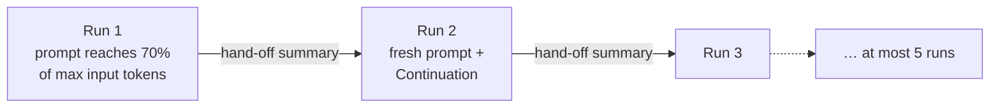

# Runs

A run is one session of work by one [agent](agents.md). It is a
transcript: the system prompt the agent started from, the messages it
received, every model reply, and every tool call with its result. The
operator can open any run and read exactly what happened
([Run transcript](run-transcript.md)).

A run starts in one of three ways: an operator chats with the agent,
the [group chat](group-chat.md) wakes it, or a [routine](routines.md)
fires. Inside a run, the agent works in *generations*: each message it
receives starts one, and the generation ends when the agent replies
without calling a tool. What a run costs is counted on
[Usage](usage.md).

## Why it exists

Agents act on their own, so the operator needs to see what they did
and why. A run keeps everything in order and never rewrites it. The
operator can check the exact prompt an agent saw, follow each step,
and pick a conversation back up later.

## How it works

### Three kinds of run

| Kind | Started by | Shape |
| --- | --- | --- |
| **Direct** | an operator, from the Chat tab | a persistent chat: it stays open after each reply and takes later messages |
| **Group chat** | the group chat | one-shot: one generation that shows the agent the recent chat, then the run completes |
| **Routine** | a routine | one-shot: one generation that hands the agent the routine's instruction, then the run completes |

A one-shot run stays visible. The operator can read the exact prompt
it was given, the message that woke it, and its tool calls. It refuses
later messages until the operator **Resume**s it into a conversation.
A direct run created without a message waits idle with its system
prompt.

An agent runs one thing at a time, whatever the kind. While it
generates, a new direct message is refused, a group delivery waits,
and a due routine waits for a later tick of the scheduler, which
checks every 30 seconds ([Routines](routines.md#the-ticker)).
Different agents generate at the same time, on one machine or on
several.

### Generations

A generation is one turn of the agent loop:

1. call the model;
2. store its reply;
3. if it asked for tools, run them one by one and store each result;
4. repeat, until the model replies with text alone.

Every row a generation adds carries its generation number, starting at
1. The opening system prompt has none.

### What a run stores

Each row holds two things:

- the **payload**: exactly what the model sees, such as a message's
  role and text;
- the **metadata**: what the operator sees and the model never does,
  such as tokens, cost, timings, and the model's reasoning.

Rows are only ever appended, and a stored payload never changes. What
the model was sent can always be rebuilt from the stored rows and the
run's snapshot. The orchestrator never retries a provider call by
itself.

The **snapshot** freezes the agent at run creation: its model
settings, its switches, and the tools it may be offered. Changing the
agent later affects new runs, with two exceptions:

- Each generation offers only the snapshot's tools that the agent's
  bindings and switches still grant. A tool turned off leaves an open
  chat at its next generation. A tool turned on reaches new runs only.
- Secrets are looked up again at every generation, so a new grant
  reaches an open chat ([Secrets](secrets.md)).

### Limits that end a run

Three limits from the agent's settings stop a run that goes on too
long:

- **Max steps**: model calls in one generation. Past it the generation
  stops with an error. The run stays open.
- **Max tool calls**: tool calls in the whole run. Near the end, each
  tool result says how many calls are left and asks the agent to wrap
  up. At the limit the run completes.
- **Max input tokens**: the size of the prompt sent to the model.
  Above it the model is not called and the run completes.

A run that hit its tool-call or input-token limit cannot be resumed.
Start a new one.

A run also completes when its model cannot be called: the model's
provider is not connected for the organisation, or an extension refuses
the model credentials or blocks the organisation. That run can be
resumed once the cause is fixed.

### Tool-result stubbing

Tool results can be large: a web page, a long file. Old ones rarely
matter. Before each model call, large tool results from earlier turns
are replaced by a short stub, in what is sent only. The stub says
which tool produced the result and how to fetch it again. The stored
run keeps the full results. By default only the current turn keeps
its full tool results. The agent's settings can keep more.

### Run chains

A coding agent's runs can grow long. Instead of stopping at the input
limit, a coding run hands off: it asks the agent for a summary, then
continues in a fresh run that starts from that summary.



The chain keeps the kind, the routine, or the group delivery of its
first run. It holds at most five runs.

### Wake-ups

A wake-up brings a run back after a delay, in the same conversation.
The agent sets one with `wake_after`, a delay of 1 to 360 minutes, and
an optional note to itself, and cancels it with `wake_cancel`
([Native tools](../tools-and-connectors/native.md#wake-ups)). It
belongs to one run, is due at a set time, and fires once. A run holds
at most one pending wake-up; setting another replaces it. A run fires
at most `max_wake_ups` wake-ups, 10 by default, counted across its
chain. When it fires, the run takes one
more generation that opens with a wake-up message, and the agent
decides what to do next.

The scheduler fires due wake-ups every 30 seconds, before it wakes
due routines, so an agent goes back to work in progress before it
starts new work. A wake-up whose agent is busy stays due for a later
tick. Wake-ups are stored, so one that came due while the
orchestrator was down fires on its first tick.

| The run when the wake-up is due | What happens |
| --- | --- |
| open | the wake-up message starts the next generation |
| completed at the end of its generation (a group chat or routine run), or because its model could not be called | the run reopens for the wake generation and completes again when it ends; it does not start taking messages |
| continued in a new run after a hand-off | the wake-up moves to the latest run of the chain and fires there |
| completed on its tool-call, input-token, or chain cap | the wake-up is cancelled, and the run records the error `wake.cancelled`, naming the cap |

A run that ends on one of those caps cancels its pending wake-up as
it ends. A wake generation is an ordinary generation: it counts
toward the run's tool-call and input-token limits, starts the agent's
machine when it is down, and starts the machine's idle timer again
when it ends.

### Cancel, interrupt, resume

- **Cancel** stops the current model call or tool command. A direct
  run stays open.
- If the orchestrator restarts mid-run, unfinished tool calls get an
  "interrupted" result, so the transcript stays valid. A one-shot run
  is marked completed.
- **Resume** reopens a completed run so it takes new messages again.

## In the app

### Chat tab

The agent's **Chat** tab shows sessions with the agent. A session is a
run. The body of the tab is the
[run transcript](run-transcript.md).

- Without `?run=`, it shows the run that is generating, keeps showing
  that run when the generation finishes, or opens a new session when
  none is generating.
- After three minutes with no action on a finished generation, the
  next time the window is focused the inspector closes.
- The tab strip carries a clock, **Session history**, that opens the
  **History** drawer (`?history=true`), and a plus, **New session**. A
  new session opened with the plus stays open while another run is
  generating.
- On a coding agent, a coding strip sits under the tab strip
  ([Coding agents](coding/index.md)).

The **History** drawer lists every run of the agent, newest first,
grouped by day, 50 at a time. It filters by kind: **Direct**,
**Group chat**, or **Routine**. Each row shows its title, the time,
the message a group chat run read up to, and the status. The title is
**Direct session**, **Group chat**, or the routine's description, and
**Routine wake-up** for a routine without one. A row opens that
run in Chat. On a phone the drawer covers the transcript until it is
dismissed. `/guilds/<id>/agents/<id>/history` opens Chat with the
drawer expanded.

The **composer** always shows a paperclip. When the agent's model
accepts images, it adds JPEG, PNG, GIF, or WebP images, at most four,
10 MiB each. A message may be images with no caption. When the model
does not accept images, or is not among the organisation's chosen
models, the paperclip is disabled and a tooltip says so. The
transcript shows the images on the operator's bubble.

An ended run shows a banner under the transcript:

- **This session has ended**, with **Resume**, when it can be resumed.
  The same transcript reopens and the next message continues it.
- **This session reached its limit**, with **New session**, after a
  tool-call, input-token, or chain cap.
- **This session continued in a new run**, with **Open it**, after a
  hand-off. A run that is open while it continues switches to the new
  run.

## Rules and limits

| Rule | Value or behaviour |
| --- | --- |
| Generations at a time | one per agent; a second direct message is 409 |
| Max steps | 30 by default (200 for a new coding agent) |
| Max tool calls | 50 by default (200 for a new coding agent); counts every tool result in the run |
| Wrap-up warning | when 8 tool calls or fewer are left |
| Max input tokens | 100000 by default; counted with `js-tiktoken` |
| Max wake-ups | 10 by default, for a coding agent too |
| Full tool results kept | the current turn only, by default |
| Results never stubbed | under 2048 bytes |
| Routine check | every 30 seconds |
| Wake-up check | every 30 seconds, before the routines; a wake-up fires up to 30 seconds late |
| Pending wake-ups | at most 1 per run; a new one replaces it |
| Wake-up delay | 1 to 360 minutes, whole |
| Wake-up note | optional, trimmed, at most 1000 characters |
| Wake-ups per run | `max_wake_ups`, counted over fired wake-ups across the chain |
| Operator message before a wake-up is due | the wake-up stays pending and fires at its time |
| Wake-up on a capped run | cancelled, with `wake.cancelled` recorded |
| Coding run hand-off | at 70% of max input tokens |
| Runs in a chain | at most 5 |
| Images per message | at most 4, 10 MiB each, JPEG, PNG, GIF, or WebP |
| Image cost in token counting | 1600 tokens each |
| One-shot runs | refuse messages until resumed |
| Resume | refused after a tool-call, input-token, or chain cap, and on a continued run |
| Provider retries | off |

## Reference

### Run row

`runs` holds `id`, `agent_id`, `org_id`, `kind` (`direct`, `group`, or
`schedule`), `status` (`active` or `completed`), `config_snapshot`,
`errors`, `metadata`, `group_chat_through_seq` (group runs),
`wake_group_message_id` (group runs: the public row that woke it),
`schedule_id` (schedule runs), `started_by_user_id` (direct runs: the
person who opened it), the system, task, and memory prompt hashes,
`created_at`, and `updated_at`. Clearing the group chat or deleting the
user clears the matching link. A run continued from a chain keeps its
cause in `metadata.chain` instead ([Chain rules](#chain-rules)).
Deleting the agent deletes its runs. The app labels `group` **Group
chat** and `schedule` **Routine**.

A direct run, or any run the operator has resumed, stays `active`
after its generation. A group or schedule run becomes `completed`. Any
run becomes `completed` when it ends on a limit, a hand-off, or a
model it cannot call ([Generation](#generation)). A completed run that
a wake-up reopens becomes `completed` again after the wake generation
([Wake-up rules](#wake-up-rules)).

### Opening rows

Row 0 is the composed system prompt. A direct run created with a
message adds it as row 1. A group run adds one Group Chat info user
message, and a schedule run one Schedule wake-up user message
([System prompt](system-prompt.md#the-runs-own-messages)). Later user
messages append operator text, or a fired wake-up's message
([Wake-up rules](#wake-up-rules)).

### Attachments

A user row may carry `metadata.attachments`: `{ id, filename, mime,
kind }` refs uploaded through `POST /api/attachments`. The stored
payload stays `{ role, content }`. An empty caption is allowed when
images are present.

At provider-request time the orchestrator hydrates image refs into
Chat Completions `image_url` parts:

- a 15-minute signed URL;
- a data URL when the store cannot sign;
- always a data URL for Kimi, which refuses public image URLs.

A Messages API provider receives the same parts as image blocks: a
data URL as a base64 source, a signed URL as a URL source.

Token counting adds 1600 tokens per image. It does not encode those
URLs.

`POST /api/attachments` takes the file bytes as the body, with the
name in `X-Filename`. It returns 201 with `id`, `filename`, `mime`,
`bytes`, `kind`, `url`, and `created_at`. It refuses an empty file or
one over 10 MiB (422). Sending refs refuses a model that does not take
attachments, more than four refs, or a repeated ref (422), and an
unknown ref (404). `GET /api/attachments/:id` serves the bytes to the
same organisation.

### Metadata

Metadata sits beside the payload and is never sent to the model:

- usage;
- cost ([Usage](usage.md));
- latency;
- tool timings;
- generation number;
- source;
- the model's reasoning text and provider reasoning blocks, when it
  streamed any.

Tool-result metadata includes the provider tool-call id for
correlation. The message row already owns the run id. Agent, guild,
and organisation ids resolve through the run rather than being copied
into metadata. Durable file mutations record the same run and
tool-call identity in `file_changes` ([Artifacts](artifacts.md)).

### Exactness rules

1. Payloads become immutable when inserted.
2. Rows are append-only; sequence numbers never change.
3. Every model call receives a recorded projection of the current
   payloads in sequence order. Tool-result stubbing is the projection;
   user and assistant text are unchanged. Replay
   `projection_policy_version` and `keep_tool_result_generations` from
   the run snapshot on the stored rows to rebuild what was sent.
4. An assistant row is the response to that projection of the prefix
   preceding it.
5. Model parameters stay fixed for the run. Each generation offers
   the snapshot's tool schemas that the live bindings and switches
   still grant, and never one the snapshot lacks.
6. Automatic provider retries are off.
7. Tool results enter history only after the output pipeline.

### Snapshot

The run stores an immutable snapshot. It holds the agent's config at
run creation, less `max_scripts` and `max_workspace_mib`, with
`projection_policy_version`, the offered `tools`, `mcp`, `secrets`,
and the `scripts` ([Scripts](scripts.md#snapshot)).

Model settings include `max_tool_calls`, `max_input_tokens`,
`max_wake_ups`, `keep_tool_result_generations`,
`projection_policy_version`, and `thinking_level`. `max_wake_ups` is
the most wake-ups the run may fire, counted over the fired wake-ups of
its chain; `wake_after` is refused past it.

Flags: `browser`, `coding`, `scripting`, and `memory`. Beside them,
`harness` is a coding agent's harness or null, `harness_model` the
model that harness runs or null for its subscription's default,
`harness_effort` the effort it runs that model at or null for the
model's default ([Harnesses](coding/harnesses.md)), and
`secret_aliases` the agent's secret aliases ([Secrets](secrets.md)).

The complete tool schemas offered to the model:

- enabled native bindings: note, record, memory when `memory` is true,
  and script tools when `scripting` is true;
- `secret_store`;
- `secret_request` on direct runs;
- `report_issue`, always;
- the seven schedule tools, when bound, on direct and group chat
  runs;
- `group_post` when that binding is on;
- `wake_after` and `wake_cancel` when bound, on every kind of run;
- the browser tools of its mode when `browser` is true: the eight
  step-by-step tools, or `browse` and `browser_eval` while
  `browser_optimized` and the System One platform key are on;
- the five code tools when `coding` is true;
- enabled MCP schemas, including curated lists from the CoinGecko,
  Alchemy, X, TwitterAPI.io, Qonto, and DexPaprika adapters, and a
  registry connector's manifest.

The snapshot also stores the agent's secrets as `[{id, name,
description}]` and a slim `mcp` list of `{connection_id, server_id,
slug, tools: [{name, remote_name}]}`.

Each generation narrows the snapshot's native tools to those the
agent's live bindings and switches still grant. Connection tools stay
as snapshotted. A snapshot that froze `browse` keeps it while the
agent's config keeps the agent-optimized browser on; its calls answer
that the System One key is missing while the key is off. Such a run
logs `browse.integration_off` once and records
`metadata.browse_integration_off_at`.

Each generation re-resolves the agent's secrets (organisation-wide,
granted to its guild, granted to it), writes them onto the snapshot,
and decrypts their values. A later grant, removal, or rotation reaches
an existing direct run. A deleted, missing, or undecryptable secret is
a generation-start error.

### Generation

At start, the loop cancels the machine's idle timer, ensures the
machine is up, and checks the disk caps. A home or machine over its
cap fails the generation with `workspace.full`
([Agent home](agent-home.md#the-disk-cap)). After the generation it
measures and stores both sizes. When the last generation on the
machine ends, the idle timer starts again
([Machines](machines.md#idle-timer)). A coding run is checked further
before the model is called: harness picked, guild repositories,
harness installed and credentialed, repositories prepared
([Coding agents](coding/index.md)).

It loads every payload in order and repeats the loop up to
`max_steps` times. Each step filters every tool result through the
output pipeline before it appends one tool message. If the last
allowed step still has tool calls, those tools run, then the loop
records `generation.max_steps`. The run stays active.

`max_tool_calls` counts every tool result on the run. After the output
pipeline, each stored tool result ends with `remaining_tool_calls: N`,
the count left after that result. When N is 8 or fewer, a wrap-up line
sits above that trailer: write durable findings and finish with text;
a batch costs one call each. When the count reaches the cap, the
current batch still finishes. Then the run records
`generation.max_tool_calls` and completes.

Before each model call the orchestrator projects the stored history,
then counts that prompt (messages and offered tools) with
`js-tiktoken` against `max_input_tokens`. Above that cap it does not
call the model. It records `generation.max_input_tokens` with a
message to start a new run, and completes the run.

Before each model call the orchestrator also resolves the model's
credentials. Each of these records its operation and completes the
run:

| Operation | Cause |
| --- | --- |
| `generation.model_key` | the model's provider is not connected for the organisation |
| `generation.model_credentials` | the extension's model credentials refuse the call |
| `generation.subscription` | the extension's policy blocks the organisation; core never blocks |

Resume is refused after `generation.max_tool_calls`,
`generation.max_input_tokens`, and `generation.max_chain`, and allowed
after the three above.

### Stubbing rules

For the provider request only, large tool **results** outside the keep
window are replaced with a short stub:

- `tool_name`;
- `source_seq`;
- `path` and `range` when the metadata has them;
- a hint to call the same tool again.

Assistant `tool_calls` stay. User and assistant text stay.

Here a generation is one user turn and the tool loop that follows, not
a run in a chain. `keep_tool_result_generations` (default 1,
snapshotted) is how many generations stay live, including the current
one:

- `1`: stub every previous generation. This is the default.
- `2`: also keep the previous user turn's tool results; stub older.

A result under 2048 bytes is never stubbed. When the projected prompt
is still over `max_input_tokens`, the oldest live results above that
floor are stubbed until four remain or the count fits. Policy version
`1`.

### Chain rules

A run whose snapshot has `coding` on continues in a new run when its
projected prompt grows. History stays append-only; each run's rows
are the store the projection was built from. Runs without `coding`
keep the input cap above.

1. When the count before a model call reaches 70% of
   `max_input_tokens`, the orchestrator appends a hand-off request: a
   user row with `metadata.source: "handoff"` asking for text only, no
   tool calls, giving the goal, what is done, what is decided, what
   remains, and the files that matter as `path:line`.
2. It makes one model call. The offered tools stay as snapshotted, so
   the reply may still call one: each call gets the result
   `ERROR: a hand-off was requested; reply with text only` and is not
   run.
3. It creates the next run for the same agent, of the same kind, from
   a freshly prepared snapshot and system prompt, with one user message
   (`metadata.source: "continuation"`):
   `Continuation: { "previous_run_id": ..., "handoff": ... }`. A reply
   with no text gives `"handoff": null` and a note to work from Memory,
   notes, and the working tree.
4. The run records `metadata.continued_by_run_id` and completes. The
   new run records `metadata.chain` (`root_run_id`, `index` from 2,
   `previous_run_id`). The agent's generation lock passes to the new
   run without being released, the first run's subscribers get
   `run.continued` with the new `run_id`, and the new run generates.

A continuation that cannot be created records `generation.continue`,
and the run stays as it is.

A schedule continuation keeps the routine's `schedule_id` and
`instruction_hash`. A group continuation keeps the delivery's
`group_chat_through_seq` and completes itself. The group delivery
waits for the whole chain, then completes the chain's first run and
advances the agent's cursor.

A chain holds at most 5 runs. The fifth run, at the hand-off point,
records `generation.max_chain` and completes. If the hand-off request
itself puts the prompt above `max_input_tokens`, the run records
`generation.max_input_tokens` and completes without a continuation.

A user message or Resume on a run with `continued_by_run_id` is 409; it
names the latest run of the chain. Cancelling the running continuation
stops the chain. The run payload carries `chain` and
`continued_by_run_id` when they are set.

### Wake-up rules

`run_wakes` holds a run's wake-ups: `id` (`wk_…`), `run_id`,
`root_run_id` (the first run of the chain), `agent_id`, `due_at`,
`message` (the agent's note, or null), `state` (`pending`, `fired`,
or `cancelled`), `cancel_reason` (`replaced`, `agent`, `operator`, or
`limit`, set only on a cancelled one), `set_tool_call_id`,
`created_at`, and `fired_at` (set only on a fired one). A partial
unique index keeps one pending wake-up per run. Deleting the run or
the agent deletes its wake-ups.

Each tick of the scheduler, before the due routines:

1. It lists the pending wake-ups with `due_at` at or before now.
2. It skips a wake-up whose agent is busy. It stays due.
3. It loads the run. A run with `continued_by_run_id` hands the
   wake-up to the latest run of its chain; when that run already has a
   pending wake-up, this one is cancelled as `replaced`.
4. A run that recorded `generation.max_tool_calls`,
   `generation.max_input_tokens`, or `generation.max_chain` has its
   wake-up cancelled as `limit`. The run records `wake.cancelled`,
   whose message names the wake-up and the cap, and publishes it as
   `run.error`.
5. It takes the agent's generation lock. A conflict leaves the
   wake-up due.
6. In one transaction it marks the wake-up `fired`, sets a completed
   run `active` with `metadata.wake_reopened_generation` (the
   generation it reopens the run for) and without
   `metadata.resumed_at`, and appends the wake-up message as the run's
   next generation. A wake-up no longer pending by then appends
   nothing.
7. It publishes the wake-up message on the run's stream as
   `message.committed`, and generates in the background, as an
   operator message does.

The wake-up message is a user row, `metadata.source: "wake"`, with
`wake_id` and `reopened_run` (whether it reopened a completed run):

```text
Wake-up: {
  "id": "wk_…",
  "set_at": "2026-11-05T14:02:11.204+00:00",
  "due_at": "2026-11-05T14:12:11.204+00:00",
  "fired_at": "2026-11-05T14:12:30.517+00:00",
  "message": "Check deploy 4812 on the staging dashboard; if green, post the summary.",
  "wake_ups_left": 7
}
```

`wake_ups_left` is the run's snapshot `max_wake_ups` less the
wake-ups fired across its chain, this one included, and never below
0. Tool results of earlier generations are stubbed as usual
([Stubbing rules](#stubbing-rules)).

A run completes when the generation its
`metadata.wake_reopened_generation` names ends, whatever its kind. A wake-up never stamps
`metadata.resumed_at`, so a group or schedule run it reopens still
refuses messages, and a completed group run it reopens completes
without moving the agent's group cursor.

When a run ends on `generation.max_tool_calls`,
`generation.max_input_tokens`, or `generation.max_chain`, the
generation cancels its pending wake-up as `limit` and records
`wake.cancelled` as it ends. A hand-off moves the pending wake-up to
the continuation as soon as the continuation is created.

### Streaming

Committed assistant and tool rows are published over SSE after the
database transaction. Reasoning and token deltas may stream first, and
a running `code_task` streams its progress lines, and a running
`browse` call each of its steps, as `tool.progress`.
History is the committed row. On reconnect the UI reloads ordered
history, then consumes new events.

### Cancellation and restart

Cancellation stops the current model call or tool command. It records
`generation.cancelled` and leaves a direct run active. The machine
stays.

If an assistant row with tool calls is already in history,
cancellation or restart appends `ERROR: execution interrupted` for
every unresolved call, so the next model request is valid.

On orchestrator startup, unresolved tool calls in active runs get
those interruption results. Startup does not replay a model call. An
unresolved `code_task` is stopped and checkpointed first
([Code tools](coding/code-tools.md)).

An interrupted group or schedule run that the operator has not
resumed records `generation.interrupted` (`orchestrator restarted`)
and is marked completed. For a group run, startup also advances the
agent's group cursor through the stored snapshot, and group dispatch
resumes. A direct run, or a resumed one, stays active. Startup then
starts the idle timer of every running machine on which no agent
generates.

### Resume

`POST /api/runs/:id/resume` reopens a completed run that has no
continuation and did not hit
`generation.max_tool_calls`, `generation.max_input_tokens`, or
`generation.max_chain`. It sets `status` back to `active` and stores
`metadata.resumed_at`. An active run is returned unchanged.

The same transcript then accepts later user messages. A group or
schedule run rejects messages until that field is set (409
`<kind>-triggered runs do not accept later messages`). After it is
set, a schedule generation leaves the run active.

### Errors and logs

Every failure the loop records appends one entry to `runs.errors`:

| Field | Content |
| --- | --- |
| `at` | when it failed, ISO 8601 |
| `generation` | the generation number |
| `operation` | what failed, such as `llm.complete`, `workspace.full`, or a `generation.*` operation above |
| `error_type` | the error's class name |
| `message` | the error message, with known secret values redacted |

The same entry is published on the run's stream as `run.error`
([Run transcript](run-transcript.md#errors-outside-a-flow)). A
provider failure before any assistant row creates no message row.

Logs carry the run, guild, agent, operation, error type, and
`traceback`.
They redact known secret values. They omit prompts, payloads, and tool
results.

### HTTP

| Route | Does | Success | Refusals |
| --- | --- | --- | --- |
| `GET /api/agents/:id/runs` | the agent's runs | 200 | |
| `POST /api/agents/:id/runs` | creates a direct run, with optional `message` and attachment ids | 201 idle, 202 generating | 422 empty message, a `message` that is neither a string nor null, or `attachment_ids` that are neither a list of strings nor null; 409 agent generating, guild being deleted |
| `GET /api/runs/:id` | the run | 200 | 404 |
| `GET /api/runs/:id/messages` | its rows in order | 200 | 404 |
| `POST /api/runs/:id/messages` | appends `content`, with optional attachment ids, and starts a generation | 202 | 422 empty, a `content` that is neither a string nor null, or `attachment_ids` that are neither a list of strings nor null; 409 one-shot not resumed, continued, ended, or generating |
| `POST /api/runs/:id/resume` | reopens a completed run | 200 | 409 continued or capped |
| `POST /api/runs/:id/cancel` | cancels the current generation | 202, or 204 with nothing to cancel | 404; 409 `run is not active` |
| `GET /api/runs/:id/stream` | the run's SSE stream | 200 | |

### Code

- `apps/orchestrator/src/generation/`: the generation loop
  (`index.ts`), one module per part:
  - `active-generations.ts`: the busy lock, one generation per agent
  - `runs.ts`: creating runs, `deliverGroupRun`,
    `deliverScheduleRun`, and the scheduler
  - `prepare.ts` and `snapshot.ts`: the composed prompt and the
    snapshot
  - `generate.ts`: the steps of a generation and the offered tools
    (`offered-tools.ts`)
  - `completion.ts`: model calls, input counting, and credentials
  - `tool-calls.ts`: tool calls and interruption results
  - `events.ts`: committed rows, run errors, and stream events
  - `run-secrets.ts`: the secrets of each generation
  - `chain.ts`: hand-offs and continuations
  - `wakes.ts`: firing due wake-ups, and cancelling one on a capped run
  - `caps.ts`: the caps a resume cannot lift and a wake-up does not
    reopen
  - `workspace.ts`: the disk caps
  - `machines.ts` and `idle.ts`: machines, Chrome, the terminal, and
    idle timers
  - `operator.ts`: what the HTTP routes call
- `apps/orchestrator/src/wakes/`: the wake-up message, the count of
  wake-ups left, the delay and note rules, and setting and cancelling a
  wake-up
- `apps/orchestrator/src/toolbox/wake.ts`: `wake_after` and
  `wake_cancel`
- `apps/orchestrator/src/db/wakes.ts`: the wake-up store
- `apps/orchestrator/src/conversation/projection.ts`: tool-result
  stubbing
- `apps/orchestrator/src/attachments/`: uploads and image hydration
- `apps/web/src/features/agent/chat/`: the Chat tab
