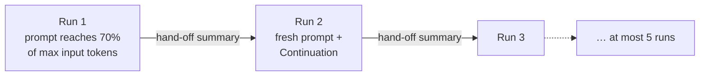

# Runs

A run is one session of work by one [agent](agents.md). It is a
transcript: the system prompt the agent started from, the messages it
received, every model reply, and every tool call with its result. The
operator can open any run and read exactly what happened.

A run starts in one of three ways: an operator chats with the agent,
the [group chat](group-chat.md) wakes it, or a [routine](routines.md)
fires. Inside a run, the agent works in *generations*: each message it
receives starts one, and the generation ends when the agent replies
without calling a tool. What a run costs is counted on
[Usage](usage.md).

## Why it exists

Agents act on their own, so the operator needs to see what they did
and why. A run keeps everything in order and never rewrites it. The
operator can check the exact prompt an agent saw, follow each step,
and pick a conversation back up later.

## How it works

### Three kinds of run

| Kind | Started by | Shape |
| --- | --- | --- |
| **Direct** | an operator, from the Chat tab | a persistent chat; stays open after each reply and takes later messages for as long as the agent exists |
| **Group** | the group chat | one-shot: one generation that shows the agent the recent chat, then the run completes |
| **Schedule** | a routine | one-shot: one generation that hands the agent the routine's instruction, then the run completes |

A one-shot run stays visible, so the operator can inspect the exact
prompts it was given (Memory included), the message that woke it, and
its private tool trace. It refuses later messages. The operator can **Resume** it
to turn it into a conversation. A direct run created without a message
waits idle with its system prompt.

An agent runs one thing at a time, whatever the kind. While it
generates, a new direct message is refused, a group delivery waits,
and a due routine waits for a later tick. Different agents generate at
the same time, on one machine or on several, each with its own
history, files, home, and lock.

### Generations

A generation is one turn of the agent loop:

1. call the model;
2. store its reply;
3. if it asked for tools, run them one by one and store each result;
4. repeat, until the model replies with text alone.

Every row a generation adds carries its generation number, starting at
1. The opening system prompt has none.

### What a run stores

Each row holds two things:

- the **payload**: exactly what the model sees, such as a message's
  role and text;
- the **metadata**: what the operator sees and the model never does,
  such as tokens, cost, timings, and the model's reasoning.

The run also stores a frozen **snapshot** of the agent at the start:
its model settings, its switches, and the exact tools it was offered.
Changing the agent later affects new runs only. Secrets are the
exception: they are looked up again at every generation, so a new
grant reaches an open chat ([Secrets](secrets.md)).

### Exactness

Rows are only ever appended, and a stored payload never changes. What
the model was sent can always be rebuilt from the stored rows and the
snapshot. The orchestrator never retries a provider call by itself.

### Limits that end a run

Three limits from the agent's settings stop a run that goes on too
long:

- **Max steps**: model calls in one generation. Past it the loop stops
  with an error.
- **Max tool calls**: tool calls in the whole run. Near the end, each
  tool result says how many calls are left and asks the agent to wrap
  up. At the limit the run completes.
- **Max input tokens**: the size of the prompt sent to the model. Above
  it the model is not called and the run completes.

A run that hit its tool-call or input-token limit cannot be resumed or
continued. Start a new one.

### Tool-result stubbing

Tool results can be large: a page of a website, a long file. Old ones
rarely matter. Before each model call, large tool results from earlier
turns are replaced, in what is sent only, by a short stub that says
which tool produced it and how to fetch it again. The stored run keeps
the full results. By default only the current turn keeps its full
tool results; the agent's settings can keep more.

### Run chains

A coding agent's runs can grow long. Instead of stopping at the input
limit, a coding run hands off: it asks the agent for a summary, then
continues in a fresh run that starts from that summary.



The chain keeps the kind, the routine, or the group delivery of its
first run. It holds at most five runs.

### Cancel, interrupt, resume

- **Cancel** stops the current model call or tool command. A direct
  run stays open.
- If the orchestrator restarts mid-run, unfinished tool calls get an
  "interrupted" result, so the transcript stays valid. A one-shot run
  is marked completed.
- **Resume** reopens a completed run so it takes new messages again.

## In the app

### Chat tab

The agent's **Chat** tab shows sessions with the agent.

- Without `?run=`, it shows the run that is generating, keeps showing
  that run when the generation finishes, or opens a new session when
  none is generating.
- After three minutes with no action on a finished generation, the
  next time the window is focused the inspector closes.
- The tab strip carries a clock that opens the session drawer
  (`?history=true`) and a plus that starts a new session.
- On a coding agent, a coding strip sits under the tab strip
  ([Coding agents](coding/index.md)).

The **session drawer** lists every direct, group, and schedule run,
newest first by day, filterable by kind, 50 at a time. Each row shows
the kind, the time, the message a group run read up to, the status,
and `memory skipped` on a one-shot run that completed without
updating its Memory. A row opens that run in Chat. On a phone the
drawer covers the transcript until it is dismissed.
`/guilds/<id>/agents/<id>/history` opens Chat with the drawer
expanded.

The **composer** always shows a paperclip. When the agent's model
accepts images, it adds JPEG, PNG, GIF, or WebP images, at most four,
10 MiB each. A message may be images with no caption. When the model
does not accept images, or is not among the organisation's chosen
models, the paperclip is disabled and a tooltip says so. The
transcript shows the images on the operator's bubble.

`?run=<run id>` opens that run's exact history, streaming while it
generates. `&call=<tool call id>` or `&seq=<n>` also opens that step,
lit, and scrolls to it.

An ended run that did not hit its tool-call, input-token, or chain cap
offers **Resume**: the same transcript reopens and the next message
continues it. A capped run offers a new session. A continued run offers
**Open it** instead of Resume. A run that is open while it continues
switches to the new run.

### The transcript

The transcript starts with the tools the run was offered and the
composed system prompt (`<guidelines>`, `<task>`, `<state>`,
`<memory>`) as collapsible sections ([System prompt](system-prompt.md)).
Note embeds show as their hydrated bodies, including the nested hop.
Each section shows its tagged parts as nested cards: JSON as a folding
tree, the rest as Markdown, with a copy button per section and per
part.

- Operator messages and final replies are bubbles. A run woken by the
  group chat or a routine says so.
- A reply whose metadata carries reasoning shows it as a collapsed
  block above the text. While generating, reasoning streams into that
  block, which collapses when the reply starts.
- A reply cut by `finish_reason: length` says the output token limit
  was reached.

Every stretch of model steps that called tools renders as one **run
flow** per generation. Its header shows:

- step and call counts;
- model and tool time;
- tokens;
- cost;
- how it ended: **completed**, **running…**, or its error count;
- a **mutations** chip counting the calls that changed state;
- a strip of the steps coloured by outcome.

The error and mutations chips are toggles: pressed, each dims every
call outside its filter. Hovering the title names the model.

Each step is a row: a dot coloured by outcome, the first sentence of
what the model wrote or thought (the tools it called when it wrote
nothing), then its call count, model time, tokens, and cost, each with
its breakdown on hover. A step that changed state carries a **wrote**
chip; a step with a failed call carries a **failed** chip; both toggle
the header's filters. A step cut by `finish_reason: length` carries
**max tokens**; any finish reason other than stopping or calling tools
is tagged too.

An open step shows, in order: the model's reasoning (clamped to six
lines, with **Show all** and a copy button), the text it wrote
alongside its calls, then the calls it requested, numbered in the
order they ran. The latest generation, a running one, and failed steps
start open.

Tool calls are coloured by kind: memory, read, write, execute, act,
post, connected.

- A `note_write`, `memory_write`, or `script_create` call carries a chip
  naming the note, memory, or script it wrote, which opens it in the
  agent's State tab.
- A `shell` call reads **Run** (or **Start** for a background command)
  and the command's first line, then its exit code when not 0.
- A `file_read` call reads **Read** and the path; a repeated read names
  the step it points to.
- A `secret_store` call reads **Stored NAME**. A `secret_request` call
  reads **Asked for NAME**.

Opening a call expands its card onto its arguments and result, each as
a folding JSON tree or raw text with a copy button, and its metadata:
call id, duration, output filter, exit code, the full-output log path,
the working directory, the file and its lines, the step a repeated
read points to, stored bytes, and tool calls left.

A `code_task` call is a row of the run flow. While it runs, its latest
progress lines show under it. Opening it shows its result, its
metadata (status, harness, repository, session, diffstat, and log
path), and its **Diff** ([Code tools](coding/code-tools.md#in-the-app)).
Progress lines are live only: they stream while the run view is open
and are not kept, so a reload shows the row without them until the
result lands. A run with repository changes ends with a **Changes**
panel: each repository with its branch and diffstat, and **Show
diff**, which fetches the run's diff from the agent's machine
([Reviewing changes](coding/reviewing-changes.md)).

Each `secret_request` call whose result asked the operator renders a
card after its run flow. It shows the agent, the variable name, the
use, the reason, and "Written by the agent. The value reaches this
agent's commands, and other agents on the same machine can read it."
The card keeps no state: it looks the name up in the organisation and
in the agent's environment, so a card in any session shows the name's
current state.

- A name the organisation lacks gets the description (prefilled from
  the request), a password field, and **Provide**, which creates the
  secret granted to this agent. An owner or admin may pick its guild or
  the organisation instead.
- A name that exists but does not reach the agent shows who has it,
  with **Grant to this agent** for an owner or admin, or a note that an
  organisation owner or admin can grant it.
- A name in the environment reads **NAME is set**.

After **Provide** or **Grant**, when the run is active and not
generating, the card sends the chat message `Secret NAME is set.`,
which starts a generation with the new variable. The value never
enters the transcript. The operator declines by replying in the chat
([Secrets](secrets.md)).

## Rules and limits

| Rule | Value or behaviour |
| --- | --- |
| Generations at a time | one per agent; a second direct message is 409 |
| Max steps | 30 by default (200 for a new coding agent) |
| Max tool calls | 50 by default (200 for a new coding agent); counts every tool result in the run |
| Wrap-up warning | when 8 tool calls or fewer are left |
| Max input tokens | 100000 by default; counted with `js-tiktoken` |
| Full tool results kept | the current turn only, by default |
| Results never stubbed | under 2048 bytes |
| Coding run hand-off | at 70% of max input tokens |
| Runs in a chain | at most 5 |
| Images per message | at most 4, 10 MiB each, JPEG, PNG, GIF, or WebP |
| Image cost in token counting | 1600 tokens each |
| One-shot runs | refuse messages until resumed |
| Resume | refused after a tool-call, input-token, or chain cap, and on a continued run |
| Provider retries | off |

## Reference

### Run row

`runs` holds `id`, `agent_id`, `org_id`, `kind` (`direct`, `group`, or
`schedule`), `status` (`active` or `completed`), `config_snapshot`,
`errors`, `metadata`, `group_chat_through_seq` (group runs),
`schedule_id` (schedule runs), the system, task, and memory prompt
hashes, `created_at`, `updated_at`, and `archived_at`. Deleting the
agent deletes its runs.

The run stays `active` (direct, or any kind the operator has resumed)
or becomes `completed` (group or schedule) after its generation.

### Opening rows

At creation a direct run begins:

```text
0  system   composed prompt (<guidelines>, <task>, <state>, <memory>)
1  user     submitted message, if any
```

Created without a user message, it keeps that system row. Later user
messages append operator text only.

Memory stays the opening `<memory>` section. The opening State
snapshot keeps the group chat, notes, scripts, environment, and the
UTC clock. The agent refreshes catalogs with tools.

A group-triggered run uses the same composed system row, then one
Group Chat info user message (`latestMessage`, `youWereTagged`) for the
snapshot sequence. History through that snapshot is already in State
as the last 10 public rows ([Group chat](group-chat.md#delivery)).

A schedule-triggered run uses the same composed system row, then one
Schedule wake-up user message (`id`, `cron` or `window`,
`instruction`, `previous_run_at`) ([Routines](routines.md#firing)).
History lists it as a schedule wake-up.

When Memory is on, group and schedule runs must call `memory_write`
once. If the generation returns without it, the orchestrator inserts a
reminder and grants one extra step. A wake that still does not write
completes with `memory_skipped: true`. When Memory is off there is no
reminder.

### Attachments

A user row may carry `metadata.attachments`: `{ id, filename, mime,
kind }` refs uploaded through `POST /api/attachments`. The stored
payload stays `{ role, content }`. An empty caption is allowed when
images are present.

At provider-request time the orchestrator hydrates image refs into
Chat Completions `image_url` parts:

- a 15-minute signed URL;
- a data URL when the store cannot sign;
- always a data URL for Kimi, which refuses public image URLs.

Token counting adds 1600 tokens per image. It does not encode those
URLs.

`POST /api/attachments` takes the file bytes as the body, with the
name in `X-Filename`. It returns 201 with `id`, `filename`, `mime`,
`bytes`, `kind`, `url`, and `created_at`. It refuses an empty file or
one over 10 MiB (422). Sending refs refuses a model that does not take
attachments, more than four refs, or a repeated ref (422), and an
unknown ref (404). `GET /api/attachments/:id` serves the bytes to the
same organisation.

### Metadata

The ordered stored payloads are the complete history. The model client
receives a projection of those payloads
([Tool-result stubbing](#stubbing-rules)).

Metadata sits beside the payload and is never sent to the model:

- usage;
- cost ([Usage](usage.md));
- latency;
- tool timings;
- generation number;
- source;
- the model's reasoning text and provider reasoning blocks, when it
  streamed any.

Tool-result metadata includes the provider tool-call id for
correlation. The message row already owns the run id. Agent, guild,
and organisation ids resolve through the run rather than being copied
into metadata. Durable file mutations record the same run and
tool-call identity in `file_changes` ([Artifacts](artifacts.md)).

### Exactness rules

1. Payloads become immutable when inserted.
2. Rows are append-only; sequence numbers never change.
3. Every model call receives a recorded projection of the current
   payloads in sequence order. Tool-result stubbing is the projection;
   user and assistant text are unchanged. Replay
   `projection_policy_version` and `keep_tool_result_generations` from
   the run snapshot on the stored rows to rebuild what was sent.
4. An assistant row is the response to that projection of the prefix
   preceding it.
5. Model parameters and tool schemas stay fixed for the run.
6. Automatic provider retries are off.
7. Tool results enter history only after the output pipeline.

### Snapshot

The run stores an immutable snapshot.

Model settings include `max_tool_calls`, `max_input_tokens`,
`keep_tool_result_generations`, `projection_policy_version`, and
`thinking_level`.

Flags: `browser`, `coding`, `scripting`, and `memory`. Beside them,
`harness` is a coding agent's harness or null, `harness_model` the
model that harness runs or null for its subscription's default
([Harnesses](coding/harnesses.md)), and `secret_aliases` the agent's
secret aliases ([Secrets](secrets.md)).

The complete tool schemas offered to the model:

- enabled native bindings: note, record, memory when `memory` is true,
  and script tools when `scripting` is true;
- `secret_store`;
- `secret_request` on direct runs;
- `report_issue`, always;
- the six schedule tools on direct and group-chat runs;
- `group_post` when that binding is on;
- the eight browser tools when `browser` is true;
- the five code tools when `coding` is true;
- enabled MCP schemas, including curated lists from the CoinGecko,
  Alchemy, X, TwitterAPI.io, Qonto, and DexPaprika adapters, and a
  registry connector's manifest.

The snapshot also stores the agent's secrets as `[{id, name,
description}]` and a slim `mcp` list of `{connection_id, server_id,
slug, tools: [{name, remote_name}]}`.

Each generation re-resolves the agent's secrets (organisation-wide,
granted to its guild, granted to it), writes them onto the snapshot,
and decrypts their values. A later grant, removal, or rotation reaches
an existing direct run. A deleted, missing, or undecryptable secret is
a generation-start error. Changing agent configuration or tool
bindings affects new runs only.

### Generation

One generation at a time per agent. Concurrent requests to the same
agent return a conflict.

At start, the loop ensures the agent's machine is up and checks the
disk caps; a home or machine over its cap fails the generation with
`workspace.full` ([Agent home](agent-home.md)). After the generation it
measures and stores both sizes. A coding run is checked further before
the model is called: harness picked, guild repositories, harness
installed and credentialed, repositories prepared
([Coding agents](coding/index.md)).

It loads every payload in order and repeats up to `max_steps`:

1. call the model;
2. append the assistant row;
3. if there are tool calls, execute them sequentially, filter each
   result, and append one tool message.

A final assistant row without tool calls ends the generation. If the
last allowed call still has tool calls, those tools still run, then
the loop stops and records an operational error.

The snapshotted `max_tool_calls` (default 50) counts every tool result
on the run. State carries that starting budget. After the output
pipeline, each stored tool result ends with `remaining_tool_calls: N`,
the count left after that result. When N is 8 or fewer, a wrap-up line
sits above that trailer: write durable findings and finish with text;
a batch costs one call each. When the count reaches the cap, the
current batch still finishes. Then the run records
`generation.max_tool_calls` and becomes completed. Later user messages
are refused, and so is Resume.

Before each model call the orchestrator projects the stored history,
then counts that prompt (messages and offered tools) with
`js-tiktoken` against `max_input_tokens` (default 100000). Above that
cap it does not call the model. It records
`generation.max_input_tokens` with a message to start a new run, and
completes the run. Resume is refused.

### Stubbing rules

The stored transcript is unchanged. For the provider request only,
large tool **results** outside the keep window are replaced with a
short stub:

- `tool_name`;
- `source_seq`;
- `path` and `range` when the metadata has them;
- a hint to call the same tool again.

Assistant `tool_calls` stay. User and assistant text stay.

Here a generation is one user turn and the tool loop that follows, not
a run in a chain. `keep_tool_result_generations` (default 1,
snapshotted) is how many generations stay live, including the current
one:

- `1`: stub every previous generation (the last finished user turn and
  earlier). This is the default.
- `2`: also keep the previous user turn's tool results; stub older.

A result under 2048 bytes is never stubbed. When the projected prompt
is still over `max_input_tokens`, the oldest live results above that
floor are stubbed until four remain or the count fits. Policy version
`1`.

Studio and Builder use the same projector with a keep of 1 and no size
floor (`apps/orchestrator/src/conversation/projection.ts`).

### Chain rules

A run whose snapshot has `coding` on continues in a new run when its
projected prompt grows. History stays append-only; each run's rows
remain the store the projection was built from. Runs without `coding`
keep the input cap above.

1. When the count before a model call reaches 70% of
   `max_input_tokens`, the orchestrator appends a hand-off request: a
   user row with `metadata.source: "handoff"` asking for text only, no
   tool calls, giving the goal, what is done, what is decided, what
   remains, and the files that matter as `path:line`.
2. It makes one model call. The offered tools stay as snapshotted, so
   the reply may still call one: each call gets the result
   `ERROR: a hand-off was requested; reply with text only` and is not
   run.
3. It creates the next run for the same agent, of the same kind, from
   a freshly prepared snapshot and system prompt, with one user message
   (`metadata.source: "continuation"`):
   `Continuation: { "previous_run_id": ..., "handoff": ... }`. A reply
   with no text gives `"handoff": null` and a note to work from Memory,
   notes, and the working tree.
4. The run records `metadata.continued_by_run_id` and completes. The
   new run records `metadata.chain` (`root_run_id`, `index` from 2,
   `previous_run_id`). The agent's generation lock passes to the new
   run without being released, the first run's subscribers get
   `run.continued` with the new `run_id`, and the new run generates.

A schedule continuation keeps the routine's `schedule_id` and
`instruction_hash`. A group continuation keeps the delivery's
`group_chat_through_seq` and completes itself. The group delivery
waits for the whole chain, then completes the chain's first run and
advances the agent's cursor. The Memory step of group and schedule
runs happens in the last run only.

A chain holds at most 5 runs. The fifth run, at the hand-off point,
records `generation.max_chain` and completes. If the hand-off request
itself puts the prompt above `max_input_tokens`, the run records
`generation.max_input_tokens` and completes without a continuation.

A user message or Resume on a run with `continued_by_run_id` is 409; it
names the latest run of the chain. Cancelling the running continuation
stops the chain. The run payload carries `chain` and
`continued_by_run_id` when they are set.

### Streaming

Committed assistant and tool rows are published over SSE after the
database transaction. Reasoning and token deltas may stream first, and
a running `code_task` streams its progress lines as `tool.progress`.
History is the committed row. On reconnect the UI reloads ordered
history, then consumes new events.

### Cancellation and restart

Cancellation stops the current model call or tool command. It records
`generation.cancelled` and leaves a direct run active. The sandbox
stays.

If an assistant row with tool calls is already in history,
cancellation or restart appends `ERROR: execution interrupted` for
every unresolved call, so the next model request is valid.

On orchestrator startup, unresolved tool calls in active runs get
those interruption results. Startup does not replay a model call. An
unresolved `code_task` is stopped and checkpointed first
([Code tools](coding/code-tools.md)).

For an interrupted group-triggered run that the operator has not
resumed, startup also marks it completed, advances the agent's group
cursor through the stored snapshot, and resumes dispatch. An
interrupted schedule-triggered run that the operator has not resumed
is marked completed. A resumed run stays active.

### Resume

`POST /api/runs/:id/resume` reopens a completed run that is not
archived, has no continuation, and did not hit
`generation.max_tool_calls`, `generation.max_input_tokens`, or
`generation.max_chain`. It sets `status` back to `active` and stores
`metadata.resumed_at`. An active run is returned unchanged.

The same transcript then accepts later user messages. A group or
schedule run rejects messages until that field is set (409
`<kind>-triggered runs do not accept later messages`). After it is
set, a schedule generation leaves the run active.

### Errors and logs

A provider failure before any assistant row creates no message. It
appends to `runs.errors` and to structured logs.

Logs carry the run, guild, agent, operation, and traceback. They
redact known secret values. They omit prompts, payloads, and tool
results.

### HTTP

| Route | Does | Success | Refusals |
| --- | --- | --- | --- |
| `GET /api/agents/:id/runs` | the agent's runs | 200 | |
| `POST /api/agents/:id/runs` | creates a direct run, with optional `message` and attachment ids | 201 idle, 202 generating | 422 empty message; 409 agent generating, agent or guild archived, guild being deleted |
| `GET /api/runs/:id` | the run | 200 | 404 |
| `GET /api/runs/:id/messages` | its rows in order | 200 | 404 |
| `POST /api/runs/:id/messages` | appends `content`, with optional attachment ids, and starts a generation | 202 | 422 empty; 409 one-shot not resumed, archived, continued, ended, or generating |
| `POST /api/runs/:id/resume` | reopens a completed run | 200 | 409 archived, continued, or capped |
| `POST /api/runs/:id/cancel` | cancels the current generation | 202, or 204 with nothing to cancel | |
| `GET /api/runs/:id/stream` | the run's SSE stream | 200 | |

### Code

- `apps/orchestrator/src/generation/`: the busy lock, the loop,
  `deliverGroupRun`, `deliverScheduleRun`, `chain.ts`
- `apps/orchestrator/src/conversation/projection.ts`: tool-result
  stubbing
- `apps/orchestrator/src/attachments/`: uploads and image hydration
- `apps/web/src/features/agent/chat/`: the Chat tab and transcript
