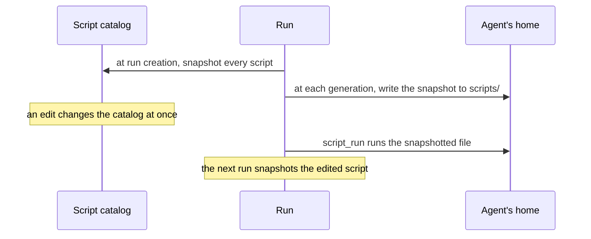

# Scripts

A script is a reusable Python file an [agent](agents.md) keeps. The
agent writes it once, gives it a name and a description, and runs it
again in later runs. Scripting is one of an agent's four
capabilities, next to the [browser](browser.md),
[coding](coding/index.md), and [Memory](memory.md).

Scripts are agent-level [artifacts](artifacts.md). They live in the
database, and each run copies them into the `scripts` folder of the
agent's [home](agent-home.md) on its [machine](machines.md), where
they execute.

## Why it exists

For an agent without coding, running a script is the one way to
execute code. A script turns a task the agent solved once (call an
API, transform a file, compute a figure) into a tool it can call
again, without rewriting the code each time.

A script can also declare parameters. Then it becomes a tool of its
own: the model sees it under its script name, with its arguments,
like any other tool.

A coding agent keeps scripts too, for reusable code. It also has
`shell`, so turning scripting off does not stop it from running
commands.

## How it works

### Five tools

With scripting on, the agent's runs offer five script tools:

- `script_create` writes a script, or replaces one of the same name
- `script_list` lists the agent's scripts and why each exists
- `script_read` reads one script
- `script_run` runs a script with optional arguments
- `script_delete` deletes a script

These tools are bindings when scripting is on. When scripting is off
they are not offered, whatever the bindings say. Scripting itself is a
switch, not a binding.

Each script has a required description. The agent sees its secrets'
names and descriptions in its State snapshot; their values reach a
script only through its environment ([Agent home](agent-home.md#the-environment-of-every-command)).

### Running a script

`script_run` runs the file on the agent's machine, in its home. The
arguments go to the script as JSON on its standard input, `{}` when
there are none. Its output comes back as the tool result.

A script with parameters is also a tool of its own, under its script
name, on new runs. Calling that tool runs the same file with the
tool's arguments.

### Each run keeps its own copy

When a run is created, it takes a snapshot of every script: name,
description, parameters, and source. The run executes that snapshot,
even when someone edits the script during the run. So a run stays
consistent from start to end.

- An edit to a script that is in the run's snapshot takes effect from
  the next run. The agent is told so when it replaces one.
- A script created during the run is not in the snapshot. It still
  runs through `script_run`, using its live source. It becomes a tool
  of its own only from the next run.
- Deleting a script during the run removes it from the snapshot and
  from the agent's home. It stops running at once.
- Listing during a run reads the live catalog, so it can show a newer
  body than the run will execute.

### The script cap

An agent keeps at most a set number of scripts, 10 by default.
Creating a new name past that count is refused. Replacing an existing
name is not. Lowering the cap below the current count is allowed and
only blocks further creates. Applying a recipe that would pass the
count is refused.

## In the app

**State › Scripts**, in the agent's inspector, hidden while scripting
is off. It shows the agent's scripts, one card each:

- the file name, with its version and who wrote it: the run, which
  opens at its step, or the person
- the description
- the source with line numbers and Python highlighting in Solarized
  dark
- a footer naming the sandbox path and the language
- **Edit** reopens the script in the form; **History** lists its
  changes; a script with parameters shows them on demand

**Add script** opens a form with **Name**, **Description**,
**Source**, and **Parameters**. With parameters, the script is also a
tool the agent calls with arguments. **Add script** is disabled once
the agent has as many scripts as its cap. **Remove all scripts**
deletes every script after a confirmation. A script deleted here
leaves the agent's home, with its tool if it had one.

On an agent with scripting off, the view's address shows **This agent
has no scripting**.

In chat, a `script_create` call carries a chip naming the script it
wrote, which opens it.

**Settings**, Model section (**Lead model** on a coding agent): the **scripting** button under **Agent
capabilities** turns it on and off, and **Max scripts** under **Run
limits** sets the cap. The create dialog offers both, with scripting
on by default.

## Rules and limits

| Rule | Value or behaviour |
| --- | --- |
| Default | scripting on |
| Scripts per agent | 10 by default; a new name past the cap is refused, a replace is not |
| Name | lowercase letter first, then lowercase letters, digits, `_`, `-`; up to 63 characters; not `manifest`; not a native or connected tool name |
| Description | required, at most 400 characters |
| Language | Python |
| Timeout | 120 seconds per run of a script |
| Arguments | a JSON object on standard input, `{}` without one |
| Edits during a run | take effect from the next run, for scripts in the run's snapshot |
| Own tool | only on new runs, only for a script with parameters |

## Reference

### Config keys

- `scripting` is whether this agent may keep and run Python scripts.
  Default true. It selects the State's Scripts view and the five
  script tools. Those tools remain bindings when the flag is on. When
  it is off they are not offered, whatever the bindings say. It is not
  itself a binding.
- `max_scripts` is how many reusable Python scripts the agent may
  keep, a positive integer, default 10. `script_create` and pane
  writes of a new name past that count are refused
  (`this agent is limited to N scripts`). A replace of an existing
  name is not. Lowering the cap below the current count is allowed
  and only blocks further creates. Applying a recipe that would pass
  the count is refused.

For an agent without `coding`, `script_run` is the one path that
executes in the sandbox. Turning scripting off removes code
execution. A coding agent keeps its scripts for reusable code, and
turning scripting off does not remove its `shell`.

### Storage

PostgreSQL is canonical for an agent's scripts. Rows live in
`artifacts` with `kind` `script` at agent level (`path` `scripts`,
`key` the script name).

`(owner, name)` is unique. `parameters` is either null or a validated
JSON Schema object (`type` `object`). The source is required and must
hold non-whitespace text. Its `source_hash` is the SHA-256 of the
source.

- `name` matches `^[a-z][a-z0-9_-]{0,62}$`. `manifest` is reserved.
  Creation rejects names that collide with native or connected tool
  names.
- `description` is required, non-blank, and at most 400 characters.

### HTTP

| Route | What it does |
| --- | --- |
| `GET /api/agents/:id/scripts` | every script, with its source and `display_path` |
| `POST /api/agents/:id/scripts` | `name`, `description`, `source`, `parameters`?; creates or replaces; 201 with the script; 422 on a refused write |
| `GET /api/agents/:id/scripts/:name` | one script with its source; 404 when missing |
| `DELETE /api/agents/:id/scripts/:name` | deletes one; 204 |
| `DELETE /api/agents/:id/scripts` | deletes every script; 204 |

Each write publishes `agent.scripts.changed` to the guild, with the
`agent_id`, the `action` (`create`, `delete`, or `clear`), and the
`name` when there is one.

The Scripts pane and `script_list` / `script_read` read the live
catalog. `script_create` writes a row and `script_delete` deletes it.
Live catalog edits affect new runs.

### Snapshot

At run creation the snapshot records every catalog row as
`{id, name, description, parameters, source, source_hash}`.
First-class tool schemas in that snapshot come from rows whose
`parameters` are set. Later generations of the same run keep that
list.

### Materialisation

At generation start, once the machine is up, the orchestrator
materialises `/home/<agent id>/scripts` from the run snapshot, not
from the live catalog
(`apps/orchestrator/src/scripts/materialise.ts`):

1. write each snapshotted source to a sibling temp file through the
   sandbox file API, delete an existing `scripts/<name>.py` if
   present, then move the temp file onto that path (OpenSandbox
   `move_files` refuses to overwrite, and a direct upload truncates in
   place);
2. write live catalog rows whose names are absent from the snapshot
   the same way, so a script created during this run remains callable
   through `script_run`;
3. remove managed files whose names are in neither set.

A snapshotted name always executes the snapshotted source, even when
the live row has since changed. `script_delete` during this run drops
that name from the snapshot and removes `scripts/<name>.py` from the
agent's home. `script_run` and its first-class tool then stop.

A name created after run creation has no frozen schema. It is invoked
only through `script_run`, using the live source.

`script_create` and pane writes update PostgreSQL immediately. They
write through to a running sandbox only for names absent from the
current run's snapshot.

When `script_create` replaces a snapshotted name, its result tells the
model that this run keeps the snapshotted version and the new one runs
from the next run.

### Execution

A script with `parameters = null` is reusable code invoked through
`script_run(name, arguments?)`. A script with a parameter schema is
also offered to the model as a first-class tool under its script name
on new runs.

Both paths run the file through `guilds-script-run`, in the agent's
home, with a 120-second timeout. The arguments (the optional
`arguments` object of `script_run`, or the first-class tool's
arguments) are serialised as JSON into `GUILDS_SCRIPT_ARGS`. An
`arguments` value that is not a JSON object is refused.

The launcher writes that value to the script's stdin, `{}` when
`script_run` has no `arguments`. Stdout and stderr pass through the
standard tool output pipeline.

The command carries the agent's environment like every other command
([Agent home](agent-home.md#environment)). MCP token payloads never
enter it.
