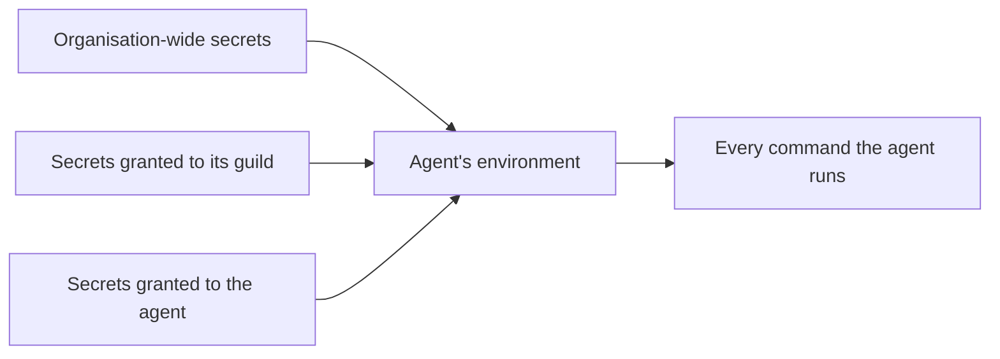

# Secrets

A secret is one private value an organisation keeps, such as an API
key, a password, or a token. It is stored encrypted. The organisation
chooses which agents get it. Those agents find it as an environment
variable on every command they run in their sandbox. The model never
sees the value: it sees only the secret's name and a description of
how to use it.

A secret belongs to its [organisation](organisations.md). It reaches
[agents](agents.md), either one by one, a whole [guild](guilds.md)
at a time, or every agent of the organisation. Who gets each secret
is one of the grants described in [Access](access.md). The commands
that carry secrets run on the agent's [machine](machines.md), next to
the agent's [home](agent-home.md).

## Why it exists

Agents call outside services from their scripts, their shell
commands, and their coding harness. Those services want a key. The
key must reach the command without passing through the model, the
chat, or the logs. A secret does that: the operator types the value
once, the orchestrator keeps it encrypted, and it appears only in the
environment of the commands of the agents it is meant for. Every tool
result has the value blanked out before the model reads it.

## How it works

### One name, one value

A secret's name is the environment variable name, for example
`ACME_API_KEY`. A name is unique in the organisation, so one name is
always one value. Two agents that need different values for the same
service use two names. When a tool insists on reading one fixed
variable name, an [alias](#aliases) points that name at the right
secret.

Each secret has a description. It tells the agents what the value is
and how to use it. The description is what the agent sees.

### Who gets a secret

A secret's access is one of:

- **Organisation**: every agent in the organisation.
- **Guilds**: every agent in each chosen guild, including agents
  added later.
- **Agents**: each chosen agent.
- **Unassigned**: no agent. The secret waits until someone grants it
  or deletes it.

Guild and agent grants add up. An agent's environment is every
organisation-wide secret, every secret granted to its guild, and
every secret granted to it. There is no switch to turn a secret off
for one agent: a secret reaches exactly the agents its access names.



### Aliases

Some tools read a fixed variable name. A coding harness, for example,
reads `CLAUDE_CODE_OAUTH_TOKEN` or `CURSOR_API_KEY`. An alias lets an
agent set that fixed name to the value of a secret with any other
name. With the alias `CLAUDE_CODE_OAUTH_TOKEN` → `TEAM_TOKEN`, the
variable `CLAUDE_CODE_OAUTH_TOKEN` holds the value of the secret
`TEAM_TOKEN`.

Aliases belong to one agent, in its configuration. An alias only
copies a secret the agent already gets. It never widens who gets a
secret. When the secret does not reach the agent, the alias is
absent. An alias wins over a secret that has the alias's own name.

This is how each coding agent runs on its own operator's harness
subscription: each operator's token is a secret of its own name, and
the agent's alias points the harness's variable at it
([Harnesses](coding/harnesses.md)).

### What reaches a sandbox

At the start of each generation, the orchestrator works out the
agent's environment, decrypts the values, and passes them, with the
agent's aliases, to every command it runs for the agent:

- the agent's scripts ([Scripts](scripts.md))
- a coding agent's `shell` commands and what they start
- a coding agent's harness and the commands it runs, less a few
  variables the harness driver removes ([Reference](#run-environment))
- the browser tools ([Browser](browser.md))

Each command also carries the agent's home and port variables
([Agent home](agent-home.md#the-environment-of-every-command)). A
`shell` command whose working folder is inside one of the guild's
repositories also gets `GH_TOKEN`, set to that repository's
installation token ([Repositories](coding/repositories.md)).

The machine's container itself holds no secret. Secrets travel with
each command. So adding, changing, or removing a secret never
replaces a container.

Two processes on the machine get no secret: the operator's terminal
in the CLI tab, and the harness check that the agent's Settings runs
outside a run.

Only secrets enter the sandbox. Logins to connected services, the
GitHub App's private key, and the instance's platform keys stay in
the orchestrator. An agent calls a connected service through the
orchestrator, never with the raw credential.

### When a change takes effect

A generation's environment is fixed when the generation starts. A
generation that is running keeps the values it started with. A
change reaches the agent at its next generation, including the next
generation of a direct run that is already open.

The changes that count are a new value, a new name, a new
description, a new or deleted secret, and a change of who gets it.

### Redaction

The orchestrator replaces every exact secret value in tool results,
log lines, and repository diffs with a marker. Tool results are
redacted before the model reads them or the database stores them.
The same goes for the credentials of the logins the run uses and a
coding run's repository tokens.

Redaction matches exact strings only. A value that a command
transformed, encoded, or split is not caught. A value the model has
already seen stays in the earlier history.

### Agents storing and asking for secrets

An agent can create a secret itself with `secret_store`. A script
writes the value to a file in the agent's home, and `secret_store`
saves it as a secret granted to that agent, then deletes the file.
The value never passes through the model. The agent can store a new
value under a name it stored before. It cannot read a value back,
delete a secret, or share it with anyone else. The new variable is
in its environment from the next generation.

An agent can ask its operator for a secret with `secret_request`.
This works in a direct chat only. The tool stores nothing: it puts a
card in the chat, and the operator types the value there. The value
goes straight to the organisation's secrets and never into the
transcript. In a group chat or a routine, an agent asks with a
message instead.

### Who manages a secret

Every member of the organisation sees each secret's name,
description, who gets it, who added it, and when. Nobody sees a
value.

Organisation owners and admins add, edit, rotate, and delete any
secret. They alone change who gets a secret, and they alone can make
one organisation-wide or leave it unassigned.

A member adds secrets only for guilds they can see and agents in
those guilds. A member edits, rotates, and deletes a secret only when
it is local to them: not organisation-wide, granted to at least one
guild or agent, and granted only to guilds they can see or agents in
them.

### What an operator relies on

- A secret reaches every agent its access names, and no other. An
  alias grants nothing.
- A value leaves the orchestrator only into the commands of the
  agents it reaches.
- While a command runs, any process on its machine can read that
  command's environment and send its secrets out, whichever agent
  the command belongs to. Agents on one machine trust each other, so
  grant narrowly
  ([SEC-24](../architecture/security-register.md#sec-24--agents-on-one-machine-can-read-each-others-homes-tokens-and-sessions)).
  An agent whose secrets must stay apart goes on a machine of its own
  ([Machines](machines.md)).
- The CLI tab is a root shell on the agent's machine. Any member who
  can see the agent's guild can open it. It carries no secret values,
  and it reaches the files and processes of every agent on that
  machine, so it can read the environment of a running command
  ([Agent home](agent-home.md#the-cli-tab)).
- Connection credentials never enter a sandbox.
- Redaction catches exact values only.

The deployment assumptions these rest on are in
[Deployment](../architecture/deployment.md).

## In the app

The same **Secrets** view shows at three places:

- **Settings › Secrets** lists every secret of the organisation,
  unassigned ones included.
- A guild's **Secrets** page lists what reaches its agents: the
  organisation-wide secrets, those granted to the guild, and those
  granted to one of its agents.
- An agent's **Secrets** tab lists exactly that agent's environment.

Each row shows:

- the name
- the description
- who it is available to: **Organisation**, a chip per granted guild
  or agent, **Private guild** for a grant the viewer cannot see, or
  **Unassigned**
- its origin: **Added by** a user, or **Stored by** an agent
- when the value was last rotated

Values never show. The view has no switches.

**Add secret** takes a variable name, a value, a description, and who
gets it. The choice starts on:

- organisation-wide in Settings, for an owner or admin
- the guild in a guild's view
- the agent in an agent's view

A member picks guilds they can see and their agents, and cannot pick
organisation-wide.

A row the viewer may manage offers **Edit**, for the name, the
description, and a new value, and **Delete**. Owners and admins also
change who gets it, with the organisation-wide toggle or the guilds
and agents to tick. Grants in guilds the viewer cannot see stay as
they are.

Every value field has a button that shows the typed value. A note
under the field says when the value has whitespace around it, which
is removed on save, or whitespace inside it, which is kept.

When an agent calls `secret_request`, its chat shows a card with the
variable name, the use, and the reason. The operator provides the
value there, or grants an existing secret to the agent
([Run transcript](run-transcript.md)). The run view labels a
`secret_store` call **Stored NAME** and a `secret_request` call
**Asked for NAME**.

An agent's **Settings** has a **Subscription token** select that
writes the alias its coding harness reads
([Harnesses](coding/harnesses.md)).

On the **Tools** view, `secret_store` and `secret_request` are
grouped as **Secrets**. Like other native tools, they can be
switched off at any scope ([Access](access.md)).

## Rules and limits

| Rule | Value |
| --- | --- |
| Name | An environment variable name, unique in the organisation |
| Description | Required, at most 400 characters |
| Value | Whitespace around it is removed; whitespace inside is kept; only whitespace is refused |
| Who reads metadata | Every member of the organisation; never the value |
| Who changes access | Organisation owners and admins |
| Aliases per agent | At most 32 |
| When a change applies | At the agent's next generation |
| Redaction | Exact values only |
| `secret_store` value file | At most 16 KiB of UTF-8 text, no NUL byte |
| Secrets one agent may create | 20; storing again under its own name does not count |
| `secret_request` | Direct runs only; reason at most 400 characters |
| CLI tab | Carries no secret |

## Reference

### Storage

A secret is encrypted with AES-GCM under `SECRETS_MASTER_KEY` from
the orchestrator's environment. The `secrets` table holds:

- `id`
- `org_id`
- `name`
- `description`
- `org_wide`
- the creator: `created_by_user_id`, or `created_by_agent_id` for a
  value an agent stored
- `ciphertext`
- `nonce`
- `created_at`
- `updated_at`
- `rotated_at`

`name` matches `^[A-Za-z_][A-Za-z0-9_]*$` and is unique in the
organisation (`secrets_org_name_unique`). A value of only whitespace
is 422.

`secret_grants` holds one row per grant: `secret_id`, then exactly one
of `guild_id` or `agent_id`, and `created_at`. A secret names a guild
or an agent at most once. A grant row is deleted with its secret, its
guild, or its agent. An organisation-wide secret has no grant rows:
setting `org_wide` clears them.

An agent's environment resolves in one query: the organisation-wide
secrets, the secrets granted to its guild, and the secrets granted to
it. There are no secret bindings.

Deletion:

- Deleting a guild removes its grants and its agents' grants, and
  deletes every secret whose grants all went with it.
- Deleting an agent deletes every secret granted only to it.
- A secret created unassigned, or whose access an admin emptied,
  stays unassigned until it is granted or deleted.
- Deleting the organisation deletes its secrets.

### HTTP

```text
GET    /api/secrets[?guild_id= | ?agent_id=]
POST   /api/secrets
GET    /api/secrets/:id
PATCH  /api/secrets/:id
PUT    /api/secrets/:id/access
DELETE /api/secrets/:id
```

- `GET /api/secrets` (any member, current organisation) returns
  `{ secrets }`. `?guild_id=` keeps what reaches that guild's agents:
  organisation-wide, granted to the guild, or granted to one of its
  agents. `?agent_id=` keeps exactly that agent's environment.
- `POST` takes
  `{ name, description, value, org_wide?, guild_ids?, agent_ids? }`
  and returns 201 with the metadata. `name`, `description` and
  `value` are strings, `org_wide` a boolean or null, and `guild_ids`
  and `agent_ids` lists of ids or null. A taken name is 409
  `NAME already exists in this organisation`. An unknown guild or
  agent id, or an invalid field, is 422. A member asking for
  organisation-wide or unassigned access, or a grant outside the
  guilds they can see, is 403.
- `PATCH` takes any of `name`, `description`, and `value`; none of
  them is 422. A new value sets `rotated_at`. A taken name is 409.
- `PUT …/access` (owners and admins) takes
  `{ org_wide, guild_ids, agent_ids }` and replaces access. Unless
  `org_wide` is set, grants the caller cannot see stay, since the
  caller cannot name them.
- `DELETE` is 204.

A refused write is 403 inside the secret's organisation and 404
across organisations.

Metadata is
`{ id, name, description, org_wide, grants: [{ kind, id, name }], created_by: { kind: user | agent, id, name } | null, created_at, updated_at, rotated_at, can_manage }`.
A grant in a guild the caller cannot see, either a private guild or
an agent in one, comes back as `{ kind, id: null, name: null }` and
reads **Private guild**. So does a creating agent in such a guild.

The agent payload, `GET /api/agents/:id`, carries `access.secrets`:
the agent's environment as `[{ id, name, description }]`.

### Aliases: `secret_aliases`

`secret_aliases` is an agent configuration key
([Agents](agents.md)). It maps environment variable names to secret
names, default `{}`:
`{ "CLAUDE_CODE_OAUTH_TOKEN": "TEAM_TOKEN" }`.

- Keys and values are variable names, `^[A-Za-z_][A-Za-z0-9_]*$`.
- A value differs from its key.
- The map holds at most 32 entries.
- Any of these broken is 422 on save. A stored map that does not
  validate reads as empty.
- The map is written to the run snapshot and stays fixed for the
  run.

The redaction set holds every aliased value.

### Run environment

Each generation:

1. resolves the agent's environment
2. writes it onto the run snapshot as `[{ id, name, description }]`
3. decrypts the values
4. passes them as environment variables on every command it runs for
   the agent, each named after its secret, with the agent's aliases
   applied

A missing or undecryptable secret fails the generation at start with
the run error `secrets.resolve`.

The State snapshot's `environment` lists each secret's name and
description ([System prompt](system-prompt.md)).

The harness driver removes these variables before it starts a
harness ([Code tools](coding/code-tools.md)):

| Harness | Removed |
| --- | --- |
| every harness | `GH_TOKEN`, `GITHUB_TOKEN` |
| Claude Code | `ANTHROPIC_API_KEY`, `ANTHROPIC_AUTH_TOKEN`, `ANTHROPIC_BASE_URL`, `CLAUDE_CODE_USE_BEDROCK`, `CLAUDE_CODE_USE_VERTEX` |
| Codex | `CODEX_API_KEY`, `OPENAI_API_KEY` |
| Antigravity | `GEMINI_API_KEY`, `GOOGLE_GEMINI_BASE_URL`, `AGY_ADC_AUTH`, `AGY_LLM_GATEWAY_URL`, `AGY_ACCOUNT`, `GOOGLE_CLOUD_QUOTA_PROJECT`, `GOOGLE_CLOUD_LOCATION` |

Each of those would move a harness off its subscription sign-in.

`shell` sets `GH_TOKEN` from `/run/guilds/<agent id>/git-tokens.json`
when its working folder is inside a guild repository, replacing a
secret of that name. MCP token payloads never enter the environment;
they only join run redaction.

Code: `apps/orchestrator/src/access/runtime.ts`, `runtime/guilds-harness`,
`runtime/guilds-code`.

### Re-sync on change

- A change of value, name, or description re-syncs the agents with an
  active run that uses the secret.
- A create, a delete, or an access change re-syncs the agents with an
  active run that gain or lose the secret.
- A `secret_store` call takes the same path: a rotation as a change
  of value, a new secret as an access change for the storing agent.

A re-sync replaces the secret list in those runs' snapshots. It
replaces no container.

### Redaction set

Redaction uses:

- every secret value resolved for the run, aliases included
- the OAuth tokens, API keys, and signing keys of the connected
  catalog logins the run offers tools from
- the platform keys that serve platform connector logins
- a coding run's GitHub installation tokens, once minted
- a value `secret_store` saved during the generation

Every tool result, log line, and repository diff has those strings
replaced with `[REDACTED:<name>]`, the longest values first.

The full `shell` logs and harness event logs that the code tools keep
in the agent's home are stored unredacted. Reading one back with
`file_read` passes through redaction
([Code tools](coding/code-tools.md)).

### `secret_store`

`secret_store { name, description, file }`. The orchestrator reads
`file` from the agent's home, `/home/<agent id>`, under the home file
rules ([Agent home](agent-home.md)). It is offered on every run kind.

| Case | Answer |
| --- | --- |
| a path outside the home, or a link out of it | `file must be a path under <home>, not a link out of it` |
| no such file | `file not found: <file>` |
| not a regular file | `file must be a regular file` |
| over 16 KiB | `file is larger than 16 KiB` |
| invalid UTF-8 | `file must be UTF-8 text` |
| a NUL byte | `file must not contain a NUL byte` |
| only whitespace | `file is empty` |
| a name the organisation holds, not created by this agent alone | `NAME is taken in this organisation; choose another name` |
| a 21st new secret | `this agent already stored 20 secrets; an operator must delete one first` |

A taken name is rotated, with its new description, when this agent
created that secret and is its only grant. Otherwise the tool writes
a new row with the agent as creator and one grant to it. It then
deletes the file and adds the value to the running generation's
redaction set.

It returns `{"stored": NAME, "rotated": bool}` plus the line
`NAME is in your environment from the next generation.`

### `secret_request`

`secret_request { name, description, reason }`. `reason` is at most
400 characters. It is offered on direct runs only. A group or
schedule run asks with `group_post` ([Group chat](group-chat.md)).

It writes nothing. The result is `{"status":"available"}` when the
name is already in this generation's environment. Otherwise it is
`{"widget":"secret_request","name":NAME,"status":"asked"}` plus a line
telling the agent it asked the operator in this chat and to end its
turn. The value the operator types goes to the secrets API, never
into the transcript.
