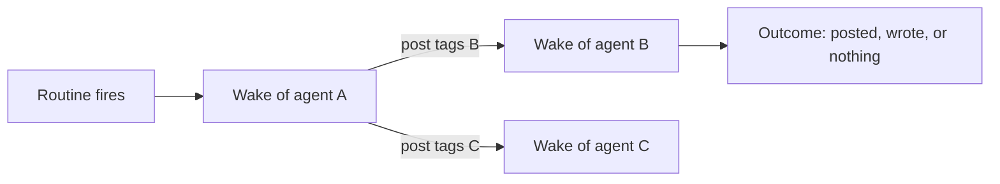

# Studio activity

Studio activity is the picture of what a guild did over a recent
window: which agent woke, what woke it, and what each wake produced.
It lives in **Agents** › **Topology** of a
[Prompt Studio](prompt-studio.md) session, the tab before the guild's
agents.

Activity is built from [runs](runs.md), the [group chat](group-chat.md),
[routines](routines.md), and the files agents changed. It reads stored
data only. It changes nothing.

## When you use it

- Agents wake each other in ways you do not expect, and you want to
  see who woke whom and how often.
- A routine seems to fire for nothing, and you want to see what its
  wakes produced.
- You want to pin one wake and ask the coach about it.

## How it works

### Wakes and chains

A **wake** is one run that was active in the window. It records what
started it, how the message reached the agent, the tools it called,
and what it produced.

Wakes form **chains**. A chain starts at a wake that no other wake in
the window started: a routine firing, an operator message (one chain
even when it woke several agents), a direct chat, or an agent's post
from before the window. It then follows each post to the wakes it
started until none are left.

### Outcomes

Each wake ends in one outcome: it **posted** to the group chat, it
**wrote** records, notes, scripts, or code, or it produced nothing. A
Memory write alone counts as nothing. An error in the window marks the
wake failed.

## In the app

**Topology** shows the activity over a window of 1 h, 6 h, 24 h, 3 d,
or 7 d.

A wake that is still generating is drawn up to now. **Refresh** reads
the activity again.

### Map

**Map** opens with a drawing of who woke whom:

- On the left: every routine of the guild's agents (faded when it did
  not fire), the operator's messages, and direct chats, each beside
  the agent it wakes most.
- Agents sit in columns to the right. An agent mostly woken by other
  agents sits one column past the agent that wakes it most.
- A line means "A woke B", with its count. Grey comes from a routine
  or the operator; blue from an agent's post. It is 1.5 to 9 px wide
  by how often it happened. A line back to an earlier or the same
  column loops under the boxes.
- Hovering a line reads out its wakes by outcome and their cost.
  Clicking a line or a box selects it, the selection is part of the
  URL, and Escape clears it.

Below the map, the **chains** list has one row per chain, newest first,
under day headings. Each row has its start time and what started it,
then each agent it woke with the wake's outcome and duration.
Connectors between them say why the message reached the agent
(tagged, routed, rules, fallback). A post that woke two agents
continues on a branch row, and long chains scroll sideways. Chains
that produced nothing are hidden until the filter is cleared. A map
selection lists only the chains that pass through it, including those
that produced nothing, and highlights the hop in each row.

Clicking the start of a chain opens what it carried: the routine's
timing and instruction with **Open routine**, the operator's message
with **Open group chat**, the direct chat's opening message, or the
earlier post.

Clicking an agent in a chain opens its wake:

- when and for how long, and what woke it
- a strip of counts (tool calls, record and note writes, scripts run
  or changed, issues reported, memory, errors, and the post or reply
  it kept) that points at the matching section
- its tool calls in order with their arguments, durations, and errors
- its side effects, its errors, and its output (each post and whom it
  woke, or its last reply)
- **Open in History** (a tool call, a write, or a post opens its exact
  step) and **Ask the coach**, which pins the wake to the next question

### Per agent

**Per agent** lists each agent's inputs and outputs over the window. An
input is one of its routines (idle ones included), the operator's
messages, another agent's posts, or direct chats. Each shows its
wakes, their reasons, and their outcomes; clicking one lists its
chains in **Map**. The outputs are its group messages and whom they
woke, record writes by collection, note writes, scripts run and
changed, issues reported, wakes that updated memory, wakes with no
output, and errors by message.

## Rules and limits

| Rule | Behaviour |
|---|---|
| Window | 24 hours by default, at most 7 days |
| Tool calls listed per wake | At most 200, with the total |
| Tool call arguments | The first 160 characters |
| Polling | Every 5 s while a wake is generating |
| Writes | None |

## Reference

### Ledger

The server projects the wake ledger from `runs`, `messages`,
`group_messages`, `file_changes`, and `schedules`
(`apps/orchestrator/src/studio/activity.ts`). It writes one row per run
active in the window.

- A group run woke on the latest row, since the same agent's previous
  group run, that tags it. Without a tag, it woke on the latest
  untagged operator row. Otherwise it woke on the snapshot's last row.
  The reason is `tag`, `jev` (the stored Jev Choice picked this
  agent), `rules` (tag rules without a tag), or `fallback` (the Choice
  call failed). The stored Jev decision sits beside it
  ([Group chat](group-chat.md)).
- A routine run starts from its routine. The ledger lists every
  routine with its timing in words and its instruction.
- A direct run is the operator's chat, from its first to its last
  message in the window, with the operator's first message in the
  window.
- The outcome is `posted` (a `group_post` in the window, with its
  tool-call id), `wrote` (record, note, script, or code writes; memory
  does not count), or no output.
- A coding wake's code writes come from its run's `metadata.repos`:
  one write of kind `code` per repository it changed, with the branch,
  files changed, insertions, and deletions. `file_changes` stays the
  ledger of artifacts.
- Errors in the window mark the wake failed.
- Each wake lists its tool calls in the window in order (at most 200,
  with the total). Each call has the first 160 characters of its
  arguments and its result's error and duration. The wake also lists
  the last text the agent wrote.

### HTTP

`GET /api/studio/sessions/:id/activity` takes `hours` (default 24; a
larger value than 168 is capped at 168) and `until` (ISO, default now;
a later value is capped at now). It returns `{ guild_id, since, until,
agents, routines, messages, wakes }`. A non-positive or non-numeric
`hours`, or an `until` that is not a timestamp, is 422.

- A routine carries `label` (its timing in words) and `instruction`.
- A wake carries `tool_calls` (`call_id`, `name`, `arguments`,
  `error`, `duration_ms`, `at`), `tool_call_count`, `reply`, and, for a
  direct chat, `opening`.

### Location and storage

A map selection is part of the session's inspector location:
`section=agents&item=link:<from>><to>` or `section=agents&item=node:<id>` (see
[Prompt Studio](prompt-studio.md#routes-and-location)). The window and
the open view (**Map** or **Per agent**) persist in `localStorage`.

### Code paths

| Path | What it holds |
|---|---|
| `apps/orchestrator/src/studio/activity.ts` | The activity ledger |
| `apps/web/src/features/studio/activity/` | The map, the chains list, and the per-agent view |
