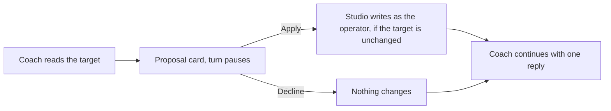

# Studio proposals

A proposal is a change the [Prompt Studio](prompt-studio.md) coach
asks the operator to make to a live guild, outside a Task. The coach
can propose a change to an agent's [Memory](memory.md), a
[note](notes.md), the guild's short description and description, a
[collection](collections.md), a [routine](routines.md), or what one
agent is offered ([access](access.md)). It can also ask for read
access to one login. Task changes are drafts, not proposals: the
operator publishes them from the inspector.

Each proposal shows in the coach chat as a card. The coach writes
nothing. The operator applies or declines each card, and Studio then
writes as the operator.

## Why it exists

The coach diagnoses from evidence, but the operator owns the guild. A
proposal lets the coach name the exact change, with its effect, while
every write stays an operator decision. A proposal also refuses to
apply over a change someone made after the coach read the target, so
nothing is overwritten by accident.

## How it works



1. The coach reads the live target and proposes the complete new
   content, with a reason.
2. The turn pauses. The card shows the live text beside the proposal.
3. The operator applies or declines. Apply refuses when the target
   changed since the coach read it; the card then shows as stale.
4. When one turn proposes several changes, the coach waits until every
   one is applied or declined. Then it continues with one reply that
   lists each decision.

### Login requests

A session starts with no access to outside data. The coach may ask for
read access to one login (a connection to an external service). The
operator grants or declines it from a card, or from **Logins** in the
workspace header. With a grant, the coach may call only that login's
read-only tools, and the grant ends with the session. A login card
counts toward the turn's answers like any other card.

## In the app

### Cards

A card shows the target, its added and removed line counts, and the
base version. While it is pending, it shows the live text beside the
proposal as a diff (one per changed field for the guild's short
description and description). Its apply button and **Decline** each
resolve that one request. A card whose target changed since shows as
stale.

While more than one card of a turn is open, a line under the cards
counts what is left, and **Apply all** and **Decline all** resolve
every open card in turn. **Apply all** is off while any open card is
stale; a refused apply stops the rest. If the coach's reply fails to
send, **Continue** sends it again.

| Proposal | What the card shows | Apply button |
|---|---|---|
| Memory, note edit, guild text | A diff of the live text and the proposal | **Apply edit** |
| New note | Its full text as added lines, and who reads it: the one agent, the guild's agents, or the organisation's | **Create note** |
| Deleted note | Its text as removed lines, and the agents whose Task embeds it (applying fails until none does) | **Delete note** |
| Collection | The collection before and after as text: a header with the owner, the purpose, one line per column, and one per grant | **Create table**, **Delete table**, or **Apply edit** |
| Routine | The routine before and after as text: the agent, the description, the timing in words, whether it is paused, and the instruction | **Create routine**, **Delete routine**, or **Apply edit** |
| Access | The agent's access before and after as text: one line per native tool and file level, and one per connection with a line per connection tool | **Apply edit** |
| Login | The server and its account | **Grant read access** |

Collection, routine, and access cards also list what applying does:

- **Collection**: which columns leave or move, in how many records;
  which stored values stay as they are after a retype; a column that
  becomes required or unique; a renamed collection whose old name
  Tasks still carry; who outside the guild reaches it.
- **Routine**: when the agent wakes; a new instruction reaching later
  wake-ups only; a pause or resume; the next wake-up planned again
  from the apply; the guild's routines being off.
- **Access**: each line says on or off, whether the agent sets it
  itself, and whether a connection tool changes data. The card says
  from which run the change takes effect, and names each connection
  tool it gives back that can change data.

### Logins popover

**Logins** in the workspace header lists every login reachable from
the guild (platform, organisation, guild, and agent logins) and grants
or revokes each one for the session.

## Rules and limits

| Rule | Behaviour |
|---|---|
| Writes by the coach | None; the operator applies each proposal |
| Targets | Memory, notes (create, change, delete), the guild's short description and description, collections (create, change, delete), routines (create, change, delete), one agent's access |
| Never a proposal | Tasks (those are drafts), scripts, records, agent configuration |
| A changed target | Apply is refused (409); the card shows as stale |
| A request | Resolves once |
| Access | Agent-level only; the guild's and the organisation's settings stay as they are |
| Collections of another guild | Read-only in Studio |
| Outside data | Only through a login granted to the session, only its read-only tools; a result is capped at 64 KiB |

## Reference

### Edit requests

`studio_edit_memory(agent_id, content, base_version, reason)`,
`studio_edit_note(action: "edit", display_path, content, base_version,
reason)`, and `studio_edit_guild(about?, description?, reason)` each
take the complete replacement text.

The handler checks reach, the byte cap (and the guild field length
limits), and that `base_version` matches the live version. It writes
nothing. Its result is a `studio_edit_request` widget with
`await_operator`, the target, base and proposed hashes, and line
counts. The proposed text stays in the tool call arguments. The card
reads the live text and the proposal through `GET …/edits/:seq`.

`studio_edit_note` takes notes only. Memory has its own tool.
Tasks, scripts, objects, and records are refused.

Apply re-reads the live content and refuses with 409 when its hash no
longer matches the base. Otherwise it writes as the operator under the
session lock:

- Memory and notes go through `writeMemory` / `writeNote` with the
  expected version, so they produce a memory revision and a
  `file_changes` row that carries the edit tool's call id and name.
- The guild goes through `updateGuild` and refreshes the session's
  `source_guild_snapshot`, so the next turn's system message holds the
  new text. Guild text keeps no content history; its change log
  records who changed which field.

Every change an apply writes, to a file, a table, a routine, access,
or the guild's text, records the session and the sequence of the coach
message that proposed it (`studio_session_id`, `studio_seq`), so its
history links back to the card
([Artifacts](artifacts.md#configuration-change-log)).

The resolution is stored on the tool message as `metadata.edit_status`
(`applied` | `declined`), `edit_resolved_at`, and `edit_version`. A
request resolves only once.

### Note requests

`studio_edit_note(action: "create", level, agent_id?, key, title?,
content, reason)` and `studio_edit_note(action: "delete", display_path,
base_version, reason)` return the same widget with `kind: "note"` and
`action` (`create` or `delete`).

- `level` is `agent` (with `agent_id`, a live member), `guild` (the
  source guild), or `org`. `key` is a `.md` file name with no folders;
  an agent note cannot take `task.md` or `memory.md`.
- A create targets the display path the note will have and binds the
  fact that no note is live there. A note already there is refused with
  a pointer to the `edit` action. Apply writes it as the operator
  through `writeNote`, with an expected version no live note has, so a
  note written meanwhile is a 409 rather than overwritten.
- A delete takes notes of the source guild, its live members, and the
  organisation, and binds the note's content hash. Apply deletes
  through `deleteByDisplayPath`, which refuses with 409 while any Task
  in the organisation embeds the note.

Publishing a Task draft that embeds a note not yet created is refused,
so a note proposed in the same turn is applied first.

### Access requests

`studio_edit_access(agent_id, native_tools?, artifact_grants?,
connections?, connection_tools?, reason)` returns the same widget with
`kind: "access"`. Each map sets one entry to `on`, `off`, or `inherit`:

- `native_tools`: a native tool name. `report_issue` and the browser
  tools are not bindings.
- `artifact_grants`: `read_guild`, `write_guild`, `read_org`, or
  `write_org`.
- `connections`: a connection id the agent resolves; the setting
  applies to that connection's server.
- `connection_tools`: a tool listed on one of the agent's connections.

`on` and `off` write the agent-level binding, keeping the connection a
server binding already names; `inherit` deletes it. A setting the agent
already holds is not a change, and a request that changes nothing is
refused. The widget binds a hash of the agent's resolved access
rendered as text, so a binding moved at any scope since makes the
request stale and apply a 409 (`apps/orchestrator/src/studio/access.ts`).
The browser, coding, scripting, and memory switches are agent
configuration, outside these requests.

### Collection requests

`studio_edit_collection` takes an `action` and returns the same widget
with `kind: "collection"` and that `action`:

- `create(name, purpose, columns, scope?, access?, reason)`
- `edit(collection, base_updated_at, name?, purpose?, columns?,
  access?, reason)`
- `delete(collection, reason)`


- `scope` is `guild` (the default: the source guild owns the
  collection) or `org`.
- `columns` follows the column dialect of
  [Collections](collections.md). On an edit it is the complete list. A
  renamed column carries `rename_from`.
- `access` changes only the subjects it names: `guild` (`read`,
  `write`, or `none`, organisation collections only) and `agents`
  (`{ agent_id, mode }` with `read`, `write`, `none`, or `inherit`,
  which removes the agent's own row). Those subjects are the source
  guild and its live members. Grants outside the source guild are
  shown and never changed.
- An edit must carry the `updated_at` the coach read and change
  something. A name already taken is refused. A collection of another
  guild is refused with 422.

The widget targets the collection by id (null until a create is
applied) and binds a hash of its name, purpose, scope, columns, and
source-guild access. Apply re-reads the collection by id and refuses
with 409 when the hash no longer matches. Then it writes as the
operator through the artifact store: create, update, or delete the
collection, then each grant it changes.

### Routine requests

`studio_edit_routine` takes an `action` and returns the same widget
with `kind: "routine"` and that `action`:

- `create(agent_id, cron? | window?, description, instruction,
  paused?, reason)`
- `edit(schedule_id, cron? | window?, description?, instruction?,
  paused?, reason)`
- `delete(schedule_id, reason)`


- `agent_id` names a live member of the source guild. `schedule_id`
  names a routine of one, from `studio_list_routines`.
- `cron` and `window` follow the timing rules of
  [Routines](routines.md); a request passes at most one. A create
  needs one, and an edit that passes one replaces the timing.
- A field an edit leaves out keeps its live value. An edit that
  changes nothing is refused.
- A create with `paused: true` starts paused.

The widget targets the routine by `schedule_id` (null until a create
is applied) and binds a hash of its agent, timing, description,
instruction, and pause. A fire moves the planned wake-up, not that
hash. Apply reviews the routine again and refuses with 409 when the
hash no longer matches. Then it writes as the operator through the
schedule service: create, `Schedules.update`, or delete
(`apps/orchestrator/src/studio/routines.ts`). The apply publishes
`agent.routines.changed` on the guild's stream.

### Connection grants

The coach asks with
`studio_request_connection_access(connection_id, reason)`. The tool
result is a `studio_connection_access` widget with `await_operator`,
so the generation pauses. The card's answer goes into the turn's one
continuation message.

`studio_call_connection_tool(connection_id, tool, arguments)` proxies
one call through the orchestrator's MCP pool on a granted, connected
login. The tool must be listed on that connection and pass
`isReadOnlyRemote` (`apps/orchestrator/src/mcp/policy.ts`):

- default-off tools are refused
- a tool the connector's manifest lists is readable unless it is
  `mutating`
- a listed tool marked `readOnlyHint` is readable on a verified
  connector; on any other the hint does not count
- any other tool is classified by the verbs in its name

The result is redacted against that connection's stored credentials,
capped at 64 KiB, and wrapped as untrusted evidence.

Grants live on `studio_sessions.granted_connection_ids` and end with
the session.

### HTTP

```text
GET    /api/studio/sessions/:id/edits/:seq
POST   /api/studio/sessions/:id/edits/:seq          { decision: "apply" | "decline" }
GET    /api/studio/sessions/:id/connections
PUT    /api/studio/sessions/:id/connections/:connection_id   { granted: true | false }
```

- `GET …/edits/:seq` returns the live text and the proposal of the
  request at that message.
- `POST …/edits/:seq` resolves it. Another `decision` is 422; a stale
  target is 409.
- `GET …/connections` lists every login reachable from the source
  guild: platform, organisation, guild, and live-member scope.
- `PUT …/connections/:connection_id` grants or revokes one. The
  connection must be reachable from the source guild and `connected`.

### Storage

An edit request is a `studio_messages` tool row whose resolution is in
its metadata.

### Code paths

| Path | What it holds |
|---|---|
| `apps/orchestrator/src/studio/edits.ts` | Edit, note, and guild requests: review and apply |
| `apps/orchestrator/src/studio/access.ts` | Access requests |
| `apps/orchestrator/src/studio/tables.ts` | Collection requests and collection evidence |
| `apps/orchestrator/src/studio/routines.ts` | Routine requests |
| `apps/orchestrator/src/studio/connections.ts` | Connection grants and the read-only proxy |
| `apps/orchestrator/src/mcp/policy.ts` | `isReadOnlyRemote` |
| `apps/web/src/features/studio/StudioChat.tsx`, `chatModel.ts` | The cards |
