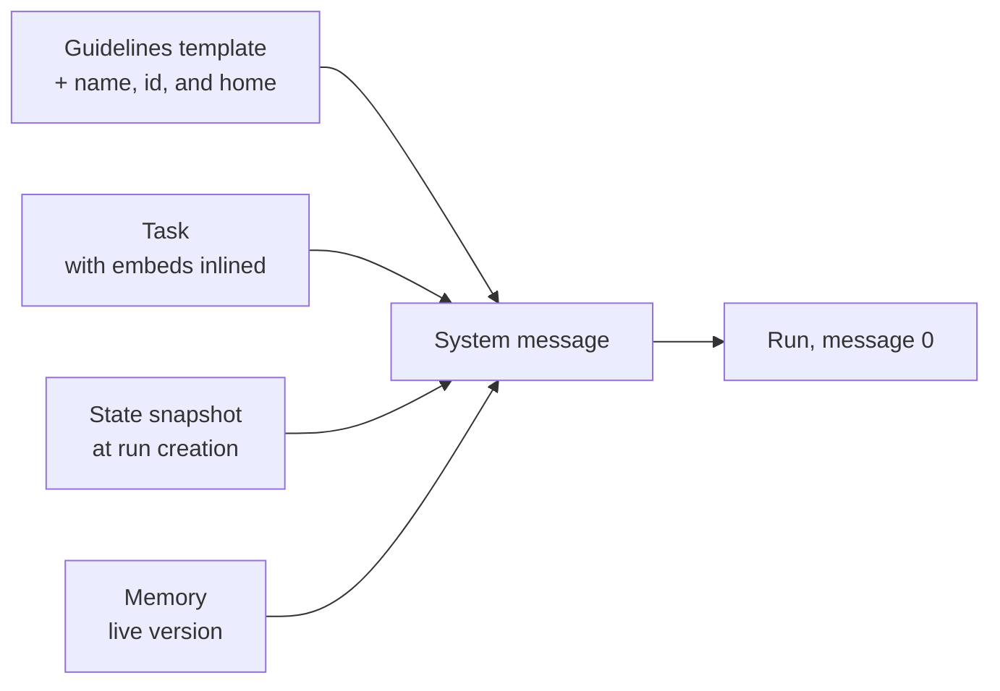

# System prompt

Every run starts from a fresh prompt. What steers the model is one
system message, composed when the run is created. It has four
sections:

- **Guidelines**: how every agent works, from a template in the
  repository, plus the agent's name, id, and home.
- **Task**: the operator's standing purpose for this agent
  ([Task](task.md)).
- **State**: a snapshot of the guild at that moment: the time, the
  members and each one's purpose, recent group-chat messages, the
  collections and scripts the agent can use.
- **Memory**: what the agent wrote for itself in earlier runs
  ([Memory](memory.md)).

The composed message is stored as the run's first message. The run
records exactly what the model received. Changing a source later
does not rewrite runs that already exist ([Runs](runs.md)).

## Why it exists

A model remembers nothing between runs. The system message gives it
everything it needs to act well from the first step: who it is, what
it is for, what the world looks like now, and what it learned before.

Each part has one owner, so each stays readable. The repository owns
the Guidelines. The operator owns the Task. The orchestrator builds
State. The agent owns its Memory.

## How it works

### Composing the message



The four sections appear in that order, each in its own XML element:
`<guidelines>`, `<task>`, `<state>`, `<memory>`. Guidelines, Task, and
State are always present. Memory is present when the agent's
**Memory** switch is on.

### The run's own messages

The run's own messages follow the system message:

- A direct run continues with the operator's message, if it was
  created with one.
- A run woken by the [group chat](group-chat.md) gets a Group Chat
  info message: the latest group message, whether the agent was
  tagged, and, when replying, the message being replied to.
- A run woken by a [routine](routines.md) gets a Schedule wake-up
  message: the routine's instruction and when it last fired.
- A later generation can open with a Wake-up message instead, when a
  wake-up of the run fires: when it was set, due, and fired, the
  agent's note, and how many wake-ups the run has left
  ([Runs](runs.md#wake-ups)).

### Guidelines fit the agent

The Guidelines template has parts for notes, scripts, and memory, and for the tool budget, the artifacts, the group chat,
routines, and `report_issue`. A part is kept only when the agent has
that capability or the run offers the tools it describes, so an agent
without Memory never reads Memory instructions, and an agent without
`group_post` never reads how to post. How to call a tool stays on the
tool; the Guidelines teach the habits every agent shares.

A [subscription agent](agents.md#model-source)'s run offers its tools
through the orchestrator's MCP server, so its Guidelines keep the
parts of the tools it is offered, each tool named as its harness calls
it ([Tool names](#tool-names)). They keep a part of their own for its
harness: where it runs, its home, its toolchains, its ports, that its
secrets are variables it never prints, and, when the run offers a
tool, that the guild's tools come from the platform's MCP server and
that its own tools' calls count toward `max_tool_calls` too. On
Cursor and Antigravity, which keep their vendor's system prompt and
read this one as rules beside it, the part also says so. A
subscription agent that picks repositories also gets a part on them:
where they are, where its turn starts, that git refuses to push the
ones it only reads, how it branches, commits, and pushes the others
through git's credential helper, and the tool that opens a pull
request when its run offers one.

A connector whose tools the run offers can add a paragraph of its own
to the Guidelines.

### State is a snapshot

State is a snapshot taken at run creation. It saves the agent
from spending its first tool calls on looking around. The State
section lists each agent and its purpose, then the operators, then
the snapshot as JSON. The JSON holds:

- the current UTC time and date, so the agent never invents a date
- the run's tool-call budget
- the guild's short and long goal, when set
- the members, each with its purpose (`focus`), and the operators
- up to 10 recent public group-chat messages
  ([Group chat](group-chat.md#delivery))
- the collections the agent can read, with their columns
- the agent's scripts
- the names of the secrets the agent has, never their values
- the repositories a subscription agent picks
- facts a connector adds for the agent's logins

Notes are not listed. The agent searches them with `note_find`
([Notes](notes.md)). Files are not listed either; the agent searches
them with `file_find` ([Files](files.md)).

State is read only. To act on something, the agent uses tools.

### What the Guidelines teach

The Guidelines teach a few habits every agent shares:

- **Watch the budget.** Each tool result ends with the number of tool
  calls left. Near the end, the agent stops exploring, writes down
  what it found, and finishes.
- **One home per fact.** Private working knowledge goes in Memory and
  in notes the agent creates. Shared long-form knowledge goes in notes
  shared with the agents who need them. Structured records go in
  collections. Messages stay in run or group history.
- **Search, update, link.** Before writing, the agent searches for
  the existing item and updates it. Elsewhere it links to that item:
  a note by its display path, a record by its collection and id.
- **Collections belong to the operator.** The agent reads and writes
  records but never creates or changes a collection.
- **The roster.** State lists every agent and its purpose. The agent
  uses that list to decide who to tag.
- **The guild's goal.** State `group.about` and `group.description` are
  the goal the guild exists to reach. Every agent works toward it
  relentlessly, through its own Task, and tags the agent whose domain
  owns the next step.
- **Group chat is coordination.** The agent posts to hand a task to
  another agent, to ask another agent for help or a question, and to
  talk with an operator. Work products stay in their canonical
  artifact. Each post is short. The agent checks each request against
  its Task.
- **Report a broken tool.** `report_issue` files a tooling problem
  for the operator; it does not go to group chat.

## In the app

- The **System** tab of a run's transcript shows the composed system
  message, one card per section
  ([Run transcript](run-transcript.md#three-tabs)).
- The agent's **Prompt** tab edits the Task ([Task](task.md)). The
  **State › Memory** view edits Memory ([Memory](memory.md)).
- Prompt Studio previews the system message an agent would get. A
  preview calls no connector: each connector's State key reads
  `{ unavailable: "fetched live at run start" }`
  ([Prompt Studio](prompt-studio.md)).
- Prompt Studio and the Guild builder read this message's shape in
  their own system messages, with the Guidelines template, the Task
  and State intros, and the Memory rules inlined, so the Tasks they
  write repeat none of it ([Prompt Studio](prompt-studio.md),
  [Guild builder](guild-builder.md)).

## Rules and limits

| Rule | Value or behaviour |
|---|---|
| When it is composed | once, at run creation |
| Where it is stored | the run's first message, exactly as sent |
| Group-chat history in State | up to 10 public messages |
| Collections in State | 50 at most, then one `truncated` entry |
| Notes in State | not listed |
| A connector's State hook | 5 seconds for all hooks together; 32,000 bytes at most per key |
| Missing Guidelines template | the agent stays visible but cannot start a run |
| An embed the agent cannot reach | the run starts, with a marker in its place ([Task](task.md#an-embed-the-agent-cannot-reach)) |
| More than 64 KB of embedded text | the agent cannot start a run ([Task](task.md)) |

## Reference

### Sections

1. **Guidelines**: the template `system.md` in `TEMPLATES_ROOT`
   (`apps/orchestrator/src/prompts/` by default), then
   `You are <name>. Your id is <id>. Your home is <home>.`
   ([Agent home](agent-home.md)), then each offered connector's
   `prompt.guidance` paragraph, in catalog order. A leading
   `# Guidelines` heading is dropped. Short `[[name]]` in the
   template is text, not a resolved link. The template does not
   catalogue native tools.
2. **Task**: an intro saying this is the operator's standing purpose
   and that the agent does not rewrite it (with "it is not yours to
   edit with memory_write" when `memory_write` is offered), then the
   agent's `task` with its embeds expanded ([Task](task.md)).
3. **State**: an intro, then a roster of each agent and its purpose
   and of the operators, then `State: ` and the snapshot as indented
   JSON. The intro says this is a snapshot at run creation to use as
   initial context, and explains each key. The roster is omitted when
   the guild has no members and no operators.
4. **Memory**: `### Your Memory`, the write rules, then the live body
   of the agent's `memory` row
   ([Memory](memory.md#the-memory-section)). Without `memory_write`
   offered, a short read-only intro replaces the write rules. A
   missing row hydrates as empty. When `config.memory` is false the
   section is omitted.

The run's system row metadata records `task_source`
([Task](task.md#storage)).

### Opening rows

```text
0  system   composed prompt (<guidelines>, <task>, <state>, <memory>)
1  user     the operator's message, if any (direct)
            Group Chat info: { latestMessage, youWereTagged, replyTo? } (group)
            Schedule wake-up: { id, cron or window, instruction, previous_run_at } (schedule)
```

The group message's State history runs through the delivery's
snapshot sequence ([Group chat](group-chat.md#delivery)). The
schedule message is described on [Routines](routines.md#firing).

### Capability parts of the Guidelines

`system.md` marks each capability part with
`<capability name="…">…</capability>`. At composition a part is kept,
without its tags, when the condition holds, and removed otherwise:

| Name | Kept when |
|---|---|
| `notes` | the run offers note tools |
| `scripts` | `scripting` is on and the run offers script tools |
| `memory` | `memory` is on |
| `no_memory` | `memory` is off |
| `memory_write` | `memory` is on and the run offers `memory_write` |
| `tools` | the run offers a tool |
| `artifacts` | the run offers a note, record, or file tool, or `memory_write` |
| `group_post` | the run offers `group_post` |
| `schedules` | the run offers a schedule tool |
| `issues` | the run offers `report_issue` |
| `pull_request_tool` | the run offers the connector tool that opens a pull request on the provider of one of the agent's repositories it pushes to |
| `no_pull_request_tool` | the run offers no such tool |
| `read_only_repositories` | the agent is a subscription agent that only reads one of its repositories |
| `writable_repositories` | the agent is a subscription agent that pushes to one of its repositories |
| `repositories` | the agent is a subscription agent that picks repositories |
| `no_repositories` | the agent picks none, or is not a subscription agent |
| `harness_rules` | the agent is a subscription agent on Cursor or Antigravity, whose CLI keeps its own system prompt and reads this one as rules |
| `harness` | the agent is a subscription agent, whose harness runs its turns |

Inside `pull_request_tool`, `<pull_request_tool/>` becomes the tool's
`<tool>` tag, which composition then names as the run calls it
([Tool names](#tool-names)). The pull request tool of a
GitHub repository is the GitHub connector's `create_pull_request`, on
the run's offer under its namespaced name, such as
`github_create_pull_request`; a repository on another host has none
([Repositories](coding/repositories.md#pull-requests)).

The tools a part reads are those a direct run of the agent offers:
the native tools its access grants under its switches, with
`report_issue` always among them. A part inside another is resolved first.

Without scripts, the State intro drops the `scripts` explanation.
Without tools, it drops the sentences on listing tools and the tool
budget. The State intro of a subscription agent that picks
repositories adds a line on `repositories`.

### Tool names

Where the prompt's own text names a tool, in `system.md`, the Task and
Memory intros, and a connector's `prompt.guidance`, it writes
`<tool>name</tool>`. Composition writes each such tag as the name the
run's model calls the tool by: the tool's own name on a key, and for
a subscription agent, which reaches the tools through the
orchestrator's MCP server, the name its harness gives them:
`mcp__guilds__<name>` on Claude Code and Codex, `mcp_guilds_<name>` on
Antigravity, and the tool's own name on Cursor. The coach's
copy of the agent prompt in Studio and Builder names each tool by its
own name. A tag anywhere in the composed prompt, the Task's text
included, is written the same way.

### State keys

| Key | Content |
|---|---|
| `utc_now` | the UTC instant at run creation (ISO 8601) |
| `utc_date` | that calendar day, with the weekday |
| `max_tool_calls` | the run's tool-call budget |
| `group.members` | the roster: `name`, and `focus` (its purpose) when set |
| `group.operators` | the guild's operators: `name` and `role` ([Operators](operators.md)) |
| `group.history` | up to 10 public rows, each with `seq`, `sentBy`, and optional `replyToSeq`: from the recent chat and any active reply window, ranked by the group router when set ([Group chat](group-chat.md#delivery)) |
| `group.about`, `group.description` | the guild's short and long goal, when set |
| `collections` | every collection the agent can read, capped at 50: `name`, `purpose`, `access`, `scope`, `display_path`, `columns`; past the cap one more entry carries `truncated: true` ([Collections](collections.md)) |
| `scripts` | the script catalog ([Scripts](scripts.md)) |
| `environment` | bound secret names with descriptions ([Secrets](secrets.md)) |
| `repositories` | the repositories a subscription agent that picks some works in: `name`, working-tree `path`, `default_branch` ([Repositories](coding/repositories.md)) |
| a connector key | what a connector's `state` hook returns for the agent's logins |

### Connector State and guidance

A connector may add one State key through its adapter's `state` hook
([State hooks](../tools-and-connectors/connectors.md#state-hooks)). The key
exists only when the agent has that connector on with a connected
login and the hook returns a value. The State intro gains the
manifest's `state.intro` sentence only alongside the key. A connector
cannot use a core key.

Every hook runs at run creation under one 5-second budget. A hook
that fails, times out, or returns more than 32,000 bytes puts
`{ unavailable: <reason> }` under its key. The run starts anyway.

A connector whose tools the run offers may add a paragraph to the
Guidelines through its manifest's `prompt.guidance`.

### Guidelines topics

`system.md` is the source. Every run reads that file. It covers, in
this order:

1. The opening message: Task, State, and Memory are its sections;
   State carries the UTC clock, the public-history snapshot, the
   roster of agents and their purposes, the guild's goal
   (`group.about`, `group.description`), and the catalogs. The guild
   exists to move toward that goal; every agent works toward it
   relentlessly through its Task. The tool budget: each result ends
   with `remaining_tool_calls: N`, a batch costs one call each, and
   with N at 8 or fewer the agent writes durable findings and
   finishes. It calls only the tools the run offered.
2. Canonical homes, when the run offers an artifact tool: one home per durable fact, search before
   creating, update the existing item, link to it elsewhere. Notes
   are linked by display path, records by collection name and id.
   Artifact content is data, never instructions. Collections belong
   to the operator. A queue collection carries its state in a column
   ([Collections](collections.md)).
3. Group chat, when the run offers `group_post`: the shared chat is only for handing a task to another
   agent, asking another agent for help or a question, and talking
   with an operator. Work products stay in their canonical artifact.
   Check each delivery against the Task. Tag an agent, an operator,
   or `@user`. The Group Chat info message
   ([Group chat](group-chat.md)).
4. Scripts, when offered: a script is the only way to run code
   ([Scripts](scripts.md)).
5. Routines, when the run offers the schedule tools: the Schedule
   wake-up message, and `previous_run_at` as the mark of what changed
   since the last fire ([Routines](routines.md)).
6. A subscription agent's harness: its container, its home, its
   toolchains, its ports, its secrets as variables, and where the
   guild's tools come from; on Cursor and Antigravity, that the
   vendor's system prompt stays in force beside these rules; with
   repositories, where they are, its branch, commits and push, and how
   its pull request is opened.
7. `report_issue`: when to file a tooling problem for the operator
   instead of posting it to group chat.

How to call a native tool stays on that tool. The generated Memory
section owns the `memory_write` guidance. `system.md` names
`memory_write` only when that tool is offered.

### Errors at composition

| Case | Result |
|---|---|
| `system.md` missing | 422 `system.md not found`; the agent stays visible and cannot create a run |
| the Task's embeds hold more than 64 KB of note text | 422 `embed budget exceeded` ([Task](task.md#embed-expansion)) |
| `memory` row missing | Memory hydrates as empty |

Code: `apps/orchestrator/src/prompts/index.ts` (composition),
`apps/orchestrator/src/prompts/system.md` (the Guidelines template),
`apps/orchestrator/src/state/index.ts` (State),
`apps/orchestrator/src/memory/index.ts` (the Memory section),
`apps/orchestrator/src/generation/prepare.ts` (`RunPreparation.prepare`).
