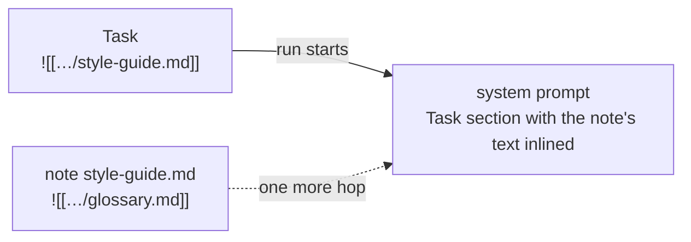

# Task

The Task is the operator's standing purpose for one agent. It says
what the agent is for and how it should work: its role, its rules,
what good output looks like. Every run of the agent carries the Task
in its [system prompt](system-prompt.md).

Only the operator writes the Task. The agent reads it and follows it,
but never changes it. What the agent learns on its own goes to its
[Memory](memory.md) and its [notes](notes.md). Keeping the two apart
makes both easy to read: the Task is what the operator asked, Memory
is what the agent chose to remember.

## When you use it

- You create an agent and describe its job.
- You change how the agent works: a new rule, a new output format, a
  different priority.
- You want a long rule set, or a shared one, in every run: you write
  it in a [note](notes.md) and embed the note in the Task.

The Task is standing guidance. It is not a question for the agent to
answer, and it is not a reason for the agent to post in
[group chat](group-chat.md).

## How it works

### Where it comes from

A new agent's Task starts from the focus given when it was created.
Without a focus, it starts from a short repository template that asks
the agent to assist the user and collaborate with the guild members.

The orchestrator reads the Task when a run is created and puts it in
the `<task>` section of the system prompt. Changing the Task does not
change runs that already exist.

Every save keeps the previous text as a version. The operator can
look at any earlier version and restore it.

### Embeds

An embed pulls a note into the Task when a run starts. It is written
`![[display-path]]`, where the display path names a note
([Artifacts](artifacts.md)).



- The note's text replaces the embed, inside an element named after
  the note, so the agent sees where it came from.
- Embeds inside that note are inlined too, one more hop. Embeds
  deeper than that stay as text.
- An embed of a [collection](collections.md) becomes the collection's
  name. Its records are not inlined.
- The same note embedded twice is inlined once. Later embeds of it
  become its title.
- An embed is resolved as the agent. A note or collection is
  inlined only when its access list gives the agent, its guild, or
  the organisation `read` or `write`
  ([Access](access.md#access-lists-for-notes-and-collections)).
- An embed the agent cannot reach is replaced by a short marker that
  names the path and says the file is not reachable. The run starts,
  and the agent can report the link.

A short `[[name]]` in prose is plain text. It is not an embed and is
never rewritten. A file name, or a line like "inlined from: …", is
not an embed either.

A display path written in the text without `![[…]]` names that file
without embedding it. The run gets the path, not the file's text.
Prompt Studio's **References** view draws each named file beside the
embeds ([Prompt Studio](prompt-studio.md#state)).

Prompt Studio and the [Guild builder](guild-builder.md) put durable
rules in notes the operator can inspect, and embed them in the Task
only with `![[display-path]]`. Both write a Task to one shape: an
opening line, then Inputs, Work, Outputs, and Files, in headings and
bullets, about 300 words, with nothing the agent's Guidelines, State,
or Memory section already say.

### An embed the agent cannot reach

An embed reaches a file when it names a live note or collection that
the agent can read. The agent cannot tell a missing file from one it
cannot read, so every other embed is handled the same way: the run
starts, and the marker takes the embed's place. The app marks the
link in three places (see below).

A note that a live Task embeds cannot be deleted. The check reads
Task text only, so an embed can still stop reaching a file:

- the note's access list does not give the agent, its guild, or the
  organisation `read` or `write`;
- a note embeds another note, and that note is deleted;
- the path names something that is not a note or collection, such as
  Memory or a record;
- the link is not a display path, such as a leftover `recipe:` link or
  a path without its `org/<org_id>/` start.

A Task whose embeds hold more than 64 KB of note text cannot start a
run until the embeds are cut down.

Prompt Studio's **References** view shows each of these, at the hop
where the agent's run meets it ([Prompt Studio](prompt-studio.md#state)).

## In the app

The agent's **Prompt** tab edits the Task.

- The editor has **Edit** and **Preview** modes. The tab opens in
  Preview; double-clicking the text switches to Edit. Save, or
  Cmd/Ctrl+S, writes the Task. **Discard** drops the edits.
- **Insert › Note** and **Insert › Table** open a picker and insert
  the chosen note or collection at the cursor as `![[display-path]]`.
  A collection chip shows the collection's name. Clicking an embed
  opens a preview of it.
- An embed the agent cannot reach is marked. A banner, **The Task
  embeds files this agent can't reach**, names each one.
- The **Version** picker lists the live version and every earlier one,
  with when it was replaced and by whom. An earlier version shows as
  **Text** or **Compare with live**. **Restore v*N*** makes it the
  live Task again, as a new version.
- When another save lands while you edit, your text is kept and a
  banner offers **Compare**, **Keep mine**, and **Use theirs**.
- A provenance strip says who changed the Task last
  ([Artifacts](artifacts.md#every-change-is-recorded)).
- Leaving with unsaved edits asks first.

An embed the agent cannot reach is also marked on the agent's row in
the sidebar and in the agent inspector's header (**Not reachable from
the Task**).

Prompt Studio drafts Task changes for the operator to review and
publish ([Prompt Studio](prompt-studio.md)).

The **System** tab of a run's transcript shows the Task as it was at
run creation, embeds inlined
([Run transcript](run-transcript.md#three-tabs)).

## Rules and limits

| Rule | Value or behaviour |
|---|---|
| Who writes the Task | operators only; agents never |
| Size | 256 KB |
| Earlier versions kept | 50 |
| Saving the same text | nothing changes, no version is added |
| Embed depth | the Task's embeds and one more hop |
| Embedded text per run | 64 KB in total |
| An embed the agent cannot reach | the run starts with a marker in its place |
| More than 64 KB of embedded text | the agent cannot start a run |
| Deleting a note a live Task embeds | refused |
| Deleting `task.md` | refused |

## Reference

### Storage

The live Task is on the agent row: `agents.task`, with `task_version`,
`task_hash`, and `task_updated_at`. It is not an artifact. Its display
path, `org/<org_id>/agents/<agent_id>/task.md`, is virtual.

Each save that changes the text archives the previous text to
`task_revisions` (`version`, `content_text`, `replaced_at`,
`replaced_by_type`, `replaced_by_id`, `replaced_by_name`), keeping the
newest 50. An empty previous text is not archived. Each save appends
a `file_changes` row ([Artifacts](artifacts.md#file-provenance)).

A new agent's Task is its focus, or the template
`apps/orchestrator/src/prompts/task.md`.

The run's system row metadata records `task_source`: the Task's
`version`, `hash`, and `display_path`, `has_embeds`, `embeds`, each
note the run inlines with its `display_path`, `version`,
`content_hash`, and `kind`, and `collections`, the display path of
each collection the agent can read that the Task embeds directly or
through a note it inlines. The run row's `metadata` holds
the same `task_source`.

### Embed expansion

`apps/orchestrator/src/artifacts/embeds.ts` expands embeds at run
creation:

- The load is as the agent, so the note's access list decides what
  is inlined. Depth is 2. The budget is 64 KB of embedded note text in
  total.
- Each note body is wrapped in an element named after its file name
  without `.md`, reduced to letters, digits, `_`, and `-`, with
  `path` and `level` attributes:

  ```text
  <style-guide path="org/o_…/guilds/guild_…/style-guide.md" level="guild">
  …note text…
  </style-guide>
  ```

- A name that would clash with a prompt section (`guidelines`,
  `task`, `state`, `memory`) or with the marker (`unreachable`), or
  cannot open an element, is prefixed `note-`. An empty name becomes
  `note`.
- A collection path the agent can read becomes the collection name.
- A path already inlined becomes the note's title (or its key
  without `.md`).
- Any other embed becomes the marker, with the path escaped:

  ```text
  <unreachable path="org/o_…/guilds/guild_…/style-guide.md" message="This file is not reachable." />
  ```

  This covers a path that is missing, deleted, out of the agent's
  reach, not a display path, or not a note or collection.

A run is refused with 422 `embed budget exceeded` when the embeds hold
more than 64 KB of note text.

Deleting a note that a live Task embeds is 409
`note is embedded in task (<agent ids>)`.

Recipes write embeds in a recipe-local form, `![[guild/…]]`,
`![[org/…]]`, or `![[agent/<role>/…]]`, which apply rewrites into
display paths ([Recipe format](recipe-format.md),
[Applying recipes](applying-recipes.md)). A live Task that still
holds a `recipe:` link or a missing file shows as not reachable.

### HTTP

```text
GET  /api/agents/:agent_id/files/task.md      { path, display_path, content, version, revisions }
PUT  /api/agents/:agent_id/files/task.md      { content, expected_version? }
GET  /api/guilds/:guild_id/embed-status       { agents: [{ id, broken_embeds }] }
GET  /api/org/embeddable-notes                the notes the Insert picker offers
```

- `revisions` lists the earlier versions newest first:
  `{ version, content, replaced_at, replaced_by_name }`.
- A `PUT` whose `expected_version` is not the live version is 409
  `version conflict`. A non-integer `expected_version` is 422.
- A write that does not come from an operator is 422
  `task is not writable`. More than 256 KB is 422
  `write exceeds 256 KB`.
- `DELETE` on `task.md` is 422 `cannot delete this file`.
- `broken_embeds` lists each embed of the agent's Task, and of the
  notes its run inlines, that the run replaces with the marker. The
  check is made as that agent, so it includes the files the agent's
  access lists keep it from.
