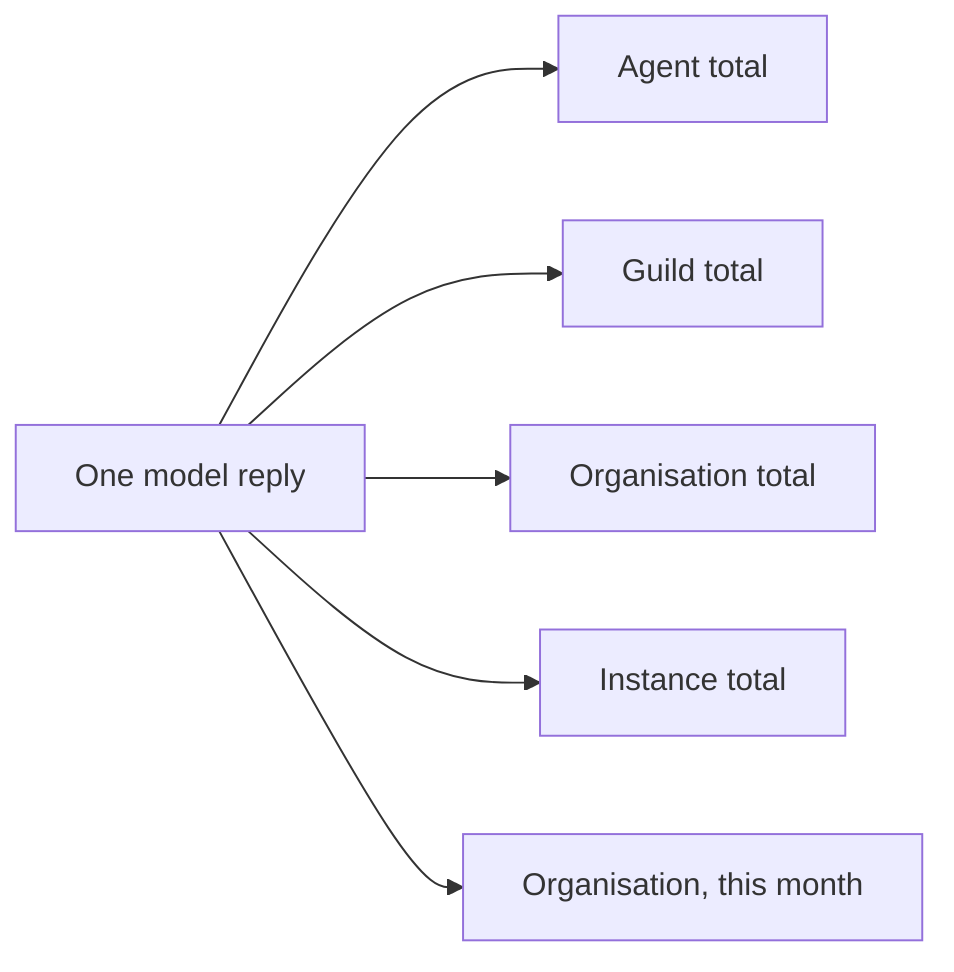

# Usage

Usage is what the model calls of a guild's agents have consumed:
tokens, cost in US dollars, and the number of calls. Every model reply
in a [run](runs.md) records its own tokens and cost. Those numbers are
also added to running totals for the [agent](agents.md), its
[guild](guilds.md), its [organisation](organisations.md), and the
whole instance.

Usage is a record, not a budget. Core never stops a run because of
what it costs. Who pays for a call is the concern of the model
credentials an extension plugs in ([Model keys](model-keys.md)).

## Why it exists

Agents call models on their own, many times a day. The operator needs
to see what each agent costs, which guild spends the most, and what
the organisation spent this month.

## How it works

### Cost of one reply

Each model reply stores its token counts: input, output, and cache
reads (the part of the input the provider served from its cache). Its
cost comes from the provider when the provider reports one. Otherwise
it is computed from the model catalog's prices, with cache reads at
the cache-read rate. A model with no catalog price records a cost of
0, marked unavailable. A provider that is not billed, such as a local
endpoint or Kimi Code, has no catalog price.

### Running totals

Each reply with usage adds to five totals at once:

The totals count since each scope was created. Deleting an agent drops
its own total; its guild, organisation, and instance totals keep what
it spent. Deleting a guild drops the guild's total and its agents';
the organisation and instance totals keep them.

Model calls of the [Prompt Studio](prompt-studio.md) coach and of the
[Guild builder](guild-builder.md) belong to no agent. They count in the
organisation, monthly, and instance totals only. The Studio coach
and the Builder each show as a row of their own.

### For extensions

After every model completion, core reports the run, the model, the
tokens, the cost, and where the cost came from to the model
credentials' usage callback, when one is set. A failing callback is
logged and never fails the run
([Extension points](../architecture/extension-points.md)).

## In the app

- **Agent › Usage**: the agent's totals since it was made, across every
  session: **Cost**, **Model calls**, **Input tokens**, **Output
  tokens**, **Total tokens**, and **Cache reads**, with when it was
  last counted. A line says the cost is what the provider reported, or
  the catalog rate when it reported none. Total tokens are input plus
  output; cache reads are counted apart. The same tab shows the disk
  the agent's home and its machine use ([Agent home](agent-home.md)).
- **Guild › Usage**: the guild's totals, the same six figures, then
  each agent with its model calls, tokens, and cost. A name opens that
  agent's Usage tab. A line says deleted agents' spend stays in the
  organisation's usage.
- **Settings › Usage**: the organisation's totals, then each guild and
  its agents with calls and cost. The **Studio coach** and the
  **Builder** each have a row, and so does **Deleted guilds and
  agents**: what the organisation's total holds beyond the rows
  listed.
- The **run flow** in a run's transcript shows the tokens and cost of
  each step and of the whole generation ([Run transcript](run-transcript.md#run-flows)).

## Rules and limits

| Rule | Value or behaviour |
| --- | --- |
| Spend gate in core | none |
| Cost source | the provider's reported cost, else the catalog price, else 0 marked `unavailable` |
| Cache reads | priced at the cache-read rate; part of input tokens |
| Total tokens | input plus output |
| Counted from | each scope's creation |
| Deleting an agent | drops its own total; parent totals keep its spend |
| Deleting a guild | drops the guild's and its agents' totals; organisation and instance keep them |
| Monthly totals | per organisation, by UTC month |
| Usage callback failure | logged; the run goes on |

## Reference

### Per message

Each assistant row with usage stores:

- `metadata.usage`: `input_tokens`, `output_tokens`,
  `cache_read_tokens`;
- `metadata.cost_usd`;
- `metadata.cost_source`: `provider`, `catalog`, or `unavailable`;
- `metadata.pricing_version`, the catalog's date, whenever the
  provider reported no cost;
- `messages.cost_usd`, a column for accounting queries. It is NULL on
  system, user, and tool rows.

### Counters

The same insert increments rollup counters in `usage_counters`, one
row per `(scope, scope_id)`:

| Scope | `scope_id` |
| --- | --- |
| `agent` | the agent id |
| `guild` | the guild id |
| `org` | the organisation id |
| `global` | empty: the instance as a whole |

Each counter holds `input_tokens`, `output_tokens`,
`cache_read_tokens`, `cost_usd`, `calls`, and `updated_at`.
`org_monthly_usage` holds the same figures per `(org_id, month)`, the
month being the UTC `YYYY-MM`.

Deleting an agent deletes its `agent` counter row and its messages.
Deleting a guild deletes its `guild` counter row and its agents'.
Parent totals stay.

Studio coach and Builder calls increment the `org` and `global`
counters and `org_monthly_usage`, not an agent or guild counter. The
organisation listing's `studio` entry is summed from the
organisation's Studio session messages, and its `builder` entry from
its Builder session messages, null when the Builder has spent
nothing. Its `archived` entry is the organisation total minus the
listed guilds, `studio`, and `builder`, each figure floored at zero,
and null when nothing is left. It therefore holds deleted guilds and
agents, and guilds the caller cannot see.

### HTTP

| Route | Returns |
| --- | --- |
| `GET /api/agents/:id/usage` | the agent's totals, `workspace_mib`, `max_workspace_mib`, and its `machine` with its own disk figures |
| `GET /api/guilds/:id/usage` | the guild's totals and `agents`, each with its totals |
| `GET /api/usage` | `{ organisation }`: the current organisation's totals, `studio`, `archived`, and `guilds` with their `agents`, limited to the guilds the caller can see |

Each set of totals carries `input_tokens`, `output_tokens`,
`cache_read_tokens`, `total_tokens`, `cost_usd`, `calls`, and
`updated_at` (null before the first call).

### Usage callback

`ModelCredentials.onUsage(usage)` is called once per completion with
`{ run_id, model, usage: { input_tokens, output_tokens,
cache_read_tokens }, cost_usd, cost_source }`. Core keeps no spend
gate.

### Code

- `apps/orchestrator/src/usage/index.ts`: counters, totals, the usage tree
- `apps/orchestrator/src/llm/cost.ts`: catalog pricing
- `apps/orchestrator/src/llm/credentials.ts`: `onUsage`
- `apps/orchestrator/src/usage/view.ts`: the organisation, guild, and agent listings
