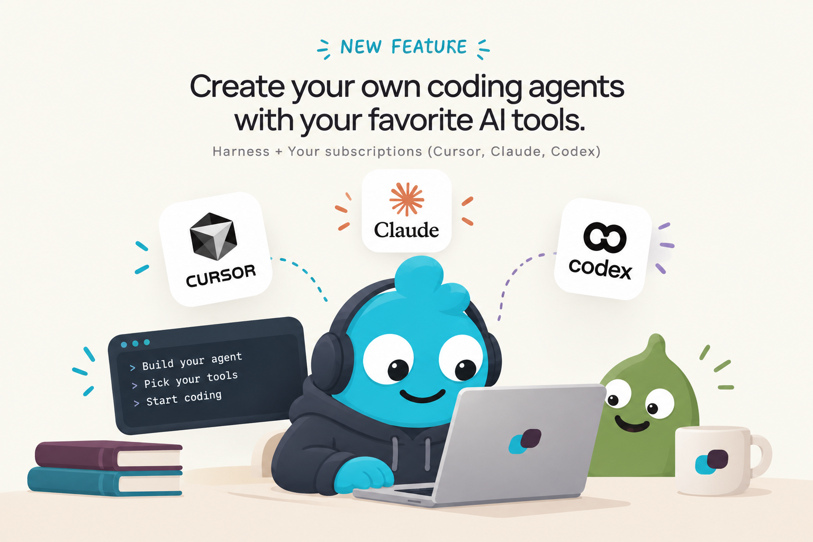

# Add an agent that works on code



This page adds an agent that changes code in one of your repositories.

The agent is a subscription agent: every turn it runs a harness, a
coding tool such as Claude Code, Codex, Cursor, or Antigravity, on the
agent's machine and on your own subscription. The harness reads the
code, edits it, runs the checks, and commits, in the repositories the
agent picks.

You need:

- the guild from [Your first guild](first-guild.md)
- a public repository on GitHub, or any public git repository
- a Claude Code subscription. The other harnesses work too, with the
  differences listed at the end.

## 1. Give the machine room to code

A subscription agent needs a machine of the **Code** tier: 2 CPUs and
4 GiB. Owners and admins of the organisation can change machines.

Open the account menu at the bottom of the sidebar. Click
**Settings**. Open **Machines**. Click **Edit** on your machine. Pick
**Code** under **Tier**. Click **Save**.

You should see the **Code** tag on the machine's card.

## 2. Create the agent

In the sidebar, click **Add agent** under the guild. The dialog
**Create an agent** walks you through three steps.

1. **Identity**: type `coder` as the **Name**, and
   `Makes small, tested changes to the code` as the **Focus**. Click
   **Next**.
2. **Model**: set **Model source** to **Subscription**. Click
   **Claude Code**. Leave **Harness model** on **Subscription default**
   and **Effort** on its default. Click **Next**.
3. **Machine**: the step names your machine. Click **Create agent**.

You should see `coder` under the guild in the sidebar.

## 3. Pick a repository

A repository belongs to the guild, and each agent picks the ones it
works on. Each agent gets its own copy of the ones it picks.

Open the agent's **Settings** tab and its **Repositories** section.
Fill in the add form of the guild's **Repositories**:

- **Name**: `demo`
- **URL**: the address of your repository, such as
  `https://github.com/you/demo`

Set **Credential** to **None: clone anonymously**. Click **Add
repository**. You should see `demo` in the list, tagged
**anonymous**, and an empty box for `demo` under **This agent works
on**. Tick it. Click **Save**.

## 4. Log in to Claude Code

Open the agent's **CLI** tab. Click **Start the terminal**. A terminal
opens on the agent's machine. Type:

```text
claude
```

Claude Code starts. Type `/login`. Follow the link it prints, sign in,
and paste the code back into the terminal. Type `/exit` once it says
you are logged in.

Open the agent's **Settings** tab on its **Harness** section. Click
**Check login**.

You should see a toast that reads "Logged in as" your account, and the
card under the harness reads **Logged in**.

## 5. Send a first task

Open the agent's **Chat** tab. Type in the composer:

```text
Read the README of demo and add a short section on how to run the
project locally. Check that the file still reads well. Do not push.
```

Send it.

You should see the harness's messages and tool calls appear one by
one as the run's own. The turn can take a few minutes. Then the agent
replies with what it changed and what it checked.

## 6. Review the diff

Under the reply, a **Changes** panel lists `demo` with its branch and
the number of lines added and removed. Click **Show diff**.

You should see the change, added lines in one colour and removed lines
in another.

## Good to know

- An anonymous repository lets the agent clone and change its copy.
  To push branches, add the repository with a credential: a GitHub
  login, which [GitHub](../tools-and-connectors/github.md) shows how to
  connect, or an access token from its git host, kept as a secret.
  [Repositories](../concepts/coding/repositories.md#access-tokens)
  shows which username each host takes.
- A pull request is opened with the host's connector tool, such as
  the GitHub connector's `create_pull_request`, once it is switched on
  for the agent. Without one, the agent's part ends with the pushed
  branch.
- A token works instead of a login. Run `claude setup-token` on your
  own computer. In the agent's **Harness** settings, click **Add
  token**, paste it, and save it as a secret. The card under the
  harness reads **Active token**.
- Codex runs on a ChatGPT login. Pick **Codex**, then type
  `codex login --device-auth` in the **CLI** tab.
- Cursor runs on an API key, and Antigravity on a Google login (type
  `agy` in the **CLI** tab and sign in). Both keep their own system
  prompt, so they run only for an agent that picks a repository.
- The agent works on its own branch, named after itself and the
  topic.
- A harness marked **Not on machine** is missing from the machine's
  image. The image built by the setup script carries all four.

[Code work](../concepts/coding/index.md) explains how the agent, the
harness, and the repositories fit together.
[Reviewing changes](../concepts/coding/reviewing-changes.md) explains
the diffs.
